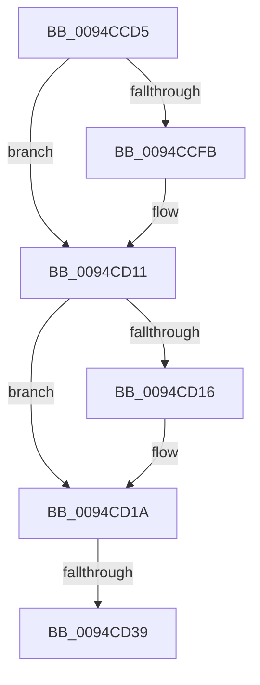

# sub_0094CCD5

- RVA: `0x0094CCD5`–`0x0094CD40` (길이 `107` bytes)
- VA: `0x000000014094CCD5`
- 실행 섹션: `PAGE`
- PDB 이름 있음: `아니요`; PDB Function 태그: `아니요`
- unwind 정보 RVA: `0x000915B4`
- 디코드: `24`개 명령, `107/107` bytes 표시
- 미해석 바이트: `0` (있으면 어셈블리에 `.byte`로 보존)

> 이 문서는 커널 이미지의 기계어와 PDB 기호를 분석해 생성했습니다. 4번과 5번은 함수 원형과 자료형을 바이너리 사용 방식에서 추정한 C 해석이며 원본 소스 복구 결과는 아닙니다.

## 1. Dependencies

- 직접 호출 지점: **2**; 고유 호출 대상: **2**
- 직접 호출자로 확인된 함수: **0**
- RIP 상대 이미지 참조: **4**

### Outgoing calls
- `0x0094CCE7` → [KeAbPreAcquire](../../text/21/KeAbPreAcquire_function_00210230.md) (function, `0x00210230`)
- `0x0094CD0C` → [ExfAcquirePushLockExclusiveEx](../../text/20/ExfAcquirePushLockExclusiveEx_function_0020FC90.md) (function, `0x0020FC90`)

### Direct callers
- 이 함수 시작 RVA로 연결되는 직접 call은 확인되지 않았습니다. 간접 호출은 완전히 역산할 수 없습니다.

### Static image references
- `0x0094CCE0` → RVA `0x00FD9BA0` (`PAGEDATA`; read)
- `0x0094CCEC` → RVA `0x00FD9BA0` (`PAGEDATA`; read/write)
- `0x0094CD1A` → RVA `0x00FD9FD0` (`PAGEDATA`; read)
- `0x0094CD21` → RVA `0x00FD9FC8` (`PAGEDATA`; read)

## 2. Other-region calls and transfers

- 다른 실행 섹션으로 향하는 call: **2**
  - `0x0094CCE7` → [KeAbPreAcquire](../../text/21/KeAbPreAcquire_function_00210230.md) (`PAGE` → `.text`)
  - `0x0094CD0C` → [ExfAcquirePushLockExclusiveEx](../../text/20/ExfAcquirePushLockExclusiveEx_function_0020FC90.md) (`PAGE` → `.text`)
- call이 아닌 외부 분기/꼬리 이동: **1**
  - `0x0094CD33` → [sub_0094CF53](Unknown_function_0094CF53.md) (`tail-transfer`)

## 3. Assembly (complete function range)

```asm
0094CCD5  8B 41 58                        mov eax, dword ptr [rcx + 0x58]
0094CCD8  45 33 C0                        xor r8d, r8d
0094CCDB  89 41 5C                        mov dword ptr [rcx + 0x5c], eax
0094CCDE  33 D2                           xor edx, edx
0094CCE0  48 8D 0D B9 CE 68 00            lea rcx, [rip + 0x68ceb9]
0094CCE7  E8 44 35 8C FF                  call 0x140210230
0094CCEC  F0 48 0F BA 2D AA CE 68 00 00   lock bts qword ptr [rip + 0x68ceaa], 0
0094CCF6  48 8B D8                        mov rbx, rax
0094CCF9  73 16                           jae 0x14094cd11
0094CCFB  4C 8D 05 9E CE 68 00            lea r8, [rip + 0x68ce9e]
0094CD02  48 8B D0                        mov rdx, rax
0094CD05  48 8D 0D 94 CE 68 00            lea rcx, [rip + 0x68ce94]
0094CD0C  E8 7F 2F 8C FF                  call 0x14020fc90
0094CD11  48 85 DB                        test rbx, rbx
0094CD14  74 04                           je 0x14094cd1a
0094CD16  C6 43 0A 01                     mov byte ptr [rbx + 0xa], 1
0094CD1A  48 8B 0D AF D2 68 00            mov rcx, qword ptr [rip + 0x68d2af]
0094CD21  48 8D 15 A0 D2 68 00            lea rdx, [rip + 0x68d2a0]
0094CD28  48 8B 45 00                     mov rax, qword ptr [rbp]
0094CD2C  48 83 C0 18                     add rax, 0x18
0094CD30  48 39 11                        cmp qword ptr [rcx], rdx
0094CD33  0F 84 1A 02 00 00               je 0x14094cf53
0094CD39  B9 03 00 00 00                  mov ecx, 3
0094CD3E  CD 29                           int 0x29
```

## 4. C-style interpretation (structured pseudocode)

```c
__int64 __fastcall sub_0094CCD5(__int64 a1, int a2, int a3)
{
    __int64 result;

    a3 = 0;
    *(unsigned int *)(a1 + 92) = (unsigned int)((unsigned int)(*(unsigned int *)(a1 + 88)));
    a2 = 0;
    result = KeAbPreAcquire(v_rip + 6868665, a2, a3, a4);
    if (!(condition_is_above_or_equal)) {
        a3 = v_rip + 6868638;
        a2 = result;
        a1 = v_rip + 6868628;
        result = ExfAcquirePushLockExclusiveEx(a1, a2, a3, a4);
    }
    if (result != 0) {
        *(unsigned __int8 *)(result + 10) = 1;
    }
    result = (*(unsigned __int64 *)(v_rbp)) + (24);
    return result;
}
```

## 5. (Beta) C Style

```c
int64_t sub_0094CCD5(void *Arg1, int32_t Arg2, int32_t Arg3)
{
    uint8_t *arg1 = (uint8_t *)Arg1;

    int64_t result;

    Arg3 = 0;
    *(uint32_t *)(arg1 + 0x5C) = (uint32_t)((uint32_t)(*(uint32_t *)(arg1 + 0x58)));
    Arg2 = 0;
    result = KeAbPreAcquire(v_rip + 6868665, Arg2, Arg3, a4);
    if (!(condition_is_above_or_equal)) {
        Arg3 = v_rip + 6868638;
        Arg2 = result;
        Arg1 = v_rip + 6868628;
        result = ExfAcquirePushLockExclusiveEx(Arg1, Arg2, Arg3, a4);
    }
    if (result != 0) {
        *(uint8_t *)(result + 0xA) = 1;
    }
    result = (*(uint64_t *)(local_rbp)) + (24);
    return result;
}
```

### 관측된 메모리 오프셋

구조체 형식이 확인되지 않은 접근은 인자 기준의 오프셋으로만 기록했습니다.

| 기준 인자 | 오프셋 표현 | 폭 (bit) | 접근 |
|---|---:|---:|---|
| `Arg1` | `+ 0x58` | `32` | `R` |
| `Arg1` | `+ 0x5C` | `32` | `W` |

## 6. Execution-region graph

[열기: 2D/3D 그래프와 함수 탐색 컨트롤 패널](../../../control-panel.html?section=page&rva=0x0094CCD5&view=graph)

- 2D 그래프는 위에서 아래로 흐르고, 3D 그래프는 빈 공간을 드래그해 회전합니다. Shift+드래그는 이동, 휠은 확대·축소, 함수 노드 선택은 대상 보고서 이동입니다.

### Static fallback


