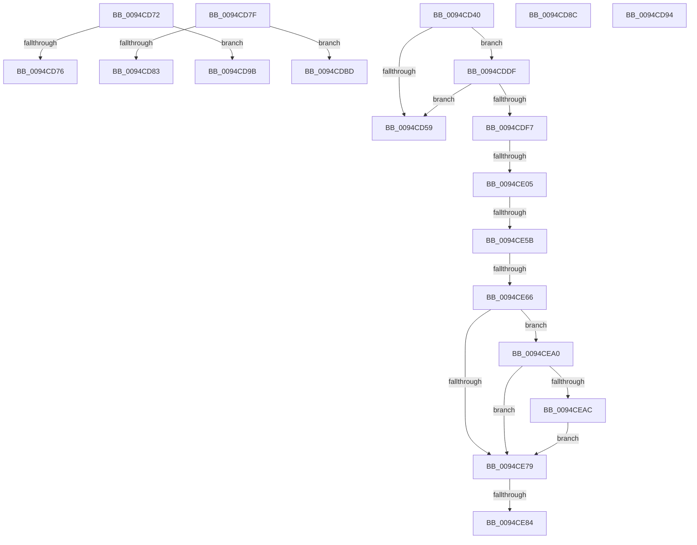

# sub_0094CD40

- RVA: `0x0094CD40`–`0x0094CEB4` (길이 `372` bytes)
- VA: `0x000000014094CD40`
- 실행 섹션: `PAGE`
- PDB 이름 있음: `아니요`; PDB Function 태그: `아니요`
- unwind 정보 RVA: `0x000915C4`
- 디코드: `85`개 명령, `372/372` bytes 표시
- 미해석 바이트: `0` (있으면 어셈블리에 `.byte`로 보존)

> 이 문서는 커널 이미지의 기계어와 PDB 기호를 분석해 생성했습니다. 4번과 5번은 함수 원형과 자료형을 바이너리 사용 방식에서 추정한 C 해석이며 원본 소스 복구 결과는 아닙니다.

## 1. Dependencies

- 직접 호출 지점: **3**; 고유 호출 대상: **3**
- 직접 호출자로 확인된 함수: **0**
- RIP 상대 이미지 참조: **0**

### Outgoing calls
- `0x0094CDEA` → [ExLockHandleTableEntry](../../text/40/ExLockHandleTableEntry_function_0040DAA0.md) (function, `0x0040DAA0`)
- `0x0094CE4B` → [ExpDuplicateSingleHandle](ExpDuplicateSingleHandle_function_0094D0E4.md) (function, `0x0094D0E4`)
- `0x0094CE96` → [ExpUpdateDebugInfo](../86/ExpUpdateDebugInfo_function_0086B174.md) (function, `0x0086B174`)

### Direct callers
- 이 함수 시작 RVA로 연결되는 직접 call은 확인되지 않았습니다. 간접 호출은 완전히 역산할 수 없습니다.

### Static image references
- 디코드된 RIP-relative 메모리 참조가 없습니다.

## 2. Other-region calls and transfers

- 다른 실행 섹션으로 향하는 call: **1**
  - `0x0094CDEA` → [ExLockHandleTableEntry](../../text/40/ExLockHandleTableEntry_function_0040DAA0.md) (`PAGE` → `.text`)
- call이 아닌 외부 분기/꼬리 이동: **12**
  - `0x0094CD6D` → [sub_0094CB86 + 0xDC](Unknown_function_0094CB86.md) (`tail-transfer`)
  - `0x0094CD7A` → [sub_0094CB86 + 0x68](Unknown_function_0094CB86.md) (`tail-transfer`)
  - `0x0094CD87` → [sub_0094CB86 + 0xA6](Unknown_function_0094CB86.md) (`tail-transfer`)
  - `0x0094CD8F` → [sub_0094CB86 + 0x68](Unknown_function_0094CB86.md) (`tail-transfer`)
  - `0x0094CD96` → [sub_0094CB86 + 0xA6](Unknown_function_0094CB86.md) (`tail-transfer`)
  - `0x0094CDB8` → [sub_0094CB86 + 0x5B](Unknown_function_0094CB86.md) (`tail-transfer`)
  - `0x0094CDDA` → [sub_0094CB86 + 0x9B](Unknown_function_0094CB86.md) (`tail-transfer`)
  - `0x0094CDFF` → [sub_0094D08D](Unknown_function_0094D08D.md) (`tail-transfer`)
  - `0x0094CE55` → [sub_0094D01D + 0x3](Unknown_function_0094D01D.md) (`tail-transfer`)
  - `0x0094CE60` → [sub_0094D01D](Unknown_function_0094D01D.md) (`tail-transfer`)
  - `0x0094CE7E` → [sub_0094CB86 + 0xFD](Unknown_function_0094CB86.md) (`tail-transfer`)
  - `0x0094CE9B` → [sub_0094CB86 + 0xFD](Unknown_function_0094CB86.md) (`tail-transfer`)

## 3. Assembly (complete function range)

```asm
0094CD40  44 8B F6                        mov r14d, esi
0094CD43  4D 03 F6                        add r14, r14
0094CD46  43 8B 04 F2                     mov eax, dword ptr [r10 + r14*8]
0094CD4A  4F 8D 3C F2                     lea r15, [r10 + r14*8]
0094CD4E  48 0F BA E0 12                  bt rax, 0x12
0094CD53  0F 82 86 00 00 00               jb 0x14094cddf
0094CD59  44 8B B4 24 D0 00 00 00         mov r14d, dword ptr [rsp + 0xd0]
0094CD61  B8 0D 00 00 C0                  mov eax, 0xc000000d
0094CD66  45 85 F6                        test r14d, r14d
0094CD69  44 0F 45 E0                     cmovne r12d, eax
0094CD6D  E9 F0 FE FF FF                  jmp 0x14094cc62
0094CD72  85 C0                           test eax, eax
0094CD74  75 25                           jne 0x14094cd9b
0094CD76  4F 8D 14 81                     lea r10, [r9 + r8*4]
0094CD7A  E9 6F FE FF FF                  jmp 0x14094cbee
0094CD7F  85 C0                           test eax, eax
0094CD81  75 3A                           jne 0x14094cdbd
0094CD83  4B 8D 2C 81                     lea rbp, [r9 + r8*4]
0094CD87  E9 A0 FE FF FF                  jmp 0x14094cc2c
0094CD8C  45 33 D2                        xor r10d, r10d
0094CD8F  E9 5A FE FF FF                  jmp 0x14094cbee
0094CD94  33 ED                           xor ebp, ebp
0094CD96  E9 91 FE FF FF                  jmp 0x14094cc2c
0094CD9B  49 8B D0                        mov rdx, r8
0094CD9E  48 C1 EA 0A                     shr rdx, 0xa
0094CDA2  48 8B C2                        mov rax, rdx
0094CDA5  48 C1 E8 09                     shr rax, 9
0094CDA9  81 E2 FF 01 00 00               and edx, 0x1ff
0094CDAF  49 8B 44 C1 FE                  mov rax, qword ptr [r9 + rax*8 - 2]
0094CDB4  48 8B 04 D0                     mov rax, qword ptr [rax + rdx*8]
0094CDB8  E9 24 FE FF FF                  jmp 0x14094cbe1
0094CDBD  49 8B C8                        mov rcx, r8
0094CDC0  48 C1 E9 0A                     shr rcx, 0xa
0094CDC4  48 8B C1                        mov rax, rcx
0094CDC7  48 C1 E8 09                     shr rax, 9
0094CDCB  81 E1 FF 01 00 00               and ecx, 0x1ff
0094CDD1  49 8B 44 C1 FE                  mov rax, qword ptr [r9 + rax*8 - 2]
0094CDD6  48 8B 04 C8                     mov rax, qword ptr [rax + rcx*8]
0094CDDA  E9 42 FE FF FF                  jmp 0x14094cc21
0094CDDF  48 8B 8C 24 C8 00 00 00         mov rcx, qword ptr [rsp + 0xc8]
0094CDE7  49 8B D7                        mov rdx, r15
0094CDEA  E8 B1 0C AC FF                  call 0x14040daa0
0094CDEF  84 C0                           test al, al
0094CDF1  0F 84 62 FF FF FF               je 0x14094cd59
0094CDF7  41 8B 07                        mov eax, dword ptr [r15]
0094CDFA  48 0F BA E0 12                  bt rax, 0x12
0094CDFF  0F 83 88 02 00 00               jae 0x14094d08d
0094CE05  48 83 BC 24 D8 00 00 00 00      cmp qword ptr [rsp + 0xd8], 0
0094CE0E  4A 8D 0C F5 00 00 00 00         lea rcx, [r14*8]
0094CE16  4C 8B B4 24 E0 00 00 00         mov r14, qword ptr [rsp + 0xe0]
0094CE1E  4D 8B CF                        mov r9, r15
0094CE21  4C 8B 84 24 C8 00 00 00         mov r8, qword ptr [rsp + 0xc8]
0094CE29  0F 95 C0                        setne al
0094CE2C  88 44 24 30                     mov byte ptr [rsp + 0x30], al
0094CE30  48 03 CD                        add rcx, rbp
0094CE33  48 89 4C 24 28                  mov qword ptr [rsp + 0x28], rcx
0094CE38  48 8B D3                        mov rdx, rbx
0094CE3B  49 8B 06                        mov rax, qword ptr [r14]
0094CE3E  48 8B 8C 24 C0 00 00 00         mov rcx, qword ptr [rsp + 0xc0]
0094CE46  48 89 44 24 20                  mov qword ptr [rsp + 0x20], rax
0094CE4B  E8 94 02 00 00                  call 0x14094d0e4
0094CE50  44 8B E0                        mov r12d, eax
0094CE53  85 C0                           test eax, eax
0094CE55  0F 88 C5 01 00 00               js 0x14094d020
0094CE5B  3D 07 01 00 00                  cmp eax, 0x107
0094CE60  0F 84 B7 01 00 00               je 0x14094d01d
0094CE66  49 8B 0E                        mov rcx, qword ptr [r14]
0094CE69  44 8B B4 24 D0 00 00 00         mov r14d, dword ptr [rsp + 0xd0]
0094CE71  FF 41 58                        inc dword ptr [rcx + 0x58]
0094CE74  45 85 F6                        test r14d, r14d
0094CE77  75 27                           jne 0x14094cea0
0094CE79  48 83 79 60 00                  cmp qword ptr [rcx + 0x60], 0
0094CE7E  0F 84 FF FD FF FF               je 0x14094cc83
0094CE84  65 48 8B 14 25 88 01 00 00      mov rdx, qword ptr gs:[0x188]
0094CE8D  41 B9 01 00 00 00               mov r9d, 1
0094CE93  4C 8B C3                        mov r8, rbx
0094CE96  E8 D9 E2 F1 FF                  call 0x14086b174
0094CE9B  E9 E3 FD FF FF                  jmp 0x14094cc83
0094CEA0  8B 54 24 40                     mov edx, dword ptr [rsp + 0x40]
0094CEA4  41 8D 46 FF                     lea eax, [r14 - 1]
0094CEA8  3B D0                           cmp edx, eax
0094CEAA  73 CD                           jae 0x14094ce79
0094CEAC  FF C2                           inc edx
0094CEAE  89 54 24 40                     mov dword ptr [rsp + 0x40], edx
0094CEB2  EB C5                           jmp 0x14094ce79
```

## 4. C-style interpretation (structured pseudocode)

```c
__int64 __fastcall sub_0094CD40(__int64 a1, __int64 a2, __int64 a3, __int64 a4, __int64 a5, __int64 a6, __int64 a7, unsigned int a8, __int64 a9, __int64 a10, __int64 a11, __int64 a12, __int64 a13, __int64 a14, __int64 a15, __int64 a16, __int64 a17, __int64 a18, __int64 a19, __int64 a20, __int64 a21, __int64 a22, __int64 a23, __int64 a24, __int64 a25, unsigned int a26, __int64 a27, __int64 a28)
{
    __int64 result;
    __int64 v_r12;
    __int64 v_r14;
    unsigned __int64 v_stack_p20;
    unsigned __int64 v_stack_p28;
    unsigned __int8 v_stack_p30;
    unsigned int v_stack_p40;

    v_r14 = ((unsigned int)((unsigned int)(v_rsi))) + ((unsigned int)((unsigned int)(v_rsi)));
    if (condition_is_below) goto loc_0094CDDF;
loc_0094CD59:
    if ((unsigned int)((unsigned int)(a26)) != 0) { v_r12 = (unsigned int)((unsigned int)(0xC000000DULL)); }
loc_0094CDDF:
    result = ExLockHandleTableEntry(a25, v_r10 + v_r14 * 8, a3, a4);
    if ((unsigned __int8)(result) == 0) goto loc_0094CD59;
    result = (a27 != 0) ? 1 : 0;
    v_stack_p30 = (unsigned __int8)(result);
    a1 = ((unsigned int)(a26) * 8) + (v_rbp);
    v_stack_p28 = a1;
    v_stack_p20 = *(unsigned __int64 *)(a28);
    result = ExpDuplicateSingleHandle(a24, v_rbx, a25, v_r10 + v_r14 * 8);
    if ((unsigned int)((unsigned int)(a26)) != 0) goto loc_0094CEA0;
loc_0094CE79:
    result = ExpUpdateDebugInfo(*(unsigned __int64 *)(a28), *(unsigned __int64 *)(gs_base + (0 + 392)), v_rbx, 1);
loc_0094CEA0:
    if (((unsigned int)((unsigned int)(a8))) >= ((unsigned int)((unsigned int)(a26) - 1))) goto loc_0094CE79;
    a2 = (unsigned int)(((unsigned int)(a8)) + 1);
    v_stack_p40 = (unsigned int)(a2);
    goto loc_0094CE79;
}
```

## 5. (Beta) C Style

```c
int64_t sub_0094CD40(int64_t Arg1, int64_t Arg2, int64_t Arg3, int64_t Arg4, uint64_t Arg5, uint64_t Arg6, uint64_t Arg7, uint32_t Arg8, uint64_t Arg9, uint64_t Arg10, uint64_t Arg11, uint64_t Arg12, uint64_t Arg13, uint64_t Arg14, uint64_t Arg15, uint64_t Arg16, uint64_t Arg17, uint64_t Arg18, uint64_t Arg19, uint64_t Arg20, uint64_t Arg21, uint64_t Arg22, uint64_t Arg23, int64_t Arg24, int64_t Arg25, uint32_t Arg26, int64_t Arg27, void *Arg28)
{
    uint8_t *arg28 = (uint8_t *)Arg28;

    int64_t result;
    int64_t local_r12;
    int64_t local_r14;
    uint64_t v_stack_p20;
    uint64_t v_stack_p28;
    uint8_t v_stack_p30;
    uint32_t v_stack_p40;

    local_r14 = ((uint32_t)((uint32_t)(local_rsi))) + ((uint32_t)((uint32_t)(local_rsi)));
    if (condition_is_below) goto loc_0094CDDF;
loc_0094CD59:
    if ((uint32_t)((uint32_t)(Arg26)) != 0) { local_r12 = (uint32_t)((uint32_t)(0xC000000DULL)); }
loc_0094CDDF:
    result = ExLockHandleTableEntry(Arg25, local_r10 + local_r14 * 8, Arg3, Arg4);
    if ((uint8_t)(result) == 0) goto loc_0094CD59;
    result = (Arg27 != 0) ? 1 : 0;
    v_stack_p30 = (uint8_t)(result);
    Arg1 = ((uint32_t)(Arg26) * 8) + (local_rbp);
    v_stack_p28 = Arg1;
    v_stack_p20 = *(uint64_t *)(arg28);
    result = ExpDuplicateSingleHandle(Arg24, local_rbx, Arg25, local_r10 + local_r14 * 8);
    if ((uint32_t)((uint32_t)(Arg26)) != 0) goto loc_0094CEA0;
loc_0094CE79:
    result = ExpUpdateDebugInfo(*(uint64_t *)(arg28), *(uint64_t *)(gs_base + (0 + 0x188)), local_rbx, 1);
loc_0094CEA0:
    if (((uint32_t)((uint32_t)(Arg8))) >= ((uint32_t)((uint32_t)(Arg26) - 1))) goto loc_0094CE79;
    Arg2 = (uint32_t)(((uint32_t)(Arg8)) + 1);
    v_stack_p40 = (uint32_t)(Arg2);
    goto loc_0094CE79;
}
```

### 관측된 메모리 오프셋

구조체 형식이 확인되지 않은 접근은 인자 기준의 오프셋으로만 기록했습니다.

| 기준 인자 | 오프셋 표현 | 폭 (bit) | 접근 |
|---|---:|---:|---|
| `Arg28` | `+ 0x0` | `64` | `R` |

## 6. Execution-region graph

[열기: 2D/3D 그래프와 함수 탐색 컨트롤 패널](../../../control-panel.html?section=page&rva=0x0094CD40&view=graph)

- 2D 그래프는 위에서 아래로 흐르고, 3D 그래프는 빈 공간을 드래그해 회전합니다. Shift+드래그는 이동, 휠은 확대·축소, 함수 노드 선택은 대상 보고서 이동입니다.

### Static fallback


