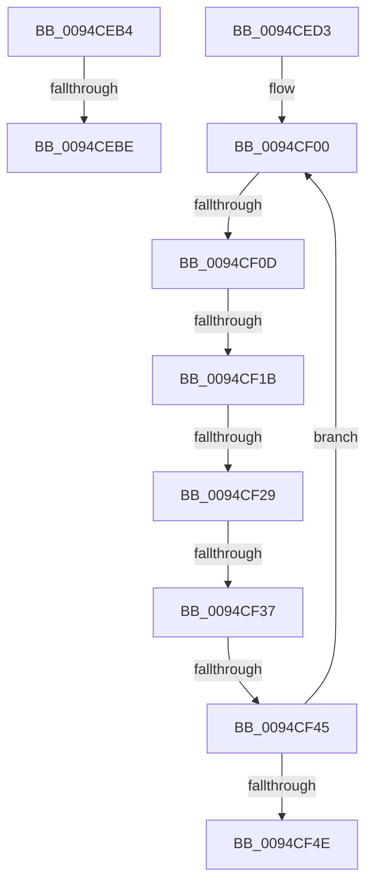

# sub_0094CEB4

- RVA: `0x0094CEB4`–`0x0094CF53` (길이 `159` bytes)
- VA: `0x000000014094CEB4`
- 실행 섹션: `PAGE`
- PDB 이름 있음: `아니요`; PDB Function 태그: `아니요`
- unwind 정보 RVA: `0x000915D8`
- 디코드: `40`개 명령, `159/159` bytes 표시
- 미해석 바이트: `0` (있으면 어셈블리에 `.byte`로 보존)

> 이 문서는 커널 이미지의 기계어와 PDB 기호를 분석해 생성했습니다. 4번과 5번은 함수 원형과 자료형을 바이너리 사용 방식에서 추정한 C 해석이며 원본 소스 복구 결과는 아닙니다.

## 1. Dependencies

- 직접 호출 지점: **1**; 고유 호출 대상: **1**
- 직접 호출자로 확인된 함수: **0**
- RIP 상대 이미지 참조: **0**

### Outgoing calls
- `0x0094CEED` → [ExpLookupHandleTableEntry](../86/ExpLookupHandleTableEntry_function_00869DB0.md) (function, `0x00869DB0`)

### Direct callers
- 이 함수 시작 RVA로 연결되는 직접 call은 확인되지 않았습니다. 간접 호출은 완전히 역산할 수 없습니다.

### Static image references
- 디코드된 RIP-relative 메모리 참조가 없습니다.

## 2. Other-region calls and transfers

- 다른 실행 섹션으로 향하는 call: **0**
- call이 아닌 외부 분기/꼬리 이동: **7**
  - `0x0094CEB8` → [sub_0094CFA2 + 0x11](Unknown_function_0094CFA2.md) (`tail-transfer`)
  - `0x0094CF07` → [sub_0094CFA2 + 0x48](Unknown_function_0094CFA2.md) (`tail-transfer`)
  - `0x0094CF15` → [sub_0094CFA2 + 0x42](Unknown_function_0094CFA2.md) (`tail-transfer`)
  - `0x0094CF23` → [sub_0094D02D + 0xE](Unknown_function_0094D02D.md) (`tail-transfer`)
  - `0x0094CF31` → [sub_0094D02D + 0x13](Unknown_function_0094D02D.md) (`tail-transfer`)
  - `0x0094CF3F` → [sub_0094D02D + 0x18](Unknown_function_0094D02D.md) (`tail-transfer`)
  - `0x0094CF4E` → [sub_0094CFA2 + 0x44](Unknown_function_0094CFA2.md) (`tail-transfer`)

## 3. Assembly (complete function range)

```asm
0094CEB4  41 F6 01 03                     test byte ptr [r9], 3
0094CEB8  0F 84 F5 00 00 00               je 0x14094cfb3
0094CEBE  B8 0D 00 00 C0                  mov eax, 0xc000000d
0094CEC3  48 81 C4 88 00 00 00            add rsp, 0x88
0094CECA  41 5F                           pop r15
0094CECC  41 5E                           pop r14
0094CECE  5F                              pop rdi
0094CECF  5E                              pop rsi
0094CED0  5D                              pop rbp
0094CED1  5B                              pop rbx
0094CED2  C3                              ret
0094CED3  CC                              int3
0094CED4  0F 1F 40 00                     nop dword ptr [rax]
0094CED8  0F 1F 84 00 00 00 00 00         nop dword ptr [rax + rax]
0094CEE0  4C 8D 8B 00 FC FF FF            lea r9, [rbx - 0x400]
0094CEE7  48 8B CE                        mov rcx, rsi
0094CEEA  49 8B D1                        mov rdx, r9
0094CEED  E8 BE CE F1 FF                  call 0x140869db0
0094CEF2  BA FF 00 00 00                  mov edx, 0xff
0094CEF7  48 8D 88 F0 0F 00 00            lea rcx, [rax + 0xff0]
0094CEFE  66 90                           nop
0094CF00  8B 01                           mov eax, dword ptr [rcx]
0094CF02  48 0F BA E0 12                  bt rax, 0x12
0094CF07  0F 82 DD 00 00 00               jb 0x14094cfea
0094CF0D  8B 41 F0                        mov eax, dword ptr [rcx - 0x10]
0094CF10  48 0F BA E0 12                  bt rax, 0x12
0094CF15  0F 82 C9 00 00 00               jb 0x14094cfe4
0094CF1B  8B 41 E0                        mov eax, dword ptr [rcx - 0x20]
0094CF1E  48 0F BA E0 12                  bt rax, 0x12
0094CF23  0F 82 12 01 00 00               jb 0x14094d03b
0094CF29  8B 41 D0                        mov eax, dword ptr [rcx - 0x30]
0094CF2C  48 0F BA E0 12                  bt rax, 0x12
0094CF31  0F 82 09 01 00 00               jb 0x14094d040
0094CF37  8B 41 C0                        mov eax, dword ptr [rcx - 0x40]
0094CF3A  48 0F BA E0 12                  bt rax, 0x12
0094CF3F  0F 82 00 01 00 00               jb 0x14094d045
0094CF45  48 83 E9 50                     sub rcx, 0x50
0094CF49  83 C2 FB                        add edx, -5
0094CF4C  75 B2                           jne 0x14094cf00
0094CF4E  E9 93 00 00 00                  jmp 0x14094cfe6
```

## 4. C-style interpretation (structured pseudocode)

```c
__int64 __fastcall sub_0094CEB4(__int64 a1, __int64 a2, __int64 a3, __int64 a4)
{
    __int64 v_rsp;

    v_rsp = (v_rsp) + (136);
    return (unsigned int)(0xC000000DULL);
}
```

## 5. (Beta) C Style

```c
int64_t sub_0094CEB4(int64_t Arg1, int64_t Arg2, int64_t Arg3, void *Arg4)
{
    uint8_t *arg4 = (uint8_t *)Arg4;

    int64_t local_rsp;

    local_rsp = (local_rsp) + (136);
    return (uint32_t)(0xC000000DULL);
}
```

### 관측된 메모리 오프셋

구조체 형식이 확인되지 않은 접근은 인자 기준의 오프셋으로만 기록했습니다.

| 기준 인자 | 오프셋 표현 | 폭 (bit) | 접근 |
|---|---:|---:|---|
| `Arg4` | `+ 0x0` | `8` | `R` |

## 6. Execution-region graph

[열기: 2D/3D 그래프와 함수 탐색 컨트롤 패널](../../../control-panel.html?section=page&rva=0x0094CEB4&view=graph)

- 2D 그래프는 위에서 아래로 흐르고, 3D 그래프는 빈 공간을 드래그해 회전합니다. Shift+드래그는 이동, 휠은 확대·축소, 함수 노드 선택은 대상 보고서 이동입니다.

### Static fallback


