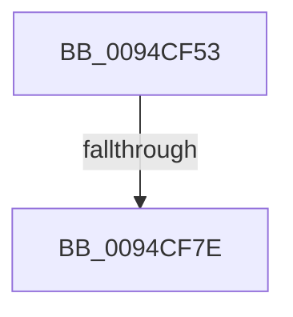

# sub_0094CF53

- RVA: `0x0094CF53`–`0x0094CFA2` (길이 `79` bytes)
- VA: `0x000000014094CF53`
- 실행 섹션: `PAGE`
- PDB 이름 있음: `아니요`; PDB Function 태그: `아니요`
- unwind 정보 RVA: `0x000915EC`
- 디코드: `16`개 명령, `79/79` bytes 표시
- 미해석 바이트: `0` (있으면 어셈블리에 `.byte`로 보존)

> 이 문서는 커널 이미지의 기계어와 PDB 기호를 분석해 생성했습니다. 4번과 5번은 함수 원형과 자료형을 바이너리 사용 방식에서 추정한 C 해석이며 원본 소스 복구 결과는 아닙니다.

## 1. Dependencies

- 직접 호출 지점: **2**; 고유 호출 대상: **2**
- 직접 호출자로 확인된 함수: **0**
- RIP 상대 이미지 참조: **3**

### Outgoing calls
- `0x0094CF85` → [KeAbPostRelease](../../text/2E/KeAbPostRelease_function_002E1600.md) (function, `0x002E1600`)
- `0x0094CF92` → [KiLeaveCriticalRegionUnsafe](../../text/25/KiLeaveCriticalRegionUnsafe_function_0025F010.md) (function, `0x0025F010`)

### Direct callers
- 이 함수 시작 RVA로 연결되는 직접 call은 확인되지 않았습니다. 간접 호출은 완전히 역산할 수 없습니다.

### Static image references
- `0x0094CF5D` → RVA `0x00FD9FD0` (`PAGEDATA`; write)
- `0x0094CF6B` → RVA `0x00FD9BA0` (`PAGEDATA`; read/write)
- `0x0094CF7E` → RVA `0x00FD9BA0` (`PAGEDATA`; read)

## 2. Other-region calls and transfers

- 다른 실행 섹션으로 향하는 call: **2**
  - `0x0094CF85` → [KeAbPostRelease](../../text/2E/KeAbPostRelease_function_002E1600.md) (`PAGE` → `.text`)
  - `0x0094CF92` → [KiLeaveCriticalRegionUnsafe](../../text/25/KiLeaveCriticalRegionUnsafe_function_0025F010.md) (`PAGE` → `.text`)
- call이 아닌 외부 분기/꼬리 이동: **1**
  - `0x0094CF78` → [sub_0094D04A](Unknown_function_0094D04A.md) (`tail-transfer`)

## 3. Assembly (complete function range)

```asm
0094CF53  48 89 10                        mov qword ptr [rax], rdx
0094CF56  48 89 48 08                     mov qword ptr [rax + 8], rcx
0094CF5A  48 89 01                        mov qword ptr [rcx], rax
0094CF5D  48 89 05 6C D0 68 00            mov qword ptr [rip + 0x68d06c], rax
0094CF64  48 C7 C0 FF FF FF FF            mov rax, 0xffffffffffffffff
0094CF6B  F0 48 0F C1 05 2C CC 68 00      lock xadd qword ptr [rip + 0x68cc2c], rax
0094CF74  24 06                           and al, 6
0094CF76  3C 02                           cmp al, 2
0094CF78  0F 84 CC 00 00 00               je 0x14094d04a
0094CF7E  48 8D 0D 1B CC 68 00            lea rcx, [rip + 0x68cc1b]
0094CF85  E8 76 46 99 FF                  call 0x1402e1600
0094CF8A  45 33 E4                        xor r12d, r12d
0094CF8D  48 8B 4C 24 60                  mov rcx, qword ptr [rsp + 0x60]
0094CF92  E8 79 20 91 FF                  call 0x14025f010
0094CF97  41 8B C4                        mov eax, r12d
0094CF9A  4C 8B A4 24 80 00 00 00         mov r12, qword ptr [rsp + 0x80]
```

## 4. C-style interpretation (structured pseudocode)

```c
__int64 __fastcall sub_0094CF53(__int64 a1, __int64 a2, __int64 a3, __int64 a4, __int64 a5, __int64 a6, __int64 a7, __int64 a8, __int64 a9, __int64 a10, __int64 a11, __int64 a12, __int64 a13, __int64 a14, __int64 a15, __int64 a16)
{
    __int64 result;
    __int64 v_r12;

    *(unsigned __int64 *)(result) = a2;
    *(unsigned __int64 *)(result + 8) = a1;
    *(unsigned __int64 *)(a1) = result;
    *(unsigned __int64 *)(v_rip + 6869100) = result;
    result = (unsigned __int8)((-1) & (6));
    result = KeAbPostRelease(v_rip + 6867995, a2, a3, a4);
    v_r12 = 0;
    result = KiLeaveCriticalRegionUnsafe(a12, a2, a3, a4);
    return 0;
}
```

## 5. (Beta) C Style

```c
int64_t sub_0094CF53(void *Arg1, int64_t Arg2, int64_t Arg3, int64_t Arg4, uint64_t Arg5, uint64_t Arg6, uint64_t Arg7, uint64_t Arg8, uint64_t Arg9, uint64_t Arg10, uint64_t Arg11, int64_t Arg12, uint64_t Arg13, uint64_t Arg14, uint64_t Arg15, int64_t Arg16)
{
    uint8_t *arg1 = (uint8_t *)Arg1;

    int64_t result;
    int64_t local_r12;

    *(uint64_t *)(result) = Arg2;
    *(void **)(result + 0x8) = Arg1;
    *(uint64_t *)(arg1) = result;
    *(uint64_t *)(v_rip + 0x68D06C) = result;
    result = (uint8_t)((-1) & (6));
    result = KeAbPostRelease(v_rip + 6867995, Arg2, Arg3, Arg4);
    local_r12 = 0;
    result = KiLeaveCriticalRegionUnsafe(Arg12, Arg2, Arg3, Arg4);
    return 0;
}
```

### 관측된 메모리 오프셋

구조체 형식이 확인되지 않은 접근은 인자 기준의 오프셋으로만 기록했습니다.

| 기준 인자 | 오프셋 표현 | 폭 (bit) | 접근 |
|---|---:|---:|---|
| `Arg1` | `+ 0x0` | `64` | `W` |

## 6. Execution-region graph

[열기: 2D/3D 그래프와 함수 탐색 컨트롤 패널](../../../control-panel.html?section=page&rva=0x0094CF53&view=graph)

- 2D 그래프는 위에서 아래로 흐르고, 3D 그래프는 빈 공간을 드래그해 회전합니다. Shift+드래그는 이동, 휠은 확대·축소, 함수 노드 선택은 대상 보고서 이동입니다.

### Static fallback


