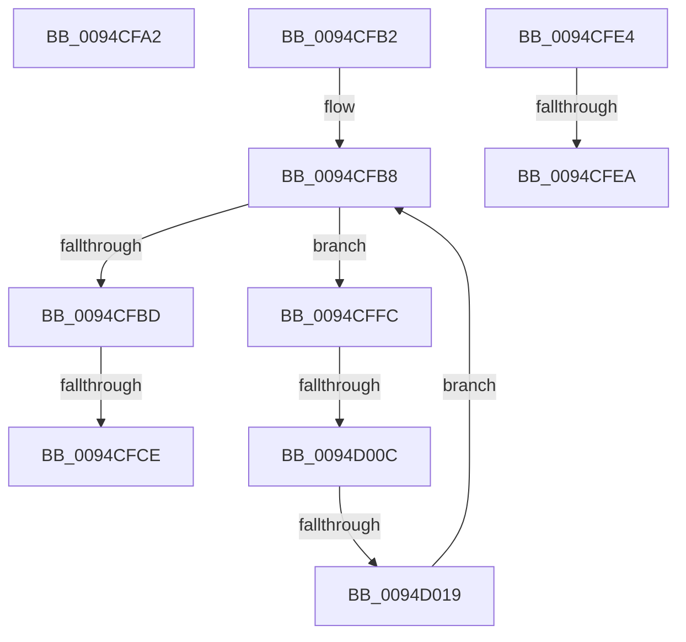

# sub_0094CFA2

- RVA: `0x0094CFA2`–`0x0094D01D` (길이 `123` bytes)
- VA: `0x000000014094CFA2`
- 실행 섹션: `PAGE`
- PDB 이름 있음: `아니요`; PDB Function 태그: `아니요`
- unwind 정보 RVA: `0x00091600`
- 디코드: `35`개 명령, `123/123` bytes 표시
- 미해석 바이트: `0` (있으면 어셈블리에 `.byte`로 보존)

> 이 문서는 커널 이미지의 기계어와 PDB 기호를 분석해 생성했습니다. 4번과 5번은 함수 원형과 자료형을 바이너리 사용 방식에서 추정한 C 해석이며 원본 소스 복구 결과는 아닙니다.

## 1. Dependencies

- 직접 호출 지점: **0**; 고유 호출 대상: **0**
- 직접 호출자로 확인된 함수: **0**
- RIP 상대 이미지 참조: **0**

### Outgoing calls
- 직접 디코드된 call 명령이 없습니다.

### Direct callers
- 이 함수 시작 RVA로 연결되는 직접 call은 확인되지 않았습니다. 간접 호출은 완전히 역산할 수 없습니다.

### Static image references
- 디코드된 RIP-relative 메모리 참조가 없습니다.

## 2. Other-region calls and transfers

- 다른 실행 섹션으로 향하는 call: **0**
- call이 아닌 외부 분기/꼬리 이동: **6**
  - `0x0094CFC8` → [sub_0094CEB4 + 0xA](Unknown_function_0094CEB4.md) (`tail-transfer`)
  - `0x0094CFDF` → [ExDupHandleTable + 0x54](ExDupHandleTable_function_0094CAC0.md) (`tail-transfer`)
  - `0x0094CFE8` → [sub_0094D02D](Unknown_function_0094D02D.md) (`tail-transfer`)
  - `0x0094CFF7` → [ExDupHandleTable + 0x54](ExDupHandleTable_function_0094CAC0.md) (`tail-transfer`)
  - `0x0094D006` → [sub_0094CEB4 + 0xA](Unknown_function_0094CEB4.md) (`tail-transfer`)
  - `0x0094D013` → [sub_0094CEB4 + 0xA](Unknown_function_0094CEB4.md) (`tail-transfer`)

## 3. Assembly (complete function range)

```asm
0094CFA2  48 81 C4 88 00 00 00            add rsp, 0x88
0094CFA9  41 5F                           pop r15
0094CFAB  41 5E                           pop r14
0094CFAD  5F                              pop rdi
0094CFAE  5E                              pop rsi
0094CFAF  5D                              pop rbp
0094CFB0  5B                              pop rbx
0094CFB1  C3                              ret
0094CFB2  CC                              int3
0094CFB3  BA 01 00 00 00                  mov edx, 1
0094CFB8  41 3B D6                        cmp edx, r14d
0094CFBB  72 3F                           jb 0x14094cffc
0094CFBD  41 8D 46 FF                     lea eax, [r14 - 1]
0094CFC1  49 8B 04 C1                     mov rax, qword ptr [r9 + rax*8]
0094CFC5  48 3B C3                        cmp rax, rbx
0094CFC8  0F 83 F0 FE FF FF               jae 0x14094cebe
0094CFCE  48 8B 8C 24 C0 00 00 00         mov rcx, qword ptr [rsp + 0xc0]
0094CFD6  48 8D 58 04                     lea rbx, [rax + 4]
0094CFDA  48 89 5C 24 50                  mov qword ptr [rsp + 0x50], rbx
0094CFDF  E9 30 FB FF FF                  jmp 0x14094cb14
0094CFE4  FF CA                           dec edx
0094CFE6  85 D2                           test edx, edx
0094CFE8  74 43                           je 0x14094d02d
0094CFEA  48 8B 8C 24 C0 00 00 00         mov rcx, qword ptr [rsp + 0xc0]
0094CFF2  48 89 5C 24 50                  mov qword ptr [rsp + 0x50], rbx
0094CFF7  E9 18 FB FF FF                  jmp 0x14094cb14
0094CFFC  8B C2                           mov eax, edx
0094CFFE  4D 8B 04 C1                     mov r8, qword ptr [r9 + rax*8]
0094D002  41 F6 C0 03                     test r8b, 3
0094D006  0F 85 B2 FE FF FF               jne 0x14094cebe
0094D00C  8D 42 FF                        lea eax, [rdx - 1]
0094D00F  4D 3B 04 C1                     cmp r8, qword ptr [r9 + rax*8]
0094D013  0F 86 A5 FE FF FF               jbe 0x14094cebe
0094D019  FF C2                           inc edx
0094D01B  EB 9B                           jmp 0x14094cfb8
```

## 4. C-style interpretation (structured pseudocode)

```c
__int64 __fastcall sub_0094CFA2(__int64 a1, __int64 a2, __int64 a3, __int64 a4)
{
    __int64 v_rsp;
    unsigned __int64 v_stack_p108;
    unsigned __int64 v_stack_p178;

    v_rsp = (v_rsp) + (136);
    return result;
}
```

## 5. (Beta) C Style

```c
int64_t sub_0094CFA2(int64_t Arg1, int64_t Arg2, int64_t Arg3, int64_t Arg4)
{
    int64_t local_rsp;
    uint64_t v_stack_p108;
    uint64_t v_stack_p178;

    local_rsp = (local_rsp) + (136);
    return result;
}
```

## 6. Execution-region graph

[열기: 2D/3D 그래프와 함수 탐색 컨트롤 패널](../../../control-panel.html?section=page&rva=0x0094CFA2&view=graph)

- 2D 그래프는 위에서 아래로 흐르고, 3D 그래프는 빈 공간을 드래그해 회전합니다. Shift+드래그는 이동, 휠은 확대·축소, 함수 노드 선택은 대상 보고서 이동입니다.

### Static fallback


