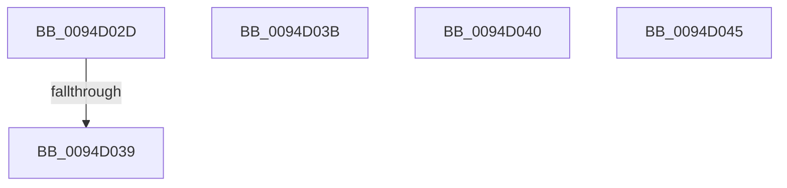

# sub_0094D02D

- RVA: `0x0094D02D`–`0x0094D04A` (길이 `29` bytes)
- VA: `0x000000014094D02D`
- 실행 섹션: `PAGE`
- PDB 이름 있음: `아니요`; PDB Function 태그: `아니요`
- unwind 정보 RVA: `0x0009162C`
- 디코드: `10`개 명령, `29/29` bytes 표시
- 미해석 바이트: `0` (있으면 어셈블리에 `.byte`로 보존)

> 이 문서는 커널 이미지의 기계어와 PDB 기호를 분석해 생성했습니다. 4번과 5번은 함수 원형과 자료형을 바이너리 사용 방식에서 추정한 C 해석이며 원본 소스 복구 결과는 아닙니다.

## 1. Dependencies

- 직접 호출 지점: **0**; 고유 호출 대상: **0**
- 직접 호출자로 확인된 함수: **0**
- RIP 상대 이미지 참조: **0**

### Outgoing calls
- 직접 디코드된 call 명령이 없습니다.

### Direct callers
- 이 함수 시작 RVA로 연결되는 직접 call은 확인되지 않았습니다. 간접 호출은 완전히 역산할 수 없습니다.

### Static image references
- 디코드된 RIP-relative 메모리 참조가 없습니다.

## 2. Other-region calls and transfers

- 다른 실행 섹션으로 향하는 call: **0**
- call이 아닌 외부 분기/꼬리 이동: **5**
  - `0x0094D033` → [sub_0094CEB4 + 0x2C](Unknown_function_0094CEB4.md) (`tail-transfer`)
  - `0x0094D039` → [sub_0094CFA2 + 0x48](Unknown_function_0094CFA2.md) (`tail-transfer`)
  - `0x0094D03E` → [sub_0094CFA2 + 0x44](Unknown_function_0094CFA2.md) (`tail-transfer`)
  - `0x0094D043` → [sub_0094CFA2 + 0x44](Unknown_function_0094CFA2.md) (`tail-transfer`)
  - `0x0094D048` → [sub_0094CFA2 + 0x44](Unknown_function_0094CFA2.md) (`tail-transfer`)

## 3. Assembly (complete function range)

```asm
0094D02D  49 8B D9                        mov rbx, r9
0094D030  4D 85 C9                        test r9, r9
0094D033  0F 85 A7 FE FF FF               jne 0x14094cee0
0094D039  EB AF                           jmp 0x14094cfea
0094D03B  83 C2 FE                        add edx, -2
0094D03E  EB A6                           jmp 0x14094cfe6
0094D040  83 C2 FD                        add edx, -3
0094D043  EB A1                           jmp 0x14094cfe6
0094D045  83 C2 FC                        add edx, -4
0094D048  EB 9C                           jmp 0x14094cfe6
```

## 4. C-style interpretation (structured pseudocode)

```c
void __fastcall sub_0094D02D(__int64 a1, int a2, __int64 a3, __int64 a4)
{
}
```

## 5. (Beta) C Style

```c
void sub_0094D02D(int64_t Arg1, int32_t Arg2, int64_t Arg3, int64_t Arg4)
{
}
```

## 6. Execution-region graph

[열기: 2D/3D 그래프와 함수 탐색 컨트롤 패널](../../../control-panel.html?section=page&rva=0x0094D02D&view=graph)

- 2D 그래프는 위에서 아래로 흐르고, 3D 그래프는 빈 공간을 드래그해 회전합니다. Shift+드래그는 이동, 휠은 확대·축소, 함수 노드 선택은 대상 보고서 이동입니다.

### Static fallback


