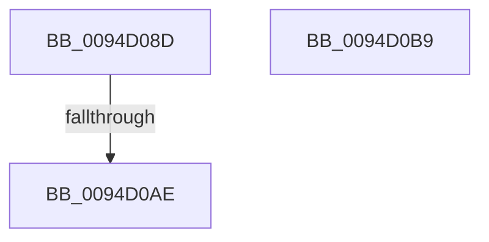

# sub_0094D08D

- RVA: `0x0094D08D`–`0x0094D0DD` (길이 `80` bytes)
- VA: `0x000000014094D08D`
- 실행 섹션: `PAGE`
- PDB 이름 있음: `아니요`; PDB Function 태그: `아니요`
- unwind 정보 RVA: `0x00091660`
- 디코드: `17`개 명령, `80/80` bytes 표시
- 미해석 바이트: `0` (있으면 어셈블리에 `.byte`로 보존)

> 이 문서는 커널 이미지의 기계어와 PDB 기호를 분석해 생성했습니다. 4번과 5번은 함수 원형과 자료형을 바이너리 사용 방식에서 추정한 C 해석이며 원본 소스 복구 결과는 아닙니다.

## 1. Dependencies

- 직접 호출 지점: **2**; 고유 호출 대상: **2**
- 직접 호출자로 확인된 함수: **0**
- RIP 상대 이미지 참조: **0**

### Outgoing calls
- `0x0094D098` → [ExUnlockHandleTableEntry](ExUnlockHandleTableEntry_function_0094D2D0.md) (function, `0x0094D2D0`)
- `0x0094D0CE` → [memset](../../text/6C/memset_function_006C6C40.md) (function, `0x006C6C40`)

### Direct callers
- 이 함수 시작 RVA로 연결되는 직접 call은 확인되지 않았습니다. 간접 호출은 완전히 역산할 수 없습니다.

### Static image references
- 디코드된 RIP-relative 메모리 참조가 없습니다.

## 2. Other-region calls and transfers

- 다른 실행 섹션으로 향하는 call: **1**
  - `0x0094D0CE` → [memset](../../text/6C/memset_function_006C6C40.md) (`PAGE` → `.text`)
- call이 아닌 외부 분기/꼬리 이동: **3**
  - `0x0094D0A8` → [sub_0094CB86 + 0xDC](Unknown_function_0094CB86.md) (`tail-transfer`)
  - `0x0094D0B4` → [sub_0094CB86 + 0xDC](Unknown_function_0094CB86.md) (`tail-transfer`)
  - `0x0094D0D8` → [sub_0094CB86 + 0x113](Unknown_function_0094CB86.md) (`tail-transfer`)

## 3. Assembly (complete function range)

```asm
0094D08D  48 8B 8C 24 C8 00 00 00         mov rcx, qword ptr [rsp + 0xc8]
0094D095  49 8B D7                        mov rdx, r15
0094D098  E8 33 02 00 00                  call 0x14094d2d0
0094D09D  44 8B B4 24 D0 00 00 00         mov r14d, dword ptr [rsp + 0xd0]
0094D0A5  45 85 F6                        test r14d, r14d
0094D0A8  0F 84 B4 FB FF FF               je 0x14094cc62
0094D0AE  41 BC 0D 00 00 C0               mov r12d, 0xc000000d
0094D0B4  E9 A9 FB FF FF                  jmp 0x14094cc62
0094D0B9  8B C6                           mov eax, esi
0094D0BB  41 B8 00 10 00 00               mov r8d, 0x1000
0094D0C1  48 C1 E0 04                     shl rax, 4
0094D0C5  33 D2                           xor edx, edx
0094D0C7  4C 2B C0                        sub r8, rax
0094D0CA  48 8D 0C 28                     lea rcx, [rax + rbp]
0094D0CE  E8 6D 9B D7 FF                  call 0x1406c6c40
0094D0D3  44 8B 5C 24 40                  mov r11d, dword ptr [rsp + 0x40]
0094D0D8  E9 BC FB FF FF                  jmp 0x14094cc99
```

## 4. C-style interpretation (structured pseudocode)

```c
__int64 __fastcall sub_0094D08D(__int64 a1, __int64 a2, __int64 a3, __int64 a4, __int64 a5, __int64 a6, __int64 a7, __int64 a8, __int64 a9, __int64 a10, __int64 a11, __int64 a12, __int64 a13, __int64 a14, __int64 a15, __int64 a16, __int64 a17, __int64 a18, __int64 a19, __int64 a20, __int64 a21, __int64 a22, __int64 a23, __int64 a24, __int64 a25, unsigned int a26)
{
    __int64 result;
    unsigned int v_stack_p40;

    result = ExUnlockHandleTableEntry(a25, v_r15, a3, a4);
}
```

## 5. (Beta) C Style

```c
int64_t sub_0094D08D(int64_t Arg1, int64_t Arg2, int64_t Arg3, int64_t Arg4, uint64_t Arg5, uint64_t Arg6, uint64_t Arg7, uint64_t Arg8, uint64_t Arg9, uint64_t Arg10, uint64_t Arg11, uint64_t Arg12, uint64_t Arg13, uint64_t Arg14, uint64_t Arg15, uint64_t Arg16, uint64_t Arg17, uint64_t Arg18, uint64_t Arg19, uint64_t Arg20, uint64_t Arg21, uint64_t Arg22, uint64_t Arg23, uint64_t Arg24, int64_t Arg25, uint32_t Arg26)
{
    int64_t result;
    uint32_t v_stack_p40;

    result = ExUnlockHandleTableEntry(Arg25, local_r15, Arg3, Arg4);
}
```

## 6. Execution-region graph

[열기: 2D/3D 그래프와 함수 탐색 컨트롤 패널](../../../control-panel.html?section=page&rva=0x0094D08D&view=graph)

- 2D 그래프는 위에서 아래로 흐르고, 3D 그래프는 빈 공간을 드래그해 회전합니다. Shift+드래그는 이동, 휠은 확대·축소, 함수 노드 선택은 대상 보고서 이동입니다.

### Static fallback


