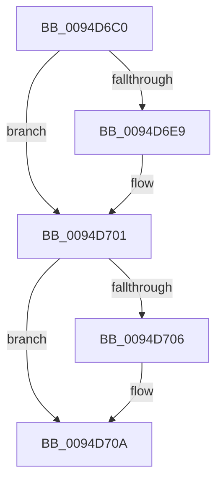

# sub_0094D6C0

- RVA: `0x0094D6C0`–`0x0094D712` (길이 `82` bytes)
- VA: `0x000000014094D6C0`
- 실행 섹션: `PAGE`
- PDB 이름 있음: `아니요`; PDB Function 태그: `아니요`
- unwind 정보 RVA: `0x000917BC`
- 디코드: `20`개 명령, `82/82` bytes 표시
- 미해석 바이트: `0` (있으면 어셈블리에 `.byte`로 보존)

> 이 문서는 커널 이미지의 기계어와 PDB 기호를 분석해 생성했습니다. 4번과 5번은 함수 원형과 자료형을 바이너리 사용 방식에서 추정한 C 해석이며 원본 소스 복구 결과는 아닙니다.

## 1. Dependencies

- 직접 호출 지점: **2**; 고유 호출 대상: **2**
- 직접 호출자로 확인된 함수: **0**
- RIP 상대 이미지 참조: **1**

### Outgoing calls
- `0x0094D6CF` → [KeAbPreAcquire](../../text/21/KeAbPreAcquire_function_00210230.md) (function, `0x00210230`)
- `0x0094D6FC` → [ExfAcquirePushLockSharedEx](../../text/21/ExfAcquirePushLockSharedEx_function_0021044C.md) (function, `0x0021044C`)

### Direct callers
- 이 함수 시작 RVA로 연결되는 직접 call은 확인되지 않았습니다. 간접 호출은 완전히 역산할 수 없습니다.

### Static image references
- `0x0094D6DE` → RVA `0x00EF7BC8` (`.data`; read)

## 2. Other-region calls and transfers

- 다른 실행 섹션으로 향하는 call: **2**
  - `0x0094D6CF` → [KeAbPreAcquire](../../text/21/KeAbPreAcquire_function_00210230.md) (`PAGE` → `.text`)
  - `0x0094D6FC` → [ExfAcquirePushLockSharedEx](../../text/21/ExfAcquirePushLockSharedEx_function_0021044C.md) (`PAGE` → `.text`)
- 별도 외부 분기/꼬리 이동을 확인하지 못했습니다.

## 3. Assembly (complete function range)

```asm
0094D6C0  48 89 6C 24 48                  mov qword ptr [rsp + 0x48], rbp
0094D6C5  33 D2                           xor edx, edx
0094D6C7  66 FF 88 E4 01 00 00            dec word ptr [rax + 0x1e4]
0094D6CE  90                              nop
0094D6CF  E8 5C 2B 8C FF                  call 0x140210230
0094D6D4  48 8B E8                        mov rbp, rax
0094D6D7  B9 11 00 00 00                  mov ecx, 0x11
0094D6DC  33 C0                           xor eax, eax
0094D6DE  F0 48 0F B1 0D E1 A4 5A 00      lock cmpxchg qword ptr [rip + 0x5aa4e1], rcx
0094D6E7  74 18                           je 0x14094d701
0094D6E9  4C 8D 0D D8 A4 5A 00            lea r9, [rip + 0x5aa4d8]
0094D6F0  4C 8B C5                        mov r8, rbp
0094D6F3  33 D2                           xor edx, edx
0094D6F5  48 8D 0D CC A4 5A 00            lea rcx, [rip + 0x5aa4cc]
0094D6FC  E8 4B 2D 8C FF                  call 0x14021044c
0094D701  48 85 ED                        test rbp, rbp
0094D704  74 04                           je 0x14094d70a
0094D706  C6 45 0A 01                     mov byte ptr [rbp + 0xa], 1
0094D70A  48 8B 06                        mov rax, qword ptr [rsi]
0094D70D  48 8B 6C 24 48                  mov rbp, qword ptr [rsp + 0x48]
```

## 4. C-style interpretation (structured pseudocode)

```c
__int64 __fastcall sub_0094D6C0(__int64 a1, int a2, __int64 a3, __int64 a4, __int64 a5, __int64 a6, __int64 a7, __int64 a8, __int64 a9)
{
    __int64 result;
    unsigned __int64 v_stack_p48;

    v_stack_p48 = v_rbp;
    a2 = 0;
    result = KeAbPreAcquire(a1, a2, a3, a4);
    result = 0;
    if (!(condition_is_equal)) {
        a4 = v_rip + 5940440;
        a3 = 0;
        a2 = 0;
        a1 = v_rip + 5940428;
        result = ExfAcquirePushLockSharedEx(a1, a2, a3, a4);
    }
    if (result != 0) {
        *(unsigned __int8 *)(result + 10) = 1;
    }
    return *(unsigned __int64 *)(v_rsi);
}
```

## 5. (Beta) C Style

```c
int64_t sub_0094D6C0(int64_t Arg1, int32_t Arg2, int64_t Arg3, int64_t Arg4, uint64_t Arg5, uint64_t Arg6, uint64_t Arg7, uint64_t Arg8, int64_t Arg9)
{
    int64_t result;
    uint64_t v_stack_p48;

    v_stack_p48 = local_rbp;
    Arg2 = 0;
    result = KeAbPreAcquire(Arg1, Arg2, Arg3, Arg4);
    result = 0;
    if (!(condition_is_equal)) {
        Arg4 = v_rip + 5940440;
        Arg3 = 0;
        Arg2 = 0;
        Arg1 = v_rip + 5940428;
        result = ExfAcquirePushLockSharedEx(Arg1, Arg2, Arg3, Arg4);
    }
    if (result != 0) {
        *(uint8_t *)(result + 0xA) = 1;
    }
    return *(uint64_t *)(local_rsi);
}
```

## 6. Execution-region graph

[열기: 2D/3D 그래프와 함수 탐색 컨트롤 패널](../../../control-panel.html?section=page&rva=0x0094D6C0&view=graph)

- 2D 그래프는 위에서 아래로 흐르고, 3D 그래프는 빈 공간을 드래그해 회전합니다. Shift+드래그는 이동, 휠은 확대·축소, 함수 노드 선택은 대상 보고서 이동입니다.

### Static fallback


