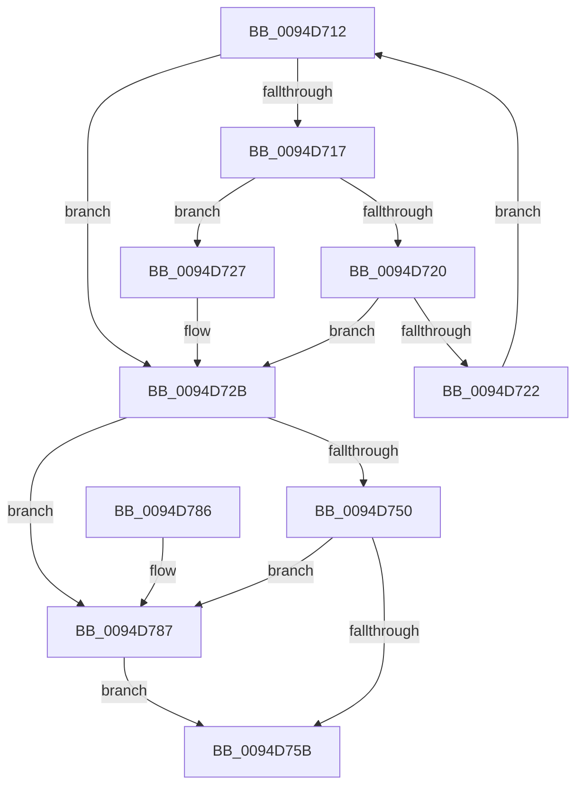

# sub_0094D712

- RVA: `0x0094D712`–`0x0094D795` (길이 `131` bytes)
- VA: `0x000000014094D712`
- 실행 섹션: `PAGE`
- PDB 이름 있음: `아니요`; PDB Function 태그: `아니요`
- unwind 정보 RVA: `0x000917D0`
- 디코드: `35`개 명령, `131/131` bytes 표시
- 미해석 바이트: `0` (있으면 어셈블리에 `.byte`로 보존)

> 이 문서는 커널 이미지의 기계어와 PDB 기호를 분석해 생성했습니다. 4번과 5번은 함수 원형과 자료형을 바이너리 사용 방식에서 추정한 C 해석이며 원본 소스 복구 결과는 아닙니다.

## 1. Dependencies

- 직접 호출 지점: **3**; 고유 호출 대상: **3**
- 직접 호출자로 확인된 함수: **0**
- RIP 상대 이미지 참조: **1**

### Outgoing calls
- `0x0094D762` → [KeAbPostRelease](../../text/2E/KeAbPostRelease_function_002E1600.md) (function, `0x002E1600`)
- `0x0094D770` → [KeLeaveCriticalRegionThread](../../text/25/KeLeaveCriticalRegionThread_function_0025EFF0.md) (function, `0x0025EFF0`)
- `0x0094D78E` → [ExfReleasePushLock](../../text/26/ExfReleasePushLock_function_002638D0.md) (function, `0x002638D0`)

### Direct callers
- 이 함수 시작 RVA로 연결되는 직접 call은 확인되지 않았습니다. 간접 호출은 완전히 역산할 수 없습니다.

### Static image references
- `0x0094D72B` → RVA `0x00EF7BC8` (`.data`; read)

## 2. Other-region calls and transfers

- 다른 실행 섹션으로 향하는 call: **3**
  - `0x0094D762` → [KeAbPostRelease](../../text/2E/KeAbPostRelease_function_002E1600.md) (`PAGE` → `.text`)
  - `0x0094D770` → [KeLeaveCriticalRegionThread](../../text/25/KeLeaveCriticalRegionThread_function_0025EFF0.md) (`PAGE` → `.text`)
  - `0x0094D78E` → [ExfReleasePushLock](../../text/26/ExfReleasePushLock_function_002638D0.md) (`PAGE` → `.text`)
- 별도 외부 분기/꼬리 이동을 확인하지 못했습니다.

## 3. Assembly (complete function range)

```asm
0094D712  48 3B C6                        cmp rax, rsi
0094D715  74 14                           je 0x14094d72b
0094D717  48 8B 48 20                     mov rcx, qword ptr [rax + 0x20]
0094D71B  48 3B 0F                        cmp rcx, qword ptr [rdi]
0094D71E  74 07                           je 0x14094d727
0094D720  7C 09                           jl 0x14094d72b
0094D722  48 8B 00                        mov rax, qword ptr [rax]
0094D725  EB EB                           jmp 0x14094d712
0094D727  48 8B 58 38                     mov rbx, qword ptr [rax + 0x38]
0094D72B  0F 0D 0D 96 A4 5A 00            prefetchw byte ptr [rip + 0x5aa496]
0094D732  48 8B 05 8F A4 5A 00            mov rax, qword ptr [rip + 0x5aa48f]
0094D739  48 8B C8                        mov rcx, rax
0094D73C  48 83 E1 F0                     and rcx, 0xfffffffffffffff0
0094D740  48 83 F9 10                     cmp rcx, 0x10
0094D744  48 8D 50 F0                     lea rdx, [rax - 0x10]
0094D748  49 0F 46 D6                     cmovbe rdx, r14
0094D74C  A8 02                           test al, 2
0094D74E  75 37                           jne 0x14094d787
0094D750  F0 48 0F B1 15 6F A4 5A 00      lock cmpxchg qword ptr [rip + 0x5aa46f], rdx
0094D759  75 2C                           jne 0x14094d787
0094D75B  48 8D 0D 66 A4 5A 00            lea rcx, [rip + 0x5aa466]
0094D762  E8 99 3E 99 FF                  call 0x1402e1600
0094D767  65 48 8B 0C 25 88 01 00 00      mov rcx, qword ptr gs:[0x188]
0094D770  E8 7B 18 91 FF                  call 0x14025eff0
0094D775  48 8B C3                        mov rax, rbx
0094D778  48 8B 5C 24 50                  mov rbx, qword ptr [rsp + 0x50]
0094D77D  48 83 C4 20                     add rsp, 0x20
0094D781  41 5E                           pop r14
0094D783  5F                              pop rdi
0094D784  5E                              pop rsi
0094D785  C3                              ret
0094D786  CC                              int3
0094D787  48 8D 0D 3A A4 5A 00            lea rcx, [rip + 0x5aa43a]
0094D78E  E8 3D 61 91 FF                  call 0x1402638d0
0094D793  EB C6                           jmp 0x14094d75b
```

## 4. C-style interpretation (structured pseudocode)

```c
__int64 __fastcall sub_0094D712(__int64 a1, __int64 a2, __int64 a3, __int64 a4, __int64 a5, __int64 a6, __int64 a7, __int64 a8, __int64 a9, __int64 a10)
{
    __int64 result;
    __int64 v_rsp;

    if (result == v_rsi) goto loc_0094D72B;
    if ((*(unsigned __int64 *)(result + 32)) == (*(unsigned __int64 *)(v_rdi))) goto loc_0094D727;
    if ((*(unsigned __int64 *)(result + 32)) < (*(unsigned __int64 *)(v_rdi))) goto loc_0094D72B;
    goto loc_0094D712;
loc_0094D727:
loc_0094D72B:
    a1 = (*(unsigned __int64 *)(v_rip + 5940367)) & (-16);
    a2 = *(unsigned __int64 *)(v_rip + 5940367) - 16;
    if (a1 <= 16) { a2 = v_r14; }
    if ((((unsigned __int8)(*(unsigned __int64 *)(v_rip + 5940367))) & (2)) != 0) goto loc_0094D787;
    if ((((unsigned __int8)(*(unsigned __int64 *)(v_rip + 5940367))) & (2)) != 0) goto loc_0094D787;
loc_0094D75B:
    result = KeAbPostRelease(v_rip + 5940326, a2, a3, a4);
    result = KeLeaveCriticalRegionThread(*(unsigned __int64 *)(gs_base + (0 + 392)), a2, a3, a4);
    v_rsp = (v_rsp) + (32);
    return *(unsigned __int64 *)(*(unsigned __int64 *)(result) + 56);
loc_0094D787:
    result = ExfReleasePushLock(v_rip + 5940282, a2, a3, a4);
    goto loc_0094D75B;
}
```

## 5. (Beta) C Style

```c
int64_t sub_0094D712(int64_t Arg1, int64_t Arg2, int64_t Arg3, int64_t Arg4, uint64_t Arg5, uint64_t Arg6, uint64_t Arg7, uint64_t Arg8, uint64_t Arg9, int64_t Arg10)
{
    int64_t result;
    int64_t local_rsp;

    if (result == local_rsi) goto loc_0094D72B;
    if ((*(uint64_t *)(result + 0x20)) == (*(uint64_t *)(local_rdi))) goto loc_0094D727;
    if ((*(uint64_t *)(result + 0x20)) < (*(uint64_t *)(local_rdi))) goto loc_0094D72B;
    goto loc_0094D712;
loc_0094D727:
loc_0094D72B:
    Arg1 = (*(uint64_t *)(v_rip + 0x5AA48F)) & (-16);
    Arg2 = *(uint64_t *)(v_rip + 0x5AA48F) - 16;
    if (Arg1 <= 16) { Arg2 = local_r14; }
    if ((((uint8_t)(*(uint64_t *)(v_rip + 0x5AA48F))) & (2)) != 0) goto loc_0094D787;
    if ((((uint8_t)(*(uint64_t *)(v_rip + 0x5AA48F))) & (2)) != 0) goto loc_0094D787;
loc_0094D75B:
    result = KeAbPostRelease(v_rip + 5940326, Arg2, Arg3, Arg4);
    result = KeLeaveCriticalRegionThread(*(uint64_t *)(gs_base + (0 + 0x188)), Arg2, Arg3, Arg4);
    local_rsp = (local_rsp) + (32);
    return *(uint64_t *)(*(uint64_t *)(result) + 0x38);
loc_0094D787:
    result = ExfReleasePushLock(v_rip + 5940282, Arg2, Arg3, Arg4);
    goto loc_0094D75B;
}
```

## 6. Execution-region graph

[열기: 2D/3D 그래프와 함수 탐색 컨트롤 패널](../../../control-panel.html?section=page&rva=0x0094D712&view=graph)

- 2D 그래프는 위에서 아래로 흐르고, 3D 그래프는 빈 공간을 드래그해 회전합니다. Shift+드래그는 이동, 휠은 확대·축소, 함수 노드 선택은 대상 보고서 이동입니다.

### Static fallback


