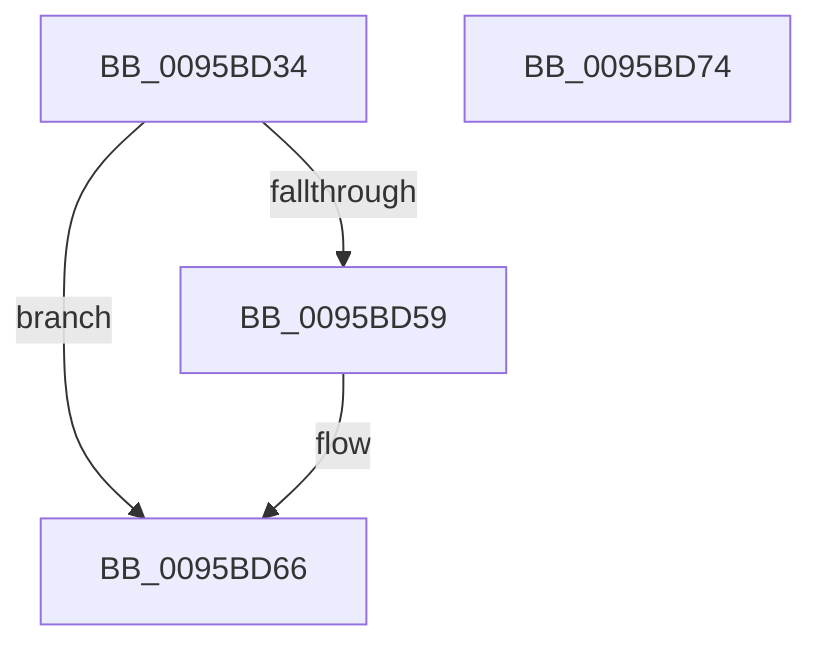

# AslAlloc

- RVA: `0x0095BD34`–`0x0095BD75` (길이 `65` bytes)
- VA: `0x000000014095BD34`
- 실행 섹션: `PAGE`
- PDB 이름 있음: `예`; PDB Function 태그: `아니요`
- unwind 정보 RVA: `0x0005CAAC`
- 디코드: `20`개 명령, `65/65` bytes 표시
- 미해석 바이트: `0` (있으면 어셈블리에 `.byte`로 보존)

> 이 문서는 커널 이미지의 기계어와 PDB 기호를 분석해 생성했습니다. 4번과 5번은 함수 원형과 자료형을 바이너리 사용 방식에서 추정한 C 해석이며 원본 소스 복구 결과는 아닙니다.

## 1. Dependencies

- 직접 호출 지점: **2**; 고유 호출 대상: **2**
- 직접 호출자로 확인된 함수: **38**
- RIP 상대 이미지 참조: **0**

### Outgoing calls
- `0x0095BD4C` → [ExAllocatePool2](../../poolcode/B8/ExAllocatePool2_function_00B820F0.md) (function, `0x00B820F0`)
- `0x0095BD61` → [memset](../../text/6C/memset_function_006C6C40.md) (function, `0x006C6C40`)

### Direct callers
- [SdbOpenDatabaseEx](../81/SdbOpenDatabaseEx_function_00812284.md) at `0x008122F2`
- [SdbpGetManifestedMergeStubAlloc](../81/SdbpGetManifestedMergeStubAlloc_function_0081275C.md) at `0x008128A2`
- [SdbpGetManifestedMergeStubAlloc](../81/SdbpGetManifestedMergeStubAlloc_function_0081275C.md) at `0x00812958`
- [SdbpSafeAllocAndConcatW](../81/SdbpSafeAllocAndConcatW_function_00813198.md) at `0x0081328F`
- [SdbQueryDataExTagID](../81/SdbQueryDataExTagID_function_008136E0.md) at `0x0081376C`
- [SdbpCheckMatchingRegistryValue](../81/SdbpCheckMatchingRegistryValue_function_0081462C.md) at `0x008146F7`
- [SdbpCheckMatchingRegistryValue](../81/SdbpCheckMatchingRegistryValue_function_0081462C.md) at `0x008147E8`
- [SdbpCheckMatchingRegistryValue](../81/SdbpCheckMatchingRegistryValue_function_0081462C.md) at `0x008148E3`
- [SdbpCheckMatchingTextEntry](../81/SdbpCheckMatchingTextEntry_function_00814A70.md) at `0x00814C81`
- [SdbpGetMatchingTextAttributes](../81/SdbpGetMatchingTextAttributes_function_00815B38.md) at `0x00815C27`
- [SdbpInitializeSearchDBContext](../81/SdbpInitializeSearchDBContext_function_00816210.md) at `0x008162B2`
- [SdbpResolveMatchingFile](../81/SdbpResolveMatchingFile_function_00816A20.md) at `0x00816BA6`
- [SdbpGetProcessHistory](../81/SdbpGetProcessHistory_function_00817250.md) at `0x008172E2`
- [SdbResolveDatabaseEx](../81/SdbResolveDatabaseEx_function_00817A54.md) at `0x00817BB9`
- [SdbpOpenCompressedDatabase](../81/SdbpOpenCompressedDatabase_function_00818524.md) at `0x008185D5`
- [SdbpCheckAllAttributes](../81/SdbpCheckAllAttributes_function_008187EC.md) at `0x0081886A`
- [AslGuidToString_UStr](../81/AslGuidToString_UStr_function_008196DC.md) at `0x0081970A`
- [AslStringAnsiToUnicode](../81/AslStringAnsiToUnicode_function_00819824.md) at `0x008198B2`
- [AslRegistryBuildMachinePath](../81/AslRegistryBuildMachinePath_function_00819CCC.md) at `0x00819D26`
- [AslRegistryBuildUserPath](../81/AslRegistryBuildUserPath_function_00819DB0.md) at `0x00819E35`
- [AslRegistryGetString](../81/AslRegistryGetString_function_0081A084.md) at `0x0081A127`
- [AslFileMappingCreateFromImageView](../81/AslFileMappingCreateFromImageView_function_0081A49C.md) at `0x0081A4F1`
- [AslPathToNetworkPathNt](../81/AslPathToNetworkPathNt_function_0081B2A4.md) at `0x0081B2F1`
- [AslPathWildcardFindFirst](../81/AslPathWildcardFindFirst_function_0081B534.md) at `0x0081B661`
- [AslPathWildcardFindFirst](../81/AslPathWildcardFindFirst_function_0081B534.md) at `0x0081B71C`
- [AslPathWildcardFindNext](../81/AslPathWildcardFindNext_function_0081BB2C.md) at `0x0081BB9D`
- [AslRegWildcardFindFirst](../81/AslRegWildcardFindFirst_function_0081C2F0.md) at `0x0081C31B`
- [AslpAllocMatchNode](../81/AslpAllocMatchNode_function_0081C430.md) at `0x0081C44D`
- [AslpPathWildcardAllocMatchNode](../81/AslpPathWildcardAllocMatchNode_function_0081C620.md) at `0x0081C709`
- [AslpProcessMatchRegNode](../81/AslpProcessMatchRegNode_function_0081CB08.md) at `0x0081CB96`
- [AslEnvExpandStrings2](../81/AslEnvExpandStrings2_function_0081CECC.md) at `0x0081CF9D`
- [AslpFileGetVersionBlock](../81/AslpFileGetVersionBlock_function_0081FA50.md) at `0x0081FE5F`
- [AslpFileGetVersionBlockImageOnly](../82/AslpFileGetVersionBlockImageOnly_function_00820260.md) at `0x00820444`
- [AslpFileLargeMapCreate](../82/AslpFileLargeMapCreate_function_00821A88.md) at `0x00821ABE`
- [AslFileMappingCreate](AslFileMappingCreate_function_00958448.md) at `0x009584DF`
- [AslStringDuplicate](AslStringDuplicate_function_00958604.md) at `0x00958688`
- [AslStringUpcaseToMultiByteN](AslStringUpcaseToMultiByteN_function_0095965C.md) at `0x0095969A`
- [SdbpCreateSearchPathPartsFromPath](SdbpCreateSearchPathPartsFromPath_function_0095A238.md) at `0x0095A28F`
- [SdbpOpenDatabaseInMemory](SdbpOpenDatabaseInMemory_function_0095A574.md) at `0x0095A59F`
- [SdbInitDatabaseInMemory](SdbInitDatabaseInMemory_function_0095BC5C.md) at `0x0095BC75`
- [SdbpCreateSearchDBContext](../A9/SdbpCreateSearchDBContext_function_00A9D544.md) at `0x00A9D5C7`
- [sub_00B488F0](../B4/Unknown_function_00B488F0.md) at `0x00B488F5`
- [sub_00B488F0](../B4/Unknown_function_00B488F0.md) at `0x00B48963`
- [sub_00B488F0](../B4/Unknown_function_00B488F0.md) at `0x00B48977`
- [sub_00B488F0](../B4/Unknown_function_00B488F0.md) at `0x00B48982`

### Static image references
- 디코드된 RIP-relative 메모리 참조가 없습니다.

## 2. Other-region calls and transfers

- 다른 실행 섹션으로 향하는 call: **2**
  - `0x0095BD4C` → [ExAllocatePool2](../../poolcode/B8/ExAllocatePool2_function_00B820F0.md) (`PAGE` → `POOLCODE`)
  - `0x0095BD61` → [memset](../../text/6C/memset_function_006C6C40.md) (`PAGE` → `.text`)
- 별도 외부 분기/꼬리 이동을 확인하지 못했습니다.

## 3. Assembly (complete function range)

```asm
0095BD34  48 89 5C 24 08                  mov qword ptr [rsp + 8], rbx
0095BD39  57                              push rdi
0095BD3A  48 83 EC 20                     sub rsp, 0x20
0095BD3E  B9 00 01 00 00                  mov ecx, 0x100
0095BD43  41 B8 41 50 70 74               mov r8d, 0x74705041
0095BD49  48 8B FA                        mov rdi, rdx
0095BD4C  E8 9F 63 22 00                  call 0x140b820f0
0095BD51  48 8B D8                        mov rbx, rax
0095BD54  48 85 C0                        test rax, rax
0095BD57  74 0D                           je 0x14095bd66
0095BD59  4C 8B C7                        mov r8, rdi
0095BD5C  33 D2                           xor edx, edx
0095BD5E  48 8B C8                        mov rcx, rax
0095BD61  E8 DA AE D6 FF                  call 0x1406c6c40
0095BD66  48 8B C3                        mov rax, rbx
0095BD69  48 8B 5C 24 30                  mov rbx, qword ptr [rsp + 0x30]
0095BD6E  48 83 C4 20                     add rsp, 0x20
0095BD72  5F                              pop rdi
0095BD73  C3                              ret
0095BD74  CC                              int3
```

## 4. C-style interpretation (structured pseudocode)

```c
__int64 __fastcall AslAlloc(__int64 a1, __int64 a2)
{
    __int64 result;
    __int64 v_rsp;
    unsigned __int64 v_stack_p8;

    v_stack_p8 = v_rbx;
    v_rsp = (v_rsp) - (32);
    result = ExAllocatePool2(256, a2, (unsigned int)(0x74705041ULL), a4);
    if (result != 0) {
        a3 = a2;
        a2 = 0;
        a1 = result;
        result = memset(a1, a2, a3, a4);
    }
    v_rsp = (v_rsp) + (32);
    return result;
}
```

## 5. (Beta) C Style

```c
int64_t AslAlloc(int64_t Arg1, int64_t Arg2)
{
    int64_t result;
    int64_t local_rsp;
    uint64_t v_stack_p8;

    v_stack_p8 = local_rbx;
    local_rsp = (local_rsp) - (32);
    result = ExAllocatePool2(256, Arg2, (uint32_t)(0x74705041ULL), a4);
    if (result != 0) {
        a3 = Arg2;
        Arg2 = 0;
        Arg1 = result;
        result = memset(Arg1, Arg2, a3, a4);
    }
    local_rsp = (local_rsp) + (32);
    return result;
}
```

## 6. Execution-region graph

[열기: 2D/3D 그래프와 함수 탐색 컨트롤 패널](../../../control-panel.html?section=page&rva=0x0095BD34&view=graph)

- 2D 그래프는 위에서 아래로 흐르고, 3D 그래프는 빈 공간을 드래그해 회전합니다. Shift+드래그는 이동, 휠은 확대·축소, 함수 노드 선택은 대상 보고서 이동입니다.

### Static fallback


