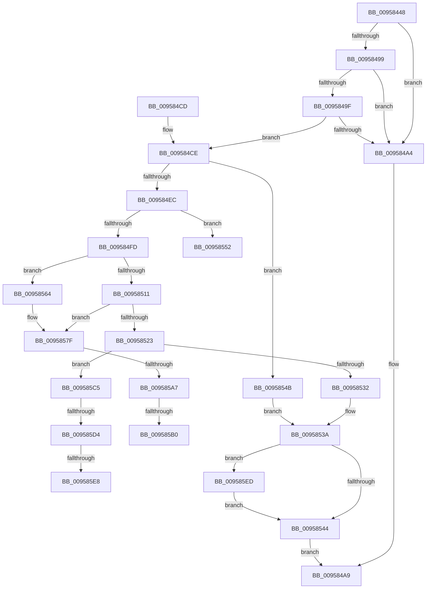

# AslFileMappingCreate

- RVA: `0x00958448`–`0x009585FB` (길이 `435` bytes)
- VA: `0x0000000140958448`
- 실행 섹션: `PAGE`
- PDB 이름 있음: `예`; PDB Function 태그: `예`
- unwind 정보 RVA: `0x00092660`
- 디코드: `121`개 명령, `435/435` bytes 표시
- 미해석 바이트: `0` (있으면 어셈블리에 `.byte`로 보존)

> 이 문서는 커널 이미지의 기계어와 PDB 기호를 분석해 생성했습니다. 4번과 5번은 함수 원형과 자료형을 바이너리 사용 방식에서 추정한 C 해석이며 원본 소스 복구 결과는 아닙니다.

## 1. Dependencies

- 직접 호출 지점: **9**; 고유 호출 대상: **9**
- 직접 호출자로 확인된 함수: **6**
- RIP 상대 이미지 참조: **2**

### Outgoing calls
- `0x009584B0` → [_security_check_cookie](../../text/6A/_security_check_cookie_function_006AC640.md) (function, `0x006AC640`)
- `0x009584D5` → [RtlInitUnicodeString](../../text/42/RtlInitUnicodeString_function_0042A780.md) (function, `0x0042A780`)
- `0x009584DF` → [AslAlloc](AslAlloc_function_0095BD34.md) (function, `0x0095BD34`)
- `0x009584F2` → [AslStringDuplicate](AslStringDuplicate_function_00958604.md) (function, `0x00958604`)
- `0x00958518` → [RtlFileMapInitializeByNtPath](../../text/4D/RtlFileMapInitializeByNtPath_function_004D3F5C.md) (function, `0x004D3F5C`)
- `0x00958525` → [AslFileNotFound](../70/AslFileNotFound_function_00705144.md) (function, `0x00705144`)
- `0x00958535` → [AslFileMappingDelete](AslFileMappingDelete_function_0095B728.md) (function, `0x0095B728`)
- `0x00958598` → [ZwQueryInformationFile](../../text/6A/ZwQueryInformationFile_function_006AD2F0.md) (function, `0x006AD2F0`)
- `0x009585F1` → [RtlFreeAnsiString](../9C/RtlFreeAnsiString_function_009C0800.md) (function, `0x009C0800`)

### Direct callers
- [SdbOpenDatabaseEx](../81/SdbOpenDatabaseEx_function_00812284.md) at `0x00812399`
- [SdbOpenDatabaseEx](../81/SdbOpenDatabaseEx_function_00812284.md) at `0x00812406`
- [SdbpCheckMatchingFiles](../81/SdbpCheckMatchingFiles_function_00814080.md) at `0x00814222`
- [SdbpCheckMatchingTextEntry](../81/SdbpCheckMatchingTextEntry_function_00814A70.md) at `0x00814B72`
- [SdbpCheckMatchingWildcardFiles](../81/SdbpCheckMatchingWildcardFiles_function_00814E30.md) at `0x00814FE6`
- [SdbGetDatabaseMatch](SdbGetDatabaseMatch_function_00958240.md) at `0x009582C3`
- [SdbpCheckKObject](SdbpCheckKObject_function_00959F04.md) at `0x00959F6D`

### Static image references
- `0x0095845F` → RVA `0x00E0A740` (`.data`; read)
- `0x00958552` → RVA `0x0003DB80` (`.rdata`; read)

## 2. Other-region calls and transfers

- 다른 실행 섹션으로 향하는 call: **4**
  - `0x009584B0` → [_security_check_cookie](../../text/6A/_security_check_cookie_function_006AC640.md) (`PAGE` → `.text`)
  - `0x009584D5` → [RtlInitUnicodeString](../../text/42/RtlInitUnicodeString_function_0042A780.md) (`PAGE` → `.text`)
  - `0x00958518` → [RtlFileMapInitializeByNtPath](../../text/4D/RtlFileMapInitializeByNtPath_function_004D3F5C.md) (`PAGE` → `.text`)
  - `0x00958598` → [ZwQueryInformationFile](../../text/6A/ZwQueryInformationFile_function_006AD2F0.md) (`PAGE` → `.text`)
- call이 아닌 외부 분기/꼬리 이동: **7**
  - `0x0095855F` → [sub_00B26AF0 + 0xD](../B2/Unknown_function_00B26AF0.md) (`tail-transfer`)
  - `0x009585A1` → [sub_00B26AF0](../B2/Unknown_function_00B26AF0.md) (`tail-transfer`)
  - `0x009585AA` → [sub_00B26AF0 + 0x6A](../B2/Unknown_function_00B26AF0.md) (`tail-transfer`)
  - `0x009585C0` → [sub_00B26AF0 + 0x6A](../B2/Unknown_function_00B26AF0.md) (`tail-transfer`)
  - `0x009585CE` → [sub_00B26AF0 + 0x28](../B2/Unknown_function_00B26AF0.md) (`tail-transfer`)
  - `0x009585E2` → [sub_00B26AF0 + 0x28](../B2/Unknown_function_00B26AF0.md) (`tail-transfer`)
  - `0x009585E8` → [sub_00B26AF0 + 0x3D](../B2/Unknown_function_00B26AF0.md) (`tail-transfer`)

## 3. Assembly (complete function range)

```asm
00958448  48 89 5C 24 18                  mov qword ptr [rsp + 0x18], rbx
0095844D  55                              push rbp
0095844E  56                              push rsi
0095844F  57                              push rdi
00958450  41 54                           push r12
00958452  41 55                           push r13
00958454  41 56                           push r14
00958456  41 57                           push r15
00958458  48 8B EC                        mov rbp, rsp
0095845B  48 83 EC 70                     sub rsp, 0x70
0095845F  48 8B 05 DA 22 4B 00            mov rax, qword ptr [rip + 0x4b22da]
00958466  48 33 C4                        xor rax, rsp
00958469  48 89 45 F8                     mov qword ptr [rbp - 8], rax
0095846D  33 C0                           xor eax, eax
0095846F  0F 57 C0                        xorps xmm0, xmm0
00958472  45 33 ED                        xor r13d, r13d
00958475  48 89 45 F0                     mov qword ptr [rbp - 0x10], rax
00958479  0F 57 C9                        xorps xmm1, xmm1
0095847C  4D 8B F9                        mov r15, r9
0095847F  49 8B F0                        mov rsi, r8
00958482  4C 8B F2                        mov r14, rdx
00958485  4C 8B E1                        mov r12, rcx
00958488  0F 11 45 E0                     movups xmmword ptr [rbp - 0x20], xmm0
0095848C  0F 11 45 C0                     movups xmmword ptr [rbp - 0x40], xmm0
00958490  0F 11 4D D0                     movups xmmword ptr [rbp - 0x30], xmm1
00958494  48 85 D2                        test rdx, rdx
00958497  74 0B                           je 0x1409584a4
00958499  66 44 39 2A                     cmp word ptr [rdx], r13w
0095849D  74 05                           je 0x1409584a4
0095849F  48 85 C9                        test rcx, rcx
009584A2  75 2A                           jne 0x1409584ce
009584A4  B8 0D 00 00 C0                  mov eax, 0xc000000d
009584A9  48 8B 4D F8                     mov rcx, qword ptr [rbp - 8]
009584AD  48 33 CC                        xor rcx, rsp
009584B0  E8 8B 41 D5 FF                  call 0x1406ac640
009584B5  48 8B 9C 24 C0 00 00 00         mov rbx, qword ptr [rsp + 0xc0]
009584BD  48 83 C4 70                     add rsp, 0x70
009584C1  41 5F                           pop r15
009584C3  41 5E                           pop r14
009584C5  41 5D                           pop r13
009584C7  41 5C                           pop r12
009584C9  5F                              pop rdi
009584CA  5E                              pop rsi
009584CB  5D                              pop rbp
009584CC  C3                              ret
009584CD  CC                              int3
009584CE  4C 89 29                        mov qword ptr [rcx], r13
009584D1  48 8D 4D C0                     lea rcx, [rbp - 0x40]
009584D5  E8 A6 22 AD FF                  call 0x14042a780
009584DA  BA 58 00 00 00                  mov edx, 0x58
009584DF  E8 50 38 00 00                  call 0x14095bd34
009584E4  48 8B F8                        mov rdi, rax
009584E7  48 85 C0                        test rax, rax
009584EA  74 5F                           je 0x14095854b
009584EC  49 8B D6                        mov rdx, r14
009584EF  48 8B C8                        mov rcx, rax
009584F2  E8 0D 01 00 00                  call 0x140958604
009584F7  8B D8                           mov ebx, eax
009584F9  85 C0                           test eax, eax
009584FB  78 55                           js 0x140958552
009584FD  48 83 FE FF                     cmp rsi, -1
00958501  49 8B C5                        mov rax, r13
00958504  48 0F 45 C6                     cmovne rax, rsi
00958508  48 8D 77 08                     lea rsi, [rdi + 8]
0095850C  48 85 C0                        test rax, rax
0095850F  75 53                           jne 0x140958564
00958511  48 8D 55 C0                     lea rdx, [rbp - 0x40]
00958515  48 8B CE                        mov rcx, rsi
00958518  E8 3F BA B7 FF                  call 0x1404d3f5c
0095851D  8B D8                           mov ebx, eax
0095851F  85 C0                           test eax, eax
00958521  79 5C                           jns 0x14095857f
00958523  8B C8                           mov ecx, eax
00958525  E8 1A CC DA FF                  call 0x140705144
0095852A  85 C0                           test eax, eax
0095852C  0F 84 93 00 00 00               je 0x1409585c5
00958532  48 8B CF                        mov rcx, rdi
00958535  E8 EE 31 00 00                  call 0x14095b728
0095853A  4C 39 75 C8                     cmp qword ptr [rbp - 0x38], r14
0095853E  0F 85 A9 00 00 00               jne 0x1409585ed
00958544  8B C3                           mov eax, ebx
00958546  E9 5E FF FF FF                  jmp 0x1409584a9
0095854B  BB 17 00 00 C0                  mov ebx, 0xc0000017
00958550  EB E8                           jmp 0x14095853a
00958552  4C 8D 0D 27 56 6E FF            lea r9, [rip - 0x91a9d9]
00958559  41 B8 7E 00 00 00               mov r8d, 0x7e
0095855F  E9 99 E5 1C 00                  jmp 0x140b26afd
00958564  0F 57 C0                        xorps xmm0, xmm0
00958567  33 C9                           xor ecx, ecx
00958569  0F 11 06                        movups xmmword ptr [rsi], xmm0
0095856C  0F 11 46 10                     movups xmmword ptr [rsi + 0x10], xmm0
00958570  0F 11 46 20                     movups xmmword ptr [rsi + 0x20], xmm0
00958574  48 89 4E 30                     mov qword ptr [rsi + 0x30], rcx
00958578  44 88 6E 30                     mov byte ptr [rsi + 0x30], r13b
0095857C  48 89 06                        mov qword ptr [rsi], rax
0095857F  48 8B 0E                        mov rcx, qword ptr [rsi]
00958582  4C 8D 45 E0                     lea r8, [rbp - 0x20]
00958586  41 B9 18 00 00 00               mov r9d, 0x18
0095858C  C7 44 24 20 05 00 00 00         mov dword ptr [rsp + 0x20], 5
00958594  48 8D 55 D0                     lea rdx, [rbp - 0x30]
00958598  E8 53 4D D5 FF                  call 0x1406ad2f0
0095859D  8B D8                           mov ebx, eax
0095859F  85 C0                           test eax, eax
009585A1  0F 88 49 E5 1C 00               js 0x140b26af0
009585A7  4D 85 FF                        test r15, r15
009585AA  0F 84 AA E5 1C 00               je 0x140b26b5a
009585B0  48 8B 45 60                     mov rax, qword ptr [rbp + 0x60]
009585B4  48 89 47 28                     mov qword ptr [rdi + 0x28], rax
009585B8  C6 47 3B 01                     mov byte ptr [rdi + 0x3b], 1
009585BC  4C 89 7F 20                     mov qword ptr [rdi + 0x20], r15
009585C0  E9 95 E5 1C 00                  jmp 0x140b26b5a
009585C5  8D 83 ED FF FF 3F               lea eax, [rbx + 0x3fffffed]
009585CB  83 F8 30                        cmp eax, 0x30
009585CE  0F 87 44 E5 1C 00               ja 0x140b26b18
009585D4  48 B9 01 80 00 00 00 00 01 00   movabs rcx, 0x1000000008001
009585DE  48 0F A3 C1                     bt rcx, rax
009585E2  0F 83 30 E5 1C 00               jae 0x140b26b18
009585E8  E9 40 E5 1C 00                  jmp 0x140b26b2d
009585ED  48 8D 4D C0                     lea rcx, [rbp - 0x40]
009585F1  E8 0A 82 06 00                  call 0x1409c0800
009585F6  E9 49 FF FF FF                  jmp 0x140958544
```

## 4. C-style interpretation (structured pseudocode)

```c
__int64 __fastcall AslFileMappingCreate(__int64 a1, __int64 a2, __int64 a3, __int64 a4, __int64 a5)
{
    __int64 result;
    __int64 v_r13;
    __int64 v_rsp;
    unsigned __int64 v_stack_m40;
    unsigned __int64 v_stack_m48;
    unsigned __int64 v_stack_m58;
    unsigned __int64 v_stack_m68;
    unsigned __int64 v_stack_m70;
    unsigned __int64 v_stack_m78;
    unsigned __int64 v_stack_p18;
    unsigned int v_stack_p20;

    v_stack_p18 = v_rbx;
    v_rsp = (v_rsp) - (112);
    result = (*(unsigned __int64 *)(v_rip + 4924122)) ^ (v_rsp);
    v_stack_m40 = result;
    result = 0;
    v_r13 = 0;
    v_stack_m48 = 0;
    v_stack_m58 = v_xmm0;
    v_stack_m78 = v_xmm0;
    v_stack_m68 = v_xmm1;
    if (a2 == 0) goto loc_009584A4;
    if ((*(unsigned __int16 *)(a2)) == 0) goto loc_009584A4;
    if (a1 != 0) goto loc_009584CE;
loc_009584A4:
loc_009584A9:
    a1 = (v_stack_m40) ^ (v_rsp);
    result = _security_check_cookie(a1, a2, a3, a4);
    v_rsp = (v_rsp) + (112);
    return result;
loc_009584CE:
    *(unsigned __int64 *)(a1) = 0;
    result = RtlInitUnicodeString(v_stack_m78, a2, a3, a4);
    result = AslAlloc(v_stack_m78, 88, a3, a4);
    if (result == 0) goto loc_0095854B;
    result = AslStringDuplicate(result, a2, a3, a4);
    if (sign_flag) goto loc_00958552;
    result = 0;
    if (a3 != -1) { result = a3; }
    if (result != 0) goto loc_00958564;
    result = RtlFileMapInitializeByNtPath(result + 8, v_stack_m78, a3, a4);
    if (!sign_flag) goto loc_0095857F;
    result = AslFileNotFound((unsigned int)((unsigned int)(result)), v_stack_m78, a3, a4);
    if ((unsigned int)(result) == 0) goto loc_009585C5;
    result = AslFileMappingDelete(result, v_stack_m78, a3, a4);
loc_0095853A:
    if (v_stack_m70 != a2) goto loc_009585ED;
loc_00958544:
    goto loc_009584A9;
loc_0095854B:
    goto loc_0095853A;
loc_00958552:
loc_00958564:
    a1 = 0;
    *(unsigned __int64 *)(result + 8) = v_xmm0;
    *(unsigned __int64 *)(result + 8 + 16) = v_xmm0;
    *(unsigned __int64 *)(result + 8 + 32) = v_xmm0;
    *(unsigned __int64 *)(result + 8 + 48) = 0;
    *(unsigned __int8 *)(result + 8 + 48) = 0;
    *(unsigned __int64 *)(result + 8) = (unsigned int)((unsigned int)((unsigned int)((unsigned int)(result))));
loc_0095857F:
    v_stack_p20 = 5;
    result = ZwQueryInformationFile(*(unsigned __int64 *)(result + 8), v_stack_m68, v_stack_m58, 24);
    *(unsigned __int64 *)(result + 40) = a5;
    *(unsigned __int8 *)(result + 59) = 1;
    *(unsigned __int64 *)(result + 32) = a4;
loc_009585C5:
loc_009585ED:
    result = RtlFreeAnsiString(v_stack_m78, v_stack_m68, v_stack_m58, 24);
    goto loc_00958544;
}
```

## 5. (Beta) C Style

```c
int64_t AslFileMappingCreate(int64_t Arg1, int64_t Arg2, int64_t Arg3, int64_t Arg4, int64_t Arg5)
{
    int64_t result;
    int64_t local_r13;
    int64_t local_rsp;
    uint64_t v_stack_m40;
    uint64_t v_stack_m48;
    uint64_t v_stack_m58;
    uint64_t v_stack_m68;
    uint64_t v_stack_m70;
    uint64_t v_stack_m78;
    uint64_t v_stack_p18;
    uint32_t v_stack_p20;

    v_stack_p18 = local_rbx;
    local_rsp = (local_rsp) - (112);
    result = (*(uint64_t *)(v_rip + 0x4B22DA)) ^ (local_rsp);
    v_stack_m40 = result;
    result = 0;
    local_r13 = 0;
    v_stack_m48 = 0;
    v_stack_m58 = v_xmm0;
    v_stack_m78 = v_xmm0;
    v_stack_m68 = v_xmm1;
    if (Arg2 == 0) goto loc_009584A4;
    if ((*(uint16_t *)(Arg2)) == 0) goto loc_009584A4;
    if (Arg1 != 0) goto loc_009584CE;
loc_009584A4:
loc_009584A9:
    Arg1 = (v_stack_m40) ^ (local_rsp);
    result = _security_check_cookie(Arg1, Arg2, Arg3, Arg4);
    local_rsp = (local_rsp) + (112);
    return result;
loc_009584CE:
    *(uint64_t *)(Arg1) = 0;
    result = RtlInitUnicodeString(v_stack_m78, Arg2, Arg3, Arg4);
    result = AslAlloc(v_stack_m78, 88, Arg3, Arg4);
    if (result == 0) goto loc_0095854B;
    result = AslStringDuplicate(result, Arg2, Arg3, Arg4);
    if (sign_flag) goto loc_00958552;
    result = 0;
    if (Arg3 != -1) { result = Arg3; }
    if (result != 0) goto loc_00958564;
    result = RtlFileMapInitializeByNtPath(result + 8, v_stack_m78, Arg3, Arg4);
    if (!sign_flag) goto loc_0095857F;
    result = AslFileNotFound((uint32_t)((uint32_t)(result)), v_stack_m78, Arg3, Arg4);
    if ((uint32_t)(result) == 0) goto loc_009585C5;
    result = AslFileMappingDelete(result, v_stack_m78, Arg3, Arg4);
loc_0095853A:
    if (v_stack_m70 != Arg2) goto loc_009585ED;
loc_00958544:
    goto loc_009584A9;
loc_0095854B:
    goto loc_0095853A;
loc_00958552:
loc_00958564:
    Arg1 = 0;
    *(uint64_t *)(result + 0x8) = v_xmm0;
    *(uint64_t *)(result + 0x8 + 0x10) = v_xmm0;
    *(uint64_t *)(result + 0x8 + 0x20) = v_xmm0;
    *(uint64_t *)(result + 0x8 + 0x30) = 0;
    *(uint8_t *)(result + 0x8 + 0x30) = 0;
    *(uint64_t *)(result + 0x8) = (uint32_t)((uint32_t)((uint32_t)((uint32_t)(result))));
loc_0095857F:
    v_stack_p20 = 5;
    result = ZwQueryInformationFile(*(uint64_t *)(result + 0x8), v_stack_m68, v_stack_m58, 24);
    *(uint64_t *)(result + 0x28) = Arg5;
    *(uint8_t *)(result + 0x3B) = 1;
    *(uint64_t *)(result + 0x20) = Arg4;
loc_009585C5:
loc_009585ED:
    result = RtlFreeAnsiString(v_stack_m78, v_stack_m68, v_stack_m58, 24);
    goto loc_00958544;
}
```

## 6. Execution-region graph

[열기: 2D/3D 그래프와 함수 탐색 컨트롤 패널](../../../control-panel.html?section=page&rva=0x00958448&view=graph)

- 2D 그래프는 위에서 아래로 흐르고, 3D 그래프는 빈 공간을 드래그해 회전합니다. Shift+드래그는 이동, 휠은 확대·축소, 함수 노드 선택은 대상 보고서 이동입니다.

### Static fallback


