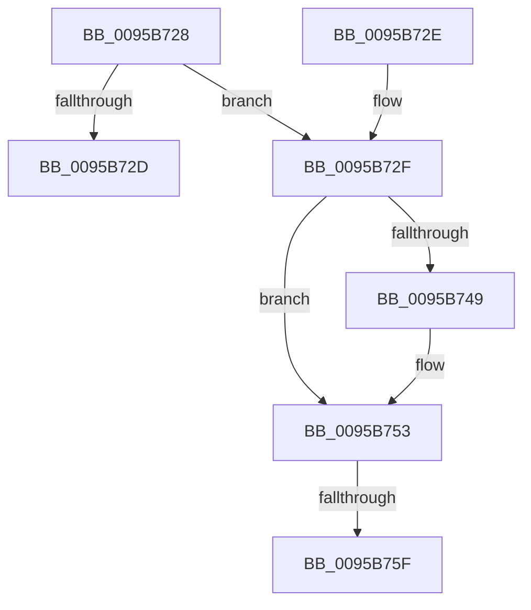

# AslFileMappingDelete

- RVA: `0x0095B728`–`0x0095B76D` (길이 `69` bytes)
- VA: `0x000000014095B728`
- 실행 섹션: `PAGE`
- PDB 이름 있음: `예`; PDB Function 태그: `예`
- unwind 정보 RVA: `0x00092B84`
- 디코드: `20`개 명령, `69/69` bytes 표시
- 미해석 바이트: `0` (있으면 어셈블리에 `.byte`로 보존)

> 이 문서는 커널 이미지의 기계어와 PDB 기호를 분석해 생성했습니다. 4번과 5번은 함수 원형과 자료형을 바이너리 사용 방식에서 추정한 C 해석이며 원본 소스 복구 결과는 아닙니다.

## 1. Dependencies

- 직접 호출 지점: **3**; 고유 호출 대상: **2**
- 직접 호출자로 확인된 함수: **9**
- RIP 상대 이미지 참조: **0**

### Outgoing calls
- `0x0095B73B` → [RtlFileMapFree](../../text/4B/RtlFileMapFree_function_004BF868.md) (function, `0x004BF868`)
- `0x0095B749` → [AslFree](AslFree_function_0095B674.md) (function, `0x0095B674`)
- `0x0095B75F` → [AslFree](AslFree_function_0095B674.md) (function, `0x0095B674`)

### Direct callers
- [SdbOpenDatabaseEx](../81/SdbOpenDatabaseEx_function_00812284.md) at `0x00812531`
- [SdbpCheckMatchingFiles](../81/SdbpCheckMatchingFiles_function_00814080.md) at `0x00814267`
- [SdbpCheckMatchingFiles](../81/SdbpCheckMatchingFiles_function_00814080.md) at `0x008142BB`
- [SdbpCheckMatchingTextEntry](../81/SdbpCheckMatchingTextEntry_function_00814A70.md) at `0x00814B9E`
- [SdbpCheckMatchingTextEntry](../81/SdbpCheckMatchingTextEntry_function_00814A70.md) at `0x00814E04`
- [SdbpCheckMatchingWildcardFiles](../81/SdbpCheckMatchingWildcardFiles_function_00814E30.md) at `0x00814FC5`
- [SdbpCheckMatchingWildcardFiles](../81/SdbpCheckMatchingWildcardFiles_function_00814E30.md) at `0x008150B9`
- [AslFileMappingCreateFromImageView](../81/AslFileMappingCreateFromImageView_function_0081A49C.md) at `0x0081A53E`
- [SdbGetDatabaseMatch](SdbGetDatabaseMatch_function_00958240.md) at `0x0095841E`
- [AslFileMappingCreate](AslFileMappingCreate_function_00958448.md) at `0x00958535`
- [SdbpCheckKObject](SdbpCheckKObject_function_00959F04.md) at `0x0095A04C`
- [SdbCloseDatabaseRead](SdbCloseDatabaseRead_function_0095A728.md) at `0x0095A74A`

### Static image references
- 디코드된 RIP-relative 메모리 참조가 없습니다.

## 2. Other-region calls and transfers

- 다른 실행 섹션으로 향하는 call: **1**
  - `0x0095B73B` → [RtlFileMapFree](../../text/4B/RtlFileMapFree_function_004BF868.md) (`PAGE` → `.text`)
- call이 아닌 외부 분기/꼬리 이동: **2**
  - `0x0095B759` → [sub_00B2788A](../B2/Unknown_function_00B2788A.md) (`tail-transfer`)
  - `0x0095B768` → [sub_00B2788A](../B2/Unknown_function_00B2788A.md) (`tail-transfer`)

## 3. Assembly (complete function range)

```asm
0095B728  48 85 C9                        test rcx, rcx
0095B72B  75 02                           jne 0x14095b72f
0095B72D  C3                              ret
0095B72E  CC                              int3
0095B72F  53                              push rbx
0095B730  48 83 EC 20                     sub rsp, 0x20
0095B734  48 8B D9                        mov rbx, rcx
0095B737  48 83 C1 08                     add rcx, 8
0095B73B  E8 28 41 B6 FF                  call 0x1404bf868
0095B740  48 8B 53 48                     mov rdx, qword ptr [rbx + 0x48]
0095B744  48 85 D2                        test rdx, rdx
0095B747  74 0A                           je 0x14095b753
0095B749  E8 26 FF FF FF                  call 0x14095b674
0095B74E  48 83 63 48 00                  and qword ptr [rbx + 0x48], 0
0095B753  48 8B 13                        mov rdx, qword ptr [rbx]
0095B756  48 85 D2                        test rdx, rdx
0095B759  0F 84 2B C1 1C 00               je 0x140b2788a
0095B75F  E8 10 FF FF FF                  call 0x14095b674
0095B764  48 83 23 00                     and qword ptr [rbx], 0
0095B768  E9 1D C1 1C 00                  jmp 0x140b2788a
```

## 4. C-style interpretation (structured pseudocode)

```c
__int64 __fastcall AslFileMappingDelete(__int64 a1)
{
    __int64 result;
    __int64 v_rsp;

    if (a1 != 0) goto loc_0095B72F;
    return result;
loc_0095B72F:
    v_rsp = (v_rsp) - (32);
    a1 = (a1) + (8);
    result = RtlFileMapFree(a1, a2, a3, a4);
    if (*(unsigned __int64 *)(a1 + 72) != 0) {
        result = AslFree(a1, *(unsigned __int64 *)(a1 + 72), a3, a4);
    }
    result = AslFree(a1, *(unsigned __int64 *)(a1), a3, a4);
}
```

## 5. (Beta) C Style

```c
int64_t AslFileMappingDelete(int64_t Arg1)
{
    int64_t result;
    int64_t local_rsp;

    if (Arg1 != 0) goto loc_0095B72F;
    return result;
loc_0095B72F:
    local_rsp = (local_rsp) - (32);
    Arg1 = (Arg1) + (8);
    result = RtlFileMapFree(Arg1, a2, a3, a4);
    if (*(uint64_t *)(Arg1 + 0x48) != 0) {
        result = AslFree(Arg1, *(uint64_t *)(Arg1 + 0x48), a3, a4);
    }
    result = AslFree(Arg1, *(uint64_t *)(Arg1), a3, a4);
}
```

## 6. Execution-region graph

[열기: 2D/3D 그래프와 함수 탐색 컨트롤 패널](../../../control-panel.html?section=page&rva=0x0095B728&view=graph)

- 2D 그래프는 위에서 아래로 흐르고, 3D 그래프는 빈 공간을 드래그해 회전합니다. Shift+드래그는 이동, 휠은 확대·축소, 함수 노드 선택은 대상 보고서 이동입니다.

### Static fallback


