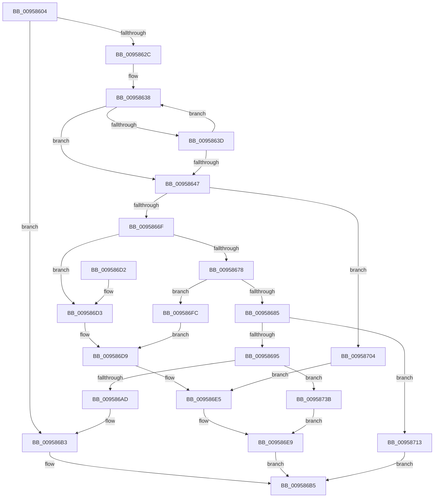

# AslStringDuplicate

- RVA: `0x00958604`–`0x0095874E` (길이 `330` bytes)
- VA: `0x0000000140958604`
- 실행 섹션: `PAGE`
- PDB 이름 있음: `예`; PDB Function 태그: `아니요`
- unwind 정보 RVA: `0x00092694`
- 디코드: `90`개 명령, `330/330` bytes 표시
- 미해석 바이트: `0` (있으면 어셈블리에 `.byte`로 보존)

> 이 문서는 커널 이미지의 기계어와 PDB 기호를 분석해 생성했습니다. 4번과 5번은 함수 원형과 자료형을 바이너리 사용 방식에서 추정한 C 해석이며 원본 소스 복구 결과는 아닙니다.

## 1. Dependencies

- 직접 호출 지점: **5**; 고유 호출 대상: **4**
- 직접 호출자로 확인된 함수: **8**
- RIP 상대 이미지 참조: **5**

### Outgoing calls
- `0x00958688` → [AslAlloc](AslAlloc_function_0095BD34.md) (function, `0x0095BD34`)
- `0x0095869E` → [RtlStringCchCopyW](../../text/26/RtlStringCchCopyW_function_0026E9A4.md) (function, `0x0026E9A4`)
- `0x009586B8` → [AslFree](AslFree_function_0095B674.md) (function, `0x0095B674`)
- `0x009586F5` → [AslLogCallPrintf](AslLogCallPrintf_function_0095E4EC.md) (function, `0x0095E4EC`)
- `0x00958731` → [AslLogCallPrintf](AslLogCallPrintf_function_0095E4EC.md) (function, `0x0095E4EC`)

### Direct callers
- [SdbpGetManifestedMergeStubAlloc](../81/SdbpGetManifestedMergeStubAlloc_function_0081275C.md) at `0x00812A46`
- [SdbpCheckMatchingRegistryValue](../81/SdbpCheckMatchingRegistryValue_function_0081462C.md) at `0x0081469A`
- [AslRegistryGetString](../81/AslRegistryGetString_function_0081A084.md) at `0x0081A1D7`
- [AslFileMappingCreateFromImageView](../81/AslFileMappingCreateFromImageView_function_0081A49C.md) at `0x0081A50E`
- [AslPathToSystemPath](../81/AslPathToSystemPath_function_0081B370.md) at `0x0081B3E5`
- [AslRegWildcardFindFirst](../81/AslRegWildcardFindFirst_function_0081C2F0.md) at `0x0081C347`
- [AslFileMappingCreate](AslFileMappingCreate_function_00958448.md) at `0x009584F2`
- [AslpFileVerQueryBlock](../AF/AslpFileVerQueryBlock_function_00AF9694.md) at `0x00AF96FC`

### Static image references
- `0x009586D9` → RVA `0x00012368` (`.rdata`; read)
- `0x009586E9` → RVA `0x00012350` (`.rdata`; read)
- `0x00958704` → RVA `0x0003B7B8` (`.rdata`; read)
- `0x00958713` → RVA `0x000129E0` (`.rdata`; read)
- `0x0095873F` → RVA `0x0003E680` (`.rdata`; read)

## 2. Other-region calls and transfers

- 다른 실행 섹션으로 향하는 call: **1**
  - `0x0095869E` → [RtlStringCchCopyW](../../text/26/RtlStringCchCopyW_function_0026E9A4.md) (`PAGE` → `.text`)
- 별도 외부 분기/꼬리 이동을 확인하지 못했습니다.

## 3. Assembly (complete function range)

```asm
00958604  48 89 5C 24 10                  mov qword ptr [rsp + 0x10], rbx
00958609  48 89 6C 24 18                  mov qword ptr [rsp + 0x18], rbp
0095860E  56                              push rsi
0095860F  57                              push rdi
00958610  41 56                           push r14
00958612  48 83 EC 30                     sub rsp, 0x30
00958616  33 ED                           xor ebp, ebp
00958618  48 8B F2                        mov rsi, rdx
0095861B  48 89 29                        mov qword ptr [rcx], rbp
0095861E  4C 8B F1                        mov r14, rcx
00958621  8B FD                           mov edi, ebp
00958623  48 85 D2                        test rdx, rdx
00958626  0F 84 87 00 00 00               je 0x1409586b3
0095862C  41 B9 FF FF FF 7F               mov r9d, 0x7fffffff
00958632  48 8B C6                        mov rax, rsi
00958635  41 8B D1                        mov edx, r9d
00958638  66 39 28                        cmp word ptr [rax], bp
0095863B  74 0A                           je 0x140958647
0095863D  48 83 C0 02                     add rax, 2
00958641  48 83 EA 01                     sub rdx, 1
00958645  75 F1                           jne 0x140958638
00958647  48 8B C2                        mov rax, rdx
0095864A  48 F7 D8                        neg rax
0095864D  48 8B C2                        mov rax, rdx
00958650  1B DB                           sbb ebx, ebx
00958652  4C 2B CA                        sub r9, rdx
00958655  F7 D3                           not ebx
00958657  81 E3 0D 00 00 C0               and ebx, 0xc000000d
0095865D  48 F7 D8                        neg rax
00958660  4D 1B C0                        sbb r8, r8
00958663  4D 23 C1                        and r8, r9
00958666  48 85 D2                        test rdx, rdx
00958669  0F 84 95 00 00 00               je 0x140958704
0095866F  49 8D 58 01                     lea rbx, [r8 + 1]
00958673  49 3B D8                        cmp rbx, r8
00958676  72 5B                           jb 0x1409586d3
00958678  B8 02 00 00 00                  mov eax, 2
0095867D  48 F7 E3                        mul rbx
00958680  48 85 D2                        test rdx, rdx
00958683  75 77                           jne 0x1409586fc
00958685  48 8B D0                        mov rdx, rax
00958688  E8 A7 36 00 00                  call 0x14095bd34
0095868D  48 8B F8                        mov rdi, rax
00958690  48 85 C0                        test rax, rax
00958693  74 7E                           je 0x140958713
00958695  4C 8B C6                        mov r8, rsi
00958698  48 8B D3                        mov rdx, rbx
0095869B  48 8B C8                        mov rcx, rax
0095869E  E8 01 63 91 FF                  call 0x14026e9a4
009586A3  8B D8                           mov ebx, eax
009586A5  85 C0                           test eax, eax
009586A7  0F 88 8E 00 00 00               js 0x14095873b
009586AD  49 89 3E                        mov qword ptr [r14], rdi
009586B0  48 8B FD                        mov rdi, rbp
009586B3  8B DD                           mov ebx, ebp
009586B5  48 8B D7                        mov rdx, rdi
009586B8  E8 B7 2F 00 00                  call 0x14095b674
009586BD  48 8B 6C 24 60                  mov rbp, qword ptr [rsp + 0x60]
009586C2  8B C3                           mov eax, ebx
009586C4  48 8B 5C 24 58                  mov rbx, qword ptr [rsp + 0x58]
009586C9  48 83 C4 30                     add rsp, 0x30
009586CD  41 5E                           pop r14
009586CF  5F                              pop rdi
009586D0  5E                              pop rsi
009586D1  C3                              ret
009586D2  CC                              int3
009586D3  41 B8 49 02 00 00               mov r8d, 0x249
009586D9  4C 8D 0D 88 9C 6B FF            lea r9, [rip - 0x946378]
009586E0  BB 95 00 00 C0                  mov ebx, 0xc0000095
009586E5  89 5C 24 20                     mov dword ptr [rsp + 0x20], ebx
009586E9  48 8D 15 60 9C 6B FF            lea rdx, [rip - 0x9463a0]
009586F0  B9 01 00 00 00                  mov ecx, 1
009586F5  E8 F2 5D 00 00                  call 0x14095e4ec
009586FA  EB B9                           jmp 0x1409586b5
009586FC  41 B8 4F 02 00 00               mov r8d, 0x24f
00958702  EB D5                           jmp 0x1409586d9
00958704  4C 8D 0D AD 30 6E FF            lea r9, [rip - 0x91cf53]
0095870B  41 B8 3E 02 00 00               mov r8d, 0x23e
00958711  EB D2                           jmp 0x1409586e5
00958713  4C 8D 0D C6 A2 6B FF            lea r9, [rip - 0x945d3a]
0095871A  41 B8 56 02 00 00               mov r8d, 0x256
00958720  48 8D 15 29 9C 6B FF            lea rdx, [rip - 0x9463d7]
00958727  B9 01 00 00 00                  mov ecx, 1
0095872C  BB 17 00 00 C0                  mov ebx, 0xc0000017
00958731  E8 B6 5D 00 00                  call 0x14095e4ec
00958736  E9 7A FF FF FF                  jmp 0x1409586b5
0095873B  89 44 24 20                     mov dword ptr [rsp + 0x20], eax
0095873F  4C 8D 0D 3A 5F 6E FF            lea r9, [rip - 0x91a0c6]
00958746  41 B8 60 02 00 00               mov r8d, 0x260
0095874C  EB 9B                           jmp 0x1409586e9
```

## 4. C-style interpretation (structured pseudocode)

```c
__int64 __fastcall AslStringDuplicate(__int64 a1, __int64 a2, __int64 a3)
{
    __int64 result;
    __int64 v_rbp;
    __int64 v_rbx;
    __int64 v_rsp;
    unsigned __int64 v_stack_p10;
    unsigned __int64 v_stack_p18;
    unsigned int v_stack_p20;

    v_stack_p10 = v_rbx;
    v_stack_p18 = v_rbp;
    v_rsp = (v_rsp) - (48);
    v_rbp = 0;
    *(unsigned __int64 *)(a1) = 0;
    if (a2 == 0) goto loc_009586B3;
loc_00958638:
    if ((*(unsigned __int16 *)(a2)) == 0) goto loc_00958647;
    result = (a2) + (2);
    a2 = ((unsigned int)((unsigned int)((unsigned int)(0x7FFFFFFFULL)))) - (1);
    if (condition_is_not_equal) goto loc_00958638;
loc_00958647:
    result = -(a2);
    a4 = ((unsigned int)(0x7FFFFFFFULL)) - (a2);
    v_rbx = (unsigned int)(~(v_rbx));
    v_rbx = (unsigned int)((v_rbx) & (0xC000000DULL));
    result = -(a2);
    a3 = (a3) & (a4);
    if (a2 == 0) goto loc_00958704;
    if ((a3 + 1) < a3) goto loc_009586D3;
    if (a2 != 0) goto loc_009586FC;
    result = AslAlloc(a1, 2, a3, a4);
    if (result == 0) goto loc_00958713;
    result = RtlStringCchCopyW(result, a3 + 1, a2, a4);
    if (sign_flag) goto loc_0095873B;
    *(unsigned __int64 *)(a1) = result;
loc_009586B3:
loc_009586B5:
    result = AslFree(result, 0, a2, a4);
    v_rsp = (v_rsp) + (48);
    return 0;
loc_009586D3:
loc_009586D9:
loc_009586E5:
    v_stack_p20 = (unsigned int)((unsigned int)(0xC0000095ULL));
loc_009586E9:
    result = AslLogCallPrintf(1, v_rip - 9724832, 585, v_rip - 9724792);
    goto loc_009586B5;
loc_009586FC:
    goto loc_009586D9;
loc_00958704:
    goto loc_009586E5;
loc_00958713:
    result = AslLogCallPrintf(1, v_rip - 9724887, 598, v_rip - 9723194);
    goto loc_009586B5;
loc_0095873B:
    v_stack_p20 = (unsigned int)(result);
    goto loc_009586E9;
}
```

## 5. (Beta) C Style

```c
int64_t AslStringDuplicate(void *Arg1, void *Arg2, int64_t Arg3)
{
    uint8_t *arg1 = (uint8_t *)Arg1;
    uint8_t *arg2 = (uint8_t *)Arg2;

    int64_t result;
    int64_t local_rbp;
    int64_t local_rbx;
    int64_t local_rsp;
    uint64_t v_stack_p10;
    uint64_t v_stack_p18;
    uint32_t v_stack_p20;

    v_stack_p10 = local_rbx;
    v_stack_p18 = local_rbp;
    local_rsp = (local_rsp) - (48);
    local_rbp = 0;
    *(uint64_t *)(arg1) = 0;
    if (Arg2 == NULL) goto loc_009586B3;
loc_00958638:
    if ((*(uint16_t *)(arg2)) == 0) goto loc_00958647;
    result = (Arg2) + (2);
    Arg2 = ((uint32_t)((uint32_t)((uint32_t)(0x7FFFFFFFULL)))) - (1);
    if (condition_is_not_equal) goto loc_00958638;
loc_00958647:
    result = -(Arg2);
    a4 = ((uint32_t)(0x7FFFFFFFULL)) - (Arg2);
    local_rbx = (uint32_t)(~(local_rbx));
    local_rbx = (uint32_t)((local_rbx) & (0xC000000DULL));
    result = -(Arg2);
    Arg3 = (Arg3) & (a4);
    if (Arg2 == NULL) goto loc_00958704;
    if ((Arg3 + 1) < Arg3) goto loc_009586D3;
    if (Arg2 != NULL) goto loc_009586FC;
    result = AslAlloc(Arg1, 2, Arg3, a4);
    if (result == 0) goto loc_00958713;
    result = RtlStringCchCopyW(result, Arg3 + 1, Arg2, a4);
    if (sign_flag) goto loc_0095873B;
    *(uint64_t *)(arg1) = result;
loc_009586B3:
loc_009586B5:
    result = AslFree(result, 0, Arg2, a4);
    local_rsp = (local_rsp) + (48);
    return 0;
loc_009586D3:
loc_009586D9:
loc_009586E5:
    v_stack_p20 = (uint32_t)((uint32_t)(0xC0000095ULL));
loc_009586E9:
    result = AslLogCallPrintf(1, v_rip - 9724832, 585, v_rip - 9724792);
    goto loc_009586B5;
loc_009586FC:
    goto loc_009586D9;
loc_00958704:
    goto loc_009586E5;
loc_00958713:
    result = AslLogCallPrintf(1, v_rip - 9724887, 598, v_rip - 9723194);
    goto loc_009586B5;
loc_0095873B:
    v_stack_p20 = (uint32_t)(result);
    goto loc_009586E9;
}
```

### 관측된 메모리 오프셋

구조체 형식이 확인되지 않은 접근은 인자 기준의 오프셋으로만 기록했습니다.

| 기준 인자 | 오프셋 표현 | 폭 (bit) | 접근 |
|---|---:|---:|---|
| `Arg1` | `+ 0x0` | `64` | `W` |
| `Arg2` | `+ 0x0` | `16` | `R` |

## 6. Execution-region graph

[열기: 2D/3D 그래프와 함수 탐색 컨트롤 패널](../../../control-panel.html?section=page&rva=0x00958604&view=graph)

- 2D 그래프는 위에서 아래로 흐르고, 3D 그래프는 빈 공간을 드래그해 회전합니다. Shift+드래그는 이동, 휠은 확대·축소, 함수 노드 선택은 대상 보고서 이동입니다.

### Static fallback


