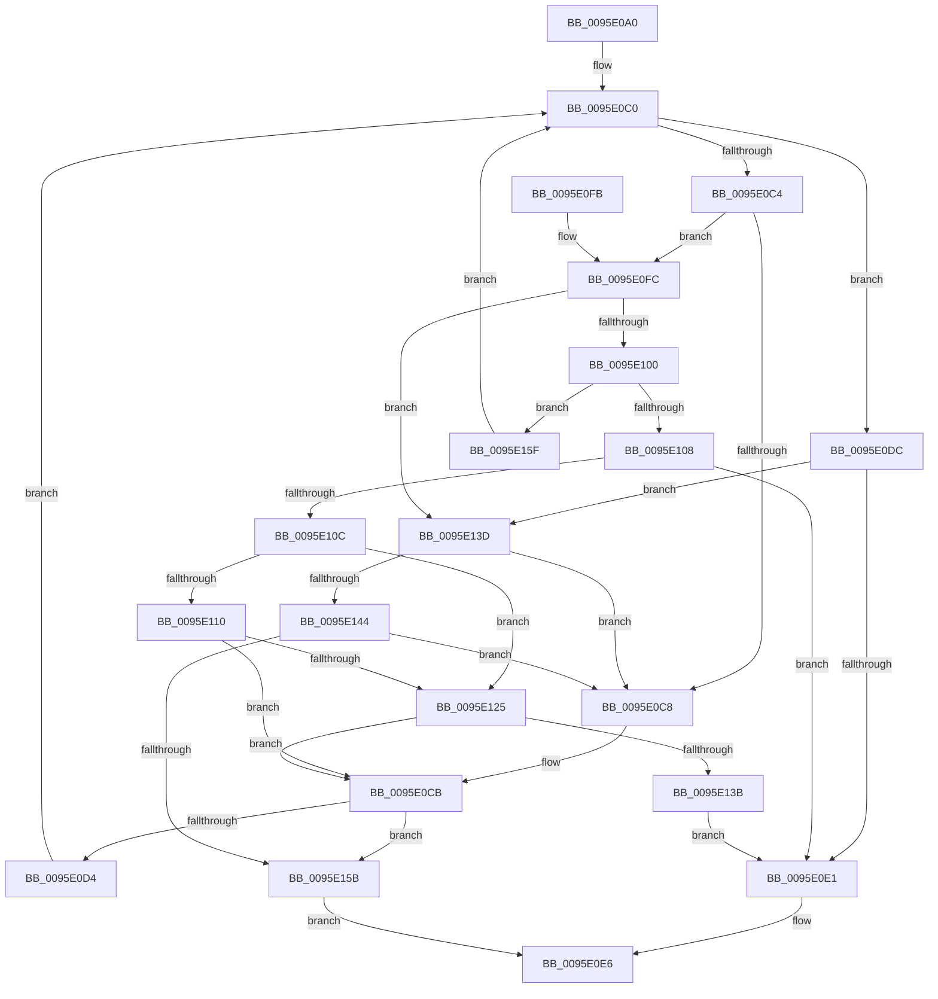

# AslStringPatternMatchExA

- RVA: `0x0095E0A0`–`0x0095E167` (길이 `199` bytes)
- VA: `0x000000014095E0A0`
- 실행 섹션: `PAGE`
- PDB 이름 있음: `예`; PDB Function 태그: `아니요`
- unwind 정보 RVA: `0x00092E9C`
- 디코드: `66`개 명령, `199/199` bytes 표시
- 미해석 바이트: `0` (있으면 어셈블리에 `.byte`로 보존)

> 이 문서는 커널 이미지의 기계어와 PDB 기호를 분석해 생성했습니다. 4번과 5번은 함수 원형과 자료형을 바이너리 사용 방식에서 추정한 C 해석이며 원본 소스 복구 결과는 아닙니다.

## 1. Dependencies

- 직접 호출 지점: **5**; 고유 호출 대상: **2**
- 직접 호출자로 확인된 함수: **3**
- RIP 상대 이미지 참조: **0**

### Outgoing calls
- `0x0095E112` → [toupper](../../text/50/toupper_function_00501870.md) (function, `0x00501870`)
- `0x0095E11C` → [toupper](../../text/50/toupper_function_00501870.md) (function, `0x00501870`)
- `0x0095E132` → [AslStringPatternMatchExA](AslStringPatternMatchExA_function_0095E0A0.md) (function, `0x0095E0A0`)
- `0x0095E144` → [toupper](../../text/50/toupper_function_00501870.md) (function, `0x00501870`)
- `0x0095E14E` → [toupper](../../text/50/toupper_function_00501870.md) (function, `0x00501870`)

### Direct callers
- [SdbpFindNextIndexedWildCardTag](SdbpFindNextIndexedWildCardTag_function_0095A078.md) at `0x0095A140`
- [SdbpFindFirstIndexedWildCardTag](SdbpFindFirstIndexedWildCardTag_function_0095DE58.md) at `0x0095DF85`
- [AslStringPatternMatchExA](AslStringPatternMatchExA_function_0095E0A0.md) at `0x0095E132`

### Static image references
- 디코드된 RIP-relative 메모리 참조가 없습니다.

## 2. Other-region calls and transfers

- 다른 실행 섹션으로 향하는 call: **4**
  - `0x0095E112` → [toupper](../../text/50/toupper_function_00501870.md) (`PAGE` → `.text`)
  - `0x0095E11C` → [toupper](../../text/50/toupper_function_00501870.md) (`PAGE` → `.text`)
  - `0x0095E144` → [toupper](../../text/50/toupper_function_00501870.md) (`PAGE` → `.text`)
  - `0x0095E14E` → [toupper](../../text/50/toupper_function_00501870.md) (`PAGE` → `.text`)
- 별도 외부 분기/꼬리 이동을 확인하지 못했습니다.

## 3. Assembly (complete function range)

```asm
0095E0A0  48 89 74 24 18                  mov qword ptr [rsp + 0x18], rsi
0095E0A5  57                              push rdi
0095E0A6  48 83 EC 20                     sub rsp, 0x20
0095E0AA  0F B6 01                        movzx eax, byte ptr [rcx]
0095E0AD  48 8B F2                        mov rsi, rdx
0095E0B0  48 89 5C 24 30                  mov qword ptr [rsp + 0x30], rbx
0095E0B5  48 8B F9                        mov rdi, rcx
0095E0B8  4C 89 74 24 38                  mov qword ptr [rsp + 0x38], r14
0095E0BD  0F 1F 00                        nop dword ptr [rax]
0095E0C0  84 C0                           test al, al
0095E0C2  74 18                           je 0x14095e0dc
0095E0C4  3C 3F                           cmp al, 0x3f
0095E0C6  75 34                           jne 0x14095e0fc
0095E0C8  48 FF C7                        inc rdi
0095E0CB  80 3E 00                        cmp byte ptr [rsi], 0
0095E0CE  0F 84 87 00 00 00               je 0x14095e15b
0095E0D4  0F B6 07                        movzx eax, byte ptr [rdi]
0095E0D7  48 FF C6                        inc rsi
0095E0DA  EB E4                           jmp 0x14095e0c0
0095E0DC  80 3E 00                        cmp byte ptr [rsi], 0
0095E0DF  75 5C                           jne 0x14095e13d
0095E0E1  B8 01 00 00 00                  mov eax, 1
0095E0E6  4C 8B 74 24 38                  mov r14, qword ptr [rsp + 0x38]
0095E0EB  48 8B 5C 24 30                  mov rbx, qword ptr [rsp + 0x30]
0095E0F0  48 8B 74 24 40                  mov rsi, qword ptr [rsp + 0x40]
0095E0F5  48 83 C4 20                     add rsp, 0x20
0095E0F9  5F                              pop rdi
0095E0FA  C3                              ret
0095E0FB  CC                              int3
0095E0FC  3C 2A                           cmp al, 0x2a
0095E0FE  75 3D                           jne 0x14095e13d
0095E100  0F BE 47 01                     movsx eax, byte ptr [rdi + 1]
0095E104  3C 2A                           cmp al, 0x2a
0095E106  74 57                           je 0x14095e15f
0095E108  84 C0                           test al, al
0095E10A  74 D5                           je 0x14095e0e1
0095E10C  3A 06                           cmp al, byte ptr [rsi]
0095E10E  74 15                           je 0x14095e125
0095E110  8B C8                           mov ecx, eax
0095E112  E8 59 37 BA FF                  call 0x140501870
0095E117  0F BE 0E                        movsx ecx, byte ptr [rsi]
0095E11A  8B D8                           mov ebx, eax
0095E11C  E8 4F 37 BA FF                  call 0x140501870
0095E121  3B D8                           cmp ebx, eax
0095E123  75 A6                           jne 0x14095e0cb
0095E125  45 33 C9                        xor r9d, r9d
0095E128  48 8D 4F 01                     lea rcx, [rdi + 1]
0095E12C  45 33 C0                        xor r8d, r8d
0095E12F  48 8B D6                        mov rdx, rsi
0095E132  E8 69 FF FF FF                  call 0x14095e0a0
0095E137  85 C0                           test eax, eax
0095E139  74 90                           je 0x14095e0cb
0095E13B  EB A4                           jmp 0x14095e0e1
0095E13D  0F BE 0E                        movsx ecx, byte ptr [rsi]
0095E140  3A C1                           cmp al, cl
0095E142  74 84                           je 0x14095e0c8
0095E144  E8 27 37 BA FF                  call 0x140501870
0095E149  0F BE 0F                        movsx ecx, byte ptr [rdi]
0095E14C  8B D8                           mov ebx, eax
0095E14E  E8 1D 37 BA FF                  call 0x140501870
0095E153  3B C3                           cmp eax, ebx
0095E155  0F 84 6D FF FF FF               je 0x14095e0c8
0095E15B  33 C0                           xor eax, eax
0095E15D  EB 87                           jmp 0x14095e0e6
0095E15F  48 FF C7                        inc rdi
0095E162  E9 59 FF FF FF                  jmp 0x14095e0c0
```

## 4. C-style interpretation (structured pseudocode)

```c
__int64 __fastcall AslStringPatternMatchExA(__int64 a1, __int64 a2, int a3, int a4)
{
    __int64 result;
    __int64 v_rdi;
    __int64 v_rsi;
    __int64 v_rsp;
    unsigned __int64 v_stack_p10;
    unsigned __int64 v_stack_p18;
    unsigned __int64 v_stack_p8;

    v_stack_p18 = v_rsi;
    v_rsp = (v_rsp) - (32);
    v_stack_p8 = v_rbx;
    v_stack_p10 = v_r14;
loc_0095E0C0:
    if ((unsigned __int8)(*(unsigned __int8 *)(a1)) == 0) goto loc_0095E0DC;
    if (((unsigned __int8)(*(unsigned __int8 *)(a1))) != 63) goto loc_0095E0FC;
loc_0095E0C8:
    v_rdi = (a1) + 1;
loc_0095E0CB:
    if ((*(unsigned __int8 *)(a2)) == 0) goto loc_0095E15B;
    v_rsi = (a2) + 1;
    goto loc_0095E0C0;
loc_0095E0DC:
    if ((*(unsigned __int8 *)(v_rsi)) != 0) goto loc_0095E13D;
loc_0095E0E1:
loc_0095E0E6:
    v_rsp = (v_rsp) + (32);
    return 1;
loc_0095E0FC:
    if (1 != 42) goto loc_0095E13D;
    if (((unsigned __int8)((__int8)(*(unsigned __int8 *)(v_rdi + 1)))) == 42) goto loc_0095E15F;
    if ((unsigned __int8)((__int8)(*(unsigned __int8 *)(v_rdi + 1))) == 0) goto loc_0095E0E1;
    if (((unsigned __int8)((__int8)(*(unsigned __int8 *)(v_rdi + 1)))) == (*(unsigned __int8 *)(v_stack_p18))) goto loc_0095E125;
    result = toupper((unsigned int)((unsigned int)((__int8)(*(unsigned __int8 *)(v_rdi + 1)))), a2, a3, a4);
    result = toupper((__int8)(*(unsigned __int8 *)(v_stack_p18)), a2, a3, a4);
    if (((unsigned int)((unsigned int)((unsigned int)(result)))) != ((unsigned int)(result))) goto loc_0095E0CB;
loc_0095E125:
    a4 = 0;
    a3 = 0;
    result = AslStringPatternMatchExA(v_rdi + 1, v_stack_p18, a3, a4);
    if ((unsigned int)(result) == 0) goto loc_0095E0CB;
    goto loc_0095E0E1;
loc_0095E13D:
    if (((unsigned __int8)(result)) == ((unsigned __int8)((__int8)(*(unsigned __int8 *)(v_stack_p18))))) goto loc_0095E0C8;
    result = toupper((__int8)(*(unsigned __int8 *)(v_stack_p18)), v_stack_p18, a3, a4);
    result = toupper((__int8)(*(unsigned __int8 *)(v_rdi)), v_stack_p18, a3, a4);
    if (((unsigned int)(result)) == ((unsigned int)((unsigned int)((unsigned int)(result))))) goto loc_0095E0C8;
loc_0095E15B:
    result = 0;
    goto loc_0095E0E6;
loc_0095E15F:
    v_rdi = (v_rdi) + 1;
    goto loc_0095E0C0;
}
```

## 5. (Beta) C Style

```c
int64_t AslStringPatternMatchExA(void *Arg1, int64_t Arg2, int32_t Arg3, int32_t Arg4)
{
    uint8_t *arg1 = (uint8_t *)Arg1;

    int64_t result;
    int64_t local_rdi;
    int64_t local_rsi;
    int64_t local_rsp;
    uint64_t v_stack_p10;
    uint64_t v_stack_p18;
    uint64_t v_stack_p8;

    v_stack_p18 = local_rsi;
    local_rsp = (local_rsp) - (32);
    v_stack_p8 = local_rbx;
    v_stack_p10 = local_r14;
loc_0095E0C0:
    if ((uint8_t)(*(uint8_t *)(arg1)) == 0) goto loc_0095E0DC;
    if (((uint8_t)(*(uint8_t *)(arg1))) != 63) goto loc_0095E0FC;
loc_0095E0C8:
    local_rdi = (Arg1) + 1;
loc_0095E0CB:
    if ((*(uint8_t *)(Arg2)) == 0) goto loc_0095E15B;
    local_rsi = (Arg2) + 1;
    goto loc_0095E0C0;
loc_0095E0DC:
    if ((*(uint8_t *)(local_rsi)) != 0) goto loc_0095E13D;
loc_0095E0E1:
loc_0095E0E6:
    local_rsp = (local_rsp) + (32);
    return 1;
loc_0095E0FC:
    if (1 != 42) goto loc_0095E13D;
    if (((uint8_t)((int8_t)(*(uint8_t *)(local_rdi + 0x1)))) == 42) goto loc_0095E15F;
    if ((uint8_t)((int8_t)(*(uint8_t *)(local_rdi + 0x1))) == 0) goto loc_0095E0E1;
    if (((uint8_t)((int8_t)(*(uint8_t *)(local_rdi + 0x1)))) == (*(uint8_t *)(v_stack_p18))) goto loc_0095E125;
    result = toupper((uint32_t)((uint32_t)((int8_t)(*(uint8_t *)(local_rdi + 0x1)))), Arg2, Arg3, Arg4);
    result = toupper((int8_t)(*(uint8_t *)(v_stack_p18)), Arg2, Arg3, Arg4);
    if (((uint32_t)((uint32_t)((uint32_t)(result)))) != ((uint32_t)(result))) goto loc_0095E0CB;
loc_0095E125:
    Arg4 = 0;
    Arg3 = 0;
    result = AslStringPatternMatchExA(local_rdi + 1, v_stack_p18, Arg3, Arg4);
    if ((uint32_t)(result) == 0) goto loc_0095E0CB;
    goto loc_0095E0E1;
loc_0095E13D:
    if (((uint8_t)(result)) == ((uint8_t)((int8_t)(*(uint8_t *)(v_stack_p18))))) goto loc_0095E0C8;
    result = toupper((int8_t)(*(uint8_t *)(v_stack_p18)), v_stack_p18, Arg3, Arg4);
    result = toupper((int8_t)(*(uint8_t *)(local_rdi)), v_stack_p18, Arg3, Arg4);
    if (((uint32_t)(result)) == ((uint32_t)((uint32_t)((uint32_t)(result))))) goto loc_0095E0C8;
loc_0095E15B:
    result = 0;
    goto loc_0095E0E6;
loc_0095E15F:
    local_rdi = (local_rdi) + 1;
    goto loc_0095E0C0;
}
```

### 관측된 메모리 오프셋

구조체 형식이 확인되지 않은 접근은 인자 기준의 오프셋으로만 기록했습니다.

| 기준 인자 | 오프셋 표현 | 폭 (bit) | 접근 |
|---|---:|---:|---|
| `Arg1` | `+ 0x0` | `8` | `R` |

## 6. Execution-region graph

[열기: 2D/3D 그래프와 함수 탐색 컨트롤 패널](../../../control-panel.html?section=page&rva=0x0095E0A0&view=graph)

- 2D 그래프는 위에서 아래로 흐르고, 3D 그래프는 빈 공간을 드래그해 회전합니다. Shift+드래그는 이동, 휠은 확대·축소, 함수 노드 선택은 대상 보고서 이동입니다.

### Static fallback


