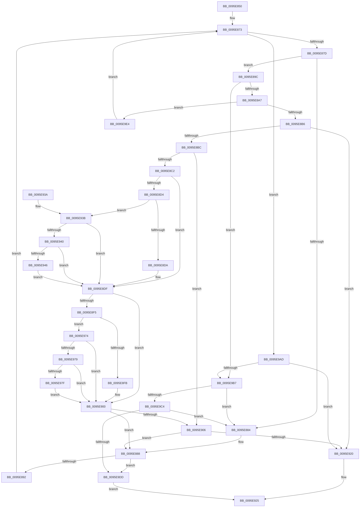

# AslStringPatternMatchExW

- RVA: `0x0095E850`–`0x0095E9ED` (길이 `413` bytes)
- VA: `0x000000014095E850`
- 실행 섹션: `PAGE`
- PDB 이름 있음: `예`; PDB Function 태그: `아니요`
- unwind 정보 RVA: `0x00092F50`
- 디코드: `109`개 명령, `413/413` bytes 표시
- 미해석 바이트: `0` (있으면 어셈블리에 `.byte`로 보존)

> 이 문서는 커널 이미지의 기계어와 PDB 기호를 분석해 생성했습니다. 4번과 5번은 함수 원형과 자료형을 바이너리 사용 방식에서 추정한 C 해석이며 원본 소스 복구 결과는 아닙니다.

## 1. Dependencies

- 직접 호출 지점: **5**; 고유 호출 대상: **3**
- 직접 호출자로 확인된 함수: **10**
- RIP 상대 이미지 참조: **0**

### Outgoing calls
- `0x0095E8C2` → [PsGetCurrentServerSiloGlobals](../../text/2F/PsGetCurrentServerSiloGlobals_function_002FE1F0.md) (function, `0x002FE1F0`)
- `0x0095E8E3` → [PsGetCurrentServerSiloGlobals](../../text/2F/PsGetCurrentServerSiloGlobals_function_002FE1F0.md) (function, `0x002FE1F0`)
- `0x0095E913` → [AslStringPatternMatchExW](AslStringPatternMatchExW_function_0095E850.md) (function, `0x0095E850`)
- `0x0095E9C4` → [RtlUpcaseUnicodeChar](../85/RtlUpcaseUnicodeChar_function_0085F0F0.md) (function, `0x0085F0F0`)
- `0x0095E9CF` → [RtlUpcaseUnicodeChar](../85/RtlUpcaseUnicodeChar_function_0085F0F0.md) (function, `0x0085F0F0`)

### Direct callers
- [KseLookupHardwareId](../74/KseLookupHardwareId_function_0074A62C.md) at `0x0074A6CD`
- [SdbpCheckMatchingRegistryValue](../81/SdbpCheckMatchingRegistryValue_function_0081462C.md) at `0x00814928`
- [SdbpFindNextNamedTagHelper](../81/SdbpFindNextNamedTagHelper_function_00816DF8.md) at `0x00816EB5`
- [SdbpCheckAttribute](../81/SdbpCheckAttribute_function_00818A84.md) at `0x00818C03`
- [AslpProcessMatchRegNode](../81/AslpProcessMatchRegNode_function_0081CB08.md) at `0x0081CBD8`
- [SdbpFindNextIndexedWildCardTag](SdbpFindNextIndexedWildCardTag_function_0095A078.md) at `0x0095A177`
- [AslStringPatternMatchW](AslStringPatternMatchW_function_0095D4A4.md) at `0x0095D4A8`
- [SdbpFindFirstIndexedWildCardTag](SdbpFindFirstIndexedWildCardTag_function_0095DE58.md) at `0x0095DFC0`
- [AslStringPatternMatchExW](AslStringPatternMatchExW_function_0095E850.md) at `0x0095E913`
- [SdbpFindFirstNamedTagHelper](../AD/SdbpFindFirstNamedTagHelper_function_00AD4D2C.md) at `0x00AD4DA1`

### Static image references
- 디코드된 RIP-relative 메모리 참조가 없습니다.

## 2. Other-region calls and transfers

- 다른 실행 섹션으로 향하는 call: **2**
  - `0x0095E8C2` → [PsGetCurrentServerSiloGlobals](../../text/2F/PsGetCurrentServerSiloGlobals_function_002FE1F0.md) (`PAGE` → `.text`)
  - `0x0095E8E3` → [PsGetCurrentServerSiloGlobals](../../text/2F/PsGetCurrentServerSiloGlobals_function_002FE1F0.md) (`PAGE` → `.text`)
- 별도 외부 분기/꼬리 이동을 확인하지 못했습니다.

## 3. Assembly (complete function range)

```asm
0095E850  48 89 6C 24 10                  mov qword ptr [rsp + 0x10], rbp
0095E855  48 89 74 24 18                  mov qword ptr [rsp + 0x18], rsi
0095E85A  57                              push rdi
0095E85B  48 83 EC 20                     sub rsp, 0x20
0095E85F  44 0F B7 01                     movzx r8d, word ptr [rcx]
0095E863  48 8B FA                        mov rdi, rdx
0095E866  48 8B F1                        mov rsi, rcx
0095E869  48 89 5C 24 30                  mov qword ptr [rsp + 0x30], rbx
0095E86E  BD C0 00 00 00                  mov ebp, 0xc0
0095E873  66 45 85 C0                     test r8w, r8w
0095E877  0F 84 30 01 00 00               je 0x14095e9ad
0095E87D  66 41 83 F8 3F                  cmp r8w, 0x3f
0095E882  75 18                           jne 0x14095e89c
0095E884  48 83 C6 02                     add rsi, 2
0095E888  66 83 3F 00                     cmp word ptr [rdi], 0
0095E88C  0F 84 4B 01 00 00               je 0x14095e9dd
0095E892  44 0F B7 06                     movzx r8d, word ptr [rsi]
0095E896  48 83 C7 02                     add rdi, 2
0095E89A  EB D7                           jmp 0x14095e873
0095E89C  66 41 83 F8 2A                  cmp r8w, 0x2a
0095E8A1  0F 85 10 01 00 00               jne 0x14095e9b7
0095E8A7  44 0F B7 46 02                  movzx r8d, word ptr [rsi + 2]
0095E8AC  41 83 F8 2A                     cmp r8d, 0x2a
0095E8B0  0F 84 2E 01 00 00               je 0x14095e9e4
0095E8B6  66 45 85 C0                     test r8w, r8w
0095E8BA  74 64                           je 0x14095e920
0095E8BC  66 44 3B 07                     cmp r8w, word ptr [rdi]
0095E8C0  74 44                           je 0x14095e906
0095E8C2  E8 29 F9 99 FF                  call 0x1402fe1f0
0095E8C7  4C 8B 88 B0 04 00 00            mov r9, qword ptr [rax + 0x4b0]
0095E8CE  41 83 F8 61                     cmp r8d, 0x61
0095E8D2  72 0B                           jb 0x14095e8df
0095E8D4  41 83 F8 7A                     cmp r8d, 0x7a
0095E8D8  77 61                           ja 0x14095e93b
0095E8DA  66 41 83 E8 20                  sub r8w, 0x20
0095E8DF  44 0F B7 0F                     movzx r9d, word ptr [rdi]
0095E8E3  E8 08 F9 99 FF                  call 0x1402fe1f0
0095E8E8  4C 8B 90 B0 04 00 00            mov r10, qword ptr [rax + 0x4b0]
0095E8EF  41 83 F9 61                     cmp r9d, 0x61
0095E8F3  72 0B                           jb 0x14095e900
0095E8F5  41 83 F9 7A                     cmp r9d, 0x7a
0095E8F9  77 79                           ja 0x14095e974
0095E8FB  66 41 83 E9 20                  sub r9w, 0x20
0095E900  66 45 3B C1                     cmp r8w, r9w
0095E904  75 82                           jne 0x14095e888
0095E906  45 33 C9                        xor r9d, r9d
0095E909  48 8D 4E 02                     lea rcx, [rsi + 2]
0095E90D  45 33 C0                        xor r8d, r8d
0095E910  48 8B D7                        mov rdx, rdi
0095E913  E8 38 FF FF FF                  call 0x14095e850
0095E918  85 C0                           test eax, eax
0095E91A  0F 84 68 FF FF FF               je 0x14095e888
0095E920  B8 01 00 00 00                  mov eax, 1
0095E925  48 8B 5C 24 30                  mov rbx, qword ptr [rsp + 0x30]
0095E92A  48 8B 6C 24 38                  mov rbp, qword ptr [rsp + 0x38]
0095E92F  48 8B 74 24 40                  mov rsi, qword ptr [rsp + 0x40]
0095E934  48 83 C4 20                     add rsp, 0x20
0095E938  5F                              pop rdi
0095E939  C3                              ret
0095E93A  CC                              int3
0095E93B  4D 85 C9                        test r9, r9
0095E93E  74 9F                           je 0x14095e8df
0095E940  66 44 3B C5                     cmp r8w, bp
0095E944  72 99                           jb 0x14095e8df
0095E946  49 8B C0                        mov rax, r8
0095E949  41 8B D0                        mov edx, r8d
0095E94C  48 C1 E8 08                     shr rax, 8
0095E950  83 E2 0F                        and edx, 0xf
0095E953  41 0F B7 0C 41                  movzx ecx, word ptr [r9 + rax*2]
0095E958  41 8B C0                        mov eax, r8d
0095E95B  C1 E8 04                        shr eax, 4
0095E95E  83 E0 0F                        and eax, 0xf
0095E961  03 C8                           add ecx, eax
0095E963  41 0F B7 0C 49                  movzx ecx, word ptr [r9 + rcx*2]
0095E968  03 CA                           add ecx, edx
0095E96A  66 45 03 04 49                  add r8w, word ptr [r9 + rcx*2]
0095E96F  E9 6B FF FF FF                  jmp 0x14095e8df
0095E974  4D 85 D2                        test r10, r10
0095E977  74 87                           je 0x14095e900
0095E979  66 44 3B CD                     cmp r9w, bp
0095E97D  72 81                           jb 0x14095e900
0095E97F  49 8B C1                        mov rax, r9
0095E982  41 8B D1                        mov edx, r9d
0095E985  48 C1 E8 08                     shr rax, 8
0095E989  83 E2 0F                        and edx, 0xf
0095E98C  41 0F B7 0C 42                  movzx ecx, word ptr [r10 + rax*2]
0095E991  41 8B C1                        mov eax, r9d
0095E994  C1 E8 04                        shr eax, 4
0095E997  83 E0 0F                        and eax, 0xf
0095E99A  03 C8                           add ecx, eax
0095E99C  41 0F B7 0C 4A                  movzx ecx, word ptr [r10 + rcx*2]
0095E9A1  03 CA                           add ecx, edx
0095E9A3  66 45 03 0C 4A                  add r9w, word ptr [r10 + rcx*2]
0095E9A8  E9 53 FF FF FF                  jmp 0x14095e900
0095E9AD  66 83 3F 00                     cmp word ptr [rdi], 0
0095E9B1  0F 84 69 FF FF FF               je 0x14095e920
0095E9B7  0F B7 0F                        movzx ecx, word ptr [rdi]
0095E9BA  66 44 3B C1                     cmp r8w, cx
0095E9BE  0F 84 C0 FE FF FF               je 0x14095e884
0095E9C4  E8 27 07 F0 FF                  call 0x14085f0f0
0095E9C9  0F B7 0E                        movzx ecx, word ptr [rsi]
0095E9CC  0F B7 D8                        movzx ebx, ax
0095E9CF  E8 1C 07 F0 FF                  call 0x14085f0f0
0095E9D4  66 3B C3                        cmp ax, bx
0095E9D7  0F 84 A7 FE FF FF               je 0x14095e884
0095E9DD  33 C0                           xor eax, eax
0095E9DF  E9 41 FF FF FF                  jmp 0x14095e925
0095E9E4  48 83 C6 02                     add rsi, 2
0095E9E8  E9 86 FE FF FF                  jmp 0x14095e873
```

## 4. C-style interpretation (structured pseudocode)

```c
__int64 __fastcall AslStringPatternMatchExW(__int64 a1, __int64 a2)
{
    __int64 result;
    __int64 v_rdi;
    __int64 v_rsi;
    __int64 v_rsp;
    unsigned __int64 v_stack_p10;
    unsigned __int64 v_stack_p18;
    unsigned __int64 v_stack_p8;

    v_stack_p10 = v_rbp;
    v_stack_p18 = v_rsi;
    v_rsp = (v_rsp) - (32);
    v_stack_p8 = v_rbx;
loc_0095E873:
    if ((unsigned __int16)(*(unsigned __int16 *)(a1)) == 0) goto loc_0095E9AD;
    if (((unsigned __int16)(*(unsigned __int16 *)(a1))) != 63) goto loc_0095E89C;
loc_0095E884:
    v_rsi = (a1) + (2);
loc_0095E888:
    if ((*(unsigned __int16 *)(a2)) == 0) goto loc_0095E9DD;
    v_rdi = (a2) + (2);
    goto loc_0095E873;
loc_0095E89C:
    if (((unsigned __int16)(*(unsigned __int16 *)(v_rsi))) != 42) goto loc_0095E9B7;
    if (((unsigned int)(*(unsigned __int16 *)(v_rsi + 2))) == 42) goto loc_0095E9E4;
    if ((unsigned __int16)(*(unsigned __int16 *)(v_rsi + 2)) == 0) goto loc_0095E920;
    if (((unsigned __int16)(*(unsigned __int16 *)(v_rsi + 2))) == (*(unsigned __int16 *)(v_rdi))) goto loc_0095E906;
    result = PsGetCurrentServerSiloGlobals(a1, a2, *(unsigned __int16 *)(v_rsi + 2), a4);
    if (((unsigned int)(*(unsigned __int16 *)(v_rsi + 2))) < 97) goto loc_0095E8DF;
    if (((unsigned int)(*(unsigned __int16 *)(v_rsi + 2))) > 122) goto loc_0095E93B;
    a3 = (unsigned __int16)((*(unsigned __int16 *)(v_rsi + 2)) - (32));
loc_0095E8DF:
    result = PsGetCurrentServerSiloGlobals(a1, a2, a3, *(unsigned __int16 *)(v_rdi));
    if (((unsigned int)(*(unsigned __int16 *)(v_rdi))) < 97) goto loc_0095E900;
    if (((unsigned int)(*(unsigned __int16 *)(v_rdi))) > 122) goto loc_0095E974;
    a4 = (unsigned __int16)((*(unsigned __int16 *)(v_rdi)) - (32));
loc_0095E900:
    if (((unsigned __int16)(a3)) != ((unsigned __int16)(a4))) goto loc_0095E888;
loc_0095E906:
    a4 = 0;
    a3 = 0;
    result = AslStringPatternMatchExW(v_rsi + 2, v_rdi, a3, a4);
    if ((unsigned int)(result) == 0) goto loc_0095E888;
loc_0095E920:
loc_0095E925:
    v_rsp = (v_rsp) + (32);
    return 1;
loc_0095E93B:
    if (0 == 0) goto loc_0095E8DF;
    if (0 < ((unsigned __int16)(v_stack_p10))) goto loc_0095E8DF;
    result = (0) >> (8);
    a2 = (unsigned int)((0) & (15));
    result = (unsigned int)((0) >> (4));
    result = (unsigned int)((result) & (15));
    a1 = (unsigned int)((*(unsigned __int16 *)(a4 + result * 2)) + ((unsigned int)(result)));
    a1 = (unsigned int)((*(unsigned __int16 *)(a4 + a1 * 2)) + ((unsigned int)(a2)));
    a3 = (unsigned __int16)((a3) + (*(unsigned __int16 *)(a4 + a1 * 2)));
    goto loc_0095E8DF;
loc_0095E974:
    if (*(unsigned __int64 *)(result + 1200) == 0) goto loc_0095E900;
    if (0 < ((unsigned __int16)(v_stack_p10))) goto loc_0095E900;
    result = (0) >> (8);
    a2 = (unsigned int)((0) & (15));
    result = (unsigned int)((0) >> (4));
    result = (unsigned int)((result) & (15));
    a1 = (unsigned int)((*(unsigned __int16 *)(*(unsigned __int64 *)(result + 1200) + result * 2)) + ((unsigned int)(result)));
    a1 = (unsigned int)((*(unsigned __int16 *)(*(unsigned __int64 *)(result + 1200) + a1 * 2)) + ((unsigned int)(a2)));
    a4 = (unsigned __int16)((a4) + (*(unsigned __int16 *)(*(unsigned __int64 *)(result + 1200) + a1 * 2)));
    goto loc_0095E900;
loc_0095E9AD:
    if ((*(unsigned __int16 *)(v_rdi)) == 0) goto loc_0095E920;
loc_0095E9B7:
    if (((unsigned __int16)(a3)) == ((unsigned __int16)(*(unsigned __int16 *)(v_rdi)))) goto loc_0095E884;
    result = RtlUpcaseUnicodeChar(*(unsigned __int16 *)(v_rdi), a2, a3, a4);
    result = RtlUpcaseUnicodeChar(*(unsigned __int16 *)(v_stack_p18), a2, a3, a4);
    if (((unsigned __int16)(result)) == ((unsigned __int16)((unsigned __int16)(result)))) goto loc_0095E884;
loc_0095E9DD:
    result = 0;
    goto loc_0095E925;
loc_0095E9E4:
    v_rsi = (v_stack_p18) + (2);
    goto loc_0095E873;
}
```

## 5. (Beta) C Style

```c
int64_t AslStringPatternMatchExW(void *Arg1, void *Arg2)
{
    uint8_t *arg1 = (uint8_t *)Arg1;
    uint8_t *arg2 = (uint8_t *)Arg2;

    int64_t result;
    int64_t local_rdi;
    int64_t local_rsi;
    int64_t local_rsp;
    uint64_t v_stack_p10;
    uint64_t v_stack_p18;
    uint64_t v_stack_p8;

    v_stack_p10 = local_rbp;
    v_stack_p18 = local_rsi;
    local_rsp = (local_rsp) - (32);
    v_stack_p8 = local_rbx;
loc_0095E873:
    if ((uint16_t)(*(uint16_t *)(arg1)) == 0) goto loc_0095E9AD;
    if (((uint16_t)(*(uint16_t *)(arg1))) != 63) goto loc_0095E89C;
loc_0095E884:
    local_rsi = (Arg1) + (2);
loc_0095E888:
    if ((*(uint16_t *)(arg2)) == 0) goto loc_0095E9DD;
    local_rdi = (Arg2) + (2);
    goto loc_0095E873;
loc_0095E89C:
    if (((uint16_t)(*(uint16_t *)(local_rsi))) != 42) goto loc_0095E9B7;
    if (((uint32_t)(*(uint16_t *)(local_rsi + 0x2))) == 42) goto loc_0095E9E4;
    if ((uint16_t)(*(uint16_t *)(local_rsi + 0x2)) == 0) goto loc_0095E920;
    if (((uint16_t)(*(uint16_t *)(local_rsi + 0x2))) == (*(uint16_t *)(local_rdi))) goto loc_0095E906;
    result = PsGetCurrentServerSiloGlobals(Arg1, Arg2, *(uint16_t *)(local_rsi + 0x2), a4);
    if (((uint32_t)(*(uint16_t *)(local_rsi + 0x2))) < 97) goto loc_0095E8DF;
    if (((uint32_t)(*(uint16_t *)(local_rsi + 0x2))) > 122) goto loc_0095E93B;
    a3 = (uint16_t)((*(uint16_t *)(local_rsi + 0x2)) - (32));
loc_0095E8DF:
    result = PsGetCurrentServerSiloGlobals(Arg1, Arg2, a3, *(uint16_t *)(local_rdi));
    if (((uint32_t)(*(uint16_t *)(local_rdi))) < 97) goto loc_0095E900;
    if (((uint32_t)(*(uint16_t *)(local_rdi))) > 122) goto loc_0095E974;
    a4 = (uint16_t)((*(uint16_t *)(local_rdi)) - (32));
loc_0095E900:
    if (((uint16_t)(a3)) != ((uint16_t)(a4))) goto loc_0095E888;
loc_0095E906:
    a4 = 0;
    a3 = 0;
    result = AslStringPatternMatchExW(local_rsi + 2, local_rdi, a3, a4);
    if ((uint32_t)(result) == 0) goto loc_0095E888;
loc_0095E920:
loc_0095E925:
    local_rsp = (local_rsp) + (32);
    return 1;
loc_0095E93B:
    if (0 == 0) goto loc_0095E8DF;
    if (0 < ((uint16_t)(v_stack_p10))) goto loc_0095E8DF;
    result = (0) >> (8);
    Arg2 = (uint32_t)((0) & (15));
    result = (uint32_t)((0) >> (4));
    result = (uint32_t)((result) & (15));
    Arg1 = (uint32_t)((*(uint16_t *)(a4 + result * 2)) + ((uint32_t)(result)));
    Arg1 = (uint32_t)((*(uint16_t *)(a4 + arg1 * 2)) + ((uint32_t)(Arg2)));
    a3 = (uint16_t)((a3) + (*(uint16_t *)(a4 + arg1 * 2)));
    goto loc_0095E8DF;
loc_0095E974:
    if (*(uint64_t *)(result + 0x4B0) == 0) goto loc_0095E900;
    if (0 < ((uint16_t)(v_stack_p10))) goto loc_0095E900;
    result = (0) >> (8);
    Arg2 = (uint32_t)((0) & (15));
    result = (uint32_t)((0) >> (4));
    result = (uint32_t)((result) & (15));
    Arg1 = (uint32_t)((*(uint16_t *)(*(uint64_t *)(result + 0x4B0) + result * 2)) + ((uint32_t)(result)));
    Arg1 = (uint32_t)((*(uint16_t *)(*(uint64_t *)(result + 0x4B0) + arg1 * 2)) + ((uint32_t)(Arg2)));
    a4 = (uint16_t)((a4) + (*(uint16_t *)(*(uint64_t *)(result + 0x4B0) + arg1 * 2)));
    goto loc_0095E900;
loc_0095E9AD:
    if ((*(uint16_t *)(local_rdi)) == 0) goto loc_0095E920;
loc_0095E9B7:
    if (((uint16_t)(a3)) == ((uint16_t)(*(uint16_t *)(local_rdi)))) goto loc_0095E884;
    result = RtlUpcaseUnicodeChar(*(uint16_t *)(local_rdi), Arg2, a3, a4);
    result = RtlUpcaseUnicodeChar(*(uint16_t *)(v_stack_p18), Arg2, a3, a4);
    if (((uint16_t)(result)) == ((uint16_t)((uint16_t)(result)))) goto loc_0095E884;
loc_0095E9DD:
    result = 0;
    goto loc_0095E925;
loc_0095E9E4:
    local_rsi = (v_stack_p18) + (2);
    goto loc_0095E873;
}
```

### 관측된 메모리 오프셋

구조체 형식이 확인되지 않은 접근은 인자 기준의 오프셋으로만 기록했습니다.

| 기준 인자 | 오프셋 표현 | 폭 (bit) | 접근 |
|---|---:|---:|---|
| `Arg1` | `+ 0x0` | `16` | `R` |
| `Arg1` | `+ 0x2` | `16` | `R` |
| `Arg1` | `+ 0x2` | `64` | `R` |
| `Arg2` | `+ 0x0` | `16` | `R` |

## 6. Execution-region graph

[열기: 2D/3D 그래프와 함수 탐색 컨트롤 패널](../../../control-panel.html?section=page&rva=0x0095E850&view=graph)

- 2D 그래프는 위에서 아래로 흐르고, 3D 그래프는 빈 공간을 드래그해 회전합니다. Shift+드래그는 이동, 휠은 확대·축소, 함수 노드 선택은 대상 보고서 이동입니다.

### Static fallback


