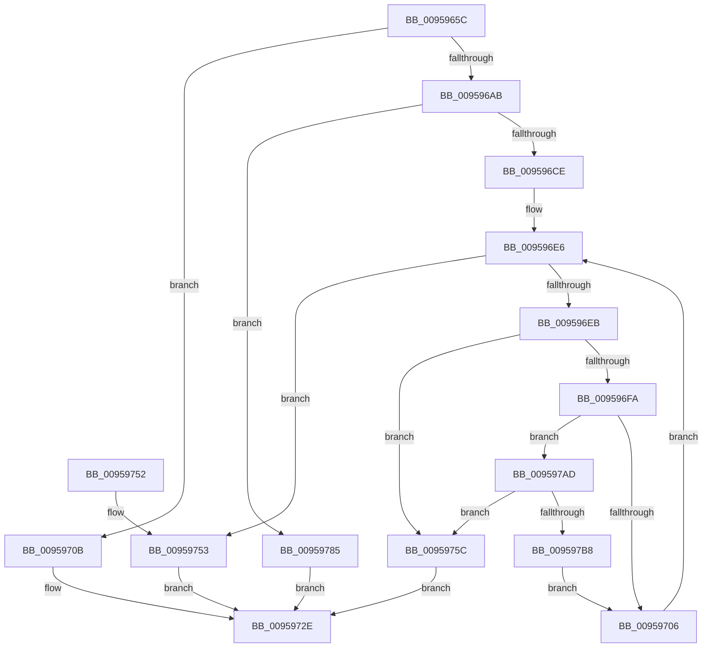

# AslStringUpcaseToMultiByteN

- RVA: `0x0095965C`–`0x009597BD` (길이 `353` bytes)
- VA: `0x000000014095965C`
- 실행 섹션: `PAGE`
- PDB 이름 있음: `예`; PDB Function 태그: `아니요`
- unwind 정보 RVA: `0x00092820`
- 디코드: `91`개 명령, `353/353` bytes 표시
- 미해석 바이트: `0` (있으면 어셈블리에 `.byte`로 보존)

> 이 문서는 커널 이미지의 기계어와 PDB 기호를 분석해 생성했습니다. 4번과 5번은 함수 원형과 자료형을 바이너리 사용 방식에서 추정한 C 해석이며 원본 소스 복구 결과는 아닙니다.

## 1. Dependencies

- 직접 호출 지점: **7**; 고유 호출 대상: **5**
- 직접 호출자로 확인된 함수: **2**
- RIP 상대 이미지 참조: **4**

### Outgoing calls
- `0x0095968F` → [RtlInitUnicodeString](../../text/42/RtlInitUnicodeString_function_0042A780.md) (function, `0x0042A780`)
- `0x0095969A` → [AslAlloc](AslAlloc_function_0095BD34.md) (function, `0x0095BD34`)
- `0x009596BF` → [RtlUpcaseUnicodeString](../96/RtlUpcaseUnicodeString_function_00960780.md) (function, `0x00960780`)
- `0x00959729` → [AslLogCallPrintf](AslLogCallPrintf_function_0095E4EC.md) (function, `0x0095E4EC`)
- `0x00959731` → [AslFree](AslFree_function_0095B674.md) (function, `0x0095B674`)
- `0x0095977E` → [AslLogCallPrintf](AslLogCallPrintf_function_0095E4EC.md) (function, `0x0095E4EC`)
- `0x009597A2` → [AslLogCallPrintf](AslLogCallPrintf_function_0095E4EC.md) (function, `0x0095E4EC`)

### Direct callers
- [SdbpFindNextIndexedWildCardTag](SdbpFindNextIndexedWildCardTag_function_0095A078.md) at `0x0095A0D0`
- [SdbpFindFirstIndexedWildCardTag](SdbpFindFirstIndexedWildCardTag_function_0095DE58.md) at `0x0095DF2A`

### Static image references
- `0x0095970B` → RVA `0x000129E0` (`.rdata`; read)
- `0x00959718` → RVA `0x00012B00` (`.rdata`; read)
- `0x00959761` → RVA `0x00012AE0` (`.rdata`; read)
- `0x00959785` → RVA `0x0003E6A0` (`.rdata`; read)

## 2. Other-region calls and transfers

- 다른 실행 섹션으로 향하는 call: **1**
  - `0x0095968F` → [RtlInitUnicodeString](../../text/42/RtlInitUnicodeString_function_0042A780.md) (`PAGE` → `.text`)
- 별도 외부 분기/꼬리 이동을 확인하지 못했습니다.

## 3. Assembly (complete function range)

```asm
0095965C  48 8B C4                        mov rax, rsp
0095965F  48 89 58 08                     mov qword ptr [rax + 8], rbx
00959663  48 89 70 10                     mov qword ptr [rax + 0x10], rsi
00959667  48 89 78 18                     mov qword ptr [rax + 0x18], rdi
0095966B  4C 89 70 20                     mov qword ptr [rax + 0x20], r14
0095966F  55                              push rbp
00959670  48 8B EC                        mov rbp, rsp
00959673  48 83 EC 50                     sub rsp, 0x50
00959677  48 8B F1                        mov rsi, rcx
0095967A  0F 57 C0                        xorps xmm0, xmm0
0095967D  45 33 F6                        xor r14d, r14d
00959680  48 8D 4D F0                     lea rcx, [rbp - 0x10]
00959684  49 8B D0                        mov rdx, r8
00959687  4C 89 75 E0                     mov qword ptr [rbp - 0x20], r14
0095968B  0F 11 45 F0                     movups xmmword ptr [rbp - 0x10], xmm0
0095968F  E8 EC 10 AD FF                  call 0x14042a780
00959694  0F B7 5D F2                     movzx ebx, word ptr [rbp - 0xe]
00959698  8B D3                           mov edx, ebx
0095969A  E8 95 26 00 00                  call 0x14095bd34
0095969F  48 89 45 E8                     mov qword ptr [rbp - 0x18], rax
009596A3  48 8B F8                        mov rdi, rax
009596A6  48 85 C0                        test rax, rax
009596A9  74 60                           je 0x14095970b
009596AB  45 33 C0                        xor r8d, r8d
009596AE  66 89 5D E2                     mov word ptr [rbp - 0x1e], bx
009596B2  48 8D 55 F0                     lea rdx, [rbp - 0x10]
009596B6  66 44 89 75 E0                  mov word ptr [rbp - 0x20], r14w
009596BB  48 8D 4D E0                     lea rcx, [rbp - 0x20]
009596BF  E8 BC 70 00 00                  call 0x140960780
009596C4  8B D8                           mov ebx, eax
009596C6  85 C0                           test eax, eax
009596C8  0F 88 B7 00 00 00               js 0x140959785
009596CE  44 0F B7 45 E0                  movzx r8d, word ptr [rbp - 0x20]
009596D3  41 8B C6                        mov eax, r14d
009596D6  48 8B 7D E8                     mov rdi, qword ptr [rbp - 0x18]
009596DA  41 8B D6                        mov edx, r14d
009596DD  49 D1 E8                        shr r8, 1
009596E0  41 B9 04 01 00 00               mov r9d, 0x104
009596E6  49 3B D0                        cmp rdx, r8
009596E9  73 68                           jae 0x140959753
009596EB  0F B7 0C 57                     movzx ecx, word ptr [rdi + rdx*2]
009596EF  88 0C 06                        mov byte ptr [rsi + rax], cl
009596F2  48 FF C0                        inc rax
009596F5  49 3B C1                        cmp rax, r9
009596F8  73 62                           jae 0x14095975c
009596FA  66 C1 E9 08                     shr cx, 8
009596FE  84 C9                           test cl, cl
00959700  0F 85 A7 00 00 00               jne 0x1409597ad
00959706  48 FF C2                        inc rdx
00959709  EB DB                           jmp 0x1409596e6
0095970B  4C 8D 0D CE 92 6B FF            lea r9, [rip - 0x946d32]
00959712  41 B8 1F 04 00 00               mov r8d, 0x41f
00959718  48 8D 15 E1 93 6B FF            lea rdx, [rip - 0x946c1f]
0095971F  B9 01 00 00 00                  mov ecx, 1
00959724  BB 17 00 00 C0                  mov ebx, 0xc0000017
00959729  E8 BE 4D 00 00                  call 0x14095e4ec
0095972E  48 8B D7                        mov rdx, rdi
00959731  E8 3E 1F 00 00                  call 0x14095b674
00959736  48 8B 74 24 68                  mov rsi, qword ptr [rsp + 0x68]
0095973B  8B C3                           mov eax, ebx
0095973D  48 8B 5C 24 60                  mov rbx, qword ptr [rsp + 0x60]
00959742  48 8B 7C 24 70                  mov rdi, qword ptr [rsp + 0x70]
00959747  4C 8B 74 24 78                  mov r14, qword ptr [rsp + 0x78]
0095974C  48 83 C4 50                     add rsp, 0x50
00959750  5D                              pop rbp
00959751  C3                              ret
00959752  CC                              int3
00959753  44 88 34 06                     mov byte ptr [rsi + rax], r14b
00959757  41 8B DE                        mov ebx, r14d
0095975A  EB D2                           jmp 0x14095972e
0095975C  BB 23 00 00 C0                  mov ebx, 0xc0000023
00959761  4C 8D 0D 78 93 6B FF            lea r9, [rip - 0x946c88]
00959768  41 B8 4E 04 00 00               mov r8d, 0x44e
0095976E  89 5C 24 20                     mov dword ptr [rsp + 0x20], ebx
00959772  48 8D 15 87 93 6B FF            lea rdx, [rip - 0x946c79]
00959779  B9 01 00 00 00                  mov ecx, 1
0095977E  E8 69 4D 00 00                  call 0x14095e4ec
00959783  EB A9                           jmp 0x14095972e
00959785  4C 8D 0D 14 4F 6E FF            lea r9, [rip - 0x91b0ec]
0095978C  89 44 24 20                     mov dword ptr [rsp + 0x20], eax
00959790  41 B8 28 04 00 00               mov r8d, 0x428
00959796  48 8D 15 63 93 6B FF            lea rdx, [rip - 0x946c9d]
0095979D  B9 01 00 00 00                  mov ecx, 1
009597A2  E8 45 4D 00 00                  call 0x14095e4ec
009597A7  48 8B 7D E8                     mov rdi, qword ptr [rbp - 0x18]
009597AB  EB 81                           jmp 0x14095972e
009597AD  88 0C 30                        mov byte ptr [rax + rsi], cl
009597B0  48 FF C0                        inc rax
009597B3  49 3B C1                        cmp rax, r9
009597B6  73 A4                           jae 0x14095975c
009597B8  E9 49 FF FF FF                  jmp 0x140959706
```

## 4. C-style interpretation (structured pseudocode)

```c
__int64 __fastcall AslStringUpcaseToMultiByteN(__int64 a1, __int64 a2, __int64 a3)
{
    __int64 result;
    __int64 v_r14;
    __int64 v_rsp;
    unsigned __int16 v_stack_m16;
    unsigned __int64 v_stack_m18;
    unsigned __int64 v_stack_m20;
    unsigned __int16 v_stack_m26;
    unsigned __int64 v_stack_m28;
    unsigned __int64 v_stack_p10;
    unsigned __int64 v_stack_p18;
    unsigned __int64 v_stack_p20;
    unsigned __int64 v_stack_p8;

    *(unsigned __int64 *)(v_rsp + 8) = v_rbx;
    *(unsigned __int64 *)(v_rsp + 16) = v_rsi;
    *(unsigned __int64 *)(v_rsp + 24) = v_rdi;
    *(unsigned __int64 *)(v_rsp + 32) = v_r14;
    v_rsp = (v_rsp) - (80);
    v_r14 = 0;
    v_stack_m28 = 0;
    v_stack_m18 = v_xmm0;
    result = RtlInitUnicodeString(v_stack_m18, a3, a3, a4);
    result = AslAlloc(v_stack_m18, (unsigned int)((unsigned int)(v_stack_m16)), a3, a4);
    v_stack_m20 = result;
    if (result == 0) goto loc_0095970B;
    a3 = 0;
    v_stack_m26 = (unsigned __int16)(v_stack_m16);
    v_stack_m28 = 0;
    result = RtlUpcaseUnicodeString(v_stack_m28, v_stack_m18, a3, a4);
    if (sign_flag) goto loc_00959785;
    a3 = (v_stack_m28) >> (1);
loc_009596E6:
    if (0 >= a3) goto loc_00959753;
    *(unsigned __int8 *)(a1 + 0 * 1) = (unsigned __int8)(*(unsigned __int16 *)(v_stack_m20 + 0 * 2));
    result = (0) + 1;
    if (result >= 260) goto loc_0095975C;
    a1 = (unsigned __int16)((*(unsigned __int16 *)(v_stack_m20 + 0 * 2)) >> (8));
    if ((unsigned __int8)(a1) != 0) goto loc_009597AD;
loc_00959706:
    a2 = (0) + 1;
    goto loc_009596E6;
loc_0095970B:
    result = AslLogCallPrintf(1, v_rip - 9727007, (unsigned int)(0x41FULL), v_rip - 9727282);
loc_0095972E:
    result = AslFree(1, v_stack_m20, (unsigned int)(0x41FULL), v_rip - 9727282);
    v_rsp = (v_rsp) + (80);
    return (unsigned int)((unsigned int)((unsigned int)(0xC0000017ULL)));
loc_00959753:
    *(unsigned __int8 *)(v_stack_p10 + (unsigned int)((unsigned int)((unsigned int)(0xC0000017ULL))) * 1) = (unsigned __int8)(v_stack_p20);
    goto loc_0095972E;
loc_0095975C:
    v_stack_p20 = (unsigned int)((unsigned int)(0xC0000023ULL));
    result = AslLogCallPrintf(1, v_rip - 9727097, (unsigned int)(0x44EULL), v_rip - 9727112);
    goto loc_0095972E;
loc_00959785:
    v_stack_p20 = (unsigned int)(result);
    result = AslLogCallPrintf(1, v_rip - 9727133, (unsigned int)(0x428ULL), v_rip - 9548012);
    goto loc_0095972E;
loc_009597AD:
    *(unsigned __int8 *)(result + v_stack_p10 * 1) = 1;
    result = (result) + 1;
    if (result >= (v_rip - 9548012)) goto loc_0095975C;
    goto loc_00959706;
}
```

## 5. (Beta) C Style

```c
int64_t AslStringUpcaseToMultiByteN(void *Arg1, int64_t Arg2, int64_t Arg3)
{
    uint8_t *arg1 = (uint8_t *)Arg1;

    int64_t result;
    int64_t local_r14;
    int64_t local_rsp;
    uint16_t v_stack_m16;
    uint64_t v_stack_m18;
    uint64_t v_stack_m20;
    uint16_t v_stack_m26;
    uint64_t v_stack_m28;
    uint64_t v_stack_p10;
    uint64_t v_stack_p18;
    uint64_t v_stack_p20;
    uint64_t v_stack_p8;

    *(uint64_t *)(local_rsp + 0x8) = local_rbx;
    *(uint64_t *)(local_rsp + 0x10) = local_rsi;
    *(uint64_t *)(local_rsp + 0x18) = local_rdi;
    *(uint64_t *)(local_rsp + 0x20) = local_r14;
    local_rsp = (local_rsp) - (80);
    local_r14 = 0;
    v_stack_m28 = 0;
    v_stack_m18 = v_xmm0;
    result = RtlInitUnicodeString(v_stack_m18, Arg3, Arg3, a4);
    result = AslAlloc(v_stack_m18, (uint32_t)((uint32_t)(v_stack_m16)), Arg3, a4);
    v_stack_m20 = result;
    if (result == 0) goto loc_0095970B;
    Arg3 = 0;
    v_stack_m26 = (uint16_t)(v_stack_m16);
    v_stack_m28 = 0;
    result = RtlUpcaseUnicodeString(v_stack_m28, v_stack_m18, Arg3, a4);
    if (sign_flag) goto loc_00959785;
    Arg3 = (v_stack_m28) >> (1);
loc_009596E6:
    if (0 >= Arg3) goto loc_00959753;
    *(uint8_t *)(arg1 + 0x0 * 1) = (uint8_t)(*(uint16_t *)(v_stack_m20 + 0x0 * 2));
    result = (0) + 1;
    if (result >= 260) goto loc_0095975C;
    Arg1 = (uint16_t)((*(uint16_t *)(v_stack_m20 + 0x0 * 2)) >> (8));
    if ((uint8_t)(Arg1) != 0) goto loc_009597AD;
loc_00959706:
    Arg2 = (0) + 1;
    goto loc_009596E6;
loc_0095970B:
    result = AslLogCallPrintf(1, v_rip - 9727007, (uint32_t)(0x41FULL), v_rip - 9727282);
loc_0095972E:
    result = AslFree(1, v_stack_m20, (uint32_t)(0x41FULL), v_rip - 9727282);
    local_rsp = (local_rsp) + (80);
    return (uint32_t)((uint32_t)((uint32_t)(0xC0000017ULL)));
loc_00959753:
    *(uint8_t *)(v_stack_p10 + (uint32_t)((uint32_t)((uint32_t)(0xC0000017ULL))) * 1) = (uint8_t)(v_stack_p20);
    goto loc_0095972E;
loc_0095975C:
    v_stack_p20 = (uint32_t)((uint32_t)(0xC0000023ULL));
    result = AslLogCallPrintf(1, v_rip - 9727097, (uint32_t)(0x44EULL), v_rip - 9727112);
    goto loc_0095972E;
loc_00959785:
    v_stack_p20 = (uint32_t)(result);
    result = AslLogCallPrintf(1, v_rip - 9727133, (uint32_t)(0x428ULL), v_rip - 9548012);
    goto loc_0095972E;
loc_009597AD:
    *(uint8_t *)(result + v_stack_p10 * 1) = 1;
    result = (result) + 1;
    if (result >= (v_rip - 9548012)) goto loc_0095975C;
    goto loc_00959706;
}
```

### 관측된 메모리 오프셋

구조체 형식이 확인되지 않은 접근은 인자 기준의 오프셋으로만 기록했습니다.

| 기준 인자 | 오프셋 표현 | 폭 (bit) | 접근 |
|---|---:|---:|---|
| `Arg1` | `+ 0x0 + rax*1` | `8` | `W` |

## 6. Execution-region graph

[열기: 2D/3D 그래프와 함수 탐색 컨트롤 패널](../../../control-panel.html?section=page&rva=0x0095965C&view=graph)

- 2D 그래프는 위에서 아래로 흐르고, 3D 그래프는 빈 공간을 드래그해 회전합니다. Shift+드래그는 이동, 휠은 확대·축소, 함수 노드 선택은 대상 보고서 이동입니다.

### Static fallback


