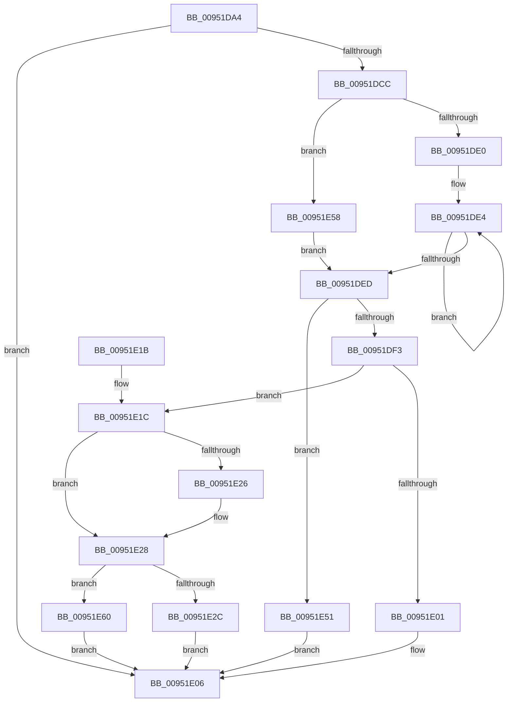

# CmGetDeviceInterfaceSymbolicLinkName

- RVA: `0x00951DA4`–`0x00951E67` (길이 `195` bytes)
- VA: `0x0000000140951DA4`
- 실행 섹션: `PAGE`
- PDB 이름 있음: `예`; PDB Function 태그: `아니요`
- unwind 정보 RVA: `0x00091EB4`
- 디코드: `58`개 명령, `195/195` bytes 표시
- 미해석 바이트: `0` (있으면 어셈블리에 `.byte`로 보존)

> 이 문서는 커널 이미지의 기계어와 PDB 기호를 분석해 생성했습니다. 4번과 5번은 함수 원형과 자료형을 바이너리 사용 방식에서 추정한 C 해석이며 원본 소스 복구 결과는 아닙니다.

## 1. Dependencies

- 직접 호출 지점: **3**; 고유 호출 대상: **3**
- 직접 호출자로 확인된 함수: **1**
- RIP 상대 이미지 참조: **0**

### Outgoing calls
- `0x00951DC1` → [CmValidateDeviceInterfaceName](../8F/CmValidateDeviceInterfaceName_function_008F1A40.md) (function, `0x008F1A40`)
- `0x00951DD6` → [wcschr](../../text/50/wcschr_function_00501A60.md) (function, `0x00501A60`)
- `0x00951E4A` → [RtlStringCchCopyNExW](../../text/43/RtlStringCchCopyNExW_function_00437CB0.md) (function, `0x00437CB0`)

### Direct callers
- [IopBuildGlobalSymbolicLinkString](IopBuildGlobalSymbolicLinkString_function_00951530.md) at `0x00951648`
- [IopBuildGlobalSymbolicLinkString](IopBuildGlobalSymbolicLinkString_function_00951530.md) at `0x00951786`

### Static image references
- 디코드된 RIP-relative 메모리 참조가 없습니다.

## 2. Other-region calls and transfers

- 다른 실행 섹션으로 향하는 call: **2**
  - `0x00951DD6` → [wcschr](../../text/50/wcschr_function_00501A60.md) (`PAGE` → `.text`)
  - `0x00951E4A` → [RtlStringCchCopyNExW](../../text/43/RtlStringCchCopyNExW_function_00437CB0.md) (`PAGE` → `.text`)
- 별도 외부 분기/꼬리 이동을 확인하지 못했습니다.

## 3. Assembly (complete function range)

```asm
00951DA4  48 89 5C 24 08                  mov qword ptr [rsp + 8], rbx
00951DA9  48 89 6C 24 10                  mov qword ptr [rsp + 0x10], rbp
00951DAE  48 89 74 24 18                  mov qword ptr [rsp + 0x18], rsi
00951DB3  57                              push rdi
00951DB4  48 83 EC 40                     sub rsp, 0x40
00951DB8  41 8B F9                        mov edi, r9d
00951DBB  49 8B F0                        mov rsi, r8
00951DBE  48 8B DA                        mov rbx, rdx
00951DC1  E8 7A FC F9 FF                  call 0x1408f1a40
00951DC6  33 ED                           xor ebp, ebp
00951DC8  85 C0                           test eax, eax
00951DCA  78 3A                           js 0x140951e06
00951DCC  48 83 C3 08                     add rbx, 8
00951DD0  8D 55 5C                        lea edx, [rbp + 0x5c]
00951DD3  48 8B CB                        mov rcx, rbx
00951DD6  E8 85 FC BA FF                  call 0x140501a60
00951DDB  48 85 C0                        test rax, rax
00951DDE  75 78                           jne 0x140951e58
00951DE0  48 83 C8 FF                     or rax, 0xffffffffffffffff
00951DE4  48 FF C0                        inc rax
00951DE7  66 39 2C 43                     cmp word ptr [rbx + rax*2], bp
00951DEB  75 F7                           jne 0x140951de4
00951DED  48 83 F8 27                     cmp rax, 0x27
00951DF1  76 5E                           jbe 0x140951e51
00951DF3  48 8D 48 01                     lea rcx, [rax + 1]
00951DF7  BA FF FF FF FF                  mov edx, 0xffffffff
00951DFC  48 3B CA                        cmp rcx, rdx
00951DFF  76 1B                           jbe 0x140951e1c
00951E01  B8 95 00 00 C0                  mov eax, 0xc0000095
00951E06  48 8B 5C 24 50                  mov rbx, qword ptr [rsp + 0x50]
00951E0B  48 8B 6C 24 58                  mov rbp, qword ptr [rsp + 0x58]
00951E10  48 8B 74 24 60                  mov rsi, qword ptr [rsp + 0x60]
00951E15  48 83 C4 40                     add rsp, 0x40
00951E19  5F                              pop rdi
00951E1A  C3                              ret
00951E1B  CC                              int3
00951E1C  48 8B 54 24 70                  mov rdx, qword ptr [rsp + 0x70]
00951E21  48 85 D2                        test rdx, rdx
00951E24  74 02                           je 0x140951e28
00951E26  89 0A                           mov dword ptr [rdx], ecx
00951E28  3B CF                           cmp ecx, edi
00951E2A  77 34                           ja 0x140951e60
00951E2C  C7 44 24 30 00 08 00 00         mov dword ptr [rsp + 0x30], 0x800
00951E34  48 8B D7                        mov rdx, rdi
00951E37  48 89 6C 24 28                  mov qword ptr [rsp + 0x28], rbp
00951E3C  4C 8B C8                        mov r9, rax
00951E3F  4C 8B C3                        mov r8, rbx
00951E42  48 89 6C 24 20                  mov qword ptr [rsp + 0x20], rbp
00951E47  48 8B CE                        mov rcx, rsi
00951E4A  E8 61 5E AE FF                  call 0x140437cb0
00951E4F  EB B5                           jmp 0x140951e06
00951E51  B8 33 00 00 C0                  mov eax, 0xc0000033
00951E56  EB AE                           jmp 0x140951e06
00951E58  48 2B C3                        sub rax, rbx
00951E5B  48 D1 F8                        sar rax, 1
00951E5E  EB 8D                           jmp 0x140951ded
00951E60  B8 23 00 00 C0                  mov eax, 0xc0000023
00951E65  EB 9F                           jmp 0x140951e06
```

## 4. C-style interpretation (structured pseudocode)

```c
__int64 __fastcall CmGetDeviceInterfaceSymbolicLinkName(__int64 a1, __int64 a2, __int64 a3, int a4, __int64 a5)
{
    __int64 result;
    __int64 v_rbp;
    __int64 v_rbx;
    __int64 v_rsp;
    unsigned __int64 v_stack_p10;
    unsigned __int64 v_stack_p18;
    unsigned __int64 v_stack_p20;
    unsigned __int64 v_stack_p28;
    unsigned int v_stack_p30;
    unsigned __int64 v_stack_p8;

    v_stack_p8 = v_rbx;
    v_stack_p10 = v_rbp;
    v_stack_p18 = v_rsi;
    v_rsp = (v_rsp) - (64);
    result = CmValidateDeviceInterfaceName(a1, a2, a3, a4);
    v_rbp = 0;
    if (sign_flag) goto loc_00951E06;
    v_rbx = (a2) + (8);
    result = wcschr(v_rbx, v_rbp + 92, a3, a4);
    if (result != 0) goto loc_00951E58;
    result = (result) | (-1);
loc_00951DE4:
    result = (result) + 1;
    if ((*(unsigned __int16 *)(v_rbx + result * 2)) != 0) goto loc_00951DE4;
loc_00951DED:
    if (result <= 39) goto loc_00951E51;
    if ((result + 1) <= ((unsigned int)(0xFFFFFFFFULL))) goto loc_00951E1C;
loc_00951E06:
    v_rsp = (v_rsp) + (64);
    return (unsigned int)(0xC0000095ULL);
loc_00951E1C:
    if (a5 != 0) {
        *(unsigned int *)(a5) = (unsigned int)(result + 1);
    }
    if (((unsigned int)(result + 1)) > ((unsigned int)((unsigned int)(a4)))) goto loc_00951E60;
    v_stack_p30 = 0x800ULL;
    v_stack_p28 = v_stack_p10;
    v_stack_p20 = v_stack_p10;
    result = RtlStringCchCopyNExW(v_stack_p18, (unsigned int)(a4), v_stack_p8, (unsigned int)(0xC0000095ULL));
    goto loc_00951E06;
loc_00951E51:
    goto loc_00951E06;
loc_00951E58:
    result = ((unsigned int)(0xC0000033ULL)) - (v_stack_p8);
    result = (result) >> (1);
    goto loc_00951DED;
loc_00951E60:
    goto loc_00951E06;
}
```

## 5. (Beta) C Style

```c
int64_t CmGetDeviceInterfaceSymbolicLinkName(int64_t Arg1, void *Arg2, int64_t Arg3, int32_t Arg4, int64_t Arg5)
{
    uint8_t *arg2 = (uint8_t *)Arg2;

    int64_t result;
    int64_t local_rbp;
    int64_t local_rbx;
    int64_t local_rsp;
    uint64_t v_stack_p10;
    uint64_t v_stack_p18;
    uint64_t v_stack_p20;
    uint64_t v_stack_p28;
    uint32_t v_stack_p30;
    uint64_t v_stack_p8;

    v_stack_p8 = local_rbx;
    v_stack_p10 = local_rbp;
    v_stack_p18 = local_rsi;
    local_rsp = (local_rsp) - (64);
    result = CmValidateDeviceInterfaceName(Arg1, Arg2, Arg3, Arg4);
    local_rbp = 0;
    if (sign_flag) goto loc_00951E06;
    local_rbx = (Arg2) + (8);
    result = wcschr(local_rbx, local_rbp + 92, Arg3, Arg4);
    if (result != 0) goto loc_00951E58;
    result = (result) | (-1);
loc_00951DE4:
    result = (result) + 1;
    if ((*(uint16_t *)(local_rbx + result * 2)) != 0) goto loc_00951DE4;
loc_00951DED:
    if (result <= 39) goto loc_00951E51;
    if ((result + 1) <= ((uint32_t)(0xFFFFFFFFULL))) goto loc_00951E1C;
loc_00951E06:
    local_rsp = (local_rsp) + (64);
    return (uint32_t)(0xC0000095ULL);
loc_00951E1C:
    if (Arg5 != 0) {
        *(uint32_t *)(Arg5) = (uint32_t)(result + 1);
    }
    if (((uint32_t)(result + 1)) > ((uint32_t)((uint32_t)(Arg4)))) goto loc_00951E60;
    v_stack_p30 = 0x800ULL;
    v_stack_p28 = v_stack_p10;
    v_stack_p20 = v_stack_p10;
    result = RtlStringCchCopyNExW(v_stack_p18, (uint32_t)(Arg4), v_stack_p8, (uint32_t)(0xC0000095ULL));
    goto loc_00951E06;
loc_00951E51:
    goto loc_00951E06;
loc_00951E58:
    result = ((uint32_t)(0xC0000033ULL)) - (v_stack_p8);
    result = (result) >> (1);
    goto loc_00951DED;
loc_00951E60:
    goto loc_00951E06;
}
```

### 관측된 메모리 오프셋

구조체 형식이 확인되지 않은 접근은 인자 기준의 오프셋으로만 기록했습니다.

| 기준 인자 | 오프셋 표현 | 폭 (bit) | 접근 |
|---|---:|---:|---|
| `Arg2` | `+ 0x0 + rax*2` | `16` | `R` |

## 6. Execution-region graph

[열기: 2D/3D 그래프와 함수 탐색 컨트롤 패널](../../../control-panel.html?section=page&rva=0x00951DA4&view=graph)

- 2D 그래프는 위에서 아래로 흐르고, 3D 그래프는 빈 공간을 드래그해 회전합니다. Shift+드래그는 이동, 휠은 확대·축소, 함수 노드 선택은 대상 보고서 이동입니다.

### Static fallback


