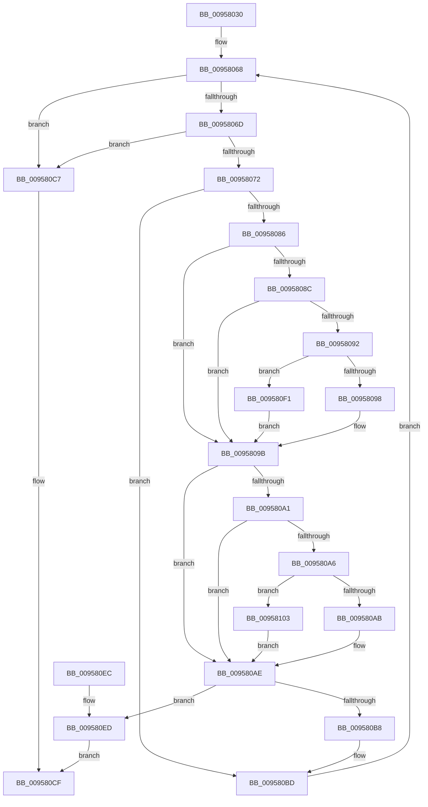

# CmpCompareCompressedName

- RVA: `0x00958030`–`0x00958110` (길이 `224` bytes)
- VA: `0x0000000140958030`
- 실행 섹션: `PAGE`
- PDB 이름 있음: `예`; PDB Function 태그: `아니요`
- unwind 정보 RVA: `0x000925B8`
- 디코드: `74`개 명령, `224/224` bytes 표시
- 미해석 바이트: `0` (있으면 어셈블리에 `.byte`로 보존)

> 이 문서는 커널 이미지의 기계어와 PDB 기호를 분석해 생성했습니다. 4번과 5번은 함수 원형과 자료형을 바이너리 사용 방식에서 추정한 C 해석이며 원본 소스 복구 결과는 아닙니다.

## 1. Dependencies

- 직접 호출 지점: **2**; 고유 호출 대상: **1**
- 직접 호출자로 확인된 함수: **3**
- RIP 상대 이미지 참조: **0**

### Outgoing calls
- `0x009580F4` → [RtlUpcaseUnicodeChar](../85/RtlUpcaseUnicodeChar_function_0085F0F0.md) (function, `0x0085F0F0`)
- `0x00958106` → [RtlUpcaseUnicodeChar](../85/RtlUpcaseUnicodeChar_function_0085F0F0.md) (function, `0x0085F0F0`)

### Direct callers
- [CmpCompareKeysByName](../94/CmpCompareKeysByName_function_00944950.md) at `0x00944A93`
- [CmpSortedValueEnumStackValueCompareFunction](../A3/CmpSortedValueEnumStackValueCompareFunction_function_00A30F30.md) at `0x00A3106F`
- [CmpFindKcbInHashEntryByCompressedName](../AB/CmpFindKcbInHashEntryByCompressedName_function_00ABC800.md) at `0x00ABC8B5`

### Static image references
- 디코드된 RIP-relative 메모리 참조가 없습니다.

## 2. Other-region calls and transfers

- 다른 실행 섹션으로 향하는 call: **0**
- 별도 외부 분기/꼬리 이동을 확인하지 못했습니다.

## 3. Assembly (complete function range)

```asm
00958030  48 89 5C 24 18                  mov qword ptr [rsp + 0x18], rbx
00958035  55                              push rbp
00958036  41 54                           push r12
00958038  41 55                           push r13
0095803A  41 56                           push r14
0095803C  41 57                           push r15
0095803E  48 83 EC 20                     sub rsp, 0x20
00958042  0F B7 19                        movzx ebx, word ptr [rcx]
00958045  B8 E0 FF 00 00                  mov eax, 0xffe0
0095804A  4C 8B 71 08                     mov r14, qword ptr [rcx + 8]
0095804E  45 8B E1                        mov r12d, r9d
00958051  48 89 74 24 50                  mov qword ptr [rsp + 0x50], rsi
00958056  41 8B E8                        mov ebp, r8d
00958059  4C 8B FA                        mov r15, rdx
0095805C  66 D1 EB                        shr bx, 1
0095805F  44 8D 68 1F                     lea r13d, [rax + 0x1f]
00958063  48 89 7C 24 58                  mov qword ptr [rsp + 0x58], rdi
00958068  66 85 DB                        test bx, bx
0095806B  74 5A                           je 0x1409580c7
0095806D  66 85 ED                        test bp, bp
00958070  74 55                           je 0x1409580c7
00958072  41 0F B7 3E                     movzx edi, word ptr [r14]
00958076  49 83 C6 02                     add r14, 2
0095807A  41 0F B6 37                     movzx esi, byte ptr [r15]
0095807E  49 FF C7                        inc r15
00958081  66 3B FE                        cmp di, si
00958084  74 37                           je 0x1409580bd
00958086  41 F6 C4 01                     test r12b, 1
0095808A  75 0F                           jne 0x14095809b
0095808C  66 83 FF 61                     cmp di, 0x61
00958090  72 09                           jb 0x14095809b
00958092  66 83 FF 7A                     cmp di, 0x7a
00958096  77 59                           ja 0x1409580f1
00958098  66 03 F8                        add di, ax
0095809B  41 F6 C4 02                     test r12b, 2
0095809F  75 0D                           jne 0x1409580ae
009580A1  83 FE 61                        cmp esi, 0x61
009580A4  72 08                           jb 0x1409580ae
009580A6  83 FE 7A                        cmp esi, 0x7a
009580A9  77 58                           ja 0x140958103
009580AB  66 03 F0                        add si, ax
009580AE  0F B7 C6                        movzx eax, si
009580B1  0F B7 CF                        movzx ecx, di
009580B4  2B C8                           sub ecx, eax
009580B6  75 35                           jne 0x1409580ed
009580B8  B8 E0 FF 00 00                  mov eax, 0xffe0
009580BD  66 41 03 DD                     add bx, r13w
009580C1  66 41 03 ED                     add bp, r13w
009580C5  EB A1                           jmp 0x140958068
009580C7  0F B7 CD                        movzx ecx, bp
009580CA  0F B7 C3                        movzx eax, bx
009580CD  2B C1                           sub eax, ecx
009580CF  48 8B 7C 24 58                  mov rdi, qword ptr [rsp + 0x58]
009580D4  48 8B 74 24 50                  mov rsi, qword ptr [rsp + 0x50]
009580D9  48 8B 5C 24 60                  mov rbx, qword ptr [rsp + 0x60]
009580DE  48 83 C4 20                     add rsp, 0x20
009580E2  41 5F                           pop r15
009580E4  41 5E                           pop r14
009580E6  41 5D                           pop r13
009580E8  41 5C                           pop r12
009580EA  5D                              pop rbp
009580EB  C3                              ret
009580EC  CC                              int3
009580ED  8B C1                           mov eax, ecx
009580EF  EB DE                           jmp 0x1409580cf
009580F1  0F B7 CF                        movzx ecx, di
009580F4  E8 F7 6F F0 FF                  call 0x14085f0f0
009580F9  0F B7 F8                        movzx edi, ax
009580FC  B8 E0 FF 00 00                  mov eax, 0xffe0
00958101  EB 98                           jmp 0x14095809b
00958103  0F B7 CE                        movzx ecx, si
00958106  E8 E5 6F F0 FF                  call 0x14085f0f0
0095810B  0F B7 F0                        movzx esi, ax
0095810E  EB 9E                           jmp 0x1409580ae
```

## 4. C-style interpretation (structured pseudocode)

```c
__int64 __fastcall CmpCompareCompressedName(__int64 a1, __int64 a2, int a3, int a4)
{
    __int64 result;
    __int64 v_r14;
    __int64 v_r15;
    __int64 v_rbp;
    __int64 v_rbx;
    __int64 v_rdi;
    __int64 v_rsi;
    __int64 v_rsp;
    unsigned __int64 v_stack_p10;
    unsigned __int64 v_stack_p18;
    unsigned __int64 v_stack_p8;

    v_stack_p18 = v_rbx;
    v_rsp = (v_rsp) - (32);
    v_stack_p8 = v_rsi;
    v_rbx = (unsigned __int16)((*(unsigned __int16 *)(a1)) >> (1));
    v_stack_p10 = v_rdi;
loc_00958068:
    if ((unsigned __int16)(v_rbx) == 0) goto loc_009580C7;
    if ((unsigned __int16)((unsigned int)(a3)) == 0) goto loc_009580C7;
    v_r14 = (*(unsigned __int64 *)(a1 + 8)) + (2);
    v_r15 = (a2) + 1;
    if (((unsigned __int16)(*(unsigned __int16 *)(*(unsigned __int64 *)(a1 + 8)))) == ((unsigned __int16)(*(unsigned __int8 *)(a2)))) goto loc_009580BD;
    if ((((unsigned __int8)((unsigned int)(a4))) & (1)) != 0) goto loc_0095809B;
    if (((unsigned __int16)(*(unsigned __int16 *)(*(unsigned __int64 *)(a1 + 8)))) < 97) goto loc_0095809B;
    if (((unsigned __int16)(*(unsigned __int16 *)(*(unsigned __int64 *)(a1 + 8)))) > 122) goto loc_009580F1;
    v_rdi = (unsigned __int16)((*(unsigned __int16 *)(*(unsigned __int64 *)(a1 + 8))) + ((unsigned __int16)((unsigned int)(0xFFE0ULL))));
loc_0095809B:
    if ((((unsigned __int8)((unsigned int)(a4))) & (2)) != 0) goto loc_009580AE;
    if (((unsigned int)(*(unsigned __int8 *)(a2))) < 97) goto loc_009580AE;
    if (((unsigned int)(*(unsigned __int8 *)(a2))) > 122) goto loc_00958103;
    v_rsi = (unsigned __int16)((*(unsigned __int8 *)(a2)) + ((unsigned __int16)((unsigned int)(0xFFE0ULL))));
loc_009580AE:
    a1 = (unsigned int)(((unsigned __int16)(v_rdi)) - ((unsigned int)((unsigned __int16)(v_rsi))));
    if (condition_is_not_equal) goto loc_009580ED;
loc_009580BD:
    v_rbx = (unsigned __int16)((v_rbx) + ((unsigned __int16)((unsigned int)(0xFFE0ULL) + 31)));
    v_rbp = (unsigned __int16)(((unsigned int)(a3)) + ((unsigned __int16)((unsigned int)(0xFFE0ULL) + 31)));
    goto loc_00958068;
loc_009580C7:
    result = (unsigned int)(((unsigned __int16)(v_rbx)) - ((unsigned int)((unsigned __int16)(v_rbp))));
loc_009580CF:
    v_rsp = (v_rsp) + (32);
    return result;
loc_009580ED:
    goto loc_009580CF;
loc_009580F1:
    result = RtlUpcaseUnicodeChar((unsigned __int16)(v_stack_p10), a2, a3, a4);
    goto loc_0095809B;
loc_00958103:
    result = RtlUpcaseUnicodeChar((unsigned __int16)(v_stack_p8), a2, a3, a4);
    goto loc_009580AE;
}
```

## 5. (Beta) C Style

```c
int64_t CmpCompareCompressedName(void *Arg1, int64_t Arg2, int32_t Arg3, int32_t Arg4)
{
    uint8_t *arg1 = (uint8_t *)Arg1;

    int64_t result;
    int64_t local_r14;
    int64_t local_r15;
    int64_t local_rbp;
    int64_t local_rbx;
    int64_t local_rdi;
    int64_t local_rsi;
    int64_t local_rsp;
    uint64_t v_stack_p10;
    uint64_t v_stack_p18;
    uint64_t v_stack_p8;

    v_stack_p18 = local_rbx;
    local_rsp = (local_rsp) - (32);
    v_stack_p8 = local_rsi;
    local_rbx = (uint16_t)((*(uint16_t *)(arg1)) >> (1));
    v_stack_p10 = local_rdi;
loc_00958068:
    if ((uint16_t)(local_rbx) == 0) goto loc_009580C7;
    if ((uint16_t)((uint32_t)(Arg3)) == 0) goto loc_009580C7;
    local_r14 = (*(uint64_t *)(arg1 + 0x8)) + (2);
    local_r15 = (Arg2) + 1;
    if (((uint16_t)(*(uint16_t *)(*(uint64_t *)(arg1 + 0x8)))) == ((uint16_t)(*(uint8_t *)(Arg2)))) goto loc_009580BD;
    if ((((uint8_t)((uint32_t)(Arg4))) & (1)) != 0) goto loc_0095809B;
    if (((uint16_t)(*(uint16_t *)(*(uint64_t *)(arg1 + 0x8)))) < 97) goto loc_0095809B;
    if (((uint16_t)(*(uint16_t *)(*(uint64_t *)(arg1 + 0x8)))) > 122) goto loc_009580F1;
    local_rdi = (uint16_t)((*(uint16_t *)(*(uint64_t *)(arg1 + 0x8))) + ((uint16_t)((uint32_t)(0xFFE0ULL))));
loc_0095809B:
    if ((((uint8_t)((uint32_t)(Arg4))) & (2)) != 0) goto loc_009580AE;
    if (((uint32_t)(*(uint8_t *)(Arg2))) < 97) goto loc_009580AE;
    if (((uint32_t)(*(uint8_t *)(Arg2))) > 122) goto loc_00958103;
    local_rsi = (uint16_t)((*(uint8_t *)(Arg2)) + ((uint16_t)((uint32_t)(0xFFE0ULL))));
loc_009580AE:
    Arg1 = (uint32_t)(((uint16_t)(local_rdi)) - ((uint32_t)((uint16_t)(local_rsi))));
    if (condition_is_not_equal) goto loc_009580ED;
loc_009580BD:
    local_rbx = (uint16_t)((local_rbx) + ((uint16_t)((uint32_t)(0xFFE0ULL) + 31)));
    local_rbp = (uint16_t)(((uint32_t)(Arg3)) + ((uint16_t)((uint32_t)(0xFFE0ULL) + 31)));
    goto loc_00958068;
loc_009580C7:
    result = (uint32_t)(((uint16_t)(local_rbx)) - ((uint32_t)((uint16_t)(local_rbp))));
loc_009580CF:
    local_rsp = (local_rsp) + (32);
    return result;
loc_009580ED:
    goto loc_009580CF;
loc_009580F1:
    result = RtlUpcaseUnicodeChar((uint16_t)(v_stack_p10), Arg2, Arg3, Arg4);
    goto loc_0095809B;
loc_00958103:
    result = RtlUpcaseUnicodeChar((uint16_t)(v_stack_p8), Arg2, Arg3, Arg4);
    goto loc_009580AE;
}
```

### 관측된 메모리 오프셋

구조체 형식이 확인되지 않은 접근은 인자 기준의 오프셋으로만 기록했습니다.

| 기준 인자 | 오프셋 표현 | 폭 (bit) | 접근 |
|---|---:|---:|---|
| `Arg1` | `+ 0x0` | `16` | `R` |
| `Arg1` | `+ 0x8` | `64` | `R` |

## 6. Execution-region graph

[열기: 2D/3D 그래프와 함수 탐색 컨트롤 패널](../../../control-panel.html?section=page&rva=0x00958030&view=graph)

- 2D 그래프는 위에서 아래로 흐르고, 3D 그래프는 빈 공간을 드래그해 회전합니다. Shift+드래그는 이동, 휠은 확대·축소, 함수 노드 선택은 대상 보고서 이동입니다.

### Static fallback


