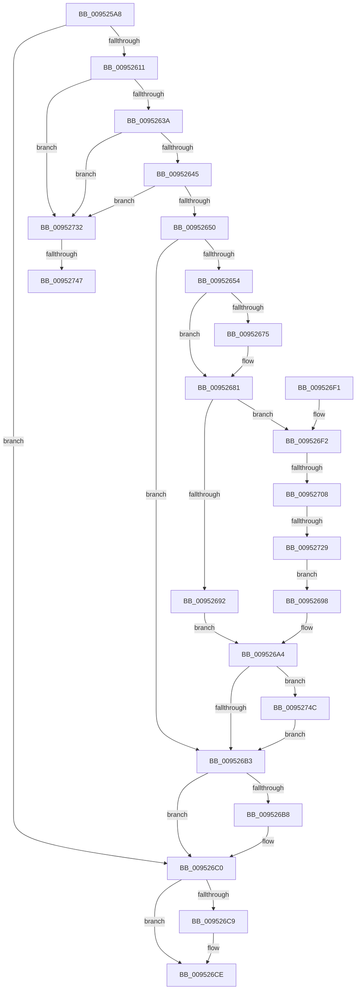

# CmpVolumeManagerGetContextForFile

- RVA: `0x009525A8`–`0x00952759` (길이 `433` bytes)
- VA: `0x00000001409525A8`
- 실행 섹션: `PAGE`
- PDB 이름 있음: `예`; PDB Function 태그: `예`
- unwind 정보 RVA: `0x00091F70`
- 디코드: `112`개 명령, `433/433` bytes 표시
- 미해석 바이트: `0` (있으면 어셈블리에 `.byte`로 보존)

> 이 문서는 커널 이미지의 기계어와 PDB 기호를 분석해 생성했습니다. 4번과 5번은 함수 원형과 자료형을 바이너리 사용 방식에서 추정한 C 해석이며 원본 소스 복구 결과는 아닙니다.

## 1. Dependencies

- 직접 호출 지점: **16**; 고유 호출 대상: **13**
- 직접 호출자로 확인된 함수: **2**
- RIP 상대 이미지 참조: **3**

### Outgoing calls
- `0x00952602` → [ObReferenceObjectByHandle](../86/ObReferenceObjectByHandle_function_00868DB0.md) (function, `0x00868DB0`)
- `0x00952619` → [IoGetAttachedDeviceReference](../../text/41/IoGetAttachedDeviceReference_function_0041D940.md) (function, `0x0041D940`)
- `0x00952628` → [IoVolumeDeviceToGuid](IoVolumeDeviceToGuid_function_00952A90.md) (function, `0x00952A90`)
- `0x00952654` → [CmpVolumeManagerLockContextListShared](../A7/CmpVolumeManagerLockContextListShared_function_00A721E4.md) (function, `0x00A721E4`)
- `0x0095265D` → [CmpVolumeManagerGetContextForGuidUnsafe](../A6/CmpVolumeManagerGetContextForGuidUnsafe_function_00A66C10.md) (function, `0x00A66C10`)
- `0x0095267C` → [ExfReleasePushLockShared](../../text/26/ExfReleasePushLockShared_function_00263440.md) (function, `0x00263440`)
- `0x00952688` → [KeAbPostRelease](../../text/2E/KeAbPostRelease_function_002E1600.md) (function, `0x002E1600`)
- `0x0095269F` → [CmSiRWLockReleaseExclusive](../A0/CmSiRWLockReleaseExclusive_function_00A0DAB0.md) (function, `0x00A0DAB0`)
- `0x009526BB` → [ObfDereferenceObject](../../text/2F/ObfDereferenceObject_function_002F9350.md) (function, `0x002F9350`)
- `0x009526C9` → [ObfDereferenceObject](../../text/2F/ObfDereferenceObject_function_002F9350.md) (function, `0x002F9350`)
- `0x009526D7` → [_security_check_cookie](../../text/6A/_security_check_cookie_function_006AC640.md) (function, `0x006AC640`)
- `0x009526F9` → [CmpVolumeContextCreate](../7E/CmpVolumeContextCreate_function_007E86F4.md) (function, `0x007E86F4`)
- `0x0095270F` → [CmSiRWLockAcquireExclusive](../A1/CmSiRWLockAcquireExclusive_function_00A1679C.md) (function, `0x00A1679C`)
- `0x00952718` → [CmpVolumeManagerGetContextForGuidUnsafe](../A6/CmpVolumeManagerGetContextForGuidUnsafe_function_00A66C10.md) (function, `0x00A66C10`)
- `0x00952738` → [CmpVolumeContextCreate](../7E/CmpVolumeContextCreate_function_007E86F4.md) (function, `0x007E86F4`)
- `0x0095274F` → [CmpVolumeContextFree](../AB/CmpVolumeContextFree_function_00AB1CF0.md) (function, `0x00AB1CF0`)

### Direct callers
- [CmpVolumeManagerGetContextForFilePath](../7E/CmpVolumeManagerGetContextForFilePath_function_007E8A6C.md) at `0x007E8B03`
- [CmpCreateHive](../87/CmpCreateHive_function_00879DF0.md) at `0x0087A0E4`

### Static image references
- `0x009525BC` → RVA `0x00E0A740` (`.data`; read)
- `0x009525CA` → RVA `0x00EF7C68` (`.data`; read)
- `0x0095266A` → RVA `0x00FDA418` (`PAGEDATA`; read)

## 2. Other-region calls and transfers

- 다른 실행 섹션으로 향하는 call: **6**
  - `0x00952619` → [IoGetAttachedDeviceReference](../../text/41/IoGetAttachedDeviceReference_function_0041D940.md) (`PAGE` → `.text`)
  - `0x0095267C` → [ExfReleasePushLockShared](../../text/26/ExfReleasePushLockShared_function_00263440.md) (`PAGE` → `.text`)
  - `0x00952688` → [KeAbPostRelease](../../text/2E/KeAbPostRelease_function_002E1600.md) (`PAGE` → `.text`)
  - `0x009526BB` → [ObfDereferenceObject](../../text/2F/ObfDereferenceObject_function_002F9350.md) (`PAGE` → `.text`)
  - `0x009526C9` → [ObfDereferenceObject](../../text/2F/ObfDereferenceObject_function_002F9350.md) (`PAGE` → `.text`)
  - `0x009526D7` → [_security_check_cookie](../../text/6A/_security_check_cookie_function_006AC640.md) (`PAGE` → `.text`)
- call이 아닌 외부 분기/꼬리 이동: **4**
  - `0x00952702` → [sub_00B262D0 + 0x43](../B2/Unknown_function_00B262D0.md) (`tail-transfer`)
  - `0x00952723` → [sub_00B262D0 + 0xC](../B2/Unknown_function_00B262D0.md) (`tail-transfer`)
  - `0x00952741` → [sub_00B262D0](../B2/Unknown_function_00B262D0.md) (`tail-transfer`)
  - `0x00952747` → [sub_00B262D0 + 0x43](../B2/Unknown_function_00B262D0.md) (`tail-transfer`)

## 3. Assembly (complete function range)

```asm
009525A8  48 89 5C 24 08                  mov qword ptr [rsp + 8], rbx
009525AD  55                              push rbp
009525AE  57                              push rdi
009525AF  41 54                           push r12
009525B1  41 56                           push r14
009525B3  41 57                           push r15
009525B5  48 8B EC                        mov rbp, rsp
009525B8  48 83 EC 60                     sub rsp, 0x60
009525BC  48 8B 05 7D 81 4B 00            mov rax, qword ptr [rip + 0x4b817d]
009525C3  48 33 C4                        xor rax, rsp
009525C6  48 89 45 F8                     mov qword ptr [rbp - 8], rax
009525CA  48 8B 05 97 56 5A 00            mov rax, qword ptr [rip + 0x5a5697]
009525D1  45 33 E4                        xor r12d, r12d
009525D4  4D 8B F9                        mov r15, r9
009525D7  4C 89 64 24 28                  mov qword ptr [rsp + 0x28], r12
009525DC  48 8B CA                        mov rcx, rdx
009525DF  4C 89 65 D0                     mov qword ptr [rbp - 0x30], r12
009525E3  0F 57 C0                        xorps xmm0, xmm0
009525E6  4C 89 65 D8                     mov qword ptr [rbp - 0x28], r12
009525EA  4C 8B 00                        mov r8, qword ptr [rax]
009525ED  45 33 C9                        xor r9d, r9d
009525F0  48 8D 45 D8                     lea rax, [rbp - 0x28]
009525F4  BA 80 00 00 00                  mov edx, 0x80
009525F9  48 89 44 24 20                  mov qword ptr [rsp + 0x20], rax
009525FE  0F 11 45 E8                     movups xmmword ptr [rbp - 0x18], xmm0
00952602  E8 A9 67 F1 FF                  call 0x140868db0
00952607  8B D8                           mov ebx, eax
00952609  85 C0                           test eax, eax
0095260B  0F 88 AF 00 00 00               js 0x1409526c0
00952611  48 8B 4D D8                     mov rcx, qword ptr [rbp - 0x28]
00952615  48 8B 49 08                     mov rcx, qword ptr [rcx + 8]
00952619  E8 22 B3 AC FF                  call 0x14041d940
0095261E  48 8D 55 E8                     lea rdx, [rbp - 0x18]
00952622  48 8B C8                        mov rcx, rax
00952625  4C 8B F0                        mov r14, rax
00952628  E8 63 04 00 00                  call 0x140952a90
0095262D  8B D8                           mov ebx, eax
0095262F  3D 0D 00 00 C0                  cmp eax, 0xc000000d
00952634  0F 84 F8 00 00 00               je 0x140952732
0095263A  3D BB 00 00 C0                  cmp eax, 0xc00000bb
0095263F  0F 84 ED 00 00 00               je 0x140952732
00952645  3D 10 00 00 C0                  cmp eax, 0xc0000010
0095264A  0F 84 E2 00 00 00               je 0x140952732
00952650  85 C0                           test eax, eax
00952652  78 5F                           js 0x1409526b3
00952654  E8 8B FB 11 00                  call 0x140a721e4
00952659  48 8D 55 E8                     lea rdx, [rbp - 0x18]
0095265D  E8 AE 45 11 00                  call 0x140a66c10
00952662  48 8B D8                        mov rbx, rax
00952665  41 8D 44 24 11                  lea eax, [r12 + 0x11]
0095266A  F0 4C 0F B1 25 A5 7D 68 00      lock cmpxchg qword ptr [rip + 0x687da5], r12
00952673  74 0C                           je 0x140952681
00952675  48 8D 0D 9C 7D 68 00            lea rcx, [rip + 0x687d9c]
0095267C  E8 BF 0D 91 FF                  call 0x140263440
00952681  48 8D 0D 90 7D 68 00            lea rcx, [rip + 0x687d90]
00952688  E8 73 EF 98 FF                  call 0x1402e1600
0095268D  48 85 DB                        test rbx, rbx
00952690  74 60                           je 0x1409526f2
00952692  48 8B 7D D0                     mov rdi, qword ptr [rbp - 0x30]
00952696  EB 0C                           jmp 0x1409526a4
00952698  48 8D 0D 79 7D 68 00            lea rcx, [rip + 0x687d79]
0095269F  E8 0C B4 0B 00                  call 0x140a0dab0
009526A4  49 89 1F                        mov qword ptr [r15], rbx
009526A7  41 8B DC                        mov ebx, r12d
009526AA  48 85 FF                        test rdi, rdi
009526AD  0F 85 99 00 00 00               jne 0x14095274c
009526B3  4D 85 F6                        test r14, r14
009526B6  74 08                           je 0x1409526c0
009526B8  49 8B CE                        mov rcx, r14
009526BB  E8 90 6C 9A FF                  call 0x1402f9350
009526C0  48 8B 4D D8                     mov rcx, qword ptr [rbp - 0x28]
009526C4  48 85 C9                        test rcx, rcx
009526C7  74 05                           je 0x1409526ce
009526C9  E8 82 6C 9A FF                  call 0x1402f9350
009526CE  8B C3                           mov eax, ebx
009526D0  48 8B 4D F8                     mov rcx, qword ptr [rbp - 8]
009526D4  48 33 CC                        xor rcx, rsp
009526D7  E8 64 9F D5 FF                  call 0x1406ac640
009526DC  48 8B 9C 24 90 00 00 00         mov rbx, qword ptr [rsp + 0x90]
009526E4  48 83 C4 60                     add rsp, 0x60
009526E8  41 5F                           pop r15
009526EA  41 5E                           pop r14
009526EC  41 5C                           pop r12
009526EE  5F                              pop rdi
009526EF  5D                              pop rbp
009526F0  C3                              ret
009526F1  CC                              int3
009526F2  4C 8D 45 D0                     lea r8, [rbp - 0x30]
009526F6  49 8B D6                        mov rdx, r14
009526F9  E8 F6 5F E9 FF                  call 0x1407e86f4
009526FE  8B D8                           mov ebx, eax
00952700  85 C0                           test eax, eax
00952702  0F 88 0B 3C 1D 00               js 0x140b26313
00952708  48 8D 0D 09 7D 68 00            lea rcx, [rip + 0x687d09]
0095270F  E8 88 40 0C 00                  call 0x140a1679c
00952714  48 8D 55 E8                     lea rdx, [rbp - 0x18]
00952718  E8 F3 44 11 00                  call 0x140a66c10
0095271D  48 8B D8                        mov rbx, rax
00952720  48 85 C0                        test rax, rax
00952723  0F 84 B3 3B 1D 00               je 0x140b262dc
00952729  48 8B 7D D0                     mov rdi, qword ptr [rbp - 0x30]
0095272D  E9 66 FF FF FF                  jmp 0x140952698
00952732  4C 8D 45 D0                     lea r8, [rbp - 0x30]
00952736  33 D2                           xor edx, edx
00952738  E8 B7 5F E9 FF                  call 0x1407e86f4
0095273D  8B D8                           mov ebx, eax
0095273F  85 C0                           test eax, eax
00952741  0F 89 89 3B 1D 00               jns 0x140b262d0
00952747  E9 C7 3B 1D 00                  jmp 0x140b26313
0095274C  48 8B CF                        mov rcx, rdi
0095274F  E8 9C F5 15 00                  call 0x140ab1cf0
00952754  E9 5A FF FF FF                  jmp 0x1409526b3
```

## 4. C-style interpretation (structured pseudocode)

```c
__int64 __fastcall CmpVolumeManagerGetContextForFile(__int64 a1, __int64 a2, __int64 a3, __int64 a4)
{
    __int64 result;
    __int64 v_r12;
    __int64 v_rsp;
    unsigned __int64 v_stack_m30;
    unsigned __int64 v_stack_m40;
    unsigned __int64 v_stack_m50;
    unsigned __int64 v_stack_m58;
    unsigned __int64 v_stack_m60;
    unsigned __int64 v_stack_m68;
    unsigned __int64 v_stack_p8;

    v_stack_p8 = v_rbx;
    v_rsp = (v_rsp) - (96);
    result = (*(unsigned __int64 *)(v_rip + 4948349)) ^ (v_rsp);
    v_stack_m30 = result;
    v_r12 = 0;
    v_stack_m60 = 0;
    v_stack_m58 = 0;
    v_stack_m50 = 0;
    a4 = 0;
    v_stack_m68 = v_stack_m50;
    v_stack_m40 = v_xmm0;
    result = ObReferenceObjectByHandle(a2, 128, *(unsigned __int64 *)(*(unsigned __int64 *)(v_rip + 5920407)), a4);
    if (sign_flag) goto loc_009526C0;
    result = IoGetAttachedDeviceReference(*(unsigned __int64 *)(v_stack_m50 + 8), 128, *(unsigned __int64 *)(*(unsigned __int64 *)(v_rip + 5920407)), a4);
    result = IoVolumeDeviceToGuid(result, v_stack_m40, *(unsigned __int64 *)(*(unsigned __int64 *)(v_rip + 5920407)), a4);
    if (((unsigned int)(result)) == 0xC000000DULL) goto loc_00952732;
    if (((unsigned int)(result)) == 0xC00000BBULL) goto loc_00952732;
    if (((unsigned int)(result)) == 0xC0000010ULL) goto loc_00952732;
    if (sign_flag) goto loc_009526B3;
    result = CmpVolumeManagerLockContextListShared(result, v_stack_m40, *(unsigned __int64 *)(*(unsigned __int64 *)(v_rip + 5920407)), a4);
    result = CmpVolumeManagerGetContextForGuidUnsafe(result, v_stack_m40, *(unsigned __int64 *)(*(unsigned __int64 *)(v_rip + 5920407)), a4);
    result = v_r12 + 17;
    if ((unsigned int)(result) != 0) {
        a1 = v_rip + 6847900;
        result = ExfReleasePushLockShared(a1, v_stack_m40, *(unsigned __int64 *)(*(unsigned __int64 *)(v_rip + 5920407)), a4);
    }
    result = KeAbPostRelease(v_rip + 6847888, v_stack_m40, *(unsigned __int64 *)(*(unsigned __int64 *)(v_rip + 5920407)), a4);
    if (result == 0) goto loc_009526F2;
    goto loc_009526A4;
loc_00952698:
    result = CmSiRWLockReleaseExclusive(v_rip + 6847865, v_stack_m40, *(unsigned __int64 *)(*(unsigned __int64 *)(v_rip + 5920407)), a4);
loc_009526A4:
    *(unsigned __int64 *)(a4) = result;
    if (v_stack_m58 != 0) goto loc_0095274C;
loc_009526B3:
    if (result != 0) {
        a1 = result;
        result = ObfDereferenceObject(a1, v_stack_m40, *(unsigned __int64 *)(*(unsigned __int64 *)(v_rip + 5920407)), a4);
    }
    if (v_stack_m50 != 0) {
        result = ObfDereferenceObject(v_stack_m50, v_stack_m40, *(unsigned __int64 *)(*(unsigned __int64 *)(v_rip + 5920407)), a4);
    }
    a1 = (v_stack_m30) ^ (v_rsp);
    result = _security_check_cookie(a1, v_stack_m40, *(unsigned __int64 *)(*(unsigned __int64 *)(v_rip + 5920407)), a4);
    v_rsp = (v_rsp) + (96);
    return result;
loc_009526F2:
    result = CmpVolumeContextCreate(a1, result, v_stack_m58, a4);
    result = CmSiRWLockAcquireExclusive(v_rip + 6847753, result, v_stack_m58, a4);
    result = CmpVolumeManagerGetContextForGuidUnsafe(v_rip + 6847753, v_stack_m40, v_stack_m58, a4);
    goto loc_00952698;
loc_00952732:
    a2 = 0;
    result = CmpVolumeContextCreate(v_rip + 6847753, a2, v_stack_m58, a4);
loc_0095274C:
    result = CmpVolumeContextFree(v_stack_m58, a2, v_stack_m58, a4);
    goto loc_009526B3;
}
```

## 5. (Beta) C Style

```c
int64_t CmpVolumeManagerGetContextForFile(int64_t Arg1, int64_t Arg2, int64_t Arg3, void *Arg4)
{
    uint8_t *arg4 = (uint8_t *)Arg4;

    int64_t result;
    int64_t local_r12;
    int64_t local_rsp;
    uint64_t v_stack_m30;
    uint64_t v_stack_m40;
    uint64_t v_stack_m50;
    uint64_t v_stack_m58;
    uint64_t v_stack_m60;
    uint64_t v_stack_m68;
    uint64_t v_stack_p8;

    v_stack_p8 = local_rbx;
    local_rsp = (local_rsp) - (96);
    result = (*(uint64_t *)(v_rip + 0x4B817D)) ^ (local_rsp);
    v_stack_m30 = result;
    local_r12 = 0;
    v_stack_m60 = 0;
    v_stack_m58 = 0;
    v_stack_m50 = 0;
    Arg4 = 0;
    v_stack_m68 = v_stack_m50;
    v_stack_m40 = v_xmm0;
    result = ObReferenceObjectByHandle(Arg2, 128, *(uint64_t *)(*(uint64_t *)(v_rip + 0x5A5697)), Arg4);
    if (sign_flag) goto loc_009526C0;
    result = IoGetAttachedDeviceReference(*(uint64_t *)(v_stack_m50 + 0x8), 128, *(uint64_t *)(*(uint64_t *)(v_rip + 0x5A5697)), Arg4);
    result = IoVolumeDeviceToGuid(result, v_stack_m40, *(uint64_t *)(*(uint64_t *)(v_rip + 0x5A5697)), Arg4);
    if (((uint32_t)(result)) == 0xC000000DULL) goto loc_00952732;
    if (((uint32_t)(result)) == 0xC00000BBULL) goto loc_00952732;
    if (((uint32_t)(result)) == 0xC0000010ULL) goto loc_00952732;
    if (sign_flag) goto loc_009526B3;
    result = CmpVolumeManagerLockContextListShared(result, v_stack_m40, *(uint64_t *)(*(uint64_t *)(v_rip + 0x5A5697)), Arg4);
    result = CmpVolumeManagerGetContextForGuidUnsafe(result, v_stack_m40, *(uint64_t *)(*(uint64_t *)(v_rip + 0x5A5697)), Arg4);
    result = local_r12 + 17;
    if ((uint32_t)(result) != 0) {
        Arg1 = v_rip + 6847900;
        result = ExfReleasePushLockShared(Arg1, v_stack_m40, *(uint64_t *)(*(uint64_t *)(v_rip + 0x5A5697)), Arg4);
    }
    result = KeAbPostRelease(v_rip + 6847888, v_stack_m40, *(uint64_t *)(*(uint64_t *)(v_rip + 0x5A5697)), Arg4);
    if (result == 0) goto loc_009526F2;
    goto loc_009526A4;
loc_00952698:
    result = CmSiRWLockReleaseExclusive(v_rip + 6847865, v_stack_m40, *(uint64_t *)(*(uint64_t *)(v_rip + 0x5A5697)), Arg4);
loc_009526A4:
    *(uint64_t *)(arg4) = result;
    if (v_stack_m58 != 0) goto loc_0095274C;
loc_009526B3:
    if (result != 0) {
        Arg1 = result;
        result = ObfDereferenceObject(Arg1, v_stack_m40, *(uint64_t *)(*(uint64_t *)(v_rip + 0x5A5697)), Arg4);
    }
    if (v_stack_m50 != 0) {
        result = ObfDereferenceObject(v_stack_m50, v_stack_m40, *(uint64_t *)(*(uint64_t *)(v_rip + 0x5A5697)), Arg4);
    }
    Arg1 = (v_stack_m30) ^ (local_rsp);
    result = _security_check_cookie(Arg1, v_stack_m40, *(uint64_t *)(*(uint64_t *)(v_rip + 0x5A5697)), Arg4);
    local_rsp = (local_rsp) + (96);
    return result;
loc_009526F2:
    result = CmpVolumeContextCreate(Arg1, result, v_stack_m58, Arg4);
    result = CmSiRWLockAcquireExclusive(v_rip + 6847753, result, v_stack_m58, Arg4);
    result = CmpVolumeManagerGetContextForGuidUnsafe(v_rip + 6847753, v_stack_m40, v_stack_m58, Arg4);
    goto loc_00952698;
loc_00952732:
    Arg2 = 0;
    result = CmpVolumeContextCreate(v_rip + 6847753, Arg2, v_stack_m58, Arg4);
loc_0095274C:
    result = CmpVolumeContextFree(v_stack_m58, Arg2, v_stack_m58, Arg4);
    goto loc_009526B3;
}
```

### 관측된 메모리 오프셋

구조체 형식이 확인되지 않은 접근은 인자 기준의 오프셋으로만 기록했습니다.

| 기준 인자 | 오프셋 표현 | 폭 (bit) | 접근 |
|---|---:|---:|---|
| `Arg4` | `+ 0x0` | `64` | `W` |

## 6. Execution-region graph

[열기: 2D/3D 그래프와 함수 탐색 컨트롤 패널](../../../control-panel.html?section=page&rva=0x009525A8&view=graph)

- 2D 그래프는 위에서 아래로 흐르고, 3D 그래프는 빈 공간을 드래그해 회전합니다. Shift+드래그는 이동, 휠은 확대·축소, 함수 노드 선택은 대상 보고서 이동입니다.

### Static fallback


