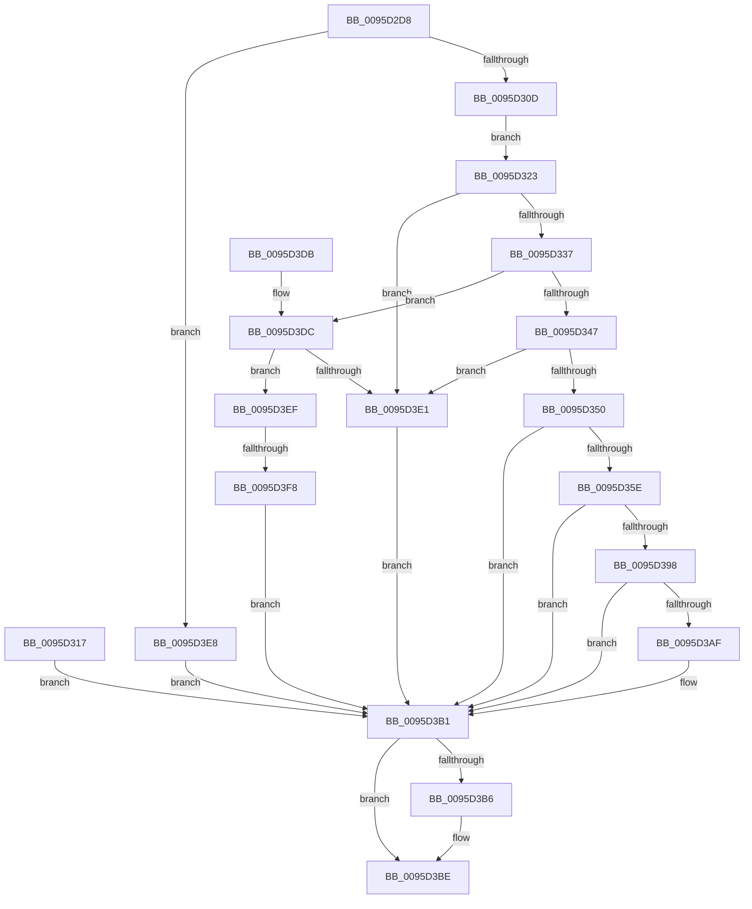

# EtwpQueryCoverageSamplerInformation

- RVA: `0x0095D2D8`–`0x0095D3FF` (길이 `295` bytes)
- VA: `0x000000014095D2D8`
- 실행 섹션: `PAGE`
- PDB 이름 있음: `예`; PDB Function 태그: `예`
- unwind 정보 RVA: `0x00092D4C`
- 디코드: `85`개 명령, `295/295` bytes 표시
- 미해석 바이트: `0` (있으면 어셈블리에 `.byte`로 보존)

> 이 문서는 커널 이미지의 기계어와 PDB 기호를 분석해 생성했습니다. 4번과 5번은 함수 원형과 자료형을 바이너리 사용 방식에서 추정한 C 해석이며 원본 소스 복구 결과는 아닙니다.

## 1. Dependencies

- 직접 호출 지점: **4**; 고유 호출 대상: **4**
- 직접 호출자로 확인된 함수: **1**
- RIP 상대 이미지 참조: **1**

### Outgoing calls
- `0x0095D353` → [ExCheckFullProcessInformationAccess](ExCheckFullProcessInformationAccess_function_0095D93C.md) (function, `0x0095D93C`)
- `0x0095D388` → [ObReferenceObjectByHandle](../86/ObReferenceObjectByHandle_function_00868DB0.md) (function, `0x00868DB0`)
- `0x0095D3A4` → [EtwpCoverageSamplerQuery](EtwpCoverageSamplerQuery_function_0095C4A0.md) (function, `0x0095C4A0`)
- `0x0095D3B9` → [ObfDereferenceObject](../../text/2F/ObfDereferenceObject_function_002F9350.md) (function, `0x002F9350`)

### Direct callers
- [EtwQueryPerformanceTraceInformation](../AF/EtwQueryPerformanceTraceInformation_function_00AF28A4.md) at `0x00AF2FBF`

### Static image references
- `0x0095D35E` → RVA `0x00EFF1D0` (`.data`; read)

## 2. Other-region calls and transfers

- 다른 실행 섹션으로 향하는 call: **1**
  - `0x0095D3B9` → [ObfDereferenceObject](../../text/2F/ObfDereferenceObject_function_002F9350.md) (`PAGE` → `.text`)
- call이 아닌 외부 분기/꼬리 이동: **1**
  - `0x0095D3F2` → [sub_00B27B2E](../B2/Unknown_function_00B27B2E.md) (`tail-transfer`)

## 3. Assembly (complete function range)

```asm
0095D2D8  48 8B C4                        mov rax, rsp
0095D2DB  48 89 58 08                     mov qword ptr [rax + 8], rbx
0095D2DF  48 89 70 10                     mov qword ptr [rax + 0x10], rsi
0095D2E3  48 89 78 18                     mov qword ptr [rax + 0x18], rdi
0095D2E7  41 54                           push r12
0095D2E9  41 56                           push r14
0095D2EB  41 57                           push r15
0095D2ED  48 83 EC 50                     sub rsp, 0x50
0095D2F1  4D 8B E1                        mov r12, r9
0095D2F4  41 8A F0                        mov sil, r8b
0095D2F7  44 8B FA                        mov r15d, edx
0095D2FA  4C 8B F1                        mov r14, rcx
0095D2FD  33 FF                           xor edi, edi
0095D2FF  48 89 7C 24 30                  mov qword ptr [rsp + 0x30], rdi
0095D304  83 FA 10                        cmp edx, 0x10
0095D307  0F 82 DB 00 00 00               jb 0x14095d3e8
0095D30D  0F 10 01                        movups xmm0, xmmword ptr [rcx]
0095D310  F3 0F 7F 40 D0                  movdqu xmmword ptr [rax - 0x30], xmm0
0095D315  EB 0C                           jmp 0x14095d323
0095D317  8B D8                           mov ebx, eax
0095D319  48 8B 7C 24 30                  mov rdi, qword ptr [rsp + 0x30]
0095D31E  E9 8E 00 00 00                  jmp 0x14095d3b1
0095D323  48 8B 4C 24 38                  mov rcx, qword ptr [rsp + 0x38]
0095D328  48 8B C1                        mov rax, rcx
0095D32B  48 C1 E8 28                     shr rax, 0x28
0095D32F  3C CF                           cmp al, 0xcf
0095D331  0F 85 AA 00 00 00               jne 0x14095d3e1
0095D337  48 C1 E9 20                     shr rcx, 0x20
0095D33B  0F B6 C9                        movzx ecx, cl
0095D33E  83 E9 01                        sub ecx, 1
0095D341  0F 85 95 00 00 00               jne 0x14095d3dc
0095D347  40 84 F6                        test sil, sil
0095D34A  0F 84 91 00 00 00               je 0x14095d3e1
0095D350  40 8A CE                        mov cl, sil
0095D353  E8 E4 05 00 00                  call 0x14095d93c
0095D358  8B D8                           mov ebx, eax
0095D35A  85 C0                           test eax, eax
0095D35C  78 53                           js 0x14095d3b1
0095D35E  4C 8B 05 6B 1E 5A 00            mov r8, qword ptr [rip + 0x5a1e6b]
0095D365  48 83 64 24 30 00               and qword ptr [rsp + 0x30], 0
0095D36B  48 83 64 24 28 00               and qword ptr [rsp + 0x28], 0
0095D371  48 8D 44 24 30                  lea rax, [rsp + 0x30]
0095D376  48 89 44 24 20                  mov qword ptr [rsp + 0x20], rax
0095D37B  44 8A CE                        mov r9b, sil
0095D37E  BA 01 00 00 00                  mov edx, 1
0095D383  48 8B 4C 24 40                  mov rcx, qword ptr [rsp + 0x40]
0095D388  E8 23 BA F0 FF                  call 0x140868db0
0095D38D  8B D8                           mov ebx, eax
0095D38F  48 8B 7C 24 30                  mov rdi, qword ptr [rsp + 0x30]
0095D394  85 C0                           test eax, eax
0095D396  78 19                           js 0x14095d3b1
0095D398  4D 8B CC                        mov r9, r12
0095D39B  45 8B C7                        mov r8d, r15d
0095D39E  49 8B D6                        mov rdx, r14
0095D3A1  48 8B CF                        mov rcx, rdi
0095D3A4  E8 F7 F0 FF FF                  call 0x14095c4a0
0095D3A9  8B D8                           mov ebx, eax
0095D3AB  85 C0                           test eax, eax
0095D3AD  78 02                           js 0x14095d3b1
0095D3AF  33 DB                           xor ebx, ebx
0095D3B1  48 85 FF                        test rdi, rdi
0095D3B4  74 08                           je 0x14095d3be
0095D3B6  48 8B CF                        mov rcx, rdi
0095D3B9  E8 92 BF 99 FF                  call 0x1402f9350
0095D3BE  8B C3                           mov eax, ebx
0095D3C0  4C 8D 5C 24 50                  lea r11, [rsp + 0x50]
0095D3C5  49 8B 5B 20                     mov rbx, qword ptr [r11 + 0x20]
0095D3C9  49 8B 73 28                     mov rsi, qword ptr [r11 + 0x28]
0095D3CD  49 8B 7B 30                     mov rdi, qword ptr [r11 + 0x30]
0095D3D1  49 8B E3                        mov rsp, r11
0095D3D4  41 5F                           pop r15
0095D3D6  41 5E                           pop r14
0095D3D8  41 5C                           pop r12
0095D3DA  C3                              ret
0095D3DB  CC                              int3
0095D3DC  83 E9 02                        sub ecx, 2
0095D3DF  75 0E                           jne 0x14095d3ef
0095D3E1  BB BB 00 00 C0                  mov ebx, 0xc00000bb
0095D3E6  EB C9                           jmp 0x14095d3b1
0095D3E8  BB 04 00 00 C0                  mov ebx, 0xc0000004
0095D3ED  EB C2                           jmp 0x14095d3b1
0095D3EF  83 F9 01                        cmp ecx, 1
0095D3F2  0F 84 36 A7 1C 00               je 0x140b27b2e
0095D3F8  BB 03 00 00 C0                  mov ebx, 0xc0000003
0095D3FD  EB B2                           jmp 0x14095d3b1
```

## 4. C-style interpretation (structured pseudocode)

```c
__int64 __fastcall EtwpQueryCoverageSamplerInformation(__int64 a1, int a2, unsigned __int8 a3, __int64 a4)
{
    __int64 result;
    __int64 v_rbx;
    __int64 v_rdi;
    __int64 v_rsp;
    unsigned __int64 v_stack_m18;
    unsigned __int64 v_stack_m28;
    unsigned __int64 v_stack_m30;
    unsigned __int64 v_stack_m38;
    unsigned __int64 v_stack_m40;
    unsigned __int64 v_stack_m48;

    *(unsigned __int64 *)(v_rsp + 8) = v_rbx;
    *(unsigned __int64 *)(v_rsp + 16) = v_rsi;
    *(unsigned __int64 *)(v_rsp + 24) = v_rdi;
    v_rsp = (v_rsp) - (80);
    v_rdi = 0;
    v_stack_m38 = 0;
    if (a2 < 16) goto loc_0095D3E8;
    *(unsigned __int64 *)(v_rsp - 48) = v_xmm0;
    goto loc_0095D323;
loc_0095D323:
    result = (v_stack_m30) >> (40);
    if (((unsigned __int8)(result)) != 207) goto loc_0095D3E1;
    a1 = (v_stack_m30) >> (32);
    a1 = (unsigned int)(((unsigned __int8)(a1)) - (1));
    if (condition_is_not_equal) goto loc_0095D3DC;
    if (a3 == 0) goto loc_0095D3E1;
    result = ExCheckFullProcessInformationAccess(a3, a2, a3, a4);
    if (sign_flag) goto loc_0095D3B1;
    v_stack_m48 = v_stack_m38;
    result = ObReferenceObjectByHandle(v_stack_m28, 1, *(unsigned __int64 *)(v_rip + 5906027), a3);
    if (sign_flag) goto loc_0095D3B1;
    result = EtwpCoverageSamplerQuery(v_stack_m38, a1, (unsigned int)((unsigned int)((unsigned int)(a2))), a4);
    v_rbx = (unsigned int)((unsigned int)(result));
    if (!(sign_flag)) {
        v_rbx = 0;
    }
    if (v_stack_m38 != 0) {
        a1 = v_stack_m38;
        result = ObfDereferenceObject(a1, a1, (unsigned int)((unsigned int)((unsigned int)(a2))), a4);
    }
    return 0;
loc_0095D3DC:
    a1 = (unsigned int)((a1) - (2));
    if (condition_is_not_equal) goto loc_0095D3EF;
loc_0095D3E1:
    goto loc_0095D3B1;
loc_0095D3E8:
    goto loc_0095D3B1;
loc_0095D3EF:
    goto loc_0095D3B1;
}
```

## 5. (Beta) C Style

```c
int64_t EtwpQueryCoverageSamplerInformation(void *Arg1, int32_t Arg2, uint8_t Arg3, int64_t Arg4)
{
    uint8_t *arg1 = (uint8_t *)Arg1;

    int64_t result;
    int64_t local_rbx;
    int64_t local_rdi;
    int64_t local_rsp;
    uint64_t v_stack_m18;
    uint64_t v_stack_m28;
    uint64_t v_stack_m30;
    uint64_t v_stack_m38;
    uint64_t v_stack_m40;
    uint64_t v_stack_m48;

    *(uint64_t *)(local_rsp + 0x8) = local_rbx;
    *(uint64_t *)(local_rsp + 0x10) = local_rsi;
    *(uint64_t *)(local_rsp + 0x18) = local_rdi;
    local_rsp = (local_rsp) - (80);
    local_rdi = 0;
    v_stack_m38 = 0;
    if (Arg2 < 16) goto loc_0095D3E8;
    *(uint64_t *)(local_rsp - 0x30) = v_xmm0;
    goto loc_0095D323;
loc_0095D323:
    result = (v_stack_m30) >> (40);
    if (((uint8_t)(result)) != 207) goto loc_0095D3E1;
    Arg1 = (v_stack_m30) >> (32);
    Arg1 = (uint32_t)(((uint8_t)(Arg1)) - (1));
    if (condition_is_not_equal) goto loc_0095D3DC;
    if (Arg3 == 0) goto loc_0095D3E1;
    result = ExCheckFullProcessInformationAccess(Arg3, Arg2, Arg3, Arg4);
    if (sign_flag) goto loc_0095D3B1;
    v_stack_m48 = v_stack_m38;
    result = ObReferenceObjectByHandle(v_stack_m28, 1, *(uint64_t *)(v_rip + 0x5A1E6B), Arg3);
    if (sign_flag) goto loc_0095D3B1;
    result = EtwpCoverageSamplerQuery(v_stack_m38, Arg1, (uint32_t)((uint32_t)((uint32_t)(Arg2))), Arg4);
    local_rbx = (uint32_t)((uint32_t)(result));
    if (!(sign_flag)) {
        local_rbx = 0;
    }
    if (v_stack_m38 != 0) {
        Arg1 = v_stack_m38;
        result = ObfDereferenceObject(Arg1, Arg1, (uint32_t)((uint32_t)((uint32_t)(Arg2))), Arg4);
    }
    return 0;
loc_0095D3DC:
    Arg1 = (uint32_t)((Arg1) - (2));
    if (condition_is_not_equal) goto loc_0095D3EF;
loc_0095D3E1:
    goto loc_0095D3B1;
loc_0095D3E8:
    goto loc_0095D3B1;
loc_0095D3EF:
    goto loc_0095D3B1;
}
```

### 관측된 메모리 오프셋

구조체 형식이 확인되지 않은 접근은 인자 기준의 오프셋으로만 기록했습니다.

| 기준 인자 | 오프셋 표현 | 폭 (bit) | 접근 |
|---|---:|---:|---|
| `Arg1` | `+ 0x0` | `128` | `R` |

## 6. Execution-region graph

[열기: 2D/3D 그래프와 함수 탐색 컨트롤 패널](../../../control-panel.html?section=page&rva=0x0095D2D8&view=graph)

- 2D 그래프는 위에서 아래로 흐르고, 3D 그래프는 빈 공간을 드래그해 회전합니다. Shift+드래그는 이동, 휠은 확대·축소, 함수 노드 선택은 대상 보고서 이동입니다.

### Static fallback


