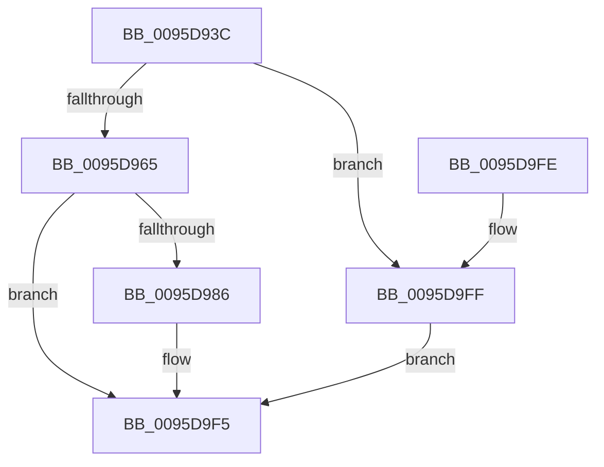

# ExCheckFullProcessInformationAccess

- RVA: `0x0095D93C`–`0x0095DA06` (길이 `202` bytes)
- VA: `0x000000014095D93C`
- 실행 섹션: `PAGE`
- PDB 이름 있음: `예`; PDB Function 태그: `아니요`
- unwind 정보 RVA: `0x00092DF0`
- 디코드: `46`개 명령, `202/202` bytes 표시
- 미해석 바이트: `0` (있으면 어셈블리에 `.byte`로 보존)

> 이 문서는 커널 이미지의 기계어와 PDB 기호를 분석해 생성했습니다. 4번과 5번은 함수 원형과 자료형을 바이너리 사용 방식에서 추정한 C 해석이며 원본 소스 복구 결과는 아닙니다.

## 1. Dependencies

- 직접 호출 지점: **4**; 고유 호출 대상: **4**
- 직접 호출자로 확인된 함수: **6**
- RIP 상대 이미지 참조: **3**

### Outgoing calls
- `0x0095D97A` → [RtlRunOnceExecuteOnce](RtlRunOnceExecuteOnce_function_0095DC00.md) (function, `0x0095DC00`)
- `0x0095D99A` → [SeCaptureSubjectContextEx](../8C/SeCaptureSubjectContextEx_function_008C4C90.md) (function, `0x008C4C90`)
- `0x0095D9E4` → [SeAccessCheckWithHint](../../text/3A/SeAccessCheckWithHint_function_003A6C30.md) (function, `0x003A6C30`)
- `0x0095D9ED` → [SeReleaseSubjectContext](../86/SeReleaseSubjectContext_function_0086B710.md) (function, `0x0086B710`)

### Direct callers
- [EtwpSetCoverageSamplerInformation](../7C/EtwpSetCoverageSamplerInformation_function_007C288C.md) at `0x007C2936`
- [EtwpSetCoverageSamplerInformation](../7C/EtwpSetCoverageSamplerInformation_function_007C288C.md) at `0x007C29EB`
- [ExpGetProcessInformation](../91/ExpGetProcessInformation_function_0091A878.md) at `0x0091BC2B`
- [NtPowerInformation](NtPowerInformation_function_00955D80.md) at `0x00955F74`
- [EtwpQueryCoverageSamplerInformation](EtwpQueryCoverageSamplerInformation_function_0095D2D8.md) at `0x0095D353`
- [NtSetDefaultLocale](../AA/NtSetDefaultLocale_function_00AAE850.md) at `0x00AAE8F1`
- [sub_00B27B2E](../B2/Unknown_function_00B27B2E.md) at `0x00B27B3A`

### Static image references
- `0x0095D96C` → RVA `0x007C43D0` (`ExpInitFullProcessSecurityInfo`; read)
- `0x0095D973` → RVA `0x00FD85B8` (`PAGEDATA`; read)
- `0x0095D9BC` → RVA `0x00B4B090` (`ExpRestrictedGenericMapping`; read)

## 2. Other-region calls and transfers

- 다른 실행 섹션으로 향하는 call: **1**
  - `0x0095D9E4` → [SeAccessCheckWithHint](../../text/3A/SeAccessCheckWithHint_function_003A6C30.md) (`PAGE` → `.text`)
- 별도 외부 분기/꼬리 이동을 확인하지 못했습니다.

## 3. Assembly (complete function range)

```asm
0095D93C  40 55                           push rbp
0095D93E  48 8B EC                        mov rbp, rsp
0095D941  48 81 EC 80 00 00 00            sub rsp, 0x80
0095D948  83 65 18 00                     and dword ptr [rbp + 0x18], 0
0095D94C  0F 57 C0                        xorps xmm0, xmm0
0095D94F  48 83 65 20 00                  and qword ptr [rbp + 0x20], 0
0095D954  0F 11 45 E0                     movups xmmword ptr [rbp - 0x20], xmm0
0095D958  0F 11 45 F0                     movups xmmword ptr [rbp - 0x10], xmm0
0095D95C  80 F9 01                        cmp cl, 1
0095D95F  0F 85 9A 00 00 00               jne 0x14095d9ff
0095D965  4C 8D 4D 20                     lea r9, [rbp + 0x20]
0095D969  45 33 C0                        xor r8d, r8d
0095D96C  48 8D 15 5D 6A E6 FF            lea rdx, [rip - 0x1995a3]
0095D973  48 8D 0D 3E AC 67 00            lea rcx, [rip + 0x67ac3e]
0095D97A  E8 81 02 00 00                  call 0x14095dc00
0095D97F  89 45 10                        mov dword ptr [rbp + 0x10], eax
0095D982  85 C0                           test eax, eax
0095D984  78 6F                           js 0x14095d9f5
0095D986  65 48 8B 0C 25 88 01 00 00      mov rcx, qword ptr gs:[0x188]
0095D98F  4C 8D 45 E0                     lea r8, [rbp - 0x20]
0095D993  48 8B 91 B8 00 00 00            mov rdx, qword ptr [rcx + 0xb8]
0095D99A  E8 F1 72 F6 FF                  call 0x1408c4c90
0095D99F  48 8B 4D 20                     mov rcx, qword ptr [rbp + 0x20]
0095D9A3  48 8D 45 10                     lea rax, [rbp + 0x10]
0095D9A7  48 89 44 24 50                  mov qword ptr [rsp + 0x50], rax
0095D9AC  4C 8D 45 E0                     lea r8, [rbp - 0x20]
0095D9B0  48 8D 45 18                     lea rax, [rbp + 0x18]
0095D9B4  45 33 C9                        xor r9d, r9d
0095D9B7  48 89 44 24 48                  mov qword ptr [rsp + 0x48], rax
0095D9BC  48 8D 05 CD D6 1E 00            lea rax, [rip + 0x1ed6cd]
0095D9C3  C6 44 24 40 01                  mov byte ptr [rsp + 0x40], 1
0095D9C8  48 89 44 24 38                  mov qword ptr [rsp + 0x38], rax
0095D9CD  48 83 64 24 30 00               and qword ptr [rsp + 0x30], 0
0095D9D3  41 8D 51 07                     lea edx, [r9 + 7]
0095D9D7  83 64 24 28 00                  and dword ptr [rsp + 0x28], 0
0095D9DC  C7 44 24 20 01 00 00 00         mov dword ptr [rsp + 0x20], 1
0095D9E4  E8 47 92 A4 FF                  call 0x1403a6c30
0095D9E9  48 8D 4D E0                     lea rcx, [rbp - 0x20]
0095D9ED  E8 1E DD F0 FF                  call 0x14086b710
0095D9F2  8B 45 10                        mov eax, dword ptr [rbp + 0x10]
0095D9F5  48 81 C4 80 00 00 00            add rsp, 0x80
0095D9FC  5D                              pop rbp
0095D9FD  C3                              ret
0095D9FE  CC                              int3
0095D9FF  B8 22 00 00 C0                  mov eax, 0xc0000022
0095DA04  EB EF                           jmp 0x14095d9f5
```

## 4. C-style interpretation (structured pseudocode)

```c
__int64 __fastcall ExCheckFullProcessInformationAccess(unsigned __int8 a1, __int64 a2, int a3)
{
    __int64 result;
    __int64 v_rsp;
    unsigned __int64 v_stack_m18;
    unsigned __int64 v_stack_m28;
    unsigned __int64 v_stack_m38;
    unsigned __int64 v_stack_m40;
    unsigned __int8 v_stack_m48;
    unsigned __int64 v_stack_m50;
    unsigned __int64 v_stack_m58;
    unsigned int v_stack_m60;
    unsigned int v_stack_m68;
    unsigned int v_stack_p10;
    unsigned __int64 v_stack_p18;
    unsigned int v_stack_p8;

    v_rsp = (v_rsp) - (128);
    v_stack_m28 = v_xmm0;
    v_stack_m18 = v_xmm0;
    if (a1 != 1) goto loc_0095D9FF;
    a3 = 0;
    result = RtlRunOnceExecuteOnce(v_rip + 6794302, v_rip - 1676707, a3, v_stack_p18);
    v_stack_p8 = (unsigned int)(result);
    if (!(sign_flag)) {
        a1 = *(unsigned __int64 *)(gs_base + (0 + 392));
        a3 = v_stack_m28;
        a2 = *(unsigned __int64 *)(a1 + 184);
        result = SeCaptureSubjectContextEx(a1, a2, a3, v_stack_p18);
        a1 = v_stack_p18;
        result = v_stack_p8;
        v_stack_m38 = result;
        a3 = v_stack_m28;
        result = v_stack_p10;
        a4 = 0;
        v_stack_m40 = result;
        result = v_rip + 2021069;
        v_stack_m48 = 1;
        v_stack_m50 = result;
        a2 = a4 + 7;
        v_stack_m68 = 1;
        result = SeAccessCheckWithHint(a1, a2, a3, a4);
        a1 = v_stack_m28;
        result = SeReleaseSubjectContext(a1, a2, a3, a4);
        result = v_stack_p8;
    }
    v_rsp = (v_rsp) + (128);
    return result;
loc_0095D9FF:
    goto loc_0095D9F5;
}
```

## 5. (Beta) C Style

```c
int64_t ExCheckFullProcessInformationAccess(uint8_t Arg1, int64_t Arg2, int32_t Arg3)
{
    int64_t result;
    int64_t local_rsp;
    uint64_t v_stack_m18;
    uint64_t v_stack_m28;
    uint64_t v_stack_m38;
    uint64_t v_stack_m40;
    uint8_t v_stack_m48;
    uint64_t v_stack_m50;
    uint64_t v_stack_m58;
    uint32_t v_stack_m60;
    uint32_t v_stack_m68;
    uint32_t v_stack_p10;
    uint64_t v_stack_p18;
    uint32_t v_stack_p8;

    local_rsp = (local_rsp) - (128);
    v_stack_m28 = v_xmm0;
    v_stack_m18 = v_xmm0;
    if (Arg1 != 1) goto loc_0095D9FF;
    Arg3 = 0;
    result = RtlRunOnceExecuteOnce(v_rip + 6794302, v_rip - 1676707, Arg3, v_stack_p18);
    v_stack_p8 = (uint32_t)(result);
    if (!(sign_flag)) {
        Arg1 = *(uint64_t *)(gs_base + (0 + 0x188));
        Arg3 = v_stack_m28;
        Arg2 = *(uint64_t *)(Arg1 + 0xB8);
        result = SeCaptureSubjectContextEx(Arg1, Arg2, Arg3, v_stack_p18);
        Arg1 = v_stack_p18;
        result = v_stack_p8;
        v_stack_m38 = result;
        Arg3 = v_stack_m28;
        result = v_stack_p10;
        a4 = 0;
        v_stack_m40 = result;
        result = v_rip + 2021069;
        v_stack_m48 = 1;
        v_stack_m50 = result;
        Arg2 = a4 + 7;
        v_stack_m68 = 1;
        result = SeAccessCheckWithHint(Arg1, Arg2, Arg3, a4);
        Arg1 = v_stack_m28;
        result = SeReleaseSubjectContext(Arg1, Arg2, Arg3, a4);
        result = v_stack_p8;
    }
    local_rsp = (local_rsp) + (128);
    return result;
loc_0095D9FF:
    goto loc_0095D9F5;
}
```

## 6. Execution-region graph

[열기: 2D/3D 그래프와 함수 탐색 컨트롤 패널](../../../control-panel.html?section=page&rva=0x0095D93C&view=graph)

- 2D 그래프는 위에서 아래로 흐르고, 3D 그래프는 빈 공간을 드래그해 회전합니다. Shift+드래그는 이동, 휠은 확대·축소, 함수 노드 선택은 대상 보고서 이동입니다.

### Static fallback


