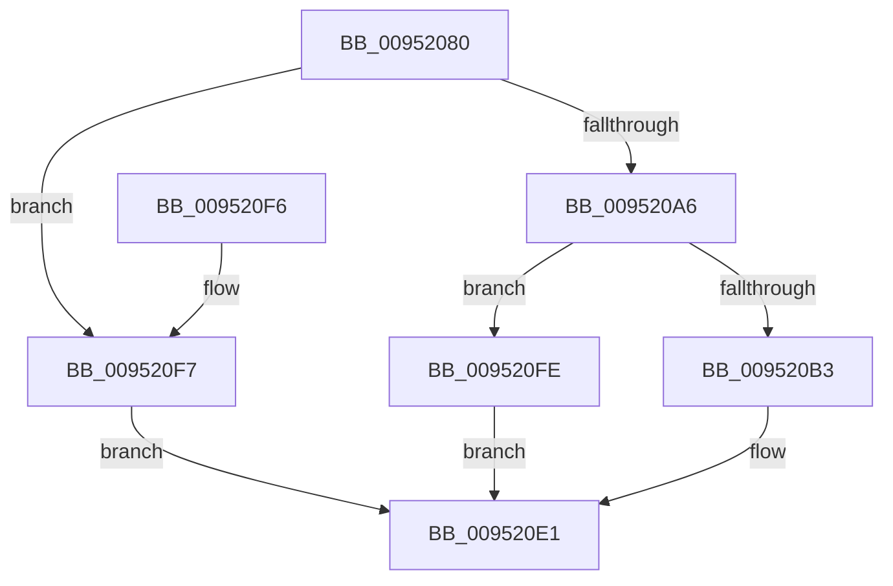

# ExGetFirmwareEnvironmentVariable

- RVA: `0x00952080`–`0x00952105` (길이 `133` bytes)
- VA: `0x0000000140952080`
- 실행 섹션: `PAGE`
- PDB 이름 있음: `예`; PDB Function 태그: `아니요`
- unwind 정보 RVA: `0x00091EE8`
- 디코드: `38`개 명령, `133/133` bytes 표시
- 미해석 바이트: `0` (있으면 어셈블리에 `.byte`로 보존)

> 이 문서는 커널 이미지의 기계어와 PDB 기호를 분석해 생성했습니다. 4번과 5번은 함수 원형과 자료형을 바이너리 사용 방식에서 추정한 C 해석이며 원본 소스 복구 결과는 아닙니다.

## 1. Dependencies

- 직접 호출 지점: **3**; 고유 호출 대상: **3**
- 직접 호출자로 확인된 함수: **2**
- RIP 상대 이미지 참조: **1**

### Outgoing calls
- `0x009520A6` → [ExpUnicodeStringToNonpagedWStr](ExpUnicodeStringToNonpagedWStr_function_0095210C.md) (function, `0x0095210C`)
- `0x009520CE` → [ExpGetFirmwareEnvironmentVariable](ExpGetFirmwareEnvironmentVariable_function_009524DC.md) (function, `0x009524DC`)
- `0x009520DA` → [ExFreePoolWithTag](../../poolcode/B8/ExFreePoolWithTag_function_00B82870.md) (function, `0x00B82870`)

### Direct callers
- [NtQuerySystemEnvironmentValueEx](NtQuerySystemEnvironmentValueEx_function_00952180.md) at `0x00952499`
- [PopCheckShutdownMarker](../../init/C3/PopCheckShutdownMarker_function_00C3DAD4.md) at `0x00C3DF30`

### Static image references
- `0x00952094` → RVA `0x00EFF050` (`.data`; read)

## 2. Other-region calls and transfers

- 다른 실행 섹션으로 향하는 call: **1**
  - `0x009520DA` → [ExFreePoolWithTag](../../poolcode/B8/ExFreePoolWithTag_function_00B82870.md) (`PAGE` → `POOLCODE`)
- 별도 외부 분기/꼬리 이동을 확인하지 못했습니다.

## 3. Assembly (complete function range)

```asm
00952080  48 89 5C 24 08                  mov qword ptr [rsp + 8], rbx
00952085  48 89 6C 24 10                  mov qword ptr [rsp + 0x10], rbp
0095208A  48 89 74 24 18                  mov qword ptr [rsp + 0x18], rsi
0095208F  57                              push rdi
00952090  48 83 EC 30                     sub rsp, 0x30
00952094  83 3D B5 CF 5A 00 02            cmp dword ptr [rip + 0x5acfb5], 2
0095209B  49 8B D9                        mov rbx, r9
0095209E  49 8B F0                        mov rsi, r8
009520A1  48 8B EA                        mov rbp, rdx
009520A4  75 51                           jne 0x1409520f7
009520A6  E8 61 00 00 00                  call 0x14095210c
009520AB  48 8B F8                        mov rdi, rax
009520AE  48 85 C0                        test rax, rax
009520B1  74 4B                           je 0x1409520fe
009520B3  48 8B 44 24 60                  mov rax, qword ptr [rsp + 0x60]
009520B8  4C 8B CB                        mov r9, rbx
009520BB  C6 44 24 28 00                  mov byte ptr [rsp + 0x28], 0
009520C0  4C 8B C6                        mov r8, rsi
009520C3  48 8B D5                        mov rdx, rbp
009520C6  48 89 44 24 20                  mov qword ptr [rsp + 0x20], rax
009520CB  48 8B CF                        mov rcx, rdi
009520CE  E8 09 04 00 00                  call 0x1409524dc
009520D3  33 D2                           xor edx, edx
009520D5  48 8B CF                        mov rcx, rdi
009520D8  8B D8                           mov ebx, eax
009520DA  E8 91 07 23 00                  call 0x140b82870
009520DF  8B C3                           mov eax, ebx
009520E1  48 8B 5C 24 40                  mov rbx, qword ptr [rsp + 0x40]
009520E6  48 8B 6C 24 48                  mov rbp, qword ptr [rsp + 0x48]
009520EB  48 8B 74 24 50                  mov rsi, qword ptr [rsp + 0x50]
009520F0  48 83 C4 30                     add rsp, 0x30
009520F4  5F                              pop rdi
009520F5  C3                              ret
009520F6  CC                              int3
009520F7  B8 02 00 00 C0                  mov eax, 0xc0000002
009520FC  EB E3                           jmp 0x1409520e1
009520FE  B8 9A 00 00 C0                  mov eax, 0xc000009a
00952103  EB DC                           jmp 0x1409520e1
```

## 4. C-style interpretation (structured pseudocode)

```c
__int64 __fastcall ExGetFirmwareEnvironmentVariable(__int64 a1, __int64 a2, __int64 a3, __int64 a4, __int64 a5)
{
    __int64 result;
    __int64 v_rsp;
    unsigned __int8 v_stack_m10;
    unsigned __int64 v_stack_m18;
    unsigned __int64 v_stack_p10;
    unsigned __int64 v_stack_p18;
    unsigned __int64 v_stack_p8;

    v_stack_p8 = v_rbx;
    v_stack_p10 = v_rbp;
    v_stack_p18 = v_rsi;
    v_rsp = (v_rsp) - (48);
    if ((*(unsigned int *)(v_rip + 5951413)) != 2) goto loc_009520F7;
    result = ExpUnicodeStringToNonpagedWStr(a1, a2, a3, a4);
    if (result == 0) goto loc_009520FE;
    v_stack_m10 = 0;
    v_stack_m18 = a5;
    result = ExpGetFirmwareEnvironmentVariable(result, a2, a3, a4);
    a2 = 0;
    result = ExFreePoolWithTag(result, a2, a3, a4);
loc_009520E1:
    v_rsp = (v_rsp) + (48);
    return (unsigned int)((unsigned int)((unsigned int)((unsigned int)(result))));
loc_009520F7:
    goto loc_009520E1;
loc_009520FE:
    goto loc_009520E1;
}
```

## 5. (Beta) C Style

```c
int64_t ExGetFirmwareEnvironmentVariable(int64_t Arg1, int64_t Arg2, int64_t Arg3, int64_t Arg4, int64_t Arg5)
{
    int64_t result;
    int64_t local_rsp;
    uint8_t v_stack_m10;
    uint64_t v_stack_m18;
    uint64_t v_stack_p10;
    uint64_t v_stack_p18;
    uint64_t v_stack_p8;

    v_stack_p8 = local_rbx;
    v_stack_p10 = local_rbp;
    v_stack_p18 = local_rsi;
    local_rsp = (local_rsp) - (48);
    if ((*(uint32_t *)(v_rip + 0x5ACFB5)) != 2) goto loc_009520F7;
    result = ExpUnicodeStringToNonpagedWStr(Arg1, Arg2, Arg3, Arg4);
    if (result == 0) goto loc_009520FE;
    v_stack_m10 = 0;
    v_stack_m18 = Arg5;
    result = ExpGetFirmwareEnvironmentVariable(result, Arg2, Arg3, Arg4);
    Arg2 = 0;
    result = ExFreePoolWithTag(result, Arg2, Arg3, Arg4);
loc_009520E1:
    local_rsp = (local_rsp) + (48);
    return (uint32_t)((uint32_t)((uint32_t)((uint32_t)(result))));
loc_009520F7:
    goto loc_009520E1;
loc_009520FE:
    goto loc_009520E1;
}
```

## 6. Execution-region graph

[열기: 2D/3D 그래프와 함수 탐색 컨트롤 패널](../../../control-panel.html?section=page&rva=0x00952080&view=graph)

- 2D 그래프는 위에서 아래로 흐르고, 3D 그래프는 빈 공간을 드래그해 회전합니다. Shift+드래그는 이동, 휠은 확대·축소, 함수 노드 선택은 대상 보고서 이동입니다.

### Static fallback


