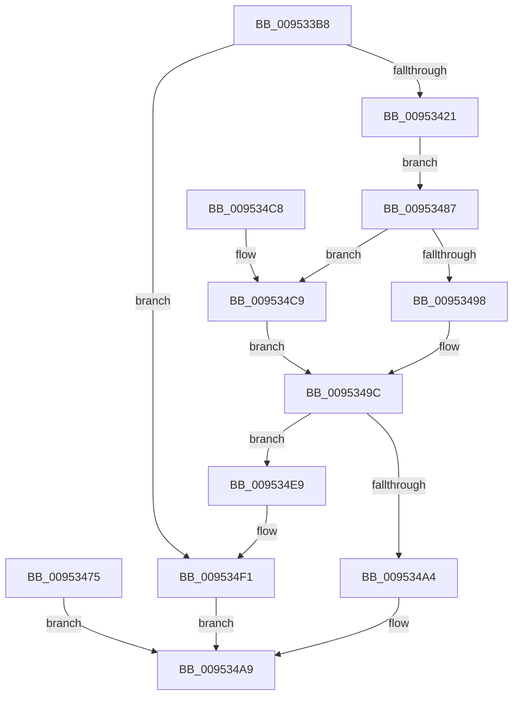

# ExLockUserBuffer

- RVA: `0x009533B8`–`0x009534F8` (길이 `320` bytes)
- VA: `0x00000001409533B8`
- 실행 섹션: `PAGE`
- PDB 이름 있음: `예`; PDB Function 태그: `아니요`
- unwind 정보 RVA: `0x00092090`
- 디코드: `90`개 명령, `320/320` bytes 표시
- 미해석 바이트: `0` (있으면 어셈블리에 `.byte`로 보존)

> 이 문서는 커널 이미지의 기계어와 PDB 기호를 분석해 생성했습니다. 4번과 5번은 함수 원형과 자료형을 바이너리 사용 방식에서 추정한 C 해석이며 원본 소스 복구 결과는 아닙니다.

## 1. Dependencies

- 직접 호출 지점: **6**; 고유 호출 대상: **6**
- 직접 호출자로 확인된 함수: **18**
- RIP 상대 이미지 참조: **0**

### Outgoing calls
- `0x009533F5` → [MmSizeOfMdl](../../text/46/MmSizeOfMdl_function_00460A10.md) (function, `0x00460A10`)
- `0x00953408` → [ExAllocatePool2](../../poolcode/B8/ExAllocatePool2_function_00B820F0.md) (function, `0x00B820F0`)
- `0x0095346E` → [MmProbeAndLockPages](../../text/23/MmProbeAndLockPages_function_0023B990.md) (function, `0x0023B990`)
- `0x0095347E` → [ExFreePoolWithTag](../../poolcode/B8/ExFreePoolWithTag_function_00B82870.md) (function, `0x00B82870`)
- `0x009534E2` → [MmMapLockedPagesSpecifyCache](../../text/31/MmMapLockedPagesSpecifyCache_function_00318800.md) (function, `0x00318800`)
- `0x009534EC` → [ExUnlockUserBuffer](../../text/29/ExUnlockUserBuffer_function_0029F258.md) (function, `0x0029F258`)

### Direct callers
- [ExpGetLookasideInformation](../../text/4E/ExpGetLookasideInformation_function_004E2468.md) at `0x004E24BD`
- [KdSystemDebugControl](../74/KdSystemDebugControl_function_00744700.md) at `0x007447F2`
- [KdSystemDebugControl](../74/KdSystemDebugControl_function_00744700.md) at `0x00744888`
- [KdSystemDebugControl](../74/KdSystemDebugControl_function_00744700.md) at `0x00744924`
- [KdSystemDebugControl](../74/KdSystemDebugControl_function_00744700.md) at `0x007449CA`
- [KdSystemDebugControl](../74/KdSystemDebugControl_function_00744700.md) at `0x00744A5D`
- [KdSystemDebugControl](../74/KdSystemDebugControl_function_00744700.md) at `0x00744AF9`
- [KdSystemDebugControl](../74/KdSystemDebugControl_function_00744700.md) at `0x00744BAA`
- [KdSystemDebugControl](../74/KdSystemDebugControl_function_00744700.md) at `0x00744CA1`
- [KdSystemDebugControl](../74/KdSystemDebugControl_function_00744700.md) at `0x00744D53`
- [KdSystemDebugControl](../74/KdSystemDebugControl_function_00744700.md) at `0x00744E44`
- [ExpGetLockInformation](../7C/ExpGetLockInformation_function_007C3AE0.md) at `0x007C3B34`
- [ExpGetObjectInformation](../7C/ExpGetObjectInformation_function_007C3B74.md) at `0x007C3BCC`
- [ExpSetFirmwareEnvironmentVariable](../7C/ExpSetFirmwareEnvironmentVariable_function_007CC9A8.md) at `0x007CC9F0`
- [NtEnumerateDriverEntries](../7C/NtEnumerateDriverEntries_function_007CD5D0.md) at `0x007CD6EF`
- [NtEnumerateSystemEnvironmentValuesEx](../7C/NtEnumerateSystemEnvironmentValuesEx_function_007CDA30.md) at `0x007CDB2A`
- [NtQueryDriverEntryOrder](../7C/NtQueryDriverEntryOrder_function_007CDCE0.md) at `0x007CDDF1`
- [MiCopyLargeVad](../81/MiCopyLargeVad_function_008118A4.md) at `0x00811A31`
- [MiCopyLargeVad](../81/MiCopyLargeVad_function_008118A4.md) at `0x00811A8A`
- [NtQuerySystemEnvironmentValueEx](NtQuerySystemEnvironmentValueEx_function_00952180.md) at `0x0095238D`
- [ExpGetFirmwareEnvironmentVariable](ExpGetFirmwareEnvironmentVariable_function_009524DC.md) at `0x00952527`
- [NtQueryInformationProcess](../9A/NtQueryInformationProcess_function_009AA250.md) at `0x009AC524`
- [NtEnumerateBootEntries](../A2/NtEnumerateBootEntries_function_00A25040.md) at `0x00A255F9`
- [ExpGetHandleInformation](../A8/ExpGetHandleInformation_function_00A8FB40.md) at `0x00A8FB94`
- [NtQueryBootEntryOrder](../A9/NtQueryBootEntryOrder_function_00A91720.md) at `0x00A9182D`
- [ExpGetHandleInformationEx](../A9/ExpGetHandleInformationEx_function_00A999B8.md) at `0x00A99A0C`
- [EtwQueryPerformanceTraceInformation](../AF/EtwQueryPerformanceTraceInformation_function_00AF28A4.md) at `0x00AF2D14`
- [sub_00B3F842](../B3/Unknown_function_00B3F842.md) at `0x00B3FC12`

### Static image references
- 디코드된 RIP-relative 메모리 참조가 없습니다.

## 2. Other-region calls and transfers

- 다른 실행 섹션으로 향하는 call: **6**
  - `0x009533F5` → [MmSizeOfMdl](../../text/46/MmSizeOfMdl_function_00460A10.md) (`PAGE` → `.text`)
  - `0x00953408` → [ExAllocatePool2](../../poolcode/B8/ExAllocatePool2_function_00B820F0.md) (`PAGE` → `POOLCODE`)
  - `0x0095346E` → [MmProbeAndLockPages](../../text/23/MmProbeAndLockPages_function_0023B990.md) (`PAGE` → `.text`)
  - `0x0095347E` → [ExFreePoolWithTag](../../poolcode/B8/ExFreePoolWithTag_function_00B82870.md) (`PAGE` → `POOLCODE`)
  - `0x009534E2` → [MmMapLockedPagesSpecifyCache](../../text/31/MmMapLockedPagesSpecifyCache_function_00318800.md) (`PAGE` → `.text`)
  - `0x009534EC` → [ExUnlockUserBuffer](../../text/29/ExUnlockUserBuffer_function_0029F258.md) (`PAGE` → `.text`)
- 별도 외부 분기/꼬리 이동을 확인하지 못했습니다.

## 3. Assembly (complete function range)

```asm
009533B8  48 8B C4                        mov rax, rsp
009533BB  48 89 58 08                     mov qword ptr [rax + 8], rbx
009533BF  48 89 70 10                     mov qword ptr [rax + 0x10], rsi
009533C3  48 89 78 18                     mov qword ptr [rax + 0x18], rdi
009533C7  4C 89 60 20                     mov qword ptr [rax + 0x20], r12
009533CB  41 55                           push r13
009533CD  41 56                           push r14
009533CF  41 57                           push r15
009533D1  48 83 EC 30                     sub rsp, 0x30
009533D5  45 8B F9                        mov r15d, r9d
009533D8  45 8A E0                        mov r12b, r8b
009533DB  44 8B EA                        mov r13d, edx
009533DE  48 8B F9                        mov rdi, rcx
009533E1  33 C0                           xor eax, eax
009533E3  4C 8B 74 24 70                  mov r14, qword ptr [rsp + 0x70]
009533E8  49 89 06                        mov qword ptr [r14], rax
009533EB  48 8B 74 24 78                  mov rsi, qword ptr [rsp + 0x78]
009533F0  48 89 06                        mov qword ptr [rsi], rax
009533F3  8B D2                           mov edx, edx
009533F5  E8 16 D6 B0 FF                  call 0x140460a10
009533FA  41 B8 49 6E 66 6F               mov r8d, 0x6f666e49
00953400  48 8B D0                        mov rdx, rax
00953403  B9 41 00 00 00                  mov ecx, 0x41
00953408  E8 E3 EC 22 00                  call 0x140b820f0
0095340D  48 8B D8                        mov rbx, rax
00953410  48 89 44 24 70                  mov qword ptr [rsp + 0x70], rax
00953415  45 33 C9                        xor r9d, r9d
00953418  48 85 C0                        test rax, rax
0095341B  0F 84 D0 00 00 00               je 0x1409534f1
00953421  4C 89 08                        mov qword ptr [rax], r9
00953424  8B D7                           mov edx, edi
00953426  8B C2                           mov eax, edx
00953428  41 B8 FF 0F 00 00               mov r8d, 0xfff
0095342E  49 23 C0                        and rax, r8
00953431  49 8D 8D FF 0F 00 00            lea rcx, [r13 + 0xfff]
00953438  48 03 C8                        add rcx, rax
0095343B  48 C1 E9 0C                     shr rcx, 0xc
0095343F  66 83 C1 06                     add cx, 6
00953443  66 C1 E1 03                     shl cx, 3
00953447  66 89 4B 08                     mov word ptr [rbx + 8], cx
0095344B  66 44 89 4B 0A                  mov word ptr [rbx + 0xa], r9w
00953450  48 81 E7 00 F0 FF FF            and rdi, 0xfffffffffffff000
00953457  48 89 7B 20                     mov qword ptr [rbx + 0x20], rdi
0095345B  41 23 D0                        and edx, r8d
0095345E  89 53 2C                        mov dword ptr [rbx + 0x2c], edx
00953461  44 89 6B 28                     mov dword ptr [rbx + 0x28], r13d
00953465  45 8B C7                        mov r8d, r15d
00953468  41 8A D4                        mov dl, r12b
0095346B  48 8B CB                        mov rcx, rbx
0095346E  E8 1D 85 8E FF                  call 0x14023b990
00953473  EB 12                           jmp 0x140953487
00953475  8B D8                           mov ebx, eax
00953477  33 D2                           xor edx, edx
00953479  48 8B 4C 24 70                  mov rcx, qword ptr [rsp + 0x70]
0095347E  E8 ED F3 22 00                  call 0x140b82870
00953483  8B C3                           mov eax, ebx
00953485  EB 22                           jmp 0x1409534a9
00953487  B8 00 20 00 00                  mov eax, 0x2000
0095348C  66 09 43 0A                     or word ptr [rbx + 0xa], ax
00953490  0F B7 43 0A                     movzx eax, word ptr [rbx + 0xa]
00953494  A8 05                           test al, 5
00953496  74 31                           je 0x1409534c9
00953498  48 8B 43 18                     mov rax, qword ptr [rbx + 0x18]
0095349C  49 89 06                        mov qword ptr [r14], rax
0095349F  48 85 C0                        test rax, rax
009534A2  74 45                           je 0x1409534e9
009534A4  48 89 1E                        mov qword ptr [rsi], rbx
009534A7  33 C0                           xor eax, eax
009534A9  48 8B 5C 24 50                  mov rbx, qword ptr [rsp + 0x50]
009534AE  48 8B 74 24 58                  mov rsi, qword ptr [rsp + 0x58]
009534B3  48 8B 7C 24 60                  mov rdi, qword ptr [rsp + 0x60]
009534B8  4C 8B 64 24 68                  mov r12, qword ptr [rsp + 0x68]
009534BD  48 83 C4 30                     add rsp, 0x30
009534C1  41 5F                           pop r15
009534C3  41 5E                           pop r14
009534C5  41 5D                           pop r13
009534C7  C3                              ret
009534C8  CC                              int3
009534C9  C7 44 24 28 20 00 00 40         mov dword ptr [rsp + 0x28], 0x40000020
009534D1  83 64 24 20 00                  and dword ptr [rsp + 0x20], 0
009534D6  45 33 C9                        xor r9d, r9d
009534D9  33 D2                           xor edx, edx
009534DB  45 8D 41 01                     lea r8d, [r9 + 1]
009534DF  48 8B CB                        mov rcx, rbx
009534E2  E8 19 53 9C FF                  call 0x140318800
009534E7  EB B3                           jmp 0x14095349c
009534E9  48 8B CB                        mov rcx, rbx
009534EC  E8 67 BD 94 FF                  call 0x14029f258
009534F1  B8 9A 00 00 C0                  mov eax, 0xc000009a
009534F6  EB B1                           jmp 0x1409534a9
```

## 4. C-style interpretation (structured pseudocode)

```c
__int64 __fastcall ExLockUserBuffer(__int64 a1, int a2, unsigned __int8 a3, int a4, __int64 a5, __int64 a6)
{
    __int64 result;
    __int64 v_rdi;
    __int64 v_rsp;
    unsigned __int64 v_stack_p10;
    unsigned __int64 v_stack_p18;
    unsigned __int64 v_stack_p20;
    unsigned __int64 v_stack_p28;
    unsigned __int64 v_stack_p8;

    *(unsigned __int64 *)(v_rsp + 8) = v_rbx;
    *(unsigned __int64 *)(v_rsp + 16) = v_rsi;
    *(unsigned __int64 *)(v_rsp + 24) = v_rdi;
    *(unsigned __int64 *)(v_rsp + 32) = v_r12;
    v_rsp = (v_rsp) - (48);
    result = 0;
    *(unsigned __int64 *)(a5) = 0;
    *(unsigned __int64 *)(a6) = 0;
    result = MmSizeOfMdl(a1, (unsigned int)(a2), a3, a4);
    result = ExAllocatePool2(65, result, (unsigned int)(0x6F666E49ULL), a4);
    v_stack_p28 = result;
    a4 = 0;
    if (result == 0) goto loc_009534F1;
    *(unsigned __int64 *)(result) = 0;
    result = ((unsigned int)((unsigned int)((unsigned int)((unsigned int)(a1))))) & ((unsigned int)(0xFFFULL));
    a1 = ((unsigned int)(a2) + 4095) + (result);
    a1 = (a1) >> (12);
    a1 = (unsigned __int16)((a1) + (6));
    a1 = (unsigned __int16)((a1) << (3));
    *(unsigned __int16 *)(result + 8) = (unsigned __int16)(a1);
    *(unsigned __int16 *)(result + 10) = 0;
    v_rdi = (a1) & (0xFFFFFFFFFFFFF000ULL);
    *(unsigned __int64 *)(result + 32) = v_rdi;
    a2 = (unsigned int)(((unsigned int)((unsigned int)(a1))) & ((unsigned int)((unsigned int)(0xFFFULL))));
    *(unsigned int *)(result + 44) = a2;
    *(unsigned int *)(result + 40) = (unsigned int)((unsigned int)(a2));
    result = MmProbeAndLockPages(result, a3, (unsigned int)((unsigned int)((unsigned int)(a4))), a4);
    goto loc_00953487;
loc_00953487:
    if ((((unsigned __int8)(*(unsigned __int16 *)(result + 10))) & (5)) == 0) goto loc_009534C9;
loc_0095349C:
    *(unsigned __int64 *)(a5) = *(unsigned __int64 *)(result + 24);
    if (*(unsigned __int64 *)(result + 24) == 0) goto loc_009534E9;
    *(unsigned __int64 *)(a6) = result;
    result = 0;
loc_009534A9:
    v_rsp = (v_rsp) + (48);
    return result;
loc_009534C9:
    v_stack_p28 = 0x40000020ULL;
    a4 = 0;
    a2 = 0;
    result = MmMapLockedPagesSpecifyCache(v_stack_p8, a2, a4 + 1, a4);
    goto loc_0095349C;
loc_009534E9:
    result = ExUnlockUserBuffer(v_stack_p8, a2, a4 + 1, a4);
loc_009534F1:
    goto loc_009534A9;
}
```

## 5. (Beta) C Style

```c
int64_t ExLockUserBuffer(int64_t Arg1, void *Arg2, uint8_t Arg3, int32_t Arg4, void *Arg5, void *Arg6)
{
    uint8_t *arg2 = (uint8_t *)Arg2;
    uint8_t *arg5 = (uint8_t *)Arg5;
    uint8_t *arg6 = (uint8_t *)Arg6;

    int64_t result;
    int64_t local_rdi;
    int64_t local_rsp;
    uint64_t v_stack_p10;
    uint64_t v_stack_p18;
    uint64_t v_stack_p20;
    uint64_t v_stack_p28;
    uint64_t v_stack_p8;

    *(uint64_t *)(local_rsp + 0x8) = local_rbx;
    *(uint64_t *)(local_rsp + 0x10) = local_rsi;
    *(uint64_t *)(local_rsp + 0x18) = local_rdi;
    *(uint64_t *)(local_rsp + 0x20) = local_r12;
    local_rsp = (local_rsp) - (48);
    result = 0;
    *(uint64_t *)(arg5) = 0;
    *(uint64_t *)(arg6) = 0;
    result = MmSizeOfMdl(Arg1, (uint32_t)(Arg2), Arg3, Arg4);
    result = ExAllocatePool2(65, result, (uint32_t)(0x6F666E49ULL), Arg4);
    v_stack_p28 = result;
    Arg4 = 0;
    if (result == 0) goto loc_009534F1;
    *(uint64_t *)(result) = 0;
    result = ((uint32_t)((uint32_t)((uint32_t)((uint32_t)(Arg1))))) & ((uint32_t)(0xFFFULL));
    Arg1 = ((uint32_t)(Arg2) + 4095) + (result);
    Arg1 = (Arg1) >> (12);
    Arg1 = (uint16_t)((Arg1) + (6));
    Arg1 = (uint16_t)((Arg1) << (3));
    *(uint16_t *)(result + 0x8) = (uint16_t)(Arg1);
    *(uint16_t *)(result + 0xA) = 0;
    local_rdi = (Arg1) & (0xFFFFFFFFFFFFF000ULL);
    *(uint64_t *)(result + 0x20) = local_rdi;
    Arg2 = (uint32_t)(((uint32_t)((uint32_t)(Arg1))) & ((uint32_t)((uint32_t)(0xFFFULL))));
    *(uint32_t *)(result + 0x2C) = Arg2;
    *(uint32_t *)(result + 0x28) = (uint32_t)((uint32_t)(Arg2));
    result = MmProbeAndLockPages(result, Arg3, (uint32_t)((uint32_t)((uint32_t)(Arg4))), Arg4);
    goto loc_00953487;
loc_00953487:
    if ((((uint8_t)(*(uint16_t *)(result + 0xA))) & (5)) == 0) goto loc_009534C9;
loc_0095349C:
    *(uint64_t *)(arg5) = *(uint64_t *)(result + 0x18);
    if (*(uint64_t *)(result + 0x18) == 0) goto loc_009534E9;
    *(uint64_t *)(arg6) = result;
    result = 0;
loc_009534A9:
    local_rsp = (local_rsp) + (48);
    return result;
loc_009534C9:
    v_stack_p28 = 0x40000020ULL;
    Arg4 = 0;
    Arg2 = 0;
    result = MmMapLockedPagesSpecifyCache(v_stack_p8, Arg2, Arg4 + 1, Arg4);
    goto loc_0095349C;
loc_009534E9:
    result = ExUnlockUserBuffer(v_stack_p8, Arg2, Arg4 + 1, Arg4);
loc_009534F1:
    goto loc_009534A9;
}
```

### 관측된 메모리 오프셋

구조체 형식이 확인되지 않은 접근은 인자 기준의 오프셋으로만 기록했습니다.

| 기준 인자 | 오프셋 표현 | 폭 (bit) | 접근 |
|---|---:|---:|---|
| `Arg2` | `+ 0xFFF` | `64` | `R` |
| `Arg5` | `+ 0x0` | `64` | `W` |
| `Arg6` | `+ 0x0` | `64` | `W` |

## 6. Execution-region graph

[열기: 2D/3D 그래프와 함수 탐색 컨트롤 패널](../../../control-panel.html?section=page&rva=0x009533B8&view=graph)

- 2D 그래프는 위에서 아래로 흐르고, 3D 그래프는 빈 공간을 드래그해 회전합니다. Shift+드래그는 이동, 휠은 확대·축소, 함수 노드 선택은 대상 보고서 이동입니다.

### Static fallback


