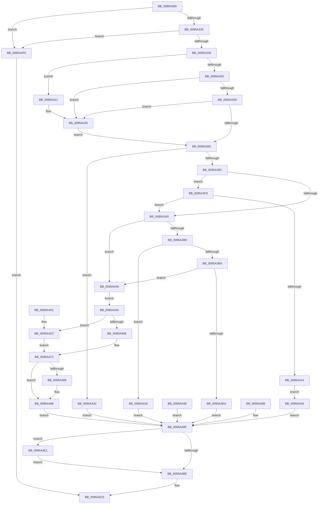

# ExpGetDeviceDataInformation

- RVA: `0x0095A300`–`0x0095A4F7` (길이 `503` bytes)
- VA: `0x000000014095A300`
- 실행 섹션: `PAGE`
- PDB 이름 있음: `예`; PDB Function 태그: `아니요`
- unwind 정보 RVA: `0x00092960`
- 디코드: `127`개 명령, `503/503` bytes 표시
- 미해석 바이트: `0` (있으면 어셈블리에 `.byte`로 보존)

> 이 문서는 커널 이미지의 기계어와 PDB 기호를 분석해 생성했습니다. 4번과 5번은 함수 원형과 자료형을 바이너리 사용 방식에서 추정한 C 해석이며 원본 소스 복구 결과는 아닙니다.

## 1. Dependencies

- 직접 호출 지점: **11**; 고유 호출 대상: **9**
- 직접 호출자로 확인된 함수: **1**
- RIP 상대 이미지 참조: **0**

### Outgoing calls
- `0x0095A389` → [ExpStringCapture](ExpStringCapture_function_00959BF4.md) (function, `0x00959BF4`)
- `0x0095A3C6` → [ProbeForWrite](../8E/ProbeForWrite_function_008E91C0.md) (function, `0x008E91C0`)
- `0x0095A3D8` → [ExAllocatePool2](../../poolcode/B8/ExAllocatePool2_function_00B820F0.md) (function, `0x00B820F0`)
- `0x0095A405` → [ExpStringCapture](ExpStringCapture_function_00959BF4.md) (function, `0x00959BF4`)
- `0x0095A421` → [ExRaiseDatatypeMisalignment](../89/ExRaiseDatatypeMisalignment_function_00899FD0.md) (function, `0x00899FD0`)
- `0x0095A46D` → [KseQueryDeviceData](KseQueryDeviceData_function_0095AFB0.md) (function, `0x0095AFB0`)
- `0x0095A491` → [memcpy](../../text/6C/memcpy_function_006C6840.md) (function, `0x006C6840`)
- `0x0095A4A7` → [ExpStringFree](../70/ExpStringFree_function_00702EE8.md) (function, `0x00702EE8`)
- `0x0095A4B4` → [ExpStringFree](../70/ExpStringFree_function_00702EE8.md) (function, `0x00702EE8`)
- `0x0095A4DA` → [KseQueryDeviceDataList](KseQueryDeviceDataList_function_00959390.md) (function, `0x00959390`)
- `0x0095A4E9` → [ExFreePoolWithTag](../../poolcode/B8/ExFreePoolWithTag_function_00B82870.md) (function, `0x00B82870`)

### Direct callers
- [ExpQuerySystemInformation](../A5/ExpQuerySystemInformation_function_00A57858.md) at `0x00A59D1D`

### Static image references
- 디코드된 RIP-relative 메모리 참조가 없습니다.

## 2. Other-region calls and transfers

- 다른 실행 섹션으로 향하는 call: **3**
  - `0x0095A3D8` → [ExAllocatePool2](../../poolcode/B8/ExAllocatePool2_function_00B820F0.md) (`PAGE` → `POOLCODE`)
  - `0x0095A491` → [memcpy](../../text/6C/memcpy_function_006C6840.md) (`PAGE` → `.text`)
  - `0x0095A4E9` → [ExFreePoolWithTag](../../poolcode/B8/ExFreePoolWithTag_function_00B82870.md) (`PAGE` → `POOLCODE`)
- 별도 외부 분기/꼬리 이동을 확인하지 못했습니다.

## 3. Assembly (complete function range)

```asm
0095A300  48 8B C4                        mov rax, rsp
0095A303  48 89 58 08                     mov qword ptr [rax + 8], rbx
0095A307  56                              push rsi
0095A308  57                              push rdi
0095A309  41 57                           push r15
0095A30B  48 83 EC 70                     sub rsp, 0x70
0095A30F  48 8B F2                        mov rsi, rdx
0095A312  44 8B F9                        mov r15d, ecx
0095A315  48 83 60 10 00                  and qword ptr [rax + 0x10], 0
0095A31A  48 83 60 20 00                  and qword ptr [rax + 0x20], 0
0095A31F  33 FF                           xor edi, edi
0095A321  48 89 78 B0                     mov qword ptr [rax - 0x50], rdi
0095A325  48 85 D2                        test rdx, rdx
0095A328  0F 84 C2 01 00 00               je 0x14095a4f0
0095A32E  41 83 F8 30                     cmp r8d, 0x30
0095A332  0F 85 B8 01 00 00               jne 0x14095a4f0
0095A338  40 F6 C6 03                     test sil, 3
0095A33C  0F 85 DF 00 00 00               jne 0x14095a421
0095A342  48 8D 42 30                     lea rax, [rdx + 0x30]
0095A346  48 B9 00 00 FF FF FF 7F 00 00   movabs rcx, 0x7fffffff0000
0095A350  48 3B C1                        cmp rax, rcx
0095A353  0F 87 CD 00 00 00               ja 0x14095a426
0095A359  48 3B C2                        cmp rax, rdx
0095A35C  0F 82 C4 00 00 00               jb 0x14095a426
0095A362  0F 10 02                        movups xmm0, xmmword ptr [rdx]
0095A365  0F 11 44 24 40                  movups xmmword ptr [rsp + 0x40], xmm0
0095A36A  0F 10 4A 10                     movups xmm1, xmmword ptr [rdx + 0x10]
0095A36E  0F 11 4C 24 50                  movups xmmword ptr [rsp + 0x50], xmm1
0095A373  0F 10 42 20                     movups xmm0, xmmword ptr [rdx + 0x20]
0095A377  0F 11 44 24 60                  movups xmmword ptr [rsp + 0x60], xmm0
0095A37C  48 8D 54 24 40                  lea rdx, [rsp + 0x40]
0095A381  48 8D 8C 24 98 00 00 00         lea rcx, [rsp + 0x98]
0095A389  E8 66 F8 FF FF                  call 0x140959bf4
0095A38E  8B D8                           mov ebx, eax
0095A390  89 44 24 30                     mov dword ptr [rsp + 0x30], eax
0095A394  85 C0                           test eax, eax
0095A396  0F 88 96 00 00 00               js 0x14095a432
0095A39C  41 81 FF 88 00 00 00            cmp r15d, 0x88
0095A3A3  74 53                           je 0x14095a3f8
0095A3A5  83 7C 24 64 00                  cmp dword ptr [rsp + 0x64], 0
0095A3AA  0F 86 86 00 00 00               jbe 0x14095a436
0095A3B0  48 8B 4C 24 68                  mov rcx, qword ptr [rsp + 0x68]
0095A3B5  48 85 C9                        test rcx, rcx
0095A3B8  74 5C                           je 0x14095a416
0095A3BA  8B 5C 24 64                     mov ebx, dword ptr [rsp + 0x64]
0095A3BE  41 B8 02 00 00 00               mov r8d, 2
0095A3C4  8B D3                           mov edx, ebx
0095A3C6  E8 F5 ED F8 FF                  call 0x1408e91c0
0095A3CB  41 B8 44 44 49 4E               mov r8d, 0x4e494444
0095A3D1  8B D3                           mov edx, ebx
0095A3D3  B9 01 01 00 00                  mov ecx, 0x101
0095A3D8  E8 13 7D 22 00                  call 0x140b820f0
0095A3DD  48 8B F8                        mov rdi, rax
0095A3E0  48 89 44 24 38                  mov qword ptr [rsp + 0x38], rax
0095A3E5  48 85 C0                        test rax, rax
0095A3E8  75 4C                           jne 0x14095a436
0095A3EA  BB 17 00 00 C0                  mov ebx, 0xc0000017
0095A3EF  89 5C 24 30                     mov dword ptr [rsp + 0x30], ebx
0095A3F3  E9 A7 00 00 00                  jmp 0x14095a49f
0095A3F8  48 8D 54 24 50                  lea rdx, [rsp + 0x50]
0095A3FD  48 8D 8C 24 A8 00 00 00         lea rcx, [rsp + 0xa8]
0095A405  E8 EA F7 FF FF                  call 0x140959bf4
0095A40A  8B D8                           mov ebx, eax
0095A40C  89 44 24 30                     mov dword ptr [rsp + 0x30], eax
0095A410  85 C0                           test eax, eax
0095A412  79 91                           jns 0x14095a3a5
0095A414  EB 1E                           jmp 0x14095a434
0095A416  BB 0D 00 00 C0                  mov ebx, 0xc000000d
0095A41B  89 5C 24 30                     mov dword ptr [rsp + 0x30], ebx
0095A41F  EB 7E                           jmp 0x14095a49f
0095A421  E8 AA FB F3 FF                  call 0x140899fd0
0095A426  8A 01                           mov al, byte ptr [rcx]
0095A428  48 8B 7C 24 38                  mov rdi, qword ptr [rsp + 0x38]
0095A42D  E9 30 FF FF FF                  jmp 0x14095a362
0095A432  EB 6B                           jmp 0x14095a49f
0095A434  EB 69                           jmp 0x14095a49f
0095A436  EB 0D                           jmp 0x14095a445
0095A438  8B D8                           mov ebx, eax
0095A43A  89 44 24 30                     mov dword ptr [rsp + 0x30], eax
0095A43E  48 8B 7C 24 38                  mov rdi, qword ptr [rsp + 0x38]
0095A443  EB 5A                           jmp 0x14095a49f
0095A445  4C 8D 4C 24 64                  lea r9, [rsp + 0x64]
0095A44A  48 8B 8C 24 98 00 00 00         mov rcx, qword ptr [rsp + 0x98]
0095A452  41 81 FF 88 00 00 00            cmp r15d, 0x88
0095A459  75 77                           jne 0x14095a4d2
0095A45B  48 89 7C 24 20                  mov qword ptr [rsp + 0x20], rdi
0095A460  4C 8D 44 24 60                  lea r8, [rsp + 0x60]
0095A465  48 8B 94 24 A8 00 00 00         mov rdx, qword ptr [rsp + 0xa8]
0095A46D  E8 3E 0B 00 00                  call 0x14095afb0
0095A472  8B D8                           mov ebx, eax
0095A474  8B 4C 24 64                     mov ecx, dword ptr [rsp + 0x64]
0095A478  89 4E 24                        mov dword ptr [rsi + 0x24], ecx
0095A47B  8B 44 24 60                     mov eax, dword ptr [rsp + 0x60]
0095A47F  89 46 20                        mov dword ptr [rsi + 0x20], eax
0095A482  85 DB                           test ebx, ebx
0095A484  78 10                           js 0x14095a496
0095A486  44 8B C1                        mov r8d, ecx
0095A489  48 8B D7                        mov rdx, rdi
0095A48C  48 8B 4C 24 68                  mov rcx, qword ptr [rsp + 0x68]
0095A491  E8 AA C3 D6 FF                  call 0x1406c6840
0095A496  EB 07                           jmp 0x14095a49f
0095A498  8B D8                           mov ebx, eax
0095A49A  48 8B 7C 24 38                  mov rdi, qword ptr [rsp + 0x38]
0095A49F  48 8B 8C 24 98 00 00 00         mov rcx, qword ptr [rsp + 0x98]
0095A4A7  E8 3C 8A DA FF                  call 0x140702ee8
0095A4AC  48 8B 8C 24 A8 00 00 00         mov rcx, qword ptr [rsp + 0xa8]
0095A4B4  E8 2F 8A DA FF                  call 0x140702ee8
0095A4B9  48 85 FF                        test rdi, rdi
0095A4BC  75 23                           jne 0x14095a4e1
0095A4BE  8B C3                           mov eax, ebx
0095A4C0  48 8B 9C 24 90 00 00 00         mov rbx, qword ptr [rsp + 0x90]
0095A4C8  48 83 C4 70                     add rsp, 0x70
0095A4CC  41 5F                           pop r15
0095A4CE  5F                              pop rdi
0095A4CF  5E                              pop rsi
0095A4D0  C3                              ret
0095A4D1  CC                              int3
0095A4D2  44 8B 44 24 64                  mov r8d, dword ptr [rsp + 0x64]
0095A4D7  48 8B D7                        mov rdx, rdi
0095A4DA  E8 B1 EE FF FF                  call 0x140959390
0095A4DF  EB 91                           jmp 0x14095a472
0095A4E1  BA 44 44 49 4E                  mov edx, 0x4e494444
0095A4E6  48 8B CF                        mov rcx, rdi
0095A4E9  E8 82 83 22 00                  call 0x140b82870
0095A4EE  EB CE                           jmp 0x14095a4be
0095A4F0  B8 04 00 00 C0                  mov eax, 0xc0000004
0095A4F5  EB C9                           jmp 0x14095a4c0
```

## 4. C-style interpretation (structured pseudocode)

```c
__int64 __fastcall ExpGetDeviceDataInformation(int a1, __int64 a2, int a3)
{
    __int64 result;
    __int64 v_rdi;
    __int64 v_rsp;
    unsigned __int64 v_stack_m20;
    unsigned int v_stack_m24;
    unsigned __int64 v_stack_m28;
    unsigned __int64 v_stack_m38;
    unsigned __int64 v_stack_m48;
    unsigned __int64 v_stack_m50;
    unsigned int v_stack_m58;
    unsigned __int64 v_stack_m68;
    unsigned __int64 v_stack_p10;
    unsigned __int64 v_stack_p20;
    unsigned int v_stack_p64;
    unsigned __int64 v_stack_p8;

    *(unsigned __int64 *)(v_rsp + 8) = v_rbx;
    v_rsp = (v_rsp) - (112);
    v_rdi = 0;
    *(unsigned __int64 *)(v_rsp - 80) = 0;
    if (a2 == 0) goto loc_0095A4F0;
    if (a3 != 48) goto loc_0095A4F0;
    if ((((unsigned __int8)(a2)) & (3)) != 0) goto loc_0095A421;
    if ((a2 + 48) > a1) goto loc_0095A426;
    if ((a2 + 48) < a2) goto loc_0095A426;
loc_0095A362:
    v_stack_m48 = v_xmm0;
    v_stack_m38 = v_xmm1;
    v_stack_m28 = v_xmm0;
    result = ExpStringCapture(v_stack_p10, v_stack_m48, a3, a4);
    v_stack_m58 = (unsigned int)(result);
    if (sign_flag) goto loc_0095A432;
    if (((unsigned int)((unsigned int)(a1))) == 136) goto loc_0095A3F8;
loc_0095A3A5:
    if (v_stack_m24 <= 0) goto loc_0095A436;
    if (v_stack_m20 == 0) goto loc_0095A416;
    result = ProbeForWrite(v_stack_m20, (unsigned int)((unsigned int)((unsigned int)(v_stack_m24))), 2, a4);
    result = ExAllocatePool2(257, (unsigned int)((unsigned int)((unsigned int)(v_stack_m24))), (unsigned int)(0x4E494444ULL), a4);
    v_stack_m50 = result;
    if (result != 0) goto loc_0095A436;
    v_stack_m58 = (unsigned int)((unsigned int)(0xC0000017ULL));
    goto loc_0095A49F;
loc_0095A3F8:
    result = ExpStringCapture(v_stack_p20, v_stack_m38, (unsigned int)(0x4E494444ULL), a4);
    v_stack_m58 = (unsigned int)(result);
    if (!sign_flag) goto loc_0095A3A5;
    goto loc_0095A434;
loc_0095A416:
    v_stack_m58 = (unsigned int)((unsigned int)(0xC000000DULL));
    goto loc_0095A49F;
loc_0095A421:
    result = ExRaiseDatatypeMisalignment(v_stack_p20, v_stack_m38, (unsigned int)(0x4E494444ULL), a4);
loc_0095A426:
    goto loc_0095A362;
loc_0095A432:
    goto loc_0095A49F;
loc_0095A434:
    goto loc_0095A49F;
loc_0095A436:
    goto loc_0095A445;
loc_0095A445:
    if (((unsigned int)((unsigned int)(a1))) != 136) goto loc_0095A4D2;
    v_stack_m68 = v_stack_m50;
    result = KseQueryDeviceData(v_stack_p10, v_stack_p20, v_stack_m28, v_stack_m24);
loc_0095A472:
    *(unsigned int *)(a2 + 36) = (unsigned int)((unsigned int)(v_stack_m24));
    *(unsigned int *)(a2 + 32) = (unsigned int)((unsigned int)(v_stack_m28));
    result = (unsigned int)(v_stack_m28);
    if (!(sign_flag)) {
        a3 = (unsigned int)((unsigned int)(v_stack_m24));
        a2 = v_stack_m50;
        a1 = v_stack_m20;
        result = memcpy(a1, a2, a3, v_stack_m24);
    }
    goto loc_0095A49F;
loc_0095A49F:
    result = ExpStringFree(v_stack_p10, a2, a3, v_stack_m24);
    result = ExpStringFree(v_stack_p20, a2, a3, v_stack_m24);
    if (v_stack_m50 != 0) goto loc_0095A4E1;
loc_0095A4BE:
loc_0095A4C0:
    v_rsp = (v_rsp) + (112);
    return (unsigned int)((unsigned int)((unsigned int)((unsigned int)(result))));
loc_0095A4D2:
    result = KseQueryDeviceDataList(v_stack_p20, v_stack_m50, (unsigned int)(v_stack_p64), v_stack_m24);
    goto loc_0095A472;
loc_0095A4E1:
    result = ExFreePoolWithTag(v_stack_m50, (unsigned int)(0x4E494444ULL), (unsigned int)(v_stack_p64), v_stack_m24);
    goto loc_0095A4BE;
loc_0095A4F0:
    goto loc_0095A4C0;
}
```

## 5. (Beta) C Style

```c
int64_t ExpGetDeviceDataInformation(int32_t Arg1, int64_t Arg2, int32_t Arg3)
{
    int64_t result;
    int64_t local_rdi;
    int64_t local_rsp;
    uint64_t v_stack_m20;
    uint32_t v_stack_m24;
    uint64_t v_stack_m28;
    uint64_t v_stack_m38;
    uint64_t v_stack_m48;
    uint64_t v_stack_m50;
    uint32_t v_stack_m58;
    uint64_t v_stack_m68;
    uint64_t v_stack_p10;
    uint64_t v_stack_p20;
    uint32_t v_stack_p64;
    uint64_t v_stack_p8;

    *(uint64_t *)(local_rsp + 0x8) = local_rbx;
    local_rsp = (local_rsp) - (112);
    local_rdi = 0;
    *(uint64_t *)(local_rsp - 0x50) = 0;
    if (Arg2 == 0) goto loc_0095A4F0;
    if (Arg3 != 48) goto loc_0095A4F0;
    if ((((uint8_t)(Arg2)) & (3)) != 0) goto loc_0095A421;
    if ((Arg2 + 48) > Arg1) goto loc_0095A426;
    if ((Arg2 + 48) < Arg2) goto loc_0095A426;
loc_0095A362:
    v_stack_m48 = v_xmm0;
    v_stack_m38 = v_xmm1;
    v_stack_m28 = v_xmm0;
    result = ExpStringCapture(v_stack_p10, v_stack_m48, Arg3, a4);
    v_stack_m58 = (uint32_t)(result);
    if (sign_flag) goto loc_0095A432;
    if (((uint32_t)((uint32_t)(Arg1))) == 136) goto loc_0095A3F8;
loc_0095A3A5:
    if (v_stack_m24 <= 0) goto loc_0095A436;
    if (v_stack_m20 == 0) goto loc_0095A416;
    result = ProbeForWrite(v_stack_m20, (uint32_t)((uint32_t)((uint32_t)(v_stack_m24))), 2, a4);
    result = ExAllocatePool2(257, (uint32_t)((uint32_t)((uint32_t)(v_stack_m24))), (uint32_t)(0x4E494444ULL), a4);
    v_stack_m50 = result;
    if (result != 0) goto loc_0095A436;
    v_stack_m58 = (uint32_t)((uint32_t)(0xC0000017ULL));
    goto loc_0095A49F;
loc_0095A3F8:
    result = ExpStringCapture(v_stack_p20, v_stack_m38, (uint32_t)(0x4E494444ULL), a4);
    v_stack_m58 = (uint32_t)(result);
    if (!sign_flag) goto loc_0095A3A5;
    goto loc_0095A434;
loc_0095A416:
    v_stack_m58 = (uint32_t)((uint32_t)(0xC000000DULL));
    goto loc_0095A49F;
loc_0095A421:
    result = ExRaiseDatatypeMisalignment(v_stack_p20, v_stack_m38, (uint32_t)(0x4E494444ULL), a4);
loc_0095A426:
    goto loc_0095A362;
loc_0095A432:
    goto loc_0095A49F;
loc_0095A434:
    goto loc_0095A49F;
loc_0095A436:
    goto loc_0095A445;
loc_0095A445:
    if (((uint32_t)((uint32_t)(Arg1))) != 136) goto loc_0095A4D2;
    v_stack_m68 = v_stack_m50;
    result = KseQueryDeviceData(v_stack_p10, v_stack_p20, v_stack_m28, v_stack_m24);
loc_0095A472:
    *(uint32_t *)(Arg2 + 0x24) = (uint32_t)((uint32_t)(v_stack_m24));
    *(uint32_t *)(Arg2 + 0x20) = (uint32_t)((uint32_t)(v_stack_m28));
    result = (uint32_t)(v_stack_m28);
    if (!(sign_flag)) {
        Arg3 = (uint32_t)((uint32_t)(v_stack_m24));
        Arg2 = v_stack_m50;
        Arg1 = v_stack_m20;
        result = memcpy(Arg1, Arg2, Arg3, v_stack_m24);
    }
    goto loc_0095A49F;
loc_0095A49F:
    result = ExpStringFree(v_stack_p10, Arg2, Arg3, v_stack_m24);
    result = ExpStringFree(v_stack_p20, Arg2, Arg3, v_stack_m24);
    if (v_stack_m50 != 0) goto loc_0095A4E1;
loc_0095A4BE:
loc_0095A4C0:
    local_rsp = (local_rsp) + (112);
    return (uint32_t)((uint32_t)((uint32_t)((uint32_t)(result))));
loc_0095A4D2:
    result = KseQueryDeviceDataList(v_stack_p20, v_stack_m50, (uint32_t)(v_stack_p64), v_stack_m24);
    goto loc_0095A472;
loc_0095A4E1:
    result = ExFreePoolWithTag(v_stack_m50, (uint32_t)(0x4E494444ULL), (uint32_t)(v_stack_p64), v_stack_m24);
    goto loc_0095A4BE;
loc_0095A4F0:
    goto loc_0095A4C0;
}
```

## 6. Execution-region graph

[열기: 2D/3D 그래프와 함수 탐색 컨트롤 패널](../../../control-panel.html?section=page&rva=0x0095A300&view=graph)

- 2D 그래프는 위에서 아래로 흐르고, 3D 그래프는 빈 공간을 드래그해 회전합니다. Shift+드래그는 이동, 휠은 확대·축소, 함수 노드 선택은 대상 보고서 이동입니다.

### Static fallback


