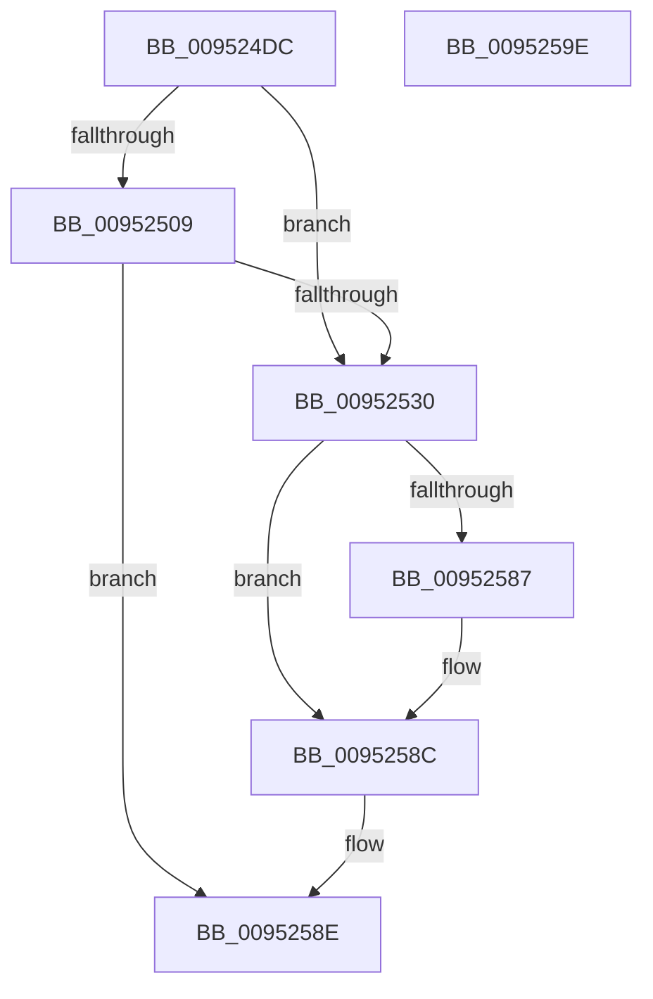

# ExpGetFirmwareEnvironmentVariable

- RVA: `0x009524DC`–`0x0095259F` (길이 `195` bytes)
- VA: `0x00000001409524DC`
- 실행 섹션: `PAGE`
- PDB 이름 있음: `예`; PDB Function 태그: `아니요`
- unwind 정보 RVA: `0x000718AC`
- 디코드: `51`개 명령, `195/195` bytes 표시
- 미해석 바이트: `0` (있으면 어셈블리에 `.byte`로 보존)

> 이 문서는 커널 이미지의 기계어와 PDB 기호를 분석해 생성했습니다. 4번과 5번은 함수 원형과 자료형을 바이너리 사용 방식에서 추정한 C 해석이며 원본 소스 복구 결과는 아닙니다.

## 1. Dependencies

- 직접 호출 지점: **6**; 고유 호출 대상: **6**
- 직접 호출자로 확인된 함수: **1**
- RIP 상대 이미지 참조: **1**

### Outgoing calls
- `0x00952527` → [ExLockUserBuffer](ExLockUserBuffer_function_009533B8.md) (function, `0x009533B8`)
- `0x00952548` → [ExAcquireFastMutexUnsafe](../../text/3F/ExAcquireFastMutexUnsafe_function_003F3720.md) (function, `0x003F3720`)
- `0x00952565` → [IoGetEnvironmentVariableEx](IoGetEnvironmentVariableEx_function_00952760.md) (function, `0x00952760`)
- `0x00952573` → [ExReleaseFastMutexUnsafe](../../text/25/ExReleaseFastMutexUnsafe_function_002503A0.md) (function, `0x002503A0`)
- `0x00952578` → [KeLeaveCriticalRegion](../../text/25/KeLeaveCriticalRegion_function_0025D8B0.md) (function, `0x0025D8B0`)
- `0x00952587` → [ExUnlockUserBuffer](../../text/29/ExUnlockUserBuffer_function_0029F258.md) (function, `0x0029F258`)

### Direct callers
- [ExGetFirmwareEnvironmentVariable](ExGetFirmwareEnvironmentVariable_function_00952080.md) at `0x009520CE`

### Static image references
- `0x00952539` → RVA `0x00EFAB40` (`.data`; read)

## 2. Other-region calls and transfers

- 다른 실행 섹션으로 향하는 call: **4**
  - `0x00952548` → [ExAcquireFastMutexUnsafe](../../text/3F/ExAcquireFastMutexUnsafe_function_003F3720.md) (`PAGE` → `.text`)
  - `0x00952573` → [ExReleaseFastMutexUnsafe](../../text/25/ExReleaseFastMutexUnsafe_function_002503A0.md) (`PAGE` → `.text`)
  - `0x00952578` → [KeLeaveCriticalRegion](../../text/25/KeLeaveCriticalRegion_function_0025D8B0.md) (`PAGE` → `.text`)
  - `0x00952587` → [ExUnlockUserBuffer](../../text/29/ExUnlockUserBuffer_function_0029F258.md) (`PAGE` → `.text`)
- 별도 외부 분기/꼬리 이동을 확인하지 못했습니다.

## 3. Assembly (complete function range)

```asm
009524DC  4C 8B DC                        mov r11, rsp
009524DF  49 89 5B 08                     mov qword ptr [r11 + 8], rbx
009524E3  49 89 73 10                     mov qword ptr [r11 + 0x10], rsi
009524E7  57                              push rdi
009524E8  48 83 EC 40                     sub rsp, 0x40
009524EC  49 83 63 E8 00                  and qword ptr [r11 - 0x18], 0
009524F1  48 8B FA                        mov rdi, rdx
009524F4  49 83 63 20 00                  and qword ptr [r11 + 0x20], 0
009524F9  49 8B D9                        mov rbx, r9
009524FC  41 8B 11                        mov edx, dword ptr [r9]
009524FF  49 8B C0                        mov rax, r8
00952502  48 8B F1                        mov rsi, rcx
00952505  85 D2                           test edx, edx
00952507  74 27                           je 0x140952530
00952509  44 8A 44 24 78                  mov r8b, byte ptr [rsp + 0x78]
0095250E  49 8D 4B E8                     lea rcx, [r11 - 0x18]
00952512  49 89 4B E0                     mov qword ptr [r11 - 0x20], rcx
00952516  41 B9 01 00 00 00               mov r9d, 1
0095251C  49 8D 4B 20                     lea rcx, [r11 + 0x20]
00952520  49 89 4B D8                     mov qword ptr [r11 - 0x28], rcx
00952524  48 8B C8                        mov rcx, rax
00952527  E8 8C 0E 00 00                  call 0x1409533b8
0095252C  85 C0                           test eax, eax
0095252E  78 5E                           js 0x14095258e
00952530  65 48 8B 04 25 88 01 00 00      mov rax, qword ptr gs:[0x188]
00952539  48 8D 0D 00 86 5A 00            lea rcx, [rip + 0x5a8600]
00952540  66 FF 88 E4 01 00 00            dec word ptr [rax + 0x1e4]
00952547  90                              nop
00952548  E8 D3 11 AA FF                  call 0x1403f3720
0095254D  48 8B 44 24 70                  mov rax, qword ptr [rsp + 0x70]
00952552  4C 8B CB                        mov r9, rbx
00952555  4C 8B 44 24 68                  mov r8, qword ptr [rsp + 0x68]
0095255A  48 8B D7                        mov rdx, rdi
0095255D  48 8B CE                        mov rcx, rsi
00952560  48 89 44 24 20                  mov qword ptr [rsp + 0x20], rax
00952565  E8 F6 01 00 00                  call 0x140952760
0095256A  48 8D 0D CF 85 5A 00            lea rcx, [rip + 0x5a85cf]
00952571  8B D8                           mov ebx, eax
00952573  E8 28 DE 8F FF                  call 0x1402503a0
00952578  E8 33 B3 90 FF                  call 0x14025d8b0
0095257D  48 8B 4C 24 30                  mov rcx, qword ptr [rsp + 0x30]
00952582  48 85 C9                        test rcx, rcx
00952585  74 05                           je 0x14095258c
00952587  E8 CC CC 94 FF                  call 0x14029f258
0095258C  8B C3                           mov eax, ebx
0095258E  48 8B 5C 24 50                  mov rbx, qword ptr [rsp + 0x50]
00952593  48 8B 74 24 58                  mov rsi, qword ptr [rsp + 0x58]
00952598  48 83 C4 40                     add rsp, 0x40
0095259C  5F                              pop rdi
0095259D  C3                              ret
0095259E  CC                              int3
```

## 4. C-style interpretation (structured pseudocode)

```c
__int64 __fastcall ExpGetFirmwareEnvironmentVariable(__int64 a1, __int64 a2, __int64 a3, __int64 a4, __int64 a5, unsigned __int8 a6)
{
    __int64 result;
    __int64 v_rsp;
    unsigned __int64 v_stack_m18;
    unsigned __int64 v_stack_m28;
    unsigned __int64 v_stack_p10;
    unsigned __int64 v_stack_p20;
    unsigned __int64 v_stack_p8;

    *(unsigned __int64 *)(v_rsp + 8) = v_rbx;
    *(unsigned __int64 *)(v_rsp + 16) = v_rsi;
    v_rsp = (v_rsp) - (64);
    if ((unsigned int)((unsigned int)(*(unsigned int *)(a4))) == 0) goto loc_00952530;
    *(unsigned __int64 *)(v_rsp - 32) = v_rsp - 24;
    *(unsigned __int64 *)(v_rsp - 40) = v_rsp + 32;
    result = ExLockUserBuffer(a3, (unsigned int)(*(unsigned int *)(a4)), a6, 1);
    if (sign_flag) goto loc_0095258E;
loc_00952530:
    result = ExAcquireFastMutexUnsafe(v_rip + 5932544, (unsigned int)(*(unsigned int *)(a4)), a6, 1);
    v_stack_m28 = a5;
    result = IoGetEnvironmentVariableEx(a1, a2, v_stack_p20, a4);
    result = ExReleaseFastMutexUnsafe(v_rip + 5932495, a2, v_stack_p20, a4);
    result = KeLeaveCriticalRegion(v_rip + 5932495, a2, v_stack_p20, a4);
    if (v_stack_m18 != 0) {
        result = ExUnlockUserBuffer(v_stack_m18, a2, v_stack_p20, a4);
    }
loc_0095258E:
    v_rsp = (v_rsp) + (64);
    return (unsigned int)((unsigned int)((unsigned int)((unsigned int)(result))));
}
```

## 5. (Beta) C Style

```c
int64_t ExpGetFirmwareEnvironmentVariable(int64_t Arg1, int64_t Arg2, int64_t Arg3, void *Arg4, int64_t Arg5, uint8_t Arg6)
{
    uint8_t *arg4 = (uint8_t *)Arg4;

    int64_t result;
    int64_t local_rsp;
    uint64_t v_stack_m18;
    uint64_t v_stack_m28;
    uint64_t v_stack_p10;
    uint64_t v_stack_p20;
    uint64_t v_stack_p8;

    *(uint64_t *)(local_rsp + 0x8) = local_rbx;
    *(uint64_t *)(local_rsp + 0x10) = local_rsi;
    local_rsp = (local_rsp) - (64);
    if ((uint32_t)((uint32_t)(*(uint32_t *)(arg4))) == 0) goto loc_00952530;
    *(uint64_t *)(local_rsp - 0x20) = local_rsp - 24;
    *(uint64_t *)(local_rsp - 0x28) = local_rsp + 32;
    result = ExLockUserBuffer(Arg3, (uint32_t)(*(uint32_t *)(arg4)), Arg6, 1);
    if (sign_flag) goto loc_0095258E;
loc_00952530:
    result = ExAcquireFastMutexUnsafe(v_rip + 5932544, (uint32_t)(*(uint32_t *)(arg4)), Arg6, 1);
    v_stack_m28 = Arg5;
    result = IoGetEnvironmentVariableEx(Arg1, Arg2, v_stack_p20, Arg4);
    result = ExReleaseFastMutexUnsafe(v_rip + 5932495, Arg2, v_stack_p20, Arg4);
    result = KeLeaveCriticalRegion(v_rip + 5932495, Arg2, v_stack_p20, Arg4);
    if (v_stack_m18 != 0) {
        result = ExUnlockUserBuffer(v_stack_m18, Arg2, v_stack_p20, Arg4);
    }
loc_0095258E:
    local_rsp = (local_rsp) + (64);
    return (uint32_t)((uint32_t)((uint32_t)((uint32_t)(result))));
}
```

### 관측된 메모리 오프셋

구조체 형식이 확인되지 않은 접근은 인자 기준의 오프셋으로만 기록했습니다.

| 기준 인자 | 오프셋 표현 | 폭 (bit) | 접근 |
|---|---:|---:|---|
| `Arg4` | `+ 0x0` | `32` | `R` |

## 6. Execution-region graph

[열기: 2D/3D 그래프와 함수 탐색 컨트롤 패널](../../../control-panel.html?section=page&rva=0x009524DC&view=graph)

- 2D 그래프는 위에서 아래로 흐르고, 3D 그래프는 빈 공간을 드래그해 회전합니다. Shift+드래그는 이동, 휠은 확대·축소, 함수 노드 선택은 대상 보고서 이동입니다.

### Static fallback


