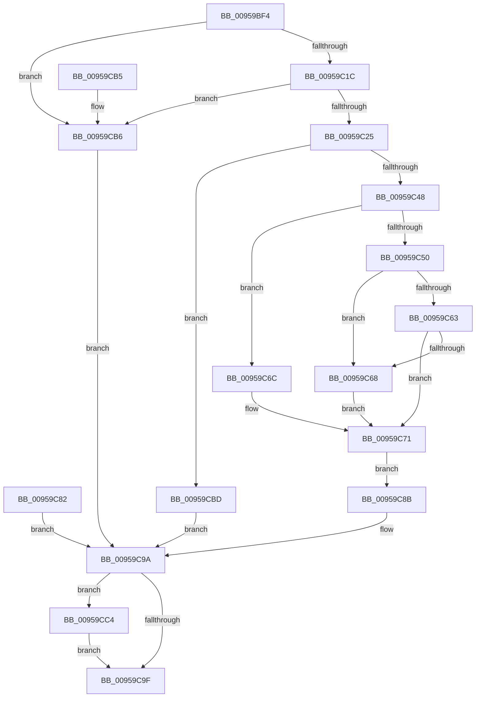

# ExpStringCapture

- RVA: `0x00959BF4`–`0x00959CD3` (길이 `223` bytes)
- VA: `0x0000000140959BF4`
- 실행 섹션: `PAGE`
- PDB 이름 있음: `예`; PDB Function 태그: `아니요`
- unwind 정보 RVA: `0x00092888`
- 디코드: `68`개 명령, `223/223` bytes 표시
- 미해석 바이트: `0` (있으면 어셈블리에 `.byte`로 보존)

> 이 문서는 커널 이미지의 기계어와 PDB 기호를 분석해 생성했습니다. 4번과 5번은 함수 원형과 자료형을 바이너리 사용 방식에서 추정한 C 해석이며 원본 소스 복구 결과는 아닙니다.

## 1. Dependencies

- 직접 호출 지점: **4**; 고유 호출 대상: **4**
- 직접 호출자로 확인된 함수: **1**
- RIP 상대 이미지 참조: **0**

### Outgoing calls
- `0x00959C36` → [ExAllocatePool2](../../poolcode/B8/ExAllocatePool2_function_00B820F0.md) (function, `0x00B820F0`)
- `0x00959C6C` → [ExRaiseDatatypeMisalignment](../89/ExRaiseDatatypeMisalignment_function_00899FD0.md) (function, `0x00899FD0`)
- `0x00959C7B` → [memcpy](../../text/6C/memcpy_function_006C6840.md) (function, `0x006C6840`)
- `0x00959CCC` → [ExFreePoolWithTag](../../poolcode/B8/ExFreePoolWithTag_function_00B82870.md) (function, `0x00B82870`)

### Direct callers
- [ExpGetDeviceDataInformation](ExpGetDeviceDataInformation_function_0095A300.md) at `0x0095A389`
- [ExpGetDeviceDataInformation](ExpGetDeviceDataInformation_function_0095A300.md) at `0x0095A405`

### Static image references
- 디코드된 RIP-relative 메모리 참조가 없습니다.

## 2. Other-region calls and transfers

- 다른 실행 섹션으로 향하는 call: **3**
  - `0x00959C36` → [ExAllocatePool2](../../poolcode/B8/ExAllocatePool2_function_00B820F0.md) (`PAGE` → `POOLCODE`)
  - `0x00959C7B` → [memcpy](../../text/6C/memcpy_function_006C6840.md) (`PAGE` → `.text`)
  - `0x00959CCC` → [ExFreePoolWithTag](../../poolcode/B8/ExFreePoolWithTag_function_00B82870.md) (`PAGE` → `POOLCODE`)
- 별도 외부 분기/꼬리 이동을 확인하지 못했습니다.

## 3. Assembly (complete function range)

```asm
00959BF4  48 89 5C 24 08                  mov qword ptr [rsp + 8], rbx
00959BF9  48 89 74 24 18                  mov qword ptr [rsp + 0x18], rsi
00959BFE  57                              push rdi
00959BFF  41 56                           push r14
00959C01  41 57                           push r15
00959C03  48 83 EC 20                     sub rsp, 0x20
00959C07  4C 8B F2                        mov r14, rdx
00959C0A  4C 8B F9                        mov r15, rcx
00959C0D  33 FF                           xor edi, edi
00959C0F  8B DF                           mov ebx, edi
00959C11  0F B7 02                        movzx eax, word ptr [rdx]
00959C14  A8 01                           test al, 1
00959C16  0F 85 9A 00 00 00               jne 0x140959cb6
00959C1C  66 85 C0                        test ax, ax
00959C1F  0F 84 91 00 00 00               je 0x140959cb6
00959C25  8B F0                           mov esi, eax
00959C27  48 8D 50 02                     lea rdx, [rax + 2]
00959C2B  B9 01 01 00 00                  mov ecx, 0x101
00959C30  41 B8 45 58 53 50               mov r8d, 0x50535845
00959C36  E8 B5 84 22 00                  call 0x140b820f0
00959C3B  48 8B D8                        mov rbx, rax
00959C3E  48 89 44 24 48                  mov qword ptr [rsp + 0x48], rax
00959C43  48 85 C0                        test rax, rax
00959C46  74 75                           je 0x140959cbd
00959C48  49 8B 46 08                     mov rax, qword ptr [r14 + 8]
00959C4C  A8 01                           test al, 1
00959C4E  75 1C                           jne 0x140959c6c
00959C50  48 8D 0C 30                     lea rcx, [rax + rsi]
00959C54  48 BA 00 00 FF FF FF 7F 00 00   movabs rdx, 0x7fffffff0000
00959C5E  48 3B CA                        cmp rcx, rdx
00959C61  77 05                           ja 0x140959c68
00959C63  48 3B C8                        cmp rcx, rax
00959C66  73 09                           jae 0x140959c71
00959C68  8A 02                           mov al, byte ptr [rdx]
00959C6A  EB 05                           jmp 0x140959c71
00959C6C  E8 5F 03 F4 FF                  call 0x140899fd0
00959C71  4C 8B C6                        mov r8, rsi
00959C74  49 8B 56 08                     mov rdx, qword ptr [r14 + 8]
00959C78  48 8B CB                        mov rcx, rbx
00959C7B  E8 C0 CB D6 FF                  call 0x1406c6840
00959C80  EB 09                           jmp 0x140959c8b
00959C82  8B F0                           mov esi, eax
00959C84  48 8B 5C 24 48                  mov rbx, qword ptr [rsp + 0x48]
00959C89  EB 0F                           jmp 0x140959c9a
00959C8B  48 D1 EE                        shr rsi, 1
00959C8E  66 89 3C 73                     mov word ptr [rbx + rsi*2], di
00959C92  49 89 1F                        mov qword ptr [r15], rbx
00959C95  48 8B DF                        mov rbx, rdi
00959C98  8B F7                           mov esi, edi
00959C9A  48 85 DB                        test rbx, rbx
00959C9D  75 25                           jne 0x140959cc4
00959C9F  8B C6                           mov eax, esi
00959CA1  48 8B 5C 24 40                  mov rbx, qword ptr [rsp + 0x40]
00959CA6  48 8B 74 24 50                  mov rsi, qword ptr [rsp + 0x50]
00959CAB  48 83 C4 20                     add rsp, 0x20
00959CAF  41 5F                           pop r15
00959CB1  41 5E                           pop r14
00959CB3  5F                              pop rdi
00959CB4  C3                              ret
00959CB5  CC                              int3
00959CB6  BE 0D 00 00 C0                  mov esi, 0xc000000d
00959CBB  EB DD                           jmp 0x140959c9a
00959CBD  BE 17 00 00 C0                  mov esi, 0xc0000017
00959CC2  EB D6                           jmp 0x140959c9a
00959CC4  BA 45 58 53 50                  mov edx, 0x50535845
00959CC9  48 8B CB                        mov rcx, rbx
00959CCC  E8 9F 8B 22 00                  call 0x140b82870
00959CD1  EB CC                           jmp 0x140959c9f
```

## 4. C-style interpretation (structured pseudocode)

```c
__int64 __fastcall ExpStringCapture(__int64 a1, __int64 a2)
{
    __int64 result;
    __int64 v_rdi;
    __int64 v_rsi;
    __int64 v_rsp;
    unsigned __int64 v_stack_p10;
    unsigned __int64 v_stack_p18;
    unsigned __int64 v_stack_p8;

    v_stack_p8 = v_rbx;
    v_stack_p18 = v_rsi;
    v_rsp = (v_rsp) - (32);
    v_rdi = 0;
    if ((((unsigned __int8)(*(unsigned __int16 *)(a2))) & (1)) != 0) goto loc_00959CB6;
    if ((unsigned __int16)(*(unsigned __int16 *)(a2)) == 0) goto loc_00959CB6;
    result = ExAllocatePool2(257, *(unsigned __int16 *)(a2) + 2, (unsigned int)(0x50535845ULL), a4);
    v_stack_p10 = result;
    if (result == 0) goto loc_00959CBD;
    if ((((unsigned __int8)(*(unsigned __int64 *)(a2 + 8))) & (1)) != 0) goto loc_00959C6C;
    if ((*(unsigned __int64 *)(a2 + 8) + (unsigned int)((unsigned int)(*(unsigned __int16 *)(a2))) * 1) > (*(unsigned __int16 *)(a2) + 2)) goto loc_00959C68;
    if ((*(unsigned __int64 *)(a2 + 8) + (unsigned int)((unsigned int)(*(unsigned __int16 *)(a2))) * 1) >= (*(unsigned __int64 *)(a2 + 8))) goto loc_00959C71;
loc_00959C68:
    goto loc_00959C71;
loc_00959C6C:
    result = ExRaiseDatatypeMisalignment(*(unsigned __int64 *)(a2 + 8) + (unsigned int)((unsigned int)(*(unsigned __int16 *)(a2))) * 1, *(unsigned __int16 *)(a2) + 2, (unsigned int)(0x50535845ULL), a4);
loc_00959C71:
    result = memcpy(result, *(unsigned __int64 *)(a2 + 8), (unsigned int)((unsigned int)(*(unsigned __int16 *)(a2))), a4);
    goto loc_00959C8B;
loc_00959C8B:
    v_rsi = ((unsigned int)((unsigned int)(*(unsigned __int16 *)(a2)))) >> (1);
    *(unsigned __int16 *)(result + v_rsi * 2) = 0;
    *(unsigned __int64 *)(a1) = result;
loc_00959C9A:
    if (0 != 0) goto loc_00959CC4;
loc_00959C9F:
    v_rsp = (v_rsp) + (32);
    return 0;
loc_00959CB6:
    goto loc_00959C9A;
loc_00959CBD:
    goto loc_00959C9A;
loc_00959CC4:
    result = ExFreePoolWithTag(v_stack_p8, (unsigned int)(0x50535845ULL), (unsigned int)((unsigned int)(*(unsigned __int16 *)(a2))), a4);
    goto loc_00959C9F;
}
```

## 5. (Beta) C Style

```c
int64_t ExpStringCapture(void *Arg1, void *Arg2)
{
    uint8_t *arg1 = (uint8_t *)Arg1;
    uint8_t *arg2 = (uint8_t *)Arg2;

    int64_t result;
    int64_t local_rdi;
    int64_t local_rsi;
    int64_t local_rsp;
    uint64_t v_stack_p10;
    uint64_t v_stack_p18;
    uint64_t v_stack_p8;

    v_stack_p8 = local_rbx;
    v_stack_p18 = local_rsi;
    local_rsp = (local_rsp) - (32);
    local_rdi = 0;
    if ((((uint8_t)(*(uint16_t *)(arg2))) & (1)) != 0) goto loc_00959CB6;
    if ((uint16_t)(*(uint16_t *)(arg2)) == 0) goto loc_00959CB6;
    result = ExAllocatePool2(257, *(uint16_t *)(arg2) + 2, (uint32_t)(0x50535845ULL), a4);
    v_stack_p10 = result;
    if (result == 0) goto loc_00959CBD;
    if ((((uint8_t)(*(uint64_t *)(arg2 + 0x8))) & (1)) != 0) goto loc_00959C6C;
    if ((*(uint64_t *)(arg2 + 0x8) + (uint32_t)((uint32_t)(*(uint16_t *)(arg2))) * 1) > (*(uint16_t *)(arg2) + 2)) goto loc_00959C68;
    if ((*(uint64_t *)(arg2 + 0x8) + (uint32_t)((uint32_t)(*(uint16_t *)(arg2))) * 1) >= (*(uint64_t *)(arg2 + 0x8))) goto loc_00959C71;
loc_00959C68:
    goto loc_00959C71;
loc_00959C6C:
    result = ExRaiseDatatypeMisalignment(*(uint64_t *)(arg2 + 0x8) + (uint32_t)((uint32_t)(*(uint16_t *)(arg2))) * 1, *(uint16_t *)(arg2) + 2, (uint32_t)(0x50535845ULL), a4);
loc_00959C71:
    result = memcpy(result, *(uint64_t *)(arg2 + 0x8), (uint32_t)((uint32_t)(*(uint16_t *)(arg2))), a4);
    goto loc_00959C8B;
loc_00959C8B:
    local_rsi = ((uint32_t)((uint32_t)(*(uint16_t *)(arg2)))) >> (1);
    *(uint16_t *)(result + local_rsi * 2) = 0;
    *(uint64_t *)(arg1) = result;
loc_00959C9A:
    if (0 != 0) goto loc_00959CC4;
loc_00959C9F:
    local_rsp = (local_rsp) + (32);
    return 0;
loc_00959CB6:
    goto loc_00959C9A;
loc_00959CBD:
    goto loc_00959C9A;
loc_00959CC4:
    result = ExFreePoolWithTag(v_stack_p8, (uint32_t)(0x50535845ULL), (uint32_t)((uint32_t)(*(uint16_t *)(arg2))), a4);
    goto loc_00959C9F;
}
```

### 관측된 메모리 오프셋

구조체 형식이 확인되지 않은 접근은 인자 기준의 오프셋으로만 기록했습니다.

| 기준 인자 | 오프셋 표현 | 폭 (bit) | 접근 |
|---|---:|---:|---|
| `Arg1` | `+ 0x0` | `64` | `W` |
| `Arg2` | `+ 0x0` | `16` | `R` |
| `Arg2` | `+ 0x8` | `64` | `R` |

## 6. Execution-region graph

[열기: 2D/3D 그래프와 함수 탐색 컨트롤 패널](../../../control-panel.html?section=page&rva=0x00959BF4&view=graph)

- 2D 그래프는 위에서 아래로 흐르고, 3D 그래프는 빈 공간을 드래그해 회전합니다. Shift+드래그는 이동, 휠은 확대·축소, 함수 노드 선택은 대상 보고서 이동입니다.

### Static fallback


