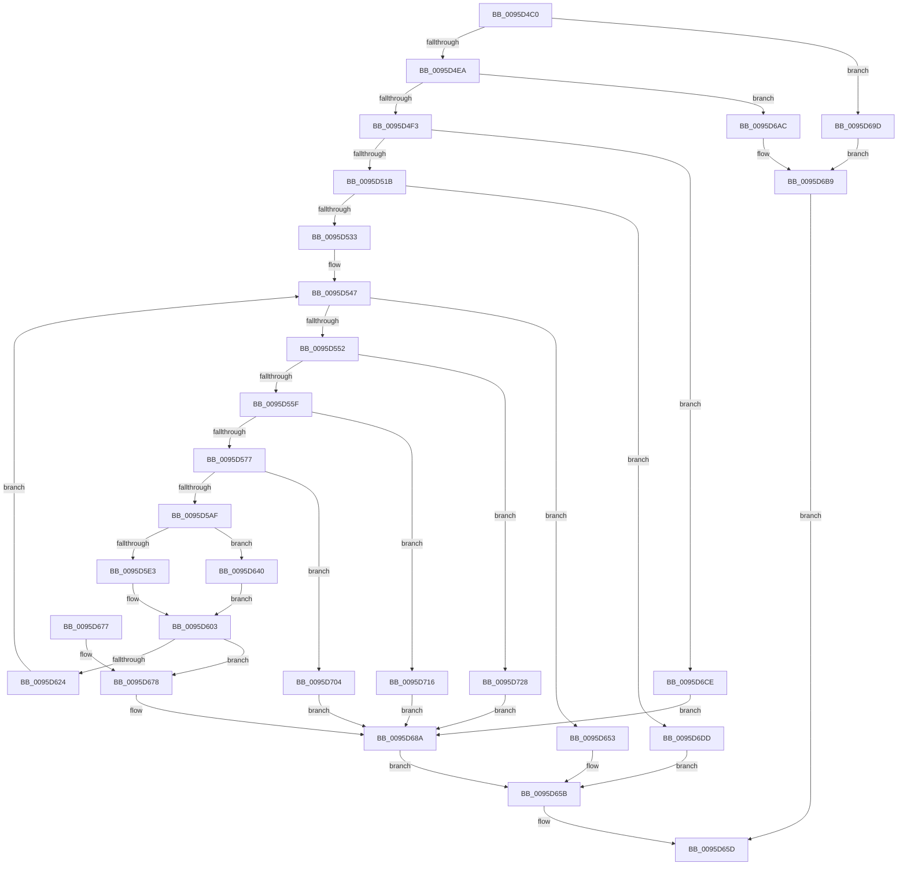

# InitOnceScanIndexes

- RVA: `0x0095D4C0`–`0x0095D73A` (길이 `634` bytes)
- VA: `0x000000014095D4C0`
- 실행 섹션: `PAGE`
- PDB 이름 있음: `예`; PDB Function 태그: `아니요`
- unwind 정보 RVA: `0x00092DA4`
- 디코드: `154`개 명령, `634/634` bytes 표시
- 미해석 바이트: `0` (있으면 어셈블리에 `.byte`로 보존)

> 이 문서는 커널 이미지의 기계어와 PDB 기호를 분석해 생성했습니다. 4번과 5번은 함수 원형과 자료형을 바이너리 사용 방식에서 추정한 C 해석이며 원본 소스 복구 결과는 아닙니다.

## 1. Dependencies

- 직접 호출 지점: **14**; 고유 호출 대상: **7**
- 직접 호출자로 확인된 함수: **0**
- RIP 상대 이미지 참조: **9**

### Outgoing calls
- `0x0095D502` → [memset](../../text/6C/memset_function_006C6C40.md) (function, `0x006C6C40`)
- `0x0095D520` → [SdbGetTagFromTagID](SdbGetTagFromTagID_function_0095E3C0.md) (function, `0x0095E3C0`)
- `0x0095D542` → [SdbFindFirstTag](SdbFindFirstTag_function_0095E34C.md) (function, `0x0095E34C`)
- `0x0095D56A` → [SdbFindFirstTag](SdbFindFirstTag_function_0095E34C.md) (function, `0x0095E34C`)
- `0x0095D57F` → [SdbReadWORDTag](SdbReadWORDTag_function_0095D898.md) (function, `0x0095D898`)
- `0x0095D5A2` → [SdbFindFirstTag](SdbFindFirstTag_function_0095E34C.md) (function, `0x0095E34C`)
- `0x0095D5B7` → [SdbReadWORDTag](SdbReadWORDTag_function_0095D898.md) (function, `0x0095D898`)
- `0x0095D5DA` → [SdbFindFirstTag](SdbFindFirstTag_function_0095E34C.md) (function, `0x0095E34C`)
- `0x0095D5EB` → [SdbReadDWORDTag](SdbReadDWORDTag_function_0095D408.md) (function, `0x0095D408`)
- `0x0095D60F` → [SdbFindFirstTag](SdbFindFirstTag_function_0095E34C.md) (function, `0x0095E34C`)
- `0x0095D636` → [SdbFindNextTag](SdbFindNextTag_function_0095D7F4.md) (function, `0x0095D7F4`)
- `0x0095D696` → [AslLogCallPrintf](AslLogCallPrintf_function_0095E4EC.md) (function, `0x0095E4EC`)
- `0x0095D6C5` → [AslLogCallPrintf](AslLogCallPrintf_function_0095E4EC.md) (function, `0x0095E4EC`)
- `0x0095D6FA` → [AslLogCallPrintf](AslLogCallPrintf_function_0095E4EC.md) (function, `0x0095E4EC`)

### Direct callers
- 이 함수 시작 RVA로 연결되는 직접 call은 확인되지 않았습니다. 간접 호출은 완전히 역산할 수 없습니다.

### Static image references
- `0x0095D67D` → RVA `0x000129A8` (`.rdata`; read)
- `0x0095D68A` → RVA `0x000129C8` (`.rdata`; read)
- `0x0095D69D` → RVA `0x0003E2B0` (`.rdata`; read)
- `0x0095D6AC` → RVA `0x0003E2E0` (`.rdata`; read)
- `0x0095D6CE` → RVA `0x0003E318` (`.rdata`; read)
- `0x0095D6DD` → RVA `0x0003E340` (`.rdata`; read)
- `0x0095D704` → RVA `0x0003E3D8` (`.rdata`; read)
- `0x0095D716` → RVA `0x0003E3B8` (`.rdata`; read)
- `0x0095D728` → RVA `0x0003E370` (`.rdata`; read)

## 2. Other-region calls and transfers

- 다른 실행 섹션으로 향하는 call: **1**
  - `0x0095D502` → [memset](../../text/6C/memset_function_006C6C40.md) (`PAGE` → `.text`)
- 별도 외부 분기/꼬리 이동을 확인하지 못했습니다.

## 3. Assembly (complete function range)

```asm
0095D4C0  48 89 5C 24 08                  mov qword ptr [rsp + 8], rbx
0095D4C5  48 89 6C 24 10                  mov qword ptr [rsp + 0x10], rbp
0095D4CA  48 89 74 24 18                  mov qword ptr [rsp + 0x18], rsi
0095D4CF  41 54                           push r12
0095D4D1  41 56                           push r14
0095D4D3  41 57                           push r15
0095D4D5  48 83 EC 30                     sub rsp, 0x30
0095D4D9  33 F6                           xor esi, esi
0095D4DB  4D 8B F8                        mov r15, r8
0095D4DE  48 8B DA                        mov rbx, rdx
0095D4E1  48 85 D2                        test rdx, rdx
0095D4E4  0F 84 B3 01 00 00               je 0x14095d69d
0095D4EA  4D 85 C0                        test r8, r8
0095D4ED  0F 84 B9 01 00 00               je 0x14095d6ac
0095D4F3  4C 8D 62 30                     lea r12, [rdx + 0x30]
0095D4F7  41 B8 00 0A 00 00               mov r8d, 0xa00
0095D4FD  49 8B CC                        mov rcx, r12
0095D500  33 D2                           xor edx, edx
0095D502  E8 39 97 D6 FF                  call 0x1406c6c40
0095D507  8B 43 14                        mov eax, dword ptr [rbx + 0x14]
0095D50A  8D 4E 0C                        lea ecx, [rsi + 0xc]
0095D50D  3B C8                           cmp ecx, eax
0095D50F  1B ED                           sbb ebp, ebp
0095D511  23 E9                           and ebp, ecx
0095D513  3B C1                           cmp eax, ecx
0095D515  0F 86 B3 01 00 00               jbe 0x14095d6ce
0095D51B  8B D5                           mov edx, ebp
0095D51D  48 8B CB                        mov rcx, rbx
0095D520  E8 9B 0E 00 00                  call 0x14095e3c0
0095D525  B9 02 78 00 00                  mov ecx, 0x7802
0095D52A  66 3B C1                        cmp ax, cx
0095D52D  0F 85 AA 01 00 00               jne 0x14095d6dd
0095D533  44 8D 41 01                     lea r8d, [rcx + 1]
0095D537  89 B3 4C 0A 00 00               mov dword ptr [rbx + 0xa4c], esi
0095D53D  48 8B CB                        mov rcx, rbx
0095D540  8B D5                           mov edx, ebp
0095D542  E8 05 0E 00 00                  call 0x14095e34c
0095D547  44 8B F0                        mov r14d, eax
0095D54A  85 C0                           test eax, eax
0095D54C  0F 84 01 01 00 00               je 0x14095d653
0095D552  83 BB 4C 0A 00 00 40            cmp dword ptr [rbx + 0xa4c], 0x40
0095D559  0F 84 C9 01 00 00               je 0x14095d728
0095D55F  41 B8 02 38 00 00               mov r8d, 0x3802
0095D565  8B D0                           mov edx, eax
0095D567  48 8B CB                        mov rcx, rbx
0095D56A  E8 DD 0D 00 00                  call 0x14095e34c
0095D56F  85 C0                           test eax, eax
0095D571  0F 84 9F 01 00 00               je 0x14095d716
0095D577  45 33 C0                        xor r8d, r8d
0095D57A  8B D0                           mov edx, eax
0095D57C  48 8B CB                        mov rcx, rbx
0095D57F  E8 14 03 00 00                  call 0x14095d898
0095D584  0F B7 D0                        movzx edx, ax
0095D587  41 B8 03 38 00 00               mov r8d, 0x3803
0095D58D  8B 83 4C 0A 00 00               mov eax, dword ptr [rbx + 0xa4c]
0095D593  48 8D 0C 80                     lea rcx, [rax + rax*4]
0095D597  66 89 54 CB 34                  mov word ptr [rbx + rcx*8 + 0x34], dx
0095D59C  41 8B D6                        mov edx, r14d
0095D59F  48 8B CB                        mov rcx, rbx
0095D5A2  E8 A5 0D 00 00                  call 0x14095e34c
0095D5A7  85 C0                           test eax, eax
0095D5A9  0F 84 55 01 00 00               je 0x14095d704
0095D5AF  45 33 C0                        xor r8d, r8d
0095D5B2  8B D0                           mov edx, eax
0095D5B4  48 8B CB                        mov rcx, rbx
0095D5B7  E8 DC 02 00 00                  call 0x14095d898
0095D5BC  0F B7 D0                        movzx edx, ax
0095D5BF  41 B8 16 40 00 00               mov r8d, 0x4016
0095D5C5  8B 83 4C 0A 00 00               mov eax, dword ptr [rbx + 0xa4c]
0095D5CB  48 8D 0C 80                     lea rcx, [rax + rax*4]
0095D5CF  66 89 54 CB 36                  mov word ptr [rbx + rcx*8 + 0x36], dx
0095D5D4  41 8B D6                        mov edx, r14d
0095D5D7  48 8B CB                        mov rcx, rbx
0095D5DA  E8 6D 0D 00 00                  call 0x14095e34c
0095D5DF  85 C0                           test eax, eax
0095D5E1  74 5D                           je 0x14095d640
0095D5E3  45 33 C0                        xor r8d, r8d
0095D5E6  8B D0                           mov edx, eax
0095D5E8  48 8B CB                        mov rcx, rbx
0095D5EB  E8 18 FE FF FF                  call 0x14095d408
0095D5F0  8B 8B 4C 0A 00 00               mov ecx, dword ptr [rbx + 0xa4c]
0095D5F6  8B D0                           mov edx, eax
0095D5F8  48 83 C1 02                     add rcx, 2
0095D5FC  48 8D 04 89                     lea rax, [rcx + rcx*4]
0095D600  89 14 C3                        mov dword ptr [rbx + rax*8], edx
0095D603  41 B8 01 98 00 00               mov r8d, 0x9801
0095D609  41 8B D6                        mov edx, r14d
0095D60C  48 8B CB                        mov rcx, rbx
0095D60F  E8 38 0D 00 00                  call 0x14095e34c
0095D614  8B D0                           mov edx, eax
0095D616  8B 83 4C 0A 00 00               mov eax, dword ptr [rbx + 0xa4c]
0095D61C  48 8D 0C 80                     lea rcx, [rax + rax*4]
0095D620  85 D2                           test edx, edx
0095D622  74 54                           je 0x14095d678
0095D624  89 54 CB 30                     mov dword ptr [rbx + rcx*8 + 0x30], edx
0095D628  45 8B C6                        mov r8d, r14d
0095D62B  FF 83 4C 0A 00 00               inc dword ptr [rbx + 0xa4c]
0095D631  8B D5                           mov edx, ebp
0095D633  48 8B CB                        mov rcx, rbx
0095D636  E8 B9 01 00 00                  call 0x14095d7f4
0095D63B  E9 07 FF FF FF                  jmp 0x14095d547
0095D640  8B 83 4C 0A 00 00               mov eax, dword ptr [rbx + 0xa4c]
0095D646  48 83 C0 02                     add rax, 2
0095D64A  48 8D 04 80                     lea rax, [rax + rax*4]
0095D64E  89 34 C3                        mov dword ptr [rbx + rax*8], esi
0095D651  EB B0                           jmp 0x14095d603
0095D653  4D 89 27                        mov qword ptr [r15], r12
0095D656  BE 01 00 00 00                  mov esi, 1
0095D65B  8B C6                           mov eax, esi
0095D65D  48 8B 5C 24 50                  mov rbx, qword ptr [rsp + 0x50]
0095D662  48 8B 6C 24 58                  mov rbp, qword ptr [rsp + 0x58]
0095D667  48 8B 74 24 60                  mov rsi, qword ptr [rsp + 0x60]
0095D66C  48 83 C4 30                     add rsp, 0x30
0095D670  41 5F                           pop r15
0095D672  41 5E                           pop r14
0095D674  41 5C                           pop r12
0095D676  C3                              ret
0095D677  CC                              int3
0095D678  66 89 74 CB 34                  mov word ptr [rbx + rcx*8 + 0x34], si
0095D67D  4C 8D 0D 24 53 6B FF            lea r9, [rip - 0x94acdc]
0095D684  41 B8 00 05 00 00               mov r8d, 0x500
0095D68A  48 8D 15 37 53 6B FF            lea rdx, [rip - 0x94acc9]
0095D691  B9 01 00 00 00                  mov ecx, 1
0095D696  E8 51 0E 00 00                  call 0x14095e4ec
0095D69B  EB BE                           jmp 0x14095d65b
0095D69D  4C 8D 0D 0C 0C 6E FF            lea r9, [rip - 0x91f3f4]
0095D6A4  41 B8 B6 04 00 00               mov r8d, 0x4b6
0095D6AA  EB 0D                           jmp 0x14095d6b9
0095D6AC  4C 8D 0D 2D 0C 6E FF            lea r9, [rip - 0x91f3d3]
0095D6B3  41 B8 BC 04 00 00               mov r8d, 0x4bc
0095D6B9  48 8D 15 08 53 6B FF            lea rdx, [rip - 0x94acf8]
0095D6C0  B9 01 00 00 00                  mov ecx, 1
0095D6C5  E8 22 0E 00 00                  call 0x14095e4ec
0095D6CA  33 C0                           xor eax, eax
0095D6CC  EB 8F                           jmp 0x14095d65d
0095D6CE  4C 8D 0D 43 0C 6E FF            lea r9, [rip - 0x91f3bd]
0095D6D5  41 B8 CB 04 00 00               mov r8d, 0x4cb
0095D6DB  EB AD                           jmp 0x14095d68a
0095D6DD  4C 8D 0D 5C 0C 6E FF            lea r9, [rip - 0x91f3a4]
0095D6E4  89 6C 24 20                     mov dword ptr [rsp + 0x20], ebp
0095D6E8  41 B8 D0 04 00 00               mov r8d, 0x4d0
0095D6EE  48 8D 15 D3 52 6B FF            lea rdx, [rip - 0x94ad2d]
0095D6F5  B9 01 00 00 00                  mov ecx, 1
0095D6FA  E8 ED 0D 00 00                  call 0x14095e4ec
0095D6FF  E9 57 FF FF FF                  jmp 0x14095d65b
0095D704  4C 8D 0D CD 0C 6E FF            lea r9, [rip - 0x91f333]
0095D70B  41 B8 EF 04 00 00               mov r8d, 0x4ef
0095D711  E9 74 FF FF FF                  jmp 0x14095d68a
0095D716  4C 8D 0D 9B 0C 6E FF            lea r9, [rip - 0x91f365]
0095D71D  41 B8 E6 04 00 00               mov r8d, 0x4e6
0095D723  E9 62 FF FF FF                  jmp 0x14095d68a
0095D728  4C 8D 0D 41 0C 6E FF            lea r9, [rip - 0x91f3bf]
0095D72F  41 B8 DF 04 00 00               mov r8d, 0x4df
0095D735  E9 50 FF FF FF                  jmp 0x14095d68a
```

## 4. C-style interpretation (structured pseudocode)

```c
__int64 __fastcall InitOnceScanIndexes(__int64 a1, __int64 a2, __int64 a3)
{
    __int64 result;
    __int64 v_rbp;
    __int64 v_rsi;
    __int64 v_rsp;
    unsigned __int64 v_stack_p10;
    unsigned __int64 v_stack_p18;
    unsigned int v_stack_p20;
    unsigned __int64 v_stack_p8;

    v_stack_p8 = v_rbx;
    v_stack_p10 = v_rbp;
    v_stack_p18 = v_rsi;
    v_rsp = (v_rsp) - (48);
    v_rsi = 0;
    if (a2 == 0) goto loc_0095D69D;
    if (a3 == 0) goto loc_0095D6AC;
    a2 = 0;
    result = memset(a2 + 48, a2, (unsigned int)(0xA00ULL), a4);
    v_rbp = (unsigned int)((v_rbp) & ((unsigned int)(v_rsi + 12)));
    if (((unsigned int)((unsigned int)(*(unsigned int *)(a2 + 20)))) <= ((unsigned int)(v_rsi + 12))) goto loc_0095D6CE;
    result = SdbGetTagFromTagID(0, (unsigned int)((unsigned int)(v_rbp)), (unsigned int)(0xA00ULL), a4);
    if (((unsigned __int16)(result)) != ((unsigned __int16)((unsigned int)(0x7802ULL)))) goto loc_0095D6DD;
    *(unsigned int *)(a2 + 2636) = 0;
    result = SdbFindFirstTag(0, (unsigned int)((unsigned int)(v_rbp)), (unsigned int)(0x7802ULL) + 1, a4);
loc_0095D547:
    if ((unsigned int)(result) == 0) goto loc_0095D653;
    if ((*(unsigned int *)(a2 + 2636)) == 64) goto loc_0095D728;
    result = SdbFindFirstTag(0, (unsigned int)((unsigned int)(result)), (unsigned int)(0x3802ULL), a4);
    if ((unsigned int)(result) == 0) goto loc_0095D716;
    a3 = 0;
    result = SdbReadWORDTag(0, (unsigned int)((unsigned int)(result)), a3, a4);
    *(unsigned __int16 *)(a2 + (unsigned int)(*(unsigned int *)(a2 + 2636)) + (unsigned int)(*(unsigned int *)(a2 + 2636)) * 4 * 8 + 52) = (unsigned __int16)((unsigned __int16)(result));
    result = SdbFindFirstTag(0, (unsigned int)((unsigned int)((unsigned int)((unsigned int)(result)))), (unsigned int)(0x3803ULL), a4);
    if ((unsigned int)(result) == 0) goto loc_0095D704;
    a3 = 0;
    result = SdbReadWORDTag(0, (unsigned int)((unsigned int)(result)), a3, a4);
    *(unsigned __int16 *)(a2 + (unsigned int)(*(unsigned int *)(a2 + 2636)) + (unsigned int)(*(unsigned int *)(a2 + 2636)) * 4 * 8 + 54) = (unsigned __int16)((unsigned __int16)(result));
    result = SdbFindFirstTag(0, (unsigned int)((unsigned int)((unsigned int)((unsigned int)(result)))), (unsigned int)(0x4016ULL), a4);
    if ((unsigned int)(result) == 0) goto loc_0095D640;
    a3 = 0;
    result = SdbReadDWORDTag(0, (unsigned int)((unsigned int)(result)), a3, a4);
    a1 = ((unsigned int)(*(unsigned int *)(a2 + 2636))) + (2);
    *(unsigned int *)(a2 + a1 + a1 * 4 * 8) = (unsigned int)((unsigned int)((unsigned int)(result)));
loc_0095D603:
    result = SdbFindFirstTag(0, (unsigned int)((unsigned int)((unsigned int)((unsigned int)(result)))), (unsigned int)(0x9801ULL), a4);
    if ((unsigned int)((unsigned int)((unsigned int)(result))) == 0) goto loc_0095D678;
    *(unsigned int *)(a2 + (unsigned int)(*(unsigned int *)(a2 + 2636)) + (unsigned int)(*(unsigned int *)(a2 + 2636)) * 4 * 8 + 48) = (unsigned int)((unsigned int)((unsigned int)(result)));
    result = SdbFindNextTag(0, (unsigned int)((unsigned int)(v_rbp)), (unsigned int)((unsigned int)((unsigned int)((unsigned int)(result)))), a4);
    goto loc_0095D547;
loc_0095D640:
    result = ((unsigned int)(*(unsigned int *)(a2 + 2636))) + (2);
    *(unsigned int *)(a2 + result + result * 4 * 8) = 0;
    goto loc_0095D603;
loc_0095D653:
    *(unsigned __int64 *)(a3) = a2 + 48;
loc_0095D65B:
loc_0095D65D:
    v_rsp = (v_rsp) + (48);
    return 1;
loc_0095D678:
    *(unsigned __int16 *)(v_stack_p8 + 0 * 8 + 52) = (unsigned __int16)(v_stack_p18);
loc_0095D68A:
    result = AslLogCallPrintf(1, v_rip - 9743561, (unsigned int)(0x500ULL), v_rip - 9743580);
    goto loc_0095D65B;
loc_0095D69D:
    goto loc_0095D6B9;
loc_0095D6AC:
loc_0095D6B9:
    result = AslLogCallPrintf(1, v_rip - 9743608, (unsigned int)(0x4BCULL), v_rip - 9565139);
    result = 0;
    goto loc_0095D65D;
loc_0095D6CE:
    goto loc_0095D68A;
loc_0095D6DD:
    v_stack_p20 = (unsigned int)(v_stack_p10);
    result = AslLogCallPrintf(1, v_rip - 9743661, (unsigned int)(0x4D0ULL), v_rip - 9565092);
    goto loc_0095D65B;
loc_0095D704:
    goto loc_0095D68A;
loc_0095D716:
    goto loc_0095D68A;
loc_0095D728:
    goto loc_0095D68A;
}
```

## 5. (Beta) C Style

```c
int64_t InitOnceScanIndexes(int64_t Arg1, void *Arg2, void *Arg3)
{
    uint8_t *arg2 = (uint8_t *)Arg2;
    uint8_t *arg3 = (uint8_t *)Arg3;

    int64_t result;
    int64_t local_rbp;
    int64_t local_rsi;
    int64_t local_rsp;
    uint64_t v_stack_p10;
    uint64_t v_stack_p18;
    uint32_t v_stack_p20;
    uint64_t v_stack_p8;

    v_stack_p8 = local_rbx;
    v_stack_p10 = local_rbp;
    v_stack_p18 = local_rsi;
    local_rsp = (local_rsp) - (48);
    local_rsi = 0;
    if (Arg2 == NULL) goto loc_0095D69D;
    if (Arg3 == NULL) goto loc_0095D6AC;
    Arg2 = 0;
    result = memset(Arg2 + 48, Arg2, (uint32_t)(0xA00ULL), a4);
    local_rbp = (uint32_t)((local_rbp) & ((uint32_t)(local_rsi + 12)));
    if (((uint32_t)((uint32_t)(*(uint32_t *)(arg2 + 0x14)))) <= ((uint32_t)(local_rsi + 12))) goto loc_0095D6CE;
    result = SdbGetTagFromTagID(0, (uint32_t)((uint32_t)(local_rbp)), (uint32_t)(0xA00ULL), a4);
    if (((uint16_t)(result)) != ((uint16_t)((uint32_t)(0x7802ULL)))) goto loc_0095D6DD;
    *(uint32_t *)(arg2 + 0xA4C) = 0;
    result = SdbFindFirstTag(0, (uint32_t)((uint32_t)(local_rbp)), (uint32_t)(0x7802ULL) + 1, a4);
loc_0095D547:
    if ((uint32_t)(result) == 0) goto loc_0095D653;
    if ((*(uint32_t *)(arg2 + 0xA4C)) == 64) goto loc_0095D728;
    result = SdbFindFirstTag(0, (uint32_t)((uint32_t)(result)), (uint32_t)(0x3802ULL), a4);
    if ((uint32_t)(result) == 0) goto loc_0095D716;
    Arg3 = 0;
    result = SdbReadWORDTag(0, (uint32_t)((uint32_t)(result)), Arg3, a4);
    *(uint16_t *)(arg2 + (uint32_t)(*(uint32_t *)(arg2 + 0xA4C)) + (uint32_t)(*(uint32_t *)(arg2 + 0xA4C)) * 4 * 8 + 0x34) = (uint16_t)((uint16_t)(result));
    result = SdbFindFirstTag(0, (uint32_t)((uint32_t)((uint32_t)((uint32_t)(result)))), (uint32_t)(0x3803ULL), a4);
    if ((uint32_t)(result) == 0) goto loc_0095D704;
    Arg3 = 0;
    result = SdbReadWORDTag(0, (uint32_t)((uint32_t)(result)), Arg3, a4);
    *(uint16_t *)(arg2 + (uint32_t)(*(uint32_t *)(arg2 + 0xA4C)) + (uint32_t)(*(uint32_t *)(arg2 + 0xA4C)) * 4 * 8 + 0x36) = (uint16_t)((uint16_t)(result));
    result = SdbFindFirstTag(0, (uint32_t)((uint32_t)((uint32_t)((uint32_t)(result)))), (uint32_t)(0x4016ULL), a4);
    if ((uint32_t)(result) == 0) goto loc_0095D640;
    Arg3 = 0;
    result = SdbReadDWORDTag(0, (uint32_t)((uint32_t)(result)), Arg3, a4);
    Arg1 = ((uint32_t)(*(uint32_t *)(arg2 + 0xA4C))) + (2);
    *(uint32_t *)(arg2 + Arg1 + Arg1 * 4 * 8) = (uint32_t)((uint32_t)((uint32_t)(result)));
loc_0095D603:
    result = SdbFindFirstTag(0, (uint32_t)((uint32_t)((uint32_t)((uint32_t)(result)))), (uint32_t)(0x9801ULL), a4);
    if ((uint32_t)((uint32_t)((uint32_t)(result))) == 0) goto loc_0095D678;
    *(uint32_t *)(arg2 + (uint32_t)(*(uint32_t *)(arg2 + 0xA4C)) + (uint32_t)(*(uint32_t *)(arg2 + 0xA4C)) * 4 * 8 + 0x30) = (uint32_t)((uint32_t)((uint32_t)(result)));
    result = SdbFindNextTag(0, (uint32_t)((uint32_t)(local_rbp)), (uint32_t)((uint32_t)((uint32_t)((uint32_t)(result)))), a4);
    goto loc_0095D547;
loc_0095D640:
    result = ((uint32_t)(*(uint32_t *)(arg2 + 0xA4C))) + (2);
    *(uint32_t *)(arg2 + result + result * 4 * 8) = 0;
    goto loc_0095D603;
loc_0095D653:
    *(void **)(arg3) = Arg2 + 48;
loc_0095D65B:
loc_0095D65D:
    local_rsp = (local_rsp) + (48);
    return 1;
loc_0095D678:
    *(uint16_t *)(v_stack_p8 + 0x0 * 8 + 0x34) = (uint16_t)(v_stack_p18);
loc_0095D68A:
    result = AslLogCallPrintf(1, v_rip - 9743561, (uint32_t)(0x500ULL), v_rip - 9743580);
    goto loc_0095D65B;
loc_0095D69D:
    goto loc_0095D6B9;
loc_0095D6AC:
loc_0095D6B9:
    result = AslLogCallPrintf(1, v_rip - 9743608, (uint32_t)(0x4BCULL), v_rip - 9565139);
    result = 0;
    goto loc_0095D65D;
loc_0095D6CE:
    goto loc_0095D68A;
loc_0095D6DD:
    v_stack_p20 = (uint32_t)(v_stack_p10);
    result = AslLogCallPrintf(1, v_rip - 9743661, (uint32_t)(0x4D0ULL), v_rip - 9565092);
    goto loc_0095D65B;
loc_0095D704:
    goto loc_0095D68A;
loc_0095D716:
    goto loc_0095D68A;
loc_0095D728:
    goto loc_0095D68A;
}
```

### 관측된 메모리 오프셋

구조체 형식이 확인되지 않은 접근은 인자 기준의 오프셋으로만 기록했습니다.

| 기준 인자 | 오프셋 표현 | 폭 (bit) | 접근 |
|---|---:|---:|---|
| `Arg2` | `+ 0x0 + rax*8` | `32` | `W` |
| `Arg2` | `+ 0x14` | `32` | `R` |
| `Arg2` | `+ 0x30 + rcx*8` | `32` | `W` |
| `Arg2` | `+ 0x34 + rcx*8` | `16` | `W` |
| `Arg2` | `+ 0x36 + rcx*8` | `16` | `W` |
| `Arg2` | `+ 0xA4C` | `32` | `R` |
| `Arg2` | `+ 0xA4C` | `32` | `R/W` |
| `Arg2` | `+ 0xA4C` | `32` | `W` |
| `Arg3` | `+ 0x0` | `64` | `W` |

## 6. Execution-region graph

[열기: 2D/3D 그래프와 함수 탐색 컨트롤 패널](../../../control-panel.html?section=page&rva=0x0095D4C0&view=graph)

- 2D 그래프는 위에서 아래로 흐르고, 3D 그래프는 빈 공간을 드래그해 회전합니다. Shift+드래그는 이동, 휠은 확대·축소, 함수 노드 선택은 대상 보고서 이동입니다.

### Static fallback


