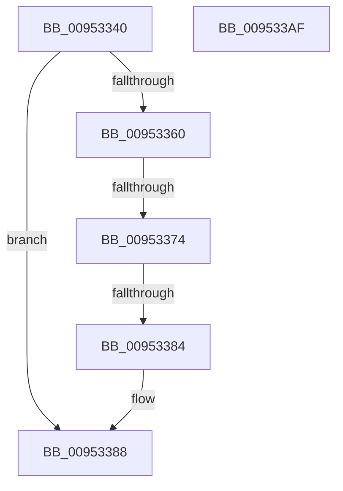

# IoGetDeviceInterfaces

- RVA: `0x00953340`–`0x009533B0` (길이 `112` bytes)
- VA: `0x0000000140953340`
- 실행 섹션: `PAGE`
- PDB 이름 있음: `예`; PDB Function 태그: `예`
- unwind 정보 RVA: `0x00066400`
- 디코드: `28`개 명령, `112/112` bytes 표시
- 미해석 바이트: `0` (있으면 어셈블리에 `.byte`로 보존)

> 이 문서는 커널 이미지의 기계어와 PDB 기호를 분석해 생성했습니다. 4번과 5번은 함수 원형과 자료형을 바이너리 사용 방식에서 추정한 C 해석이며 원본 소스 복구 결과는 아닙니다.

## 1. Dependencies

- 직접 호출 지점: **1**; 고유 호출 대상: **1**
- 직접 호출자로 확인된 함수: **8**
- RIP 상대 이미지 참조: **0**

### Outgoing calls
- `0x00953395` → [IopGetDeviceInterfaces](../8F/IopGetDeviceInterfaces_function_008F0120.md) (function, `0x008F0120`)

### Direct callers
- [PnprIsMemoryDevice](../73/PnprIsMemoryDevice_function_00739DF0.md) at `0x00739E29`
- [PnprIsProcessorDevice](../73/PnprIsProcessorDevice_function_00739EA8.md) at `0x00739EEE`
- [PopRegisterCoolingExtensionProtection](../75/PopRegisterCoolingExtensionProtection_function_007575D0.md) at `0x007576FF`
- [VhdiMountVhdFile](../83/VhdiMountVhdFile_function_0083BED0.md) at `0x0083BFAF`
- [PfSnOpenVolumesForPrefetch](../8A/PfSnOpenVolumesForPrefetch_function_008AA4AC.md) at `0x008AA617`
- [IopOpenSystemVariableDevice](IopOpenSystemVariableDevice_function_00952910.md) at `0x0095295F`
- [IoRegisterPlugPlayNotification](IoRegisterPlugPlayNotification_function_009535A0.md) at `0x0095385E`
- [IopFetchConfigurationInformation](../../init/C2/IopFetchConfigurationInformation_function_00C2CA28.md) at `0x00C2CA60`

### Static image references
- 디코드된 RIP-relative 메모리 참조가 없습니다.

## 2. Other-region calls and transfers

- 다른 실행 섹션으로 향하는 call: **0**
- call이 아닌 외부 분기/꼬리 이동: **2**
  - `0x0095336E` → [sub_00B26334](../B2/Unknown_function_00B26334.md) (`tail-transfer`)
  - `0x0095337E` → [sub_00B26334](../B2/Unknown_function_00B26334.md) (`tail-transfer`)

## 3. Assembly (complete function range)

```asm
00953340  48 89 5C 24 08                  mov qword ptr [rsp + 8], rbx
00953345  48 89 6C 24 10                  mov qword ptr [rsp + 0x10], rbp
0095334A  48 89 74 24 18                  mov qword ptr [rsp + 0x18], rsi
0095334F  57                              push rdi
00953350  48 83 EC 30                     sub rsp, 0x30
00953354  48 8B DA                        mov rbx, rdx
00953357  33 F6                           xor esi, esi
00953359  8B D6                           mov edx, esi
0095335B  48 85 DB                        test rbx, rbx
0095335E  74 28                           je 0x140953388
00953360  48 8B 83 38 01 00 00            mov rax, qword ptr [rbx + 0x138]
00953367  48 8B 50 28                     mov rdx, qword ptr [rax + 0x28]
0095336B  48 85 D2                        test rdx, rdx
0095336E  0F 84 C0 2F 1D 00               je 0x140b26334
00953374  F7 82 8C 01 00 00 00 00 02 00   test dword ptr [rdx + 0x18c], 0x20000
0095337E  0F 85 B0 2F 1D 00               jne 0x140b26334
00953384  48 83 C2 28                     add rdx, 0x28
00953388  48 89 74 24 28                  mov qword ptr [rsp + 0x28], rsi
0095338D  4C 89 4C 24 20                  mov qword ptr [rsp + 0x20], r9
00953392  45 33 C9                        xor r9d, r9d
00953395  E8 86 CD F9 FF                  call 0x1408f0120
0095339A  48 8B 5C 24 40                  mov rbx, qword ptr [rsp + 0x40]
0095339F  48 8B 6C 24 48                  mov rbp, qword ptr [rsp + 0x48]
009533A4  48 8B 74 24 50                  mov rsi, qword ptr [rsp + 0x50]
009533A9  48 83 C4 30                     add rsp, 0x30
009533AD  5F                              pop rdi
009533AE  C3                              ret
009533AF  CC                              int3
```

## 4. C-style interpretation (structured pseudocode)

```c
__int64 __fastcall IoGetDeviceInterfaces(__int64 a1, __int64 a2, __int64 a3, __int64 a4)
{
    __int64 result;
    __int64 v_rsi;
    __int64 v_rsp;
    unsigned __int64 v_stack_m10;
    unsigned __int64 v_stack_m18;
    unsigned __int64 v_stack_p10;
    unsigned __int64 v_stack_p18;
    unsigned __int64 v_stack_p8;

    v_stack_p8 = v_rbx;
    v_stack_p10 = v_rbp;
    v_stack_p18 = v_rsi;
    v_rsp = (v_rsp) - (48);
    v_rsi = 0;
    if (a2 == 0) goto loc_00953388;
    a2 = (*(unsigned __int64 *)(*(unsigned __int64 *)(a2 + 312) + 40)) + (40);
loc_00953388:
    v_stack_m10 = 0;
    v_stack_m18 = a4;
    a4 = 0;
    result = IopGetDeviceInterfaces(a1, a2, a3, a4);
    v_rsp = (v_rsp) + (48);
    return result;
}
```

## 5. (Beta) C Style

```c
int64_t IoGetDeviceInterfaces(int64_t Arg1, int64_t Arg2, int64_t Arg3, int64_t Arg4)
{
    int64_t result;
    int64_t local_rsi;
    int64_t local_rsp;
    uint64_t v_stack_m10;
    uint64_t v_stack_m18;
    uint64_t v_stack_p10;
    uint64_t v_stack_p18;
    uint64_t v_stack_p8;

    v_stack_p8 = local_rbx;
    v_stack_p10 = local_rbp;
    v_stack_p18 = local_rsi;
    local_rsp = (local_rsp) - (48);
    local_rsi = 0;
    if (Arg2 == 0) goto loc_00953388;
    Arg2 = (*(uint64_t *)(*(uint64_t *)(Arg2 + 0x138) + 0x28)) + (40);
loc_00953388:
    v_stack_m10 = 0;
    v_stack_m18 = Arg4;
    Arg4 = 0;
    result = IopGetDeviceInterfaces(Arg1, Arg2, Arg3, Arg4);
    local_rsp = (local_rsp) + (48);
    return result;
}
```

## 6. Execution-region graph

[열기: 2D/3D 그래프와 함수 탐색 컨트롤 패널](../../../control-panel.html?section=page&rva=0x00953340&view=graph)

- 2D 그래프는 위에서 아래로 흐르고, 3D 그래프는 빈 공간을 드래그해 회전합니다. Shift+드래그는 이동, 휠은 확대·축소, 함수 노드 선택은 대상 보고서 이동입니다.

### Static fallback


