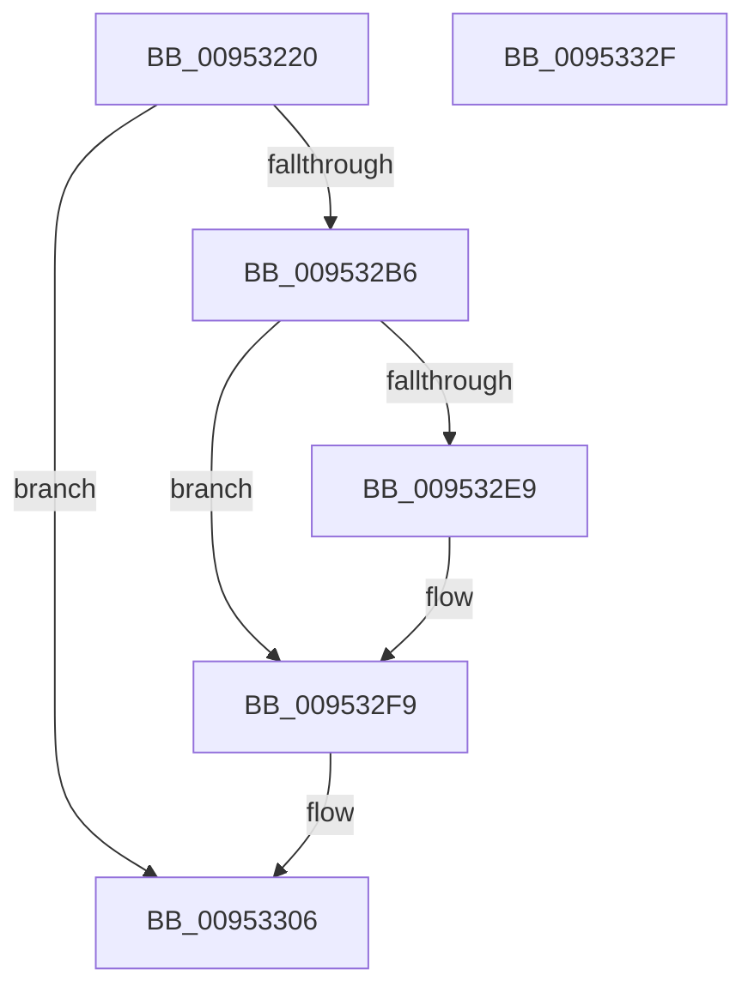

# IoGetDeviceObjectPointer

- RVA: `0x00953220`–`0x00953330` (길이 `272` bytes)
- VA: `0x0000000140953220`
- 실행 섹션: `PAGE`
- PDB 이름 있음: `예`; PDB Function 태그: `아니요`
- unwind 정보 RVA: `0x00092068`
- 디코드: `63`개 명령, `272/272` bytes 표시
- 미해석 바이트: `0` (있으면 어셈블리에 `.byte`로 보존)

> 이 문서는 커널 이미지의 기계어와 PDB 기호를 분석해 생성했습니다. 4번과 5번은 함수 원형과 자료형을 바이너리 사용 방식에서 추정한 C 해석이며 원본 소스 복구 결과는 아닙니다.

## 1. Dependencies

- 직접 호출 지점: **5**; 고유 호출 대상: **5**
- 직접 호출자로 확인된 함수: **19**
- RIP 상대 이미지 참조: **2**

### Outgoing calls
- `0x009532AB` → [ZwOpenFile](../../text/6A/ZwOpenFile_function_006AD730.md) (function, `0x006AD730`)
- `0x009532DE` → [ObReferenceObjectByHandle](../86/ObReferenceObjectByHandle_function_00868DB0.md) (function, `0x00868DB0`)
- `0x009532F1` → [IoGetRelatedDeviceObject](../../text/29/IoGetRelatedDeviceObject_function_0029B120.md) (function, `0x0029B120`)
- `0x00953301` → [ZwClose](../../text/6A/ZwClose_function_006AD2B0.md) (function, `0x006AD2B0`)
- `0x0095330F` → [KeLeaveCriticalRegionThread](../../text/25/KeLeaveCriticalRegionThread_function_0025EFF0.md) (function, `0x0025EFF0`)

### Direct callers
- [DifIoGetDeviceObjectPointerWrapper](../../text/62/DifIoGetDeviceObjectPointerWrapper_function_0062AA20.md) at `0x0062AB13`
- [HalpDynamicDeviceInterfaceNotification](../70/HalpDynamicDeviceInterfaceNotification_function_00708410.md) at `0x007084A3`
- [PopRegisterTargetDeviceProtection](../75/PopRegisterTargetDeviceProtection_function_00756A94.md) at `0x00756B6D`
- [PopHandleCancelQueryRemove](../75/PopHandleCancelQueryRemove_function_0075730C.md) at `0x00757348`
- [PopHandleCancelQueryRemove](../75/PopHandleCancelQueryRemove_function_0075730C.md) at `0x00757367`
- [PopRegisterCoolingExtensionProtection](../75/PopRegisterCoolingExtensionProtection_function_007575D0.md) at `0x007576D4`
- [PopRegisterCoolingExtensionProtection](../75/PopRegisterCoolingExtensionProtection_function_007575D0.md) at `0x00757757`
- [PopPolicyDeviceHandleWakeAlarmNotification](../76/PopPolicyDeviceHandleWakeAlarmNotification_function_007660A4.md) at `0x00766162`
- [PopEtDeferredInitDxgContext](../76/PopEtDeferredInitDxgContext_function_00769B40.md) at `0x00769BA3`
- [ExpAcquirePrmInterface](../7C/ExpAcquirePrmInterface_function_007CECA8.md) at `0x007CECDD`
- [VhdiMountVhdFile](../83/VhdiMountVhdFile_function_0083BED0.md) at `0x0083BFF1`
- [IoVolumeDeviceToDosName](../8A/IoVolumeDeviceToDosName_function_008A63F0.md) at `0x008A6516`
- [IopOpenSystemVariableDevice](IopOpenSystemVariableDevice_function_00952910.md) at `0x00952997`
- [IopOpenSystemVariableDevice](IopOpenSystemVariableDevice_function_00952910.md) at `0x00952A12`
- [IopOpenSystemVariableDevice](IopOpenSystemVariableDevice_function_00952910.md) at `0x00952A4A`
- [IoVolumeDeviceNameToGuidPath](IoVolumeDeviceNameToGuidPath_function_00952CC0.md) at `0x00952DA1`
- [NtApphelpCacheControl](NtApphelpCacheControl_function_00953050.md) at `0x00953189`
- [IopCreateArcNamesCd](../../init/C2/IopCreateArcNamesCd_function_00C2C060.md) at `0x00C2C20E`
- [IopCreateArcNamesCd](../../init/C2/IopCreateArcNamesCd_function_00C2C060.md) at `0x00C2C35E`
- [IopCreateArcNamesDisk](../../init/C2/IopCreateArcNamesDisk_function_00C2C594.md) at `0x00C2C6B0`
- [IopStoreBootDriveLetter](../../init/C2/IopStoreBootDriveLetter_function_00C2D5CC.md) at `0x00C2D62B`
- [IopGetBootDiskInformation](../../init/C2/IopGetBootDiskInformation_function_00C2DAAC.md) at `0x00C2DC0A`
- [SbpAddTransportToInstance](../../init/C6/SbpAddTransportToInstance_function_00C6F314.md) at `0x00C6F35F`
- [SbpStartLanman](../../init/C6/SbpStartLanman_function_00C6F500.md) at `0x00C6F572`

### Static image references
- `0x00953241` → RVA `0x00E0A9C0` (`.data`; read)
- `0x009532B6` → RVA `0x00FC6AE0` (`ALMOSTRO`; read)

## 2. Other-region calls and transfers

- 다른 실행 섹션으로 향하는 call: **4**
  - `0x009532AB` → [ZwOpenFile](../../text/6A/ZwOpenFile_function_006AD730.md) (`PAGE` → `.text`)
  - `0x009532F1` → [IoGetRelatedDeviceObject](../../text/29/IoGetRelatedDeviceObject_function_0029B120.md) (`PAGE` → `.text`)
  - `0x00953301` → [ZwClose](../../text/6A/ZwClose_function_006AD2B0.md) (`PAGE` → `.text`)
  - `0x0095330F` → [KeLeaveCriticalRegionThread](../../text/25/KeLeaveCriticalRegionThread_function_0025EFF0.md) (`PAGE` → `.text`)
- 별도 외부 분기/꼬리 이동을 확인하지 못했습니다.

## 3. Assembly (complete function range)

```asm
00953220  4C 8B DC                        mov r11, rsp
00953223  49 89 5B 10                     mov qword ptr [r11 + 0x10], rbx
00953227  49 89 6B 18                     mov qword ptr [r11 + 0x18], rbp
0095322B  49 89 73 20                     mov qword ptr [r11 + 0x20], rsi
0095322F  57                              push rdi
00953230  48 81 EC 80 00 00 00            sub rsp, 0x80
00953237  49 C7 43 C0 30 00 00 00         mov qword ptr [r11 - 0x40], 0x30
0095323F  33 ED                           xor ebp, ebp
00953241  39 2D 79 77 4B 00               cmp dword ptr [rip + 0x4b7779], ebp
00953247  49 8B F0                        mov rsi, r8
0095324A  89 6C 24 64                     mov dword ptr [rsp + 0x64], ebp
0095324E  0F 57 C0                        xorps xmm0, xmm0
00953251  49 89 6B C8                     mov qword ptr [r11 - 0x38], rbp
00953255  B8 00 02 00 00                  mov eax, 0x200
0095325A  49 89 6B 08                     mov qword ptr [r11 + 8], rbp
0095325E  41 B8 40 02 00 00               mov r8d, 0x240
00953264  41 0F 45 C0                     cmovne eax, r8d
00953268  C7 44 24 28 40 00 00 00         mov dword ptr [rsp + 0x28], 0x40
00953270  89 44 24 60                     mov dword ptr [rsp + 0x60], eax
00953274  4D 8D 43 C0                     lea r8, [r11 - 0x40]
00953278  49 89 4B D0                     mov qword ptr [r11 - 0x30], rcx
0095327C  49 8B F9                        mov rdi, r9
0095327F  F3 0F 7F 44 24 68               movdqu xmmword ptr [rsp + 0x68], xmm0
00953285  4D 8D 4B B0                     lea r9, [r11 - 0x50]
00953289  C7 44 24 20 03 00 00 00         mov dword ptr [rsp + 0x20], 3
00953291  0F 11 44 24 38                  movups xmmword ptr [rsp + 0x38], xmm0
00953296  65 48 8B 04 25 88 01 00 00      mov rax, qword ptr gs:[0x188]
0095329F  49 8D 4B 08                     lea rcx, [r11 + 8]
009532A3  66 FF 88 E4 01 00 00            dec word ptr [rax + 0x1e4]
009532AA  90                              nop
009532AB  E8 80 A4 D5 FF                  call 0x1406ad730
009532B0  8B D8                           mov ebx, eax
009532B2  85 C0                           test eax, eax
009532B4  78 50                           js 0x140953306
009532B6  4C 8B 05 23 38 67 00            mov r8, qword ptr [rip + 0x673823]
009532BD  48 8D 44 24 30                  lea rax, [rsp + 0x30]
009532C2  48 8B 8C 24 90 00 00 00         mov rcx, qword ptr [rsp + 0x90]
009532CA  45 33 C9                        xor r9d, r9d
009532CD  48 89 6C 24 28                  mov qword ptr [rsp + 0x28], rbp
009532D2  33 D2                           xor edx, edx
009532D4  48 89 44 24 20                  mov qword ptr [rsp + 0x20], rax
009532D9  48 89 6C 24 30                  mov qword ptr [rsp + 0x30], rbp
009532DE  E8 CD 5A F1 FF                  call 0x140868db0
009532E3  8B D8                           mov ebx, eax
009532E5  85 C0                           test eax, eax
009532E7  78 10                           js 0x1409532f9
009532E9  48 8B 4C 24 30                  mov rcx, qword ptr [rsp + 0x30]
009532EE  48 89 0E                        mov qword ptr [rsi], rcx
009532F1  E8 2A 7E 94 FF                  call 0x14029b120
009532F6  48 89 07                        mov qword ptr [rdi], rax
009532F9  48 8B 8C 24 90 00 00 00         mov rcx, qword ptr [rsp + 0x90]
00953301  E8 AA 9F D5 FF                  call 0x1406ad2b0
00953306  65 48 8B 0C 25 88 01 00 00      mov rcx, qword ptr gs:[0x188]
0095330F  E8 DC BC 90 FF                  call 0x14025eff0
00953314  4C 8D 9C 24 80 00 00 00         lea r11, [rsp + 0x80]
0095331C  8B C3                           mov eax, ebx
0095331E  49 8B 5B 18                     mov rbx, qword ptr [r11 + 0x18]
00953322  49 8B 6B 20                     mov rbp, qword ptr [r11 + 0x20]
00953326  49 8B 73 28                     mov rsi, qword ptr [r11 + 0x28]
0095332A  49 8B E3                        mov rsp, r11
0095332D  5F                              pop rdi
0095332E  C3                              ret
0095332F  CC                              int3
```

## 4. C-style interpretation (structured pseudocode)

```c
__int64 __fastcall IoGetDeviceObjectPointer(__int64 a1, int a2, __int64 a3, __int64 a4)
{
    __int64 result;
    __int64 v_rbp;
    __int64 v_rsp;
    unsigned __int64 v_stack_m20;
    unsigned int v_stack_m24;
    unsigned int v_stack_m28;
    unsigned __int64 v_stack_m50;
    unsigned __int64 v_stack_m58;
    unsigned int v_stack_m60;
    unsigned int v_stack_m68;
    unsigned __int64 v_stack_m8;
    unsigned __int64 v_stack_p8;

    *(unsigned __int64 *)(v_rsp + 16) = v_rbx;
    *(unsigned __int64 *)(v_rsp + 24) = v_rbp;
    *(unsigned __int64 *)(v_rsp + 32) = v_rsi;
    v_rsp = (v_rsp) - (128);
    *(unsigned __int64 *)(v_rsp - 64) = 48;
    v_rbp = 0;
    v_stack_m24 = 0;
    *(unsigned __int64 *)(v_rsp - 56) = 0;
    *(unsigned __int64 *)(v_rsp + 8) = 0;
    result = 512;
    if ((*(unsigned int *)(v_rip + 4945785)) != 0) { result = 576; }
    v_stack_m60 = 64;
    v_stack_m28 = (unsigned int)(result);
    *(unsigned __int64 *)(v_rsp - 48) = a1;
    v_stack_m20 = v_xmm0;
    v_stack_m68 = 3;
    v_stack_m50 = v_xmm0;
    result = ZwOpenFile(v_rsp + 8, a2, v_rsp - 64, v_rsp - 80);
    if (sign_flag) goto loc_00953306;
    a4 = 0;
    v_stack_m60 = 0;
    a2 = 0;
    v_stack_m68 = v_stack_m58;
    v_stack_m58 = 0;
    result = ObReferenceObjectByHandle(v_stack_p8, a2, *(unsigned __int64 *)(v_rip + 6764579), a4);
    if (!(sign_flag)) {
        a1 = v_stack_m58;
        *(unsigned __int64 *)(a3) = a1;
        result = IoGetRelatedDeviceObject(a1, a2, *(unsigned __int64 *)(v_rip + 6764579), a4);
        *(unsigned __int64 *)(a4) = result;
    }
    result = ZwClose(v_stack_p8, a2, *(unsigned __int64 *)(v_rip + 6764579), a4);
loc_00953306:
    result = KeLeaveCriticalRegionThread(*(unsigned __int64 *)(gs_base + (0 + 392)), a2, *(unsigned __int64 *)(v_rip + 6764579), a4);
    return (unsigned int)((unsigned int)((unsigned int)((unsigned int)(result))));
}
```

## 5. (Beta) C Style

```c
int64_t IoGetDeviceObjectPointer(int64_t Arg1, int32_t Arg2, void *Arg3, void *Arg4)
{
    uint8_t *arg3 = (uint8_t *)Arg3;
    uint8_t *arg4 = (uint8_t *)Arg4;

    int64_t result;
    int64_t local_rbp;
    int64_t local_rsp;
    uint64_t v_stack_m20;
    uint32_t v_stack_m24;
    uint32_t v_stack_m28;
    uint64_t v_stack_m50;
    uint64_t v_stack_m58;
    uint32_t v_stack_m60;
    uint32_t v_stack_m68;
    uint64_t v_stack_m8;
    uint64_t v_stack_p8;

    *(uint64_t *)(local_rsp + 0x10) = local_rbx;
    *(uint64_t *)(local_rsp + 0x18) = local_rbp;
    *(uint64_t *)(local_rsp + 0x20) = local_rsi;
    local_rsp = (local_rsp) - (128);
    *(uint64_t *)(local_rsp - 0x40) = 48;
    local_rbp = 0;
    v_stack_m24 = 0;
    *(uint64_t *)(local_rsp - 0x38) = 0;
    *(uint64_t *)(local_rsp + 0x8) = 0;
    result = 512;
    if ((*(uint32_t *)(v_rip + 0x4B7779)) != 0) { result = 576; }
    v_stack_m60 = 64;
    v_stack_m28 = (uint32_t)(result);
    *(uint64_t *)(local_rsp - 0x30) = Arg1;
    v_stack_m20 = v_xmm0;
    v_stack_m68 = 3;
    v_stack_m50 = v_xmm0;
    result = ZwOpenFile(local_rsp + 8, Arg2, local_rsp - 64, local_rsp - 80);
    if (sign_flag) goto loc_00953306;
    Arg4 = 0;
    v_stack_m60 = 0;
    Arg2 = 0;
    v_stack_m68 = v_stack_m58;
    v_stack_m58 = 0;
    result = ObReferenceObjectByHandle(v_stack_p8, Arg2, *(uint64_t *)(v_rip + 0x673823), Arg4);
    if (!(sign_flag)) {
        Arg1 = v_stack_m58;
        *(uint64_t *)(arg3) = Arg1;
        result = IoGetRelatedDeviceObject(Arg1, Arg2, *(uint64_t *)(v_rip + 0x673823), Arg4);
        *(uint64_t *)(arg4) = result;
    }
    result = ZwClose(v_stack_p8, Arg2, *(uint64_t *)(v_rip + 0x673823), Arg4);
loc_00953306:
    result = KeLeaveCriticalRegionThread(*(uint64_t *)(gs_base + (0 + 0x188)), Arg2, *(uint64_t *)(v_rip + 0x673823), Arg4);
    return (uint32_t)((uint32_t)((uint32_t)((uint32_t)(result))));
}
```

### 관측된 메모리 오프셋

구조체 형식이 확인되지 않은 접근은 인자 기준의 오프셋으로만 기록했습니다.

| 기준 인자 | 오프셋 표현 | 폭 (bit) | 접근 |
|---|---:|---:|---|
| `Arg3` | `+ 0x0` | `64` | `W` |
| `Arg4` | `+ 0x0` | `64` | `W` |

## 6. Execution-region graph

[열기: 2D/3D 그래프와 함수 탐색 컨트롤 패널](../../../control-panel.html?section=page&rva=0x00953220&view=graph)

- 2D 그래프는 위에서 아래로 흐르고, 3D 그래프는 빈 공간을 드래그해 회전합니다. Shift+드래그는 이동, 휠은 확대·축소, 함수 노드 선택은 대상 보고서 이동입니다.

### Static fallback


