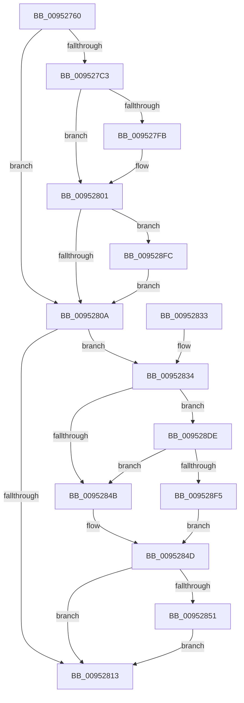

# IoGetEnvironmentVariableEx

- RVA: `0x00952760`–`0x00952909` (길이 `425` bytes)
- VA: `0x0000000140952760`
- 실행 섹션: `PAGE`
- PDB 이름 있음: `예`; PDB Function 태그: `아니요`
- unwind 정보 RVA: `0x00091FA0`
- 디코드: `111`개 명령, `425/425` bytes 표시
- 미해석 바이트: `0` (있으면 어셈블리에 `.byte`로 보존)

> 이 문서는 커널 이미지의 기계어와 PDB 기호를 분석해 생성했습니다. 4번과 5번은 함수 원형과 자료형을 바이너리 사용 방식에서 추정한 C 해석이며 원본 소스 복구 결과는 아닙니다.

## 1. Dependencies

- 직접 호출 지점: **6**; 고유 호출 대상: **6**
- 직접 호출자로 확인된 함수: **11**
- RIP 상대 이미지 참조: **5**

### Outgoing calls
- `0x009527B8` → [IopOpenSystemVariableDevice](IopOpenSystemVariableDevice_function_00952910.md) (function, `0x00952910`)
- `0x009527EF` → [guard_dispatch_icall](../../text/6B/guard_dispatch_icall_function_006BAAD0.md) (function, `0x006BAAD0`)
- `0x0095281C` → [_security_check_cookie](../../text/6A/_security_check_cookie_function_006AC640.md) (function, `0x006AC640`)
- `0x00952858` → [tlgCreate1Sz_wchar_t](../../text/42/tlgCreate1Sz_wchar_t_function_00426198.md) (function, `0x00426198`)
- `0x009528D4` → [tlgWriteTransfer_EtwWriteTransfer](../../text/42/tlgWriteTransfer_EtwWriteTransfer_function_004260E0.md) (function, `0x004260E0`)
- `0x009528FF` → [ObfDereferenceObject](../../text/2F/ObfDereferenceObject_function_002F9350.md) (function, `0x002F9350`)

### Direct callers
- [IopInitializeOfflineCrashDump](../../text/59/IopInitializeOfflineCrashDump_function_00595A24.md) at `0x00595B72`
- [ExpSetBootEntry](../7C/ExpSetBootEntry_function_007CBD2C.md) at `0x007CC1F5`
- [ExpSetBootEntry](../7C/ExpSetBootEntry_function_007CBD2C.md) at `0x007CC24C`
- [ExpSetBootEntry](../7C/ExpSetBootEntry_function_007CBD2C.md) at `0x007CC2D2`
- [ExpSetBootEntry](../7C/ExpSetBootEntry_function_007CBD2C.md) at `0x007CC330`
- [ExpSetDriverEntry](../7C/ExpSetDriverEntry_function_007CC424.md) at `0x007CC780`
- [ExpSetDriverEntry](../7C/ExpSetDriverEntry_function_007CC424.md) at `0x007CC7D7`
- [ExpSetDriverEntry](../7C/ExpSetDriverEntry_function_007CC424.md) at `0x007CC863`
- [ExpSetDriverEntry](../7C/ExpSetDriverEntry_function_007CC424.md) at `0x007CC8C1`
- [NtDeleteBootEntry](../7C/NtDeleteBootEntry_function_007CD2B0.md) at `0x007CD379`
- [NtDeleteBootEntry](../7C/NtDeleteBootEntry_function_007CD2B0.md) at `0x007CD3D0`
- [NtDeleteDriverEntry](../7C/NtDeleteDriverEntry_function_007CD440.md) at `0x007CD509`
- [NtDeleteDriverEntry](../7C/NtDeleteDriverEntry_function_007CD440.md) at `0x007CD560`
- [NtGetEnvironmentVariableEx](../7C/NtGetEnvironmentVariableEx_function_007CDBC0.md) at `0x007CDC3C`
- [NtQuerySystemEnvironmentValueEx](NtQuerySystemEnvironmentValueEx_function_00952180.md) at `0x009523DD`
- [ExpGetFirmwareEnvironmentVariable](ExpGetFirmwareEnvironmentVariable_function_009524DC.md) at `0x00952565`
- [NtQueryBootEntryOrder](../A9/NtQueryBootEntryOrder_function_00A91720.md) at `0x00A9188F`
- [NtQueryBootOptions](../AA/NtQueryBootOptions_function_00AAFBC0.md) at `0x00AAFCEB`
- [NtQueryBootOptions](../AA/NtQueryBootOptions_function_00AAFBC0.md) at `0x00AAFD63`
- [NtQueryBootOptions](../AA/NtQueryBootOptions_function_00AAFBC0.md) at `0x00AAFDBB`
- [IopCachePreviousBootData](../../init/C2/IopCachePreviousBootData_function_00C2A790.md) at `0x00C2A802`

### Static image references
- `0x00952777` → RVA `0x00E0A740` (`.data`; read)
- `0x0095280A` → RVA `0x00E06ED8` (`.data`; read)
- `0x0095283E` → RVA `0x00E06EE8` (`.data`; read)
- `0x00952861` → RVA `0x00046BAE` (`.rdata`; read)
- `0x009528DE` → RVA `0x00E06EF0` (`.data`; read)

## 2. Other-region calls and transfers

- 다른 실행 섹션으로 향하는 call: **5**
  - `0x009527EF` → [guard_dispatch_icall](../../text/6B/guard_dispatch_icall_function_006BAAD0.md) (`PAGE` → `.text`)
  - `0x0095281C` → [_security_check_cookie](../../text/6A/_security_check_cookie_function_006AC640.md) (`PAGE` → `.text`)
  - `0x00952858` → [tlgCreate1Sz_wchar_t](../../text/42/tlgCreate1Sz_wchar_t_function_00426198.md) (`PAGE` → `.text`)
  - `0x009528D4` → [tlgWriteTransfer_EtwWriteTransfer](../../text/42/tlgWriteTransfer_EtwWriteTransfer_function_004260E0.md) (`PAGE` → `.text`)
  - `0x009528FF` → [ObfDereferenceObject](../../text/2F/ObfDereferenceObject_function_002F9350.md) (`PAGE` → `.text`)
- 별도 외부 분기/꼬리 이동을 확인하지 못했습니다.

## 3. Assembly (complete function range)

```asm
00952760  40 55                           push rbp
00952762  53                              push rbx
00952763  56                              push rsi
00952764  57                              push rdi
00952765  41 54                           push r12
00952767  41 56                           push r14
00952769  41 57                           push r15
0095276B  48 8D 6C 24 E1                  lea rbp, [rsp - 0x1f]
00952770  48 81 EC E0 00 00 00            sub rsp, 0xe0
00952777  48 8B 05 C2 7F 4B 00            mov rax, qword ptr [rip + 0x4b7fc2]
0095277E  48 33 C4                        xor rax, rsp
00952781  48 89 45 0F                     mov qword ptr [rbp + 0xf], rax
00952785  48 8B 75 7F                     mov rsi, qword ptr [rbp + 0x7f]
00952789  49 8B D8                        mov rbx, r8
0095278C  48 83 65 8F 00                  and qword ptr [rbp - 0x71], 0
00952791  4C 8D 45 97                     lea r8, [rbp - 0x69]
00952795  48 83 65 87 00                  and qword ptr [rbp - 0x79], 0
0095279A  4C 8B FA                        mov r15, rdx
0095279D  48 83 65 97 00                  and qword ptr [rbp - 0x69], 0
009527A2  48 8D 55 8F                     lea rdx, [rbp - 0x71]
009527A6  4C 8B F1                        mov r14, rcx
009527A9  C7 44 24 40 EF BE AD DE         mov dword ptr [rsp + 0x40], 0xdeadbeef
009527B1  48 8D 4D 87                     lea rcx, [rbp - 0x79]
009527B5  4D 8B E1                        mov r12, r9
009527B8  E8 53 01 00 00                  call 0x140952910
009527BD  8B F8                           mov edi, eax
009527BF  85 C0                           test eax, eax
009527C1  78 47                           js 0x14095280a
009527C3  48 8B 45 97                     mov rax, qword ptr [rbp - 0x69]
009527C7  48 8D 4C 24 40                  lea rcx, [rsp + 0x40]
009527CC  48 8B 55 8F                     mov rdx, qword ptr [rbp - 0x71]
009527D0  4D 8B CF                        mov r9, r15
009527D3  48 89 4C 24 30                  mov qword ptr [rsp + 0x30], rcx
009527D8  4D 8B C6                        mov r8, r14
009527DB  4C 89 64 24 28                  mov qword ptr [rsp + 0x28], r12
009527E0  48 8B 00                        mov rax, qword ptr [rax]
009527E3  48 89 5C 24 20                  mov qword ptr [rsp + 0x20], rbx
009527E8  48 8B 5D 87                     mov rbx, qword ptr [rbp - 0x79]
009527EC  48 8B CB                        mov rcx, rbx
009527EF  E8 DC 82 D6 FF                  call 0x1406baad0
009527F4  8B F8                           mov edi, eax
009527F6  48 85 F6                        test rsi, rsi
009527F9  74 06                           je 0x140952801
009527FB  8B 44 24 40                     mov eax, dword ptr [rsp + 0x40]
009527FF  89 06                           mov dword ptr [rsi], eax
00952801  48 85 DB                        test rbx, rbx
00952804  0F 85 F2 00 00 00               jne 0x1409528fc
0095280A  83 3D C7 46 4B 00 05            cmp dword ptr [rip + 0x4b46c7], 5
00952811  77 21                           ja 0x140952834
00952813  8B C7                           mov eax, edi
00952815  48 8B 4D 0F                     mov rcx, qword ptr [rbp + 0xf]
00952819  48 33 CC                        xor rcx, rsp
0095281C  E8 1F 9E D5 FF                  call 0x1406ac640
00952821  48 81 C4 E0 00 00 00            add rsp, 0xe0
00952828  41 5F                           pop r15
0095282A  41 5E                           pop r14
0095282C  41 5C                           pop r12
0095282E  5F                              pop rdi
0095282F  5E                              pop rsi
00952830  5B                              pop rbx
00952831  5D                              pop rbp
00952832  C3                              ret
00952833  CC                              int3
00952834  48 BA 00 00 00 00 00 20 00 00   movabs rdx, 0x200000000000
0095283E  48 85 15 A3 46 4B 00            test qword ptr [rip + 0x4b46a3], rdx
00952845  0F 85 93 00 00 00               jne 0x1409528de
0095284B  32 C0                           xor al, al
0095284D  84 C0                           test al, al
0095284F  74 C2                           je 0x140952813
00952851  49 8B D6                        mov rdx, r14
00952854  48 8D 4D BF                     lea rcx, [rbp - 0x41]
00952858  E8 3B 39 AD FF                  call 0x140426198
0095285D  41 8B 04 24                     mov eax, dword ptr [r12]
00952861  48 8D 15 46 43 6F FF            lea rdx, [rip - 0x90bcba]
00952868  83 65 DB 00                     and dword ptr [rbp - 0x25], 0
0095286C  B9 04 00 00 00                  mov ecx, 4
00952871  83 65 EB 00                     and dword ptr [rbp - 0x15], 0
00952875  45 33 C9                        xor r9d, r9d
00952878  83 65 FB 00                     and dword ptr [rbp - 5], 0
0095287C  45 33 C0                        xor r8d, r8d
0095287F  83 65 0B 00                     and dword ptr [rbp + 0xb], 0
00952883  89 45 87                        mov dword ptr [rbp - 0x79], eax
00952886  48 8D 45 87                     lea rax, [rbp - 0x79]
0095288A  48 89 45 DF                     mov qword ptr [rbp - 0x21], rax
0095288E  8B 44 24 40                     mov eax, dword ptr [rsp + 0x40]
00952892  89 45 8F                        mov dword ptr [rbp - 0x71], eax
00952895  48 8D 45 8F                     lea rax, [rbp - 0x71]
00952899  48 89 45 EF                     mov qword ptr [rbp - 0x11], rax
0095289D  48 8D 45 97                     lea rax, [rbp - 0x69]
009528A1  48 89 45 FF                     mov qword ptr [rbp - 1], rax
009528A5  48 8D 45 9F                     lea rax, [rbp - 0x61]
009528A9  89 4D E7                        mov dword ptr [rbp - 0x19], ecx
009528AC  89 4D F7                        mov dword ptr [rbp - 9], ecx
009528AF  89 4D 07                        mov dword ptr [rbp + 7], ecx
009528B2  48 8D 0D 1F 46 4B 00            lea rcx, [rip + 0x4b461f]
009528B9  48 89 44 24 28                  mov qword ptr [rsp + 0x28], rax
009528BE  C7 44 24 20 07 00 00 00         mov dword ptr [rsp + 0x20], 7
009528C6  4C 89 7D CF                     mov qword ptr [rbp - 0x31], r15
009528CA  C7 45 D7 10 00 00 00            mov dword ptr [rbp - 0x29], 0x10
009528D1  89 7D 97                        mov dword ptr [rbp - 0x69], edi
009528D4  E8 07 38 AD FF                  call 0x1404260e0
009528D9  E9 35 FF FF FF                  jmp 0x140952813
009528DE  48 8B 05 0B 46 4B 00            mov rax, qword ptr [rip + 0x4b460b]
009528E5  48 23 C2                        and rax, rdx
009528E8  48 3B 05 01 46 4B 00            cmp rax, qword ptr [rip + 0x4b4601]
009528EF  0F 85 56 FF FF FF               jne 0x14095284b
009528F5  B0 01                           mov al, 1
009528F7  E9 51 FF FF FF                  jmp 0x14095284d
009528FC  48 8B CB                        mov rcx, rbx
009528FF  E8 4C 6A 9A FF                  call 0x1402f9350
00952904  E9 01 FF FF FF                  jmp 0x14095280a
```

## 4. C-style interpretation (structured pseudocode)

```c
__int64 __fastcall IoGetEnvironmentVariableEx(__int64 a1, __int64 a2, __int64 a3, __int64 a4, __int64 a5)
{
    __int64 result;
    __int64 v_rsp;
    unsigned __int64 v_stack_m48;
    unsigned int v_stack_m4C;
    unsigned int v_stack_m50;
    unsigned __int64 v_stack_m57;
    unsigned __int64 v_stack_m58;
    unsigned int v_stack_m5C;
    unsigned int v_stack_m60;
    unsigned __int64 v_stack_m68;
    unsigned int v_stack_m6C;
    unsigned int v_stack_m70;
    unsigned __int64 v_stack_m78;
    unsigned int v_stack_m7C;
    unsigned int v_stack_m80;
    unsigned __int64 v_stack_m88;
    unsigned __int64 v_stack_m98;
    unsigned __int64 v_stack_mB8;
    unsigned __int64 v_stack_mC0;
    unsigned __int64 v_stack_mC8;
    unsigned __int64 v_stack_mD0;
    unsigned int v_stack_mD8;
    unsigned __int64 v_stack_mE8;
    unsigned __int64 v_stack_mF0;
    unsigned __int64 v_stack_mF8;
    unsigned int v_stack_p20;
    unsigned __int64 v_stack_p28;
    unsigned int v_stack_p40;

    v_rsp = (v_rsp) - (224);
    result = (*(unsigned __int64 *)(v_rip + 4947906)) ^ (v_rsp);
    v_stack_m48 = result;
    v_stack_mD8 = 0xDEADBEEFULL;
    result = IopOpenSystemVariableDevice(v_stack_mD0, v_stack_mC8, v_stack_mC0, a4);
    if (sign_flag) goto loc_0095280A;
    v_stack_mE8 = v_stack_mD8;
    v_stack_mF0 = a4;
    v_stack_mF8 = a3;
    result = guard_dispatch_icall(v_stack_mD0, v_stack_mC8, a1, a2);
    if (a5 != 0) {
        result = v_stack_mD8;
        *(unsigned int *)(a5) = (unsigned int)(result);
    }
    if (v_stack_mD0 != 0) goto loc_009528FC;
loc_0095280A:
    if ((*(unsigned int *)(v_rip + 4933319)) > 5) goto loc_00952834;
loc_00952813:
    a1 = (v_stack_m48) ^ (v_rsp);
    result = _security_check_cookie(a1, v_stack_mC8, a1, a2);
    v_rsp = (v_rsp) + (224);
    return result;
loc_00952834:
    if (((*(unsigned __int64 *)(v_rip + 4933283)) & (v_stack_mC8)) != 0) goto loc_009528DE;
loc_0095284B:
    result = 0;
loc_0095284D:
    if (0 == 0) goto loc_00952813;
    result = tlgCreate1Sz_wchar_t(v_stack_m98, a1, a1, a2);
    a4 = 0;
    a3 = 0;
    v_stack_mD0 = (unsigned int)((unsigned int)(*(unsigned int *)(a4)));
    v_stack_m78 = v_stack_mD0;
    v_stack_mC8 = (unsigned int)((unsigned int)(v_stack_p40));
    v_stack_m68 = v_stack_mC8;
    v_stack_m58 = v_stack_mC0;
    v_stack_m70 = 4;
    v_stack_m60 = 4;
    v_stack_m50 = 4;
    v_stack_p28 = v_stack_mB8;
    v_stack_p20 = 7;
    v_stack_m88 = a2;
    v_stack_m80 = 16;
    v_stack_mC0 = (unsigned int)((unsigned int)((unsigned int)(result)));
    result = tlgWriteTransfer_EtwWriteTransfer(v_rip + 4933151, v_rip - 9485498, a3, a4);
    goto loc_00952813;
loc_009528DE:
    result = (*(unsigned __int64 *)(v_rip + 4933131)) & (v_rip - 9485498);
    if (result != (*(unsigned __int64 *)(v_rip + 4933121))) goto loc_0095284B;
    goto loc_0095284D;
loc_009528FC:
    result = ObfDereferenceObject(v_stack_mD0, v_rip - 9485498, a3, a4);
    goto loc_0095280A;
}
```

## 5. (Beta) C Style

```c
int64_t IoGetEnvironmentVariableEx(int64_t Arg1, int64_t Arg2, int64_t Arg3, void *Arg4, int64_t Arg5)
{
    uint8_t *arg4 = (uint8_t *)Arg4;

    int64_t result;
    int64_t local_rsp;
    uint64_t v_stack_m48;
    uint32_t v_stack_m4C;
    uint32_t v_stack_m50;
    uint64_t v_stack_m57;
    uint64_t v_stack_m58;
    uint32_t v_stack_m5C;
    uint32_t v_stack_m60;
    uint64_t v_stack_m68;
    uint32_t v_stack_m6C;
    uint32_t v_stack_m70;
    uint64_t v_stack_m78;
    uint32_t v_stack_m7C;
    uint32_t v_stack_m80;
    uint64_t v_stack_m88;
    uint64_t v_stack_m98;
    uint64_t v_stack_mB8;
    uint64_t v_stack_mC0;
    uint64_t v_stack_mC8;
    uint64_t v_stack_mD0;
    uint32_t v_stack_mD8;
    uint64_t v_stack_mE8;
    uint64_t v_stack_mF0;
    uint64_t v_stack_mF8;
    uint32_t v_stack_p20;
    uint64_t v_stack_p28;
    uint32_t v_stack_p40;

    local_rsp = (local_rsp) - (224);
    result = (*(uint64_t *)(v_rip + 0x4B7FC2)) ^ (local_rsp);
    v_stack_m48 = result;
    v_stack_mD8 = 0xDEADBEEFULL;
    result = IopOpenSystemVariableDevice(v_stack_mD0, v_stack_mC8, v_stack_mC0, Arg4);
    if (sign_flag) goto loc_0095280A;
    v_stack_mE8 = v_stack_mD8;
    v_stack_mF0 = Arg4;
    v_stack_mF8 = Arg3;
    result = guard_dispatch_icall(v_stack_mD0, v_stack_mC8, Arg1, Arg2);
    if (Arg5 != 0) {
        result = v_stack_mD8;
        *(uint32_t *)(Arg5) = (uint32_t)(result);
    }
    if (v_stack_mD0 != 0) goto loc_009528FC;
loc_0095280A:
    if ((*(uint32_t *)(v_rip + 0x4B46C7)) > 5) goto loc_00952834;
loc_00952813:
    Arg1 = (v_stack_m48) ^ (local_rsp);
    result = _security_check_cookie(Arg1, v_stack_mC8, Arg1, Arg2);
    local_rsp = (local_rsp) + (224);
    return result;
loc_00952834:
    if (((*(uint64_t *)(v_rip + 0x4B46A3)) & (v_stack_mC8)) != 0) goto loc_009528DE;
loc_0095284B:
    result = 0;
loc_0095284D:
    if (0 == 0) goto loc_00952813;
    result = tlgCreate1Sz_wchar_t(v_stack_m98, Arg1, Arg1, Arg2);
    Arg4 = 0;
    Arg3 = 0;
    v_stack_mD0 = (uint32_t)((uint32_t)(*(uint32_t *)(arg4)));
    v_stack_m78 = v_stack_mD0;
    v_stack_mC8 = (uint32_t)((uint32_t)(v_stack_p40));
    v_stack_m68 = v_stack_mC8;
    v_stack_m58 = v_stack_mC0;
    v_stack_m70 = 4;
    v_stack_m60 = 4;
    v_stack_m50 = 4;
    v_stack_p28 = v_stack_mB8;
    v_stack_p20 = 7;
    v_stack_m88 = Arg2;
    v_stack_m80 = 16;
    v_stack_mC0 = (uint32_t)((uint32_t)((uint32_t)(result)));
    result = tlgWriteTransfer_EtwWriteTransfer(v_rip + 4933151, v_rip - 9485498, Arg3, Arg4);
    goto loc_00952813;
loc_009528DE:
    result = (*(uint64_t *)(v_rip + 0x4B460B)) & (v_rip - 9485498);
    if (result != (*(uint64_t *)(v_rip + 0x4B4601))) goto loc_0095284B;
    goto loc_0095284D;
loc_009528FC:
    result = ObfDereferenceObject(v_stack_mD0, v_rip - 9485498, Arg3, Arg4);
    goto loc_0095280A;
}
```

### 관측된 메모리 오프셋

구조체 형식이 확인되지 않은 접근은 인자 기준의 오프셋으로만 기록했습니다.

| 기준 인자 | 오프셋 표현 | 폭 (bit) | 접근 |
|---|---:|---:|---|
| `Arg4` | `+ 0x0` | `32` | `R` |

## 6. Execution-region graph

[열기: 2D/3D 그래프와 함수 탐색 컨트롤 패널](../../../control-panel.html?section=page&rva=0x00952760&view=graph)

- 2D 그래프는 위에서 아래로 흐르고, 3D 그래프는 빈 공간을 드래그해 회전합니다. Shift+드래그는 이동, 휠은 확대·축소, 함수 노드 선택은 대상 보고서 이동입니다.

### Static fallback


