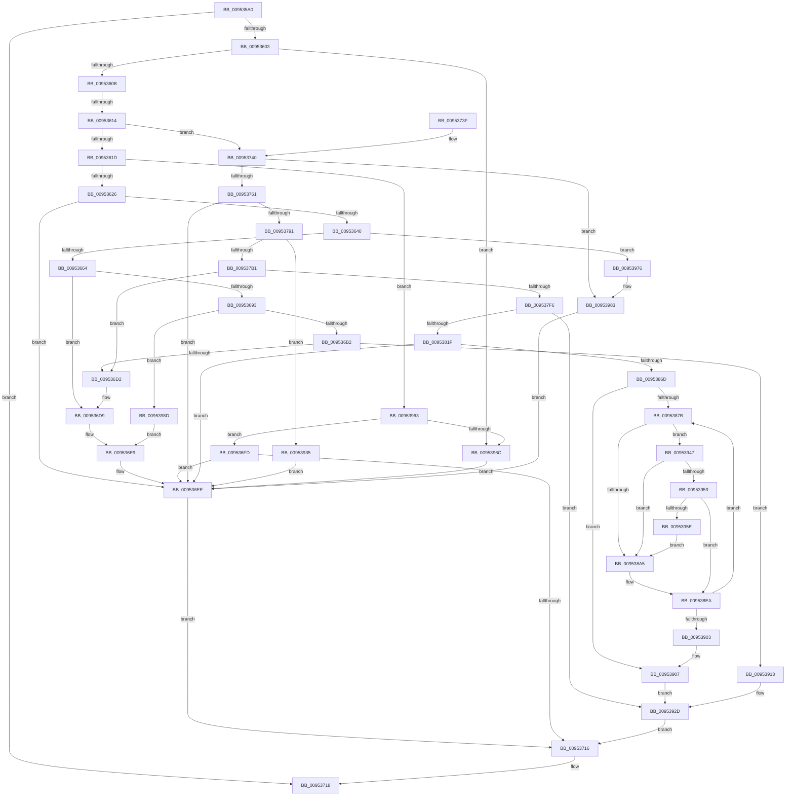

# IoRegisterPlugPlayNotification

- RVA: `0x009535A0`–`0x009539A1` (길이 `1,025` bytes)
- VA: `0x00000001409535A0`
- 실행 섹션: `PAGE`
- PDB 이름 있음: `예`; PDB Function 태그: `예`
- unwind 정보 RVA: `0x000920D8`
- 디코드: `255`개 명령, `1,025/1,025` bytes 표시
- 미해석 바이트: `0` (있으면 어셈블리에 `.byte`로 보존)

> 이 문서는 커널 이미지의 기계어와 PDB 기호를 분석해 생성했습니다. 4번과 5번은 함수 원형과 자료형을 바이너리 사용 방식에서 추정한 C 해석이며 원본 소스 복구 결과는 아닙니다.

## 1. Dependencies

- 직접 호출 지점: **32**; 고유 호출 대상: **22**
- 직접 호출자로 확인된 함수: **11**
- RIP 상대 이미지 참조: **6**

### Outgoing calls
- `0x009535F6` → [ObReferenceObjectByPointerWithTag](../../text/41/ObReferenceObjectByPointerWithTag_function_00419870.md) (function, `0x00419870`)
- `0x00953631` → [PnpGetRelatedTargetDevice](../../text/27/PnpGetRelatedTargetDevice_function_00271F54.md) (function, `0x00271F54`)
- `0x00953653` → [ExAllocatePool2](../../poolcode/B8/ExAllocatePool2_function_00B820F0.md) (function, `0x00B820F0`)
- `0x00953685` → [PnpInitializeNotifyEntry](../A4/PnpInitializeNotifyEntry_function_00A456D0.md) (function, `0x00A456D0`)
- `0x009536A3` → [PnpDeferNotification](PnpDeferNotification_function_00951888.md) (function, `0x00951888`)
- `0x009536B9` → [ExAcquireFastMutex](../../text/20/ExAcquireFastMutex_function_0020E5A0.md) (function, `0x0020E5A0`)
- `0x009536DC` → [ExFreePoolWithTag](../../poolcode/B8/ExFreePoolWithTag_function_00B82870.md) (function, `0x00B82870`)
- `0x009536E9` → [ObfDereferenceObject](../../text/2F/ObfDereferenceObject_function_002F9350.md) (function, `0x002F9350`)
- `0x009536F6` → [ObfDereferenceObjectWithTag](../../text/2F/ObfDereferenceObjectWithTag_function_002F78E0.md) (function, `0x002F78E0`)
- `0x0095370B` → [PiRegisterKernelSoftRestartNotification](../73/PiRegisterKernelSoftRestartNotification_function_0073E28C.md) (function, `0x0073E28C`)
- `0x0095371F` → [_security_check_cookie](../../text/6A/_security_check_cookie_function_006AC640.md) (function, `0x006AC640`)
- `0x00953750` → [ExAllocatePool2](../../poolcode/B8/ExAllocatePool2_function_00B820F0.md) (function, `0x00B820F0`)
- `0x00953782` → [PnpInitializeNotifyEntry](../A4/PnpInitializeNotifyEntry_function_00A456D0.md) (function, `0x00A456D0`)
- `0x009537A2` → [PnpDeferNotification](PnpDeferNotification_function_00951888.md) (function, `0x00951888`)
- `0x009537B8` → [ExAcquireFastMutex](../../text/20/ExAcquireFastMutex_function_0020E5A0.md) (function, `0x0020E5A0`)
- `0x0095380B` → [ExReleaseFastMutex](../../text/25/ExReleaseFastMutex_function_002519C0.md) (function, `0x002519C0`)
- `0x0095385E` → [IoGetDeviceInterfaces](IoGetDeviceInterfaces_function_00953340.md) (function, `0x00953340`)
- `0x00953882` → [RtlInitUnicodeString](../../text/42/RtlInitUnicodeString_function_0042A780.md) (function, `0x0042A780`)
- `0x0095388F` → [PsGetCurrentServerSilo](../../text/22/PsGetCurrentServerSilo_function_00225710.md) (function, `0x00225710`)
- `0x00953897` → [PsGetServerSiloServiceSessionId](../../text/45/PsGetServerSiloServiceSessionId_function_0045ED00.md) (function, `0x0045ED00`)
- `0x009538A5` → [Feature_PreventInterfaceChangeConcurrentNotify__private_ReportDeviceUsage](../../text/48/Feature_PreventInterfaceChangeConcurrentNotify__private_ReportDeviceUsage_function_00487ED0.md) (function, `0x00487ED0`)
- `0x009538C2` → [ExAcquireResourceExclusiveLite](../../text/21/ExAcquireResourceExclusiveLite_function_00214E20.md) (function, `0x00214E20`)
- `0x009538D2` → [PnpNotifyDriverCallback](PnpNotifyDriverCallback_function_00954AA0.md) (function, `0x00954AA0`)
- `0x009538D7` → [Feature_PreventInterfaceChangeConcurrentNotify__private_ReportDeviceUsage](../../text/48/Feature_PreventInterfaceChangeConcurrentNotify__private_ReportDeviceUsage_function_00487ED0.md) (function, `0x00487ED0`)
- `0x009538E0` → [ExReleaseResourceLite](../../text/25/ExReleaseResourceLite_function_0025FA10.md) (function, `0x0025FA10`)
- `0x009538E5` → [KeLeaveCriticalRegion](../../text/25/KeLeaveCriticalRegion_function_0025D8B0.md) (function, `0x0025D8B0`)
- `0x0095390C` → [ExFreePoolWithTag](../../poolcode/B8/ExFreePoolWithTag_function_00B82870.md) (function, `0x00B82870`)
- `0x00953928` → [ExReleaseFastMutex](../../text/25/ExReleaseFastMutex_function_002519C0.md) (function, `0x002519C0`)
- `0x0095393D` → [ExFreePoolWithTag](../../poolcode/B8/ExFreePoolWithTag_function_00B82870.md) (function, `0x00B82870`)
- `0x0095394B` → [IopGetSessionIdFromSymbolicName](../70/IopGetSessionIdFromSymbolicName_function_00702084.md) (function, `0x00702084`)
- `0x0095397E` → [ObfDereferenceObject](../../text/2F/ObfDereferenceObject_function_002F9350.md) (function, `0x002F9350`)
- `0x00953993` → [ExFreePoolWithTag](../../poolcode/B8/ExFreePoolWithTag_function_00B82870.md) (function, `0x00B82870`)

### Direct callers
- [HalpAddDevice](../70/HalpAddDevice_function_00708060.md) at `0x007082FC`
- [PopRegisterTargetDeviceProtection](../75/PopRegisterTargetDeviceProtection_function_00756A94.md) at `0x00756B9F`
- [PopHandleCancelQueryRemove](../75/PopHandleCancelQueryRemove_function_0075730C.md) at `0x007573E6`
- [PopRegisterCoolingExtensionProtection](../75/PopRegisterCoolingExtensionProtection_function_007575D0.md) at `0x00757794`
- [PopConnectToPolicyDevice](../76/PopConnectToPolicyDevice_function_00765D20.md) at `0x00765E23`
- [SmKmStoreFileCreate](../7A/SmKmStoreFileCreate_function_007A8F14.md) at `0x007A92F8`
- [ExpAcquirePrmInterface](../7C/ExpAcquirePrmInterface_function_007CECA8.md) at `0x007CED6F`
- [CmpHiveCacheSubscribePnpNotifications](../7E/CmpHiveCacheSubscribePnpNotifications_function_007E8D2C.md) at `0x007E8DB1`
- [PoInitDriverServices](../../init/C3/PoInitDriverServices_function_00C3D08C.md) at `0x00C3D0D4`
- [PoInitDriverServices](../../init/C3/PoInitDriverServices_function_00C3D08C.md) at `0x00C3D103`
- [PoInitDriverServices](../../init/C3/PoInitDriverServices_function_00C3D08C.md) at `0x00C3D136`
- [PoInitDriverServices](../../init/C3/PoInitDriverServices_function_00C3D08C.md) at `0x00C3D169`
- [PoInitDriverServices](../../init/C3/PoInitDriverServices_function_00C3D08C.md) at `0x00C3D19C`
- [PoInitDriverServices](../../init/C3/PoInitDriverServices_function_00C3D08C.md) at `0x00C3D1CF`
- [PoInitDriverServices](../../init/C3/PoInitDriverServices_function_00C3D08C.md) at `0x00C3D207`
- [SbpWaitForVmbus](../../init/C6/SbpWaitForVmbus_function_00C6F8D8.md) at `0x00C6F93F`
- [Phase1InitializationIoReady](../../init/C7/Phase1InitializationIoReady_function_00C70458.md) at `0x00C70810`

### Static image references
- `0x009535BC` → RVA `0x00E0A740` (`.data`; read)
- `0x009535EC` → RVA `0x00FC6C78` (`ALMOSTRO`; read)
- `0x00953668` → RVA `0x00F8CDA0` (`.data`; read)
- `0x00953765` → RVA `0x00F8CD60` (`.data`; read)
- `0x009537D7` → RVA `0x00FDA7E0` (`PAGEDATA`; read)
- `0x00953834` → RVA `0x00013E30` (`.rdata`; read)

## 2. Other-region calls and transfers

- 다른 실행 섹션으로 향하는 call: **24**
  - `0x009535F6` → [ObReferenceObjectByPointerWithTag](../../text/41/ObReferenceObjectByPointerWithTag_function_00419870.md) (`PAGE` → `.text`)
  - `0x00953631` → [PnpGetRelatedTargetDevice](../../text/27/PnpGetRelatedTargetDevice_function_00271F54.md) (`PAGE` → `.text`)
  - `0x00953653` → [ExAllocatePool2](../../poolcode/B8/ExAllocatePool2_function_00B820F0.md) (`PAGE` → `POOLCODE`)
  - `0x009536B9` → [ExAcquireFastMutex](../../text/20/ExAcquireFastMutex_function_0020E5A0.md) (`PAGE` → `.text`)
  - `0x009536DC` → [ExFreePoolWithTag](../../poolcode/B8/ExFreePoolWithTag_function_00B82870.md) (`PAGE` → `POOLCODE`)
  - `0x009536E9` → [ObfDereferenceObject](../../text/2F/ObfDereferenceObject_function_002F9350.md) (`PAGE` → `.text`)
  - `0x009536F6` → [ObfDereferenceObjectWithTag](../../text/2F/ObfDereferenceObjectWithTag_function_002F78E0.md) (`PAGE` → `.text`)
  - `0x0095371F` → [_security_check_cookie](../../text/6A/_security_check_cookie_function_006AC640.md) (`PAGE` → `.text`)
  - `0x00953750` → [ExAllocatePool2](../../poolcode/B8/ExAllocatePool2_function_00B820F0.md) (`PAGE` → `POOLCODE`)
  - `0x009537B8` → [ExAcquireFastMutex](../../text/20/ExAcquireFastMutex_function_0020E5A0.md) (`PAGE` → `.text`)
  - `0x0095380B` → [ExReleaseFastMutex](../../text/25/ExReleaseFastMutex_function_002519C0.md) (`PAGE` → `.text`)
  - `0x00953882` → [RtlInitUnicodeString](../../text/42/RtlInitUnicodeString_function_0042A780.md) (`PAGE` → `.text`)
  - `0x0095388F` → [PsGetCurrentServerSilo](../../text/22/PsGetCurrentServerSilo_function_00225710.md) (`PAGE` → `.text`)
  - `0x00953897` → [PsGetServerSiloServiceSessionId](../../text/45/PsGetServerSiloServiceSessionId_function_0045ED00.md) (`PAGE` → `.text`)
  - `0x009538A5` → [Feature_PreventInterfaceChangeConcurrentNotify__private_ReportDeviceUsage](../../text/48/Feature_PreventInterfaceChangeConcurrentNotify__private_ReportDeviceUsage_function_00487ED0.md) (`PAGE` → `.text`)
  - `0x009538C2` → [ExAcquireResourceExclusiveLite](../../text/21/ExAcquireResourceExclusiveLite_function_00214E20.md) (`PAGE` → `.text`)
  - `0x009538D7` → [Feature_PreventInterfaceChangeConcurrentNotify__private_ReportDeviceUsage](../../text/48/Feature_PreventInterfaceChangeConcurrentNotify__private_ReportDeviceUsage_function_00487ED0.md) (`PAGE` → `.text`)
  - `0x009538E0` → [ExReleaseResourceLite](../../text/25/ExReleaseResourceLite_function_0025FA10.md) (`PAGE` → `.text`)
  - `0x009538E5` → [KeLeaveCriticalRegion](../../text/25/KeLeaveCriticalRegion_function_0025D8B0.md) (`PAGE` → `.text`)
  - `0x0095390C` → [ExFreePoolWithTag](../../poolcode/B8/ExFreePoolWithTag_function_00B82870.md) (`PAGE` → `POOLCODE`)
  - `0x00953928` → [ExReleaseFastMutex](../../text/25/ExReleaseFastMutex_function_002519C0.md) (`PAGE` → `.text`)
  - `0x0095393D` → [ExFreePoolWithTag](../../poolcode/B8/ExFreePoolWithTag_function_00B82870.md) (`PAGE` → `POOLCODE`)
  - `0x0095397E` → [ObfDereferenceObject](../../text/2F/ObfDereferenceObject_function_002F9350.md) (`PAGE` → `.text`)
  - `0x00953993` → [ExFreePoolWithTag](../../poolcode/B8/ExFreePoolWithTag_function_00B82870.md) (`PAGE` → `POOLCODE`)
- call이 아닌 외부 분기/꼬리 이동: **1**
  - `0x0095360E` → [sub_00B26446](../B2/Unknown_function_00B26446.md) (`tail-transfer`)

## 3. Assembly (complete function range)

```asm
009535A0  48 89 5C 24 08                  mov qword ptr [rsp + 8], rbx
009535A5  55                              push rbp
009535A6  56                              push rsi
009535A7  57                              push rdi
009535A8  41 54                           push r12
009535AA  41 55                           push r13
009535AC  41 56                           push r14
009535AE  41 57                           push r15
009535B0  48 8D 6C 24 F1                  lea rbp, [rsp - 0xf]
009535B5  48 81 EC 90 00 00 00            sub rsp, 0x90
009535BC  48 8B 05 7D 71 4B 00            mov rax, qword ptr [rip + 0x4b717d]
009535C3  48 33 C4                        xor rax, rsp
009535C6  48 89 45 FF                     mov qword ptr [rbp - 1], rax
009535CA  4C 8B 7D 7F                     mov r15, qword ptr [rbp + 0x7f]
009535CE  49 8B F1                        mov rsi, r9
009535D1  4D 8B F0                        mov r14, r8
009535D4  C7 44 24 20 50 6E 70 4E         mov dword ptr [rsp + 0x20], 0x4e706e50
009535DC  44 8B EA                        mov r13d, edx
009535DF  8B D9                           mov ebx, ecx
009535E1  45 33 E4                        xor r12d, r12d
009535E4  45 33 C9                        xor r9d, r9d
009535E7  4D 89 27                        mov qword ptr [r15], r12
009535EA  33 D2                           xor edx, edx
009535EC  4C 8B 05 85 36 67 00            mov r8, qword ptr [rip + 0x673685]
009535F3  48 8B CE                        mov rcx, rsi
009535F6  E8 75 62 AC FF                  call 0x140419870
009535FB  85 C0                           test eax, eax
009535FD  0F 88 15 01 00 00               js 0x140953718
00953603  85 DB                           test ebx, ebx
00953605  0F 84 61 03 00 00               je 0x14095396c
0095360B  83 EB 01                        sub ebx, 1
0095360E  0F 84 32 2E 1D 00               je 0x140b26446
00953614  83 EB 01                        sub ebx, 1
00953617  0F 84 23 01 00 00               je 0x140953740
0095361D  83 EB 01                        sub ebx, 1
00953620  0F 85 3D 03 00 00               jne 0x140953963
00953626  48 8D 55 AF                     lea rdx, [rbp - 0x51]
0095362A  4C 89 65 AF                     mov qword ptr [rbp - 0x51], r12
0095362E  49 8B CE                        mov rcx, r14
00953631  E8 1E E9 91 FF                  call 0x140271f54
00953636  8B D8                           mov ebx, eax
00953638  85 C0                           test eax, eax
0095363A  0F 88 AE 00 00 00               js 0x1409536ee
00953640  41 BD 50 6E 70 43               mov r13d, 0x43706e50
00953646  41 8D 54 24 70                  lea edx, [r12 + 0x70]
0095364B  45 8B C5                        mov r8d, r13d
0095364E  B9 00 01 00 00                  mov ecx, 0x100
00953653  E8 98 EA 22 00                  call 0x140b820f0
00953658  48 8B F8                        mov rdi, rax
0095365B  48 85 C0                        test rax, rax
0095365E  0F 84 12 03 00 00               je 0x140953976
00953664  4C 8B 4D 77                     mov r9, qword ptr [rbp + 0x77]
00953668  48 8D 05 31 97 63 00            lea rax, [rip + 0x639731]
0095366F  4C 8B 45 6F                     mov r8, qword ptr [rbp + 0x6f]
00953673  41 8D 54 24 03                  lea edx, [r12 + 3]
00953678  48 89 44 24 28                  mov qword ptr [rsp + 0x28], rax
0095367D  48 8B CF                        mov rcx, rdi
00953680  48 89 74 24 20                  mov qword ptr [rsp + 0x20], rsi
00953685  E8 46 20 0F 00                  call 0x140a456d0
0095368A  8B D8                           mov ebx, eax
0095368C  48 8B CF                        mov rcx, rdi
0095368F  85 C0                           test eax, eax
00953691  78 46                           js 0x1409536d9
00953693  4C 89 77 50                     mov qword ptr [rdi + 0x50], r14
00953697  4C 8B 75 AF                     mov r14, qword ptr [rbp - 0x51]
0095369B  49 8B 46 20                     mov rax, qword ptr [r14 + 0x20]
0095369F  48 89 47 58                     mov qword ptr [rdi + 0x58], rax
009536A3  E8 E0 E1 FF FF                  call 0x140951888
009536A8  8B D8                           mov ebx, eax
009536AA  85 C0                           test eax, eax
009536AC  0F 88 DB 02 00 00               js 0x14095398d
009536B2  48 8D 0D E7 96 63 00            lea rcx, [rip + 0x6396e7]
009536B9  E8 E2 AE 8B FF                  call 0x14020e5a0
009536BE  49 8D 86 D8 01 00 00            lea rax, [r14 + 0x1d8]
009536C5  48 8B 50 08                     mov rdx, qword ptr [rax + 8]
009536C9  48 39 02                        cmp qword ptr [rdx], rax
009536CC  0F 84 41 02 00 00               je 0x140953913
009536D2  B9 03 00 00 00                  mov ecx, 3
009536D7  CD 29                           int 0x29
009536D9  41 8B D5                        mov edx, r13d
009536DC  E8 8F F1 22 00                  call 0x140b82870
009536E1  48 8B 4D AF                     mov rcx, qword ptr [rbp - 0x51]
009536E5  48 8B 49 20                     mov rcx, qword ptr [rcx + 0x20]
009536E9  E8 62 5C 9A FF                  call 0x1402f9350
009536EE  BA 50 6E 70 4E                  mov edx, 0x4e706e50
009536F3  48 8B CE                        mov rcx, rsi
009536F6  E8 E5 41 9A FF                  call 0x1402f78e0
009536FB  EB 19                           jmp 0x140953716
009536FD  4C 8B 45 77                     mov r8, qword ptr [rbp + 0x77]
00953701  4D 8B CF                        mov r9, r15
00953704  48 8B 55 6F                     mov rdx, qword ptr [rbp + 0x6f]
00953708  48 8B CE                        mov rcx, rsi
0095370B  E8 7C AB DE FF                  call 0x14073e28c
00953710  8B D8                           mov ebx, eax
00953712  85 C0                           test eax, eax
00953714  78 D8                           js 0x1409536ee
00953716  8B C3                           mov eax, ebx
00953718  48 8B 4D FF                     mov rcx, qword ptr [rbp - 1]
0095371C  48 33 CC                        xor rcx, rsp
0095371F  E8 1C 8F D5 FF                  call 0x1406ac640
00953724  48 8B 9C 24 D0 00 00 00         mov rbx, qword ptr [rsp + 0xd0]
0095372C  48 81 C4 90 00 00 00            add rsp, 0x90
00953733  41 5F                           pop r15
00953735  41 5E                           pop r14
00953737  41 5D                           pop r13
00953739  41 5C                           pop r12
0095373B  5F                              pop rdi
0095373C  5E                              pop rsi
0095373D  5D                              pop rbp
0095373E  C3                              ret
0095373F  CC                              int3
00953740  BA 60 00 00 00                  mov edx, 0x60
00953745  B9 00 01 00 00                  mov ecx, 0x100
0095374A  41 B8 50 6E 70 44               mov r8d, 0x44706e50
00953750  E8 9B E9 22 00                  call 0x140b820f0
00953755  48 8B F8                        mov rdi, rax
00953758  48 85 C0                        test rax, rax
0095375B  0F 84 22 02 00 00               je 0x140953983
00953761  4C 8B 4D 77                     mov r9, qword ptr [rbp + 0x77]
00953765  48 8D 05 F4 95 63 00            lea rax, [rip + 0x6395f4]
0095376C  4C 8B 45 6F                     mov r8, qword ptr [rbp + 0x6f]
00953770  BA 02 00 00 00                  mov edx, 2
00953775  48 89 44 24 28                  mov qword ptr [rsp + 0x28], rax
0095377A  48 8B CF                        mov rcx, rdi
0095377D  48 89 74 24 20                  mov qword ptr [rsp + 0x20], rsi
00953782  E8 49 1F 0F 00                  call 0x140a456d0
00953787  8B D8                           mov ebx, eax
00953789  85 C0                           test eax, eax
0095378B  0F 88 5D FF FF FF               js 0x1409536ee
00953791  41 0F 10 06                     movups xmm0, xmmword ptr [r14]
00953795  4C 8D 67 50                     lea r12, [rdi + 0x50]
00953799  48 8B CF                        mov rcx, rdi
0095379C  F3 41 0F 7F 04 24               movdqu xmmword ptr [r12], xmm0
009537A2  E8 E1 E0 FF FF                  call 0x140951888
009537A7  8B D8                           mov ebx, eax
009537A9  85 C0                           test eax, eax
009537AB  0F 88 84 01 00 00               js 0x140953935
009537B1  48 8D 0D A8 95 63 00            lea rcx, [rip + 0x6395a8]
009537B8  E8 E3 AD 8B FF                  call 0x14020e5a0
009537BD  8B 4F 5C                        mov ecx, dword ptr [rdi + 0x5c]
009537C0  B8 4F EC C4 4E                  mov eax, 0x4ec4ec4f
009537C5  03 4F 58                        add ecx, dword ptr [rdi + 0x58]
009537C8  03 4F 54                        add ecx, dword ptr [rdi + 0x54]
009537CB  41 03 0C 24                     add ecx, dword ptr [r12]
009537CF  F7 E1                           mul ecx
009537D1  C1 EA 02                        shr edx, 2
009537D4  6B C2 0D                        imul eax, edx, 0xd
009537D7  48 8D 15 02 70 68 00            lea rdx, [rip + 0x687002]
009537DE  2B C8                           sub ecx, eax
009537E0  8B C1                           mov eax, ecx
009537E2  48 C1 E0 04                     shl rax, 4
009537E6  48 03 C2                        add rax, rdx
009537E9  48 8B 50 08                     mov rdx, qword ptr [rax + 8]
009537ED  48 39 02                        cmp qword ptr [rdx], rax
009537F0  0F 85 DC FE FF FF               jne 0x1409536d2
009537F6  48 89 07                        mov qword ptr [rdi], rax
009537F9  48 8D 0D 60 95 63 00            lea rcx, [rip + 0x639560]
00953800  48 89 57 08                     mov qword ptr [rdi + 8], rdx
00953804  48 89 3A                        mov qword ptr [rdx], rdi
00953807  48 89 78 08                     mov qword ptr [rax + 8], rdi
0095380B  E8 B0 E1 8F FF                  call 0x1402519c0
00953810  41 BE 01 00 00 00               mov r14d, 1
00953816  45 84 EE                        test r14b, r13b
00953819  0F 84 0E 01 00 00               je 0x14095392d
0095381F  0F 57 C0                        xorps xmm0, xmm0
00953822  C7 45 CF 01 00 30 00            mov dword ptr [rbp - 0x31], 0x300001
00953829  0F 11 45 BF                     movups xmmword ptr [rbp - 0x41], xmm0
0095382D  45 33 ED                        xor r13d, r13d
00953830  4C 8D 4D B7                     lea r9, [rbp - 0x49]
00953834  0F 10 05 F5 05 6C FF            movups xmm0, xmmword ptr [rip - 0x93fa0b]
0095383B  45 33 C0                        xor r8d, r8d
0095383E  4C 89 6D B7                     mov qword ptr [rbp - 0x49], r13
00953842  33 D2                           xor edx, edx
00953844  4C 89 6D F3                     mov qword ptr [rbp - 0xd], r13
00953848  F3 0F 7F 45 D3                  movdqu xmmword ptr [rbp - 0x2d], xmm0
0095384D  49 8B CC                        mov rcx, r12
00953850  44 89 6D FB                     mov dword ptr [rbp - 5], r13d
00953854  41 0F 10 04 24                  movups xmm0, xmmword ptr [r12]
00953859  F3 0F 7F 45 E3                  movdqu xmmword ptr [rbp - 0x1d], xmm0
0095385E  E8 DD FA FF FF                  call 0x140953340
00953863  8B D8                           mov ebx, eax
00953865  85 C0                           test eax, eax
00953867  0F 88 81 FE FF FF               js 0x1409536ee
0095386D  48 8B 75 B7                     mov rsi, qword ptr [rbp - 0x49]
00953871  66 44 39 2E                     cmp word ptr [rsi], r13w
00953875  0F 84 8C 00 00 00               je 0x140953907
0095387B  48 8B D6                        mov rdx, rsi
0095387E  48 8D 4D BF                     lea rcx, [rbp - 0x41]
00953882  E8 F9 6E AD FF                  call 0x14042a780
00953887  48 8D 45 BF                     lea rax, [rbp - 0x41]
0095388B  48 89 45 F7                     mov qword ptr [rbp - 9], rax
0095388F  E8 7C 1E 8D FF                  call 0x140225710
00953894  48 8B C8                        mov rcx, rax
00953897  E8 64 B4 B0 FF                  call 0x14045ed00
0095389C  39 47 14                        cmp dword ptr [rdi + 0x14], eax
0095389F  0F 85 A2 00 00 00               jne 0x140953947
009538A5  E8 26 46 B3 FF                  call 0x140487ed0
009538AA  65 48 8B 04 25 88 01 00 00      mov rax, qword ptr gs:[0x188]
009538B3  41 8A D6                        mov dl, r14b
009538B6  66 FF 88 E4 01 00 00            dec word ptr [rax + 0x1e4]
009538BD  90                              nop
009538BE  48 8B 4F 48                     mov rcx, qword ptr [rdi + 0x48]
009538C2  E8 59 15 8C FF                  call 0x140214e20
009538C7  4C 8D 45 AF                     lea r8, [rbp - 0x51]
009538CB  48 8B CF                        mov rcx, rdi
009538CE  48 8D 55 CF                     lea rdx, [rbp - 0x31]
009538D2  E8 C9 11 00 00                  call 0x140954aa0
009538D7  E8 F4 45 B3 FF                  call 0x140487ed0
009538DC  48 8B 4F 48                     mov rcx, qword ptr [rdi + 0x48]
009538E0  E8 2B C1 90 FF                  call 0x14025fa10
009538E5  E8 C6 9F 90 FF                  call 0x14025d8b0
009538EA  0F B7 45 BF                     movzx eax, word ptr [rbp - 0x41]
009538EE  48 D1 E8                        shr rax, 1
009538F1  48 8D 34 46                     lea rsi, [rsi + rax*2]
009538F5  48 83 C6 02                     add rsi, 2
009538F9  66 44 39 2E                     cmp word ptr [rsi], r13w
009538FD  0F 85 78 FF FF FF               jne 0x14095387b
00953903  48 8B 75 B7                     mov rsi, qword ptr [rbp - 0x49]
00953907  33 D2                           xor edx, edx
00953909  48 8B CE                        mov rcx, rsi
0095390C  E8 5F EF 22 00                  call 0x140b82870
00953911  EB 1A                           jmp 0x14095392d
00953913  48 89 07                        mov qword ptr [rdi], rax
00953916  48 8D 0D 83 94 63 00            lea rcx, [rip + 0x639483]
0095391D  48 89 57 08                     mov qword ptr [rdi + 8], rdx
00953921  48 89 3A                        mov qword ptr [rdx], rdi
00953924  48 89 78 08                     mov qword ptr [rax + 8], rdi
00953928  E8 93 E0 8F FF                  call 0x1402519c0
0095392D  49 89 3F                        mov qword ptr [r15], rdi
00953930  E9 E1 FD FF FF                  jmp 0x140953716
00953935  BA 50 6E 70 44                  mov edx, 0x44706e50
0095393A  48 8B CF                        mov rcx, rdi
0095393D  E8 2E EF 22 00                  call 0x140b82870
00953942  E9 A7 FD FF FF                  jmp 0x1409536ee
00953947  48 8B 4D F7                     mov rcx, qword ptr [rbp - 9]
0095394B  E8 34 E7 DA FF                  call 0x140702084
00953950  83 F8 FF                        cmp eax, -1
00953953  0F 84 4C FF FF FF               je 0x1409538a5
00953959  39 47 14                        cmp dword ptr [rdi + 0x14], eax
0095395C  75 8C                           jne 0x1409538ea
0095395E  E9 42 FF FF FF                  jmp 0x1409538a5
00953963  83 FB 01                        cmp ebx, 1
00953966  0F 84 91 FD FF FF               je 0x1409536fd
0095396C  BB EF 00 00 C0                  mov ebx, 0xc00000ef
00953971  E9 78 FD FF FF                  jmp 0x1409536ee
00953976  48 8B 4D AF                     mov rcx, qword ptr [rbp - 0x51]
0095397A  48 8B 49 20                     mov rcx, qword ptr [rcx + 0x20]
0095397E  E8 CD 59 9A FF                  call 0x1402f9350
00953983  BB 9A 00 00 C0                  mov ebx, 0xc000009a
00953988  E9 61 FD FF FF                  jmp 0x1409536ee
0095398D  41 8B D5                        mov edx, r13d
00953990  48 8B CF                        mov rcx, rdi
00953993  E8 D8 EE 22 00                  call 0x140b82870
00953998  49 8B 4E 20                     mov rcx, qword ptr [r14 + 0x20]
0095399C  E9 48 FD FF FF                  jmp 0x1409536e9
```

## 4. C-style interpretation (structured pseudocode)

```c
__int64 __fastcall IoRegisterPlugPlayNotification(int a1, int a2, __int64 a3, __int64 a4, __int64 a5, __int64 a6, __int64 a7)
{
    __int64 result;
    __int64 v_r12;
    __int64 v_r13;
    __int64 v_rbx;
    __int64 v_rsi;
    __int64 v_rsp;
    unsigned __int64 v_stack_m47;
    unsigned __int64 v_stack_m48;
    unsigned int v_stack_m4C;
    unsigned __int64 v_stack_m50;
    unsigned __int64 v_stack_m54;
    unsigned __int64 v_stack_m64;
    unsigned __int64 v_stack_m74;
    unsigned int v_stack_m78;
    unsigned __int64 v_stack_m88;
    unsigned __int64 v_stack_m90;
    unsigned __int64 v_stack_m98;
    unsigned __int64 v_stack_mA0;
    unsigned int v_stack_mA8;
    unsigned __int64 v_stack_p20;
    unsigned __int64 v_stack_p28;
    unsigned __int64 v_stack_p8;

    v_stack_p8 = v_rbx;
    v_rsp = (v_rsp) - (144);
    result = (*(unsigned __int64 *)(v_rip + 4944253)) ^ (v_rsp);
    v_stack_m48 = result;
    v_stack_mA8 = 0x4E706E50ULL;
    v_r12 = 0;
    a4 = 0;
    *(unsigned __int64 *)(a7) = 0;
    a2 = 0;
    result = ObReferenceObjectByPointerWithTag(0, a2, *(unsigned __int64 *)(v_rip + 6764165), a4);
    if (sign_flag) goto loc_00953718;
    if ((unsigned int)((unsigned int)(a1)) == 0) goto loc_0095396C;
    v_rbx = (unsigned int)(((unsigned int)(a1)) - (1));
    v_rbx = (unsigned int)((v_rbx) - (1));
    if (condition_is_equal) goto loc_00953740;
    v_rbx = (unsigned int)((v_rbx) - (1));
    if (condition_is_not_equal) goto loc_00953963;
    v_stack_m98 = 0;
    result = PnpGetRelatedTargetDevice(a3, v_stack_m98, *(unsigned __int64 *)(v_rip + 6764165), a4);
    if (sign_flag) goto loc_009536EE;
    result = ExAllocatePool2(256, v_r12 + 112, (unsigned int)((unsigned int)((unsigned int)(0x43706E50ULL))), a4);
    if (result == 0) goto loc_00953976;
    v_stack_mA0 = v_rip + 6526769;
    v_stack_mA8 = 0;
    result = PnpInitializeNotifyEntry(result, v_r12 + 3, a5, a6);
    if (sign_flag) goto loc_009536D9;
    *(unsigned __int64 *)(result + 80) = a3;
    *(unsigned __int64 *)(result + 88) = *(unsigned __int64 *)(v_stack_m98 + 32);
    result = PnpDeferNotification(result, v_r12 + 3, a5, a6);
    if (sign_flag) goto loc_0095398D;
    result = ExAcquireFastMutex(v_rip + 6526695, v_r12 + 3, a5, a6);
    if ((*(unsigned __int64 *)(*(unsigned __int64 *)(v_stack_m98 + 472 + 8))) == (v_stack_m98 + 472)) goto loc_00953913;
loc_009536D2:
loc_009536D9:
    result = ExFreePoolWithTag(3, (unsigned int)((unsigned int)((unsigned int)(0x43706E50ULL))), a5, a6);
loc_009536E9:
    result = ObfDereferenceObject(*(unsigned __int64 *)(v_stack_m98 + 32), (unsigned int)((unsigned int)((unsigned int)(0x43706E50ULL))), a5, a6);
loc_009536EE:
    result = ObfDereferenceObjectWithTag(0, (unsigned int)(0x4E706E50ULL), a5, a6);
    goto loc_00953716;
loc_009536FD:
    result = PiRegisterKernelSoftRestartNotification(0, a5, a6, a7);
    if (sign_flag) goto loc_009536EE;
loc_00953716:
loc_00953718:
    a1 = (v_stack_m48) ^ (v_rsp);
    result = _security_check_cookie(a1, a5, a6, a7);
    v_rsp = (v_rsp) + (144);
    return result;
loc_00953740:
    result = ExAllocatePool2(256, 96, (unsigned int)(0x44706E50ULL), a7);
    if (result == 0) goto loc_00953983;
    v_stack_p28 = v_rip + 6526452;
    v_stack_p20 = 0;
    result = PnpInitializeNotifyEntry(result, 2, a5, a6);
    if (sign_flag) goto loc_009536EE;
    *(unsigned __int64 *)(result + 80) = v_xmm0;
    result = PnpDeferNotification(result, 2, a5, a6);
    if (sign_flag) goto loc_00953935;
    result = ExAcquireFastMutex(v_rip + 6526376, 2, a5, a6);
    a1 = (unsigned int)(((unsigned int)(*(unsigned int *)(result + 92))) + (*(unsigned int *)(result + 88)));
    a1 = (unsigned int)((a1) + (*(unsigned int *)(result + 84)));
    a1 = (unsigned int)((a1) + (*(unsigned int *)(result + 80)));
    a2 = (unsigned int)((2) >> (2));
    result = (unsigned int)(((unsigned int)(0x4EC4EC4FULL)) * (a2));
    a1 = (unsigned int)((a1) - ((unsigned int)(result)));
    result = ((unsigned int)(a1)) << (4);
    result = (result) + (v_rip + 6844418);
    if ((*(unsigned __int64 *)(*(unsigned __int64 *)(result + 8))) != result) goto loc_009536D2;
    *(unsigned __int64 *)(result) = result;
    *(unsigned __int64 *)(result + 8) = *(unsigned __int64 *)(result + 8);
    *(unsigned __int64 *)(*(unsigned __int64 *)(result + 8)) = result;
    *(unsigned __int64 *)(result + 8) = result;
    result = ExReleaseFastMutex(v_rip + 6526304, *(unsigned __int64 *)(result + 8), a5, a6);
    if (((1) & ((unsigned __int8)((unsigned int)(0x43706E50ULL)))) == 0) goto loc_0095392D;
    v_stack_m78 = 0x300001ULL;
    v_stack_m88 = v_xmm0;
    v_r13 = 0;
    a3 = 0;
    v_stack_m90 = 0;
    a2 = 0;
    v_stack_m54 = 0;
    v_stack_m74 = v_xmm0;
    v_stack_m4C = 0;
    v_stack_m64 = v_xmm0;
    result = IoGetDeviceInterfaces(result + 80, a2, a3, v_stack_m90);
    if (sign_flag) goto loc_009536EE;
    if ((*(unsigned __int16 *)(v_stack_m90)) == 0) goto loc_00953907;
loc_0095387B:
    result = RtlInitUnicodeString(v_stack_m88, v_stack_m90, a3, v_stack_m90);
    v_stack_m50 = v_stack_m88;
    result = PsGetCurrentServerSilo(v_stack_m88, v_stack_m90, a3, v_stack_m90);
    result = PsGetServerSiloServiceSessionId(result, v_stack_m90, a3, v_stack_m90);
    if ((*(unsigned int *)(result + 20)) != ((unsigned int)(result))) goto loc_00953947;
loc_009538A5:
    result = Feature_PreventInterfaceChangeConcurrentNotify__private_ReportDeviceUsage(result, v_stack_m90, a3, v_stack_m90);
    result = ExAcquireResourceExclusiveLite(*(unsigned __int64 *)(result + 72), 1, a3, v_stack_m90);
    result = PnpNotifyDriverCallback(result, v_stack_m78, v_stack_m98, v_stack_m90);
    result = Feature_PreventInterfaceChangeConcurrentNotify__private_ReportDeviceUsage(result, v_stack_m78, v_stack_m98, v_stack_m90);
    result = ExReleaseResourceLite(*(unsigned __int64 *)(result + 72), v_stack_m78, v_stack_m98, v_stack_m90);
    result = KeLeaveCriticalRegion(*(unsigned __int64 *)(result + 72), v_stack_m78, v_stack_m98, v_stack_m90);
loc_009538EA:
    result = (v_stack_m88) >> (1);
    v_rsi = (v_stack_m90 + result * 2) + (2);
    if ((*(unsigned __int16 *)(v_rsi)) != 0) goto loc_0095387B;
loc_00953907:
    a2 = 0;
    result = ExFreePoolWithTag(v_stack_m90, a2, v_stack_m98, v_stack_m90);
    goto loc_0095392D;
loc_00953913:
    *(unsigned __int64 *)(result) = result;
    *(unsigned __int64 *)(result + 8) = 0;
    *(unsigned __int64 *)(a2) = result;
    *(unsigned __int64 *)(result + 8) = result;
    result = ExReleaseFastMutex(v_rip + 6526083, a2, v_stack_m98, v_stack_m90);
loc_0095392D:
    *(unsigned __int64 *)(a7) = result;
    goto loc_00953716;
loc_00953935:
    result = ExFreePoolWithTag(result, (unsigned int)(0x44706E50ULL), v_stack_m98, v_stack_m90);
    goto loc_009536EE;
loc_00953947:
    result = IopGetSessionIdFromSymbolicName(v_stack_m50, (unsigned int)(0x44706E50ULL), v_stack_m98, v_stack_m90);
    if (((unsigned int)(result)) == -1) goto loc_009538A5;
    if ((*(unsigned int *)(result + 20)) != ((unsigned int)(result))) goto loc_009538EA;
    goto loc_009538A5;
loc_00953963:
    if (((unsigned int)((unsigned int)((unsigned int)(result)))) == 1) goto loc_009536FD;
loc_0095396C:
    goto loc_009536EE;
loc_00953976:
    result = ObfDereferenceObject(*(unsigned __int64 *)(v_stack_m98 + 32), (unsigned int)(0x44706E50ULL), v_stack_m98, v_stack_m90);
loc_00953983:
    goto loc_009536EE;
loc_0095398D:
    result = ExFreePoolWithTag(result, 0, v_stack_m98, v_stack_m90);
    goto loc_009536E9;
}
```

## 5. (Beta) C Style

```c
int64_t IoRegisterPlugPlayNotification(int32_t Arg1, int32_t Arg2, void *Arg3, int64_t Arg4, int64_t Arg5, int64_t Arg6, void *Arg7)
{
    uint8_t *arg3 = (uint8_t *)Arg3;
    uint8_t *arg7 = (uint8_t *)Arg7;

    int64_t result;
    int64_t local_r12;
    int64_t local_r13;
    int64_t local_rbx;
    int64_t local_rsi;
    int64_t local_rsp;
    uint64_t v_stack_m47;
    uint64_t v_stack_m48;
    uint32_t v_stack_m4C;
    uint64_t v_stack_m50;
    uint64_t v_stack_m54;
    uint64_t v_stack_m64;
    uint64_t v_stack_m74;
    uint32_t v_stack_m78;
    uint64_t v_stack_m88;
    uint64_t v_stack_m90;
    uint64_t v_stack_m98;
    uint64_t v_stack_mA0;
    uint32_t v_stack_mA8;
    uint64_t v_stack_p20;
    uint64_t v_stack_p28;
    uint64_t v_stack_p8;

    v_stack_p8 = local_rbx;
    local_rsp = (local_rsp) - (144);
    result = (*(uint64_t *)(v_rip + 0x4B717D)) ^ (local_rsp);
    v_stack_m48 = result;
    v_stack_mA8 = 0x4E706E50ULL;
    local_r12 = 0;
    Arg4 = 0;
    *(uint64_t *)(arg7) = 0;
    Arg2 = 0;
    result = ObReferenceObjectByPointerWithTag(0, Arg2, *(uint64_t *)(v_rip + 0x673685), Arg4);
    if (sign_flag) goto loc_00953718;
    if ((uint32_t)((uint32_t)(Arg1)) == 0) goto loc_0095396C;
    local_rbx = (uint32_t)(((uint32_t)(Arg1)) - (1));
    local_rbx = (uint32_t)((local_rbx) - (1));
    if (condition_is_equal) goto loc_00953740;
    local_rbx = (uint32_t)((local_rbx) - (1));
    if (condition_is_not_equal) goto loc_00953963;
    v_stack_m98 = 0;
    result = PnpGetRelatedTargetDevice(Arg3, v_stack_m98, *(uint64_t *)(v_rip + 0x673685), Arg4);
    if (sign_flag) goto loc_009536EE;
    result = ExAllocatePool2(256, local_r12 + 112, (uint32_t)((uint32_t)((uint32_t)(0x43706E50ULL))), Arg4);
    if (result == 0) goto loc_00953976;
    v_stack_mA0 = v_rip + 6526769;
    v_stack_mA8 = 0;
    result = PnpInitializeNotifyEntry(result, local_r12 + 3, Arg5, Arg6);
    if (sign_flag) goto loc_009536D9;
    *(void **)(result + 0x50) = Arg3;
    *(uint64_t *)(result + 0x58) = *(uint64_t *)(v_stack_m98 + 0x20);
    result = PnpDeferNotification(result, local_r12 + 3, Arg5, Arg6);
    if (sign_flag) goto loc_0095398D;
    result = ExAcquireFastMutex(v_rip + 6526695, local_r12 + 3, Arg5, Arg6);
    if ((*(uint64_t *)(*(uint64_t *)(v_stack_m98 + 0x1D8 + 0x8))) == (v_stack_m98 + 472)) goto loc_00953913;
loc_009536D2:
loc_009536D9:
    result = ExFreePoolWithTag(3, (uint32_t)((uint32_t)((uint32_t)(0x43706E50ULL))), Arg5, Arg6);
loc_009536E9:
    result = ObfDereferenceObject(*(uint64_t *)(v_stack_m98 + 0x20), (uint32_t)((uint32_t)((uint32_t)(0x43706E50ULL))), Arg5, Arg6);
loc_009536EE:
    result = ObfDereferenceObjectWithTag(0, (uint32_t)(0x4E706E50ULL), Arg5, Arg6);
    goto loc_00953716;
loc_009536FD:
    result = PiRegisterKernelSoftRestartNotification(0, Arg5, Arg6, Arg7);
    if (sign_flag) goto loc_009536EE;
loc_00953716:
loc_00953718:
    Arg1 = (v_stack_m48) ^ (local_rsp);
    result = _security_check_cookie(Arg1, Arg5, Arg6, Arg7);
    local_rsp = (local_rsp) + (144);
    return result;
loc_00953740:
    result = ExAllocatePool2(256, 96, (uint32_t)(0x44706E50ULL), Arg7);
    if (result == 0) goto loc_00953983;
    v_stack_p28 = v_rip + 6526452;
    v_stack_p20 = 0;
    result = PnpInitializeNotifyEntry(result, 2, Arg5, Arg6);
    if (sign_flag) goto loc_009536EE;
    *(uint64_t *)(result + 0x50) = v_xmm0;
    result = PnpDeferNotification(result, 2, Arg5, Arg6);
    if (sign_flag) goto loc_00953935;
    result = ExAcquireFastMutex(v_rip + 6526376, 2, Arg5, Arg6);
    Arg1 = (uint32_t)(((uint32_t)(*(uint32_t *)(result + 0x5C))) + (*(uint32_t *)(result + 0x58)));
    Arg1 = (uint32_t)((Arg1) + (*(uint32_t *)(result + 0x54)));
    Arg1 = (uint32_t)((Arg1) + (*(uint32_t *)(result + 0x50)));
    Arg2 = (uint32_t)((2) >> (2));
    result = (uint32_t)(((uint32_t)(0x4EC4EC4FULL)) * (Arg2));
    Arg1 = (uint32_t)((Arg1) - ((uint32_t)(result)));
    result = ((uint32_t)(Arg1)) << (4);
    result = (result) + (v_rip + 6844418);
    if ((*(uint64_t *)(*(uint64_t *)(result + 0x8))) != result) goto loc_009536D2;
    *(uint64_t *)(result) = result;
    *(uint64_t *)(result + 0x8) = *(uint64_t *)(result + 0x8);
    *(uint64_t *)(*(uint64_t *)(result + 0x8)) = result;
    *(uint64_t *)(result + 0x8) = result;
    result = ExReleaseFastMutex(v_rip + 6526304, *(uint64_t *)(result + 0x8), Arg5, Arg6);
    if (((1) & ((uint8_t)((uint32_t)(0x43706E50ULL)))) == 0) goto loc_0095392D;
    v_stack_m78 = 0x300001ULL;
    v_stack_m88 = v_xmm0;
    local_r13 = 0;
    Arg3 = 0;
    v_stack_m90 = 0;
    Arg2 = 0;
    v_stack_m54 = 0;
    v_stack_m74 = v_xmm0;
    v_stack_m4C = 0;
    v_stack_m64 = v_xmm0;
    result = IoGetDeviceInterfaces(result + 80, Arg2, Arg3, v_stack_m90);
    if (sign_flag) goto loc_009536EE;
    if ((*(uint16_t *)(v_stack_m90)) == 0) goto loc_00953907;
loc_0095387B:
    result = RtlInitUnicodeString(v_stack_m88, v_stack_m90, Arg3, v_stack_m90);
    v_stack_m50 = v_stack_m88;
    result = PsGetCurrentServerSilo(v_stack_m88, v_stack_m90, Arg3, v_stack_m90);
    result = PsGetServerSiloServiceSessionId(result, v_stack_m90, Arg3, v_stack_m90);
    if ((*(uint32_t *)(result + 0x14)) != ((uint32_t)(result))) goto loc_00953947;
loc_009538A5:
    result = Feature_PreventInterfaceChangeConcurrentNotify__private_ReportDeviceUsage(result, v_stack_m90, Arg3, v_stack_m90);
    result = ExAcquireResourceExclusiveLite(*(uint64_t *)(result + 0x48), 1, Arg3, v_stack_m90);
    result = PnpNotifyDriverCallback(result, v_stack_m78, v_stack_m98, v_stack_m90);
    result = Feature_PreventInterfaceChangeConcurrentNotify__private_ReportDeviceUsage(result, v_stack_m78, v_stack_m98, v_stack_m90);
    result = ExReleaseResourceLite(*(uint64_t *)(result + 0x48), v_stack_m78, v_stack_m98, v_stack_m90);
    result = KeLeaveCriticalRegion(*(uint64_t *)(result + 0x48), v_stack_m78, v_stack_m98, v_stack_m90);
loc_009538EA:
    result = (v_stack_m88) >> (1);
    local_rsi = (v_stack_m90 + result * 2) + (2);
    if ((*(uint16_t *)(local_rsi)) != 0) goto loc_0095387B;
loc_00953907:
    Arg2 = 0;
    result = ExFreePoolWithTag(v_stack_m90, Arg2, v_stack_m98, v_stack_m90);
    goto loc_0095392D;
loc_00953913:
    *(uint64_t *)(result) = result;
    *(uint64_t *)(result + 0x8) = 0;
    *(uint64_t *)(Arg2) = result;
    *(uint64_t *)(result + 0x8) = result;
    result = ExReleaseFastMutex(v_rip + 6526083, Arg2, v_stack_m98, v_stack_m90);
loc_0095392D:
    *(uint64_t *)(arg7) = result;
    goto loc_00953716;
loc_00953935:
    result = ExFreePoolWithTag(result, (uint32_t)(0x44706E50ULL), v_stack_m98, v_stack_m90);
    goto loc_009536EE;
loc_00953947:
    result = IopGetSessionIdFromSymbolicName(v_stack_m50, (uint32_t)(0x44706E50ULL), v_stack_m98, v_stack_m90);
    if (((uint32_t)(result)) == -1) goto loc_009538A5;
    if ((*(uint32_t *)(result + 0x14)) != ((uint32_t)(result))) goto loc_009538EA;
    goto loc_009538A5;
loc_00953963:
    if (((uint32_t)((uint32_t)((uint32_t)(result)))) == 1) goto loc_009536FD;
loc_0095396C:
    goto loc_009536EE;
loc_00953976:
    result = ObfDereferenceObject(*(uint64_t *)(v_stack_m98 + 0x20), (uint32_t)(0x44706E50ULL), v_stack_m98, v_stack_m90);
loc_00953983:
    goto loc_009536EE;
loc_0095398D:
    result = ExFreePoolWithTag(result, 0, v_stack_m98, v_stack_m90);
    goto loc_009536E9;
}
```

### 관측된 메모리 오프셋

구조체 형식이 확인되지 않은 접근은 인자 기준의 오프셋으로만 기록했습니다.

| 기준 인자 | 오프셋 표현 | 폭 (bit) | 접근 |
|---|---:|---:|---|
| `Arg3` | `+ 0x0` | `128` | `R` |
| `Arg7` | `+ 0x0` | `64` | `W` |

## 6. Execution-region graph

[열기: 2D/3D 그래프와 함수 탐색 컨트롤 패널](../../../control-panel.html?section=page&rva=0x009535A0&view=graph)

- 2D 그래프는 위에서 아래로 흐르고, 3D 그래프는 빈 공간을 드래그해 회전합니다. Shift+드래그는 이동, 휠은 확대·축소, 함수 노드 선택은 대상 보고서 이동입니다.

### Static fallback


