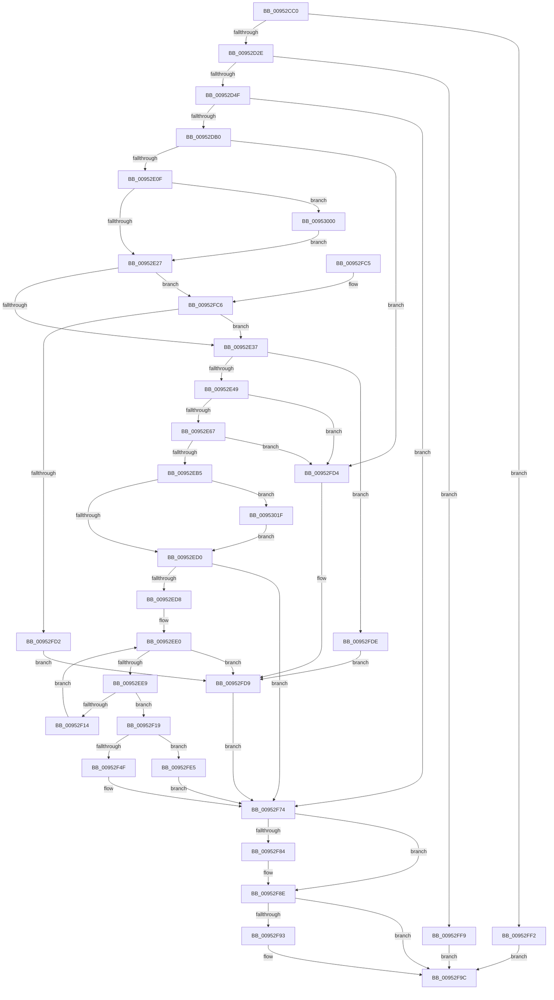

# IoVolumeDeviceNameToGuidPath

- RVA: `0x00952CC0`–`0x0095303D` (길이 `893` bytes)
- VA: `0x0000000140952CC0`
- 실행 섹션: `PAGE`
- PDB 이름 있음: `예`; PDB Function 태그: `아니요`
- unwind 정보 RVA: `0x00092014`
- 디코드: `231`개 명령, `893/893` bytes 표시
- 미해석 바이트: `0` (있으면 어셈블리에 `.byte`로 보존)

> 이 문서는 커널 이미지의 기계어와 PDB 기호를 분석해 생성했습니다. 4번과 5번은 함수 원형과 자료형을 바이너리 사용 방식에서 추정한 C 해석이며 원본 소스 복구 결과는 아닙니다.

## 1. Dependencies

- 직접 호출 지점: **20**; 고유 호출 대상: **12**
- 직접 호출자로 확인된 함수: **2**
- RIP 상대 이미지 참조: **3**

### Outgoing calls
- `0x00952D3E` → [ExAllocatePool2](../../poolcode/B8/ExAllocatePool2_function_00B820F0.md) (function, `0x00B820F0`)
- `0x00952D7B` → [memcpy](../../text/6C/memcpy_function_006C6840.md) (function, `0x006C6840`)
- `0x00952D8B` → [RtlInitUnicodeString](../../text/42/RtlInitUnicodeString_function_0042A780.md) (function, `0x0042A780`)
- `0x00952DA1` → [IoGetDeviceObjectPointer](IoGetDeviceObjectPointer_function_00953220.md) (function, `0x00953220`)
- `0x00952DC2` → [KeInitializeEvent](../../text/40/KeInitializeEvent_function_0040DD10.md) (function, `0x0040DD10`)
- `0x00952E01` → [IoBuildDeviceIoControlRequest](../../text/20/IoBuildDeviceIoControlRequest_function_00204FD0.md) (function, `0x00204FD0`)
- `0x00952E15` → [IofCallDriver](../../text/29/IofCallDriver_function_0029B4B0.md) (function, `0x0029B4B0`)
- `0x00952E56` → [ExAllocatePool2](../../poolcode/B8/ExAllocatePool2_function_00B820F0.md) (function, `0x00B820F0`)
- `0x00952E74` → [KeInitializeEvent](../../text/40/KeInitializeEvent_function_0040DD10.md) (function, `0x0040DD10`)
- `0x00952EA7` → [IoBuildDeviceIoControlRequest](../../text/20/IoBuildDeviceIoControlRequest_function_00204FD0.md) (function, `0x00204FD0`)
- `0x00952EBB` → [IofCallDriver](../../text/29/IofCallDriver_function_0029B4B0.md) (function, `0x0029B4B0`)
- `0x00952F0B` → [wcsnicmp](../../text/50/wcsnicmp_function_005001C0.md) (function, `0x005001C0`)
- `0x00952F3D` → [ExAllocatePool2](../../poolcode/B8/ExAllocatePool2_function_00B820F0.md) (function, `0x00B820F0`)
- `0x00952F59` → [memcpy](../../text/6C/memcpy_function_006C6840.md) (function, `0x006C6840`)
- `0x00952F79` → [ExFreePoolWithTag](../../poolcode/B8/ExFreePoolWithTag_function_00B82870.md) (function, `0x00B82870`)
- `0x00952F89` → [ExFreePoolWithTag](../../poolcode/B8/ExFreePoolWithTag_function_00B82870.md) (function, `0x00B82870`)
- `0x00952F97` → [ObfDereferenceObject](../../text/2F/ObfDereferenceObject_function_002F9350.md) (function, `0x002F9350`)
- `0x00952FA5` → [_security_check_cookie](../../text/6A/_security_check_cookie_function_006AC640.md) (function, `0x006AC640`)
- `0x00953012` → [KeWaitForSingleObject](../../text/20/KeWaitForSingleObject_function_0020E6B0.md) (function, `0x0020E6B0`)
- `0x00953030` → [KeWaitForSingleObject](../../text/20/KeWaitForSingleObject_function_0020E6B0.md) (function, `0x0020E6B0`)

### Direct callers
- [IoVolumeDeviceNameToGuid](../72/IoVolumeDeviceNameToGuid_function_00720EE0.md) at `0x00720F08`
- [IoVolumeDeviceToGuidPath](IoVolumeDeviceToGuidPath_function_00952B20.md) at `0x00952C33`

### Static image references
- `0x00952CDC` → RVA `0x00E0A740` (`.data`; read)
- `0x00952D80` → RVA `0x00AFCF90` (` ?? ::NNGAKEGL::`string'`; read)
- `0x00952EEB` → RVA `0x000122F8` (`.rdata`; read)

## 2. Other-region calls and transfers

- 다른 실행 섹션으로 향하는 call: **19**
  - `0x00952D3E` → [ExAllocatePool2](../../poolcode/B8/ExAllocatePool2_function_00B820F0.md) (`PAGE` → `POOLCODE`)
  - `0x00952D7B` → [memcpy](../../text/6C/memcpy_function_006C6840.md) (`PAGE` → `.text`)
  - `0x00952D8B` → [RtlInitUnicodeString](../../text/42/RtlInitUnicodeString_function_0042A780.md) (`PAGE` → `.text`)
  - `0x00952DC2` → [KeInitializeEvent](../../text/40/KeInitializeEvent_function_0040DD10.md) (`PAGE` → `.text`)
  - `0x00952E01` → [IoBuildDeviceIoControlRequest](../../text/20/IoBuildDeviceIoControlRequest_function_00204FD0.md) (`PAGE` → `.text`)
  - `0x00952E15` → [IofCallDriver](../../text/29/IofCallDriver_function_0029B4B0.md) (`PAGE` → `.text`)
  - `0x00952E56` → [ExAllocatePool2](../../poolcode/B8/ExAllocatePool2_function_00B820F0.md) (`PAGE` → `POOLCODE`)
  - `0x00952E74` → [KeInitializeEvent](../../text/40/KeInitializeEvent_function_0040DD10.md) (`PAGE` → `.text`)
  - `0x00952EA7` → [IoBuildDeviceIoControlRequest](../../text/20/IoBuildDeviceIoControlRequest_function_00204FD0.md) (`PAGE` → `.text`)
  - `0x00952EBB` → [IofCallDriver](../../text/29/IofCallDriver_function_0029B4B0.md) (`PAGE` → `.text`)
  - `0x00952F0B` → [wcsnicmp](../../text/50/wcsnicmp_function_005001C0.md) (`PAGE` → `.text`)
  - `0x00952F3D` → [ExAllocatePool2](../../poolcode/B8/ExAllocatePool2_function_00B820F0.md) (`PAGE` → `POOLCODE`)
  - `0x00952F59` → [memcpy](../../text/6C/memcpy_function_006C6840.md) (`PAGE` → `.text`)
  - `0x00952F79` → [ExFreePoolWithTag](../../poolcode/B8/ExFreePoolWithTag_function_00B82870.md) (`PAGE` → `POOLCODE`)
  - `0x00952F89` → [ExFreePoolWithTag](../../poolcode/B8/ExFreePoolWithTag_function_00B82870.md) (`PAGE` → `POOLCODE`)
  - `0x00952F97` → [ObfDereferenceObject](../../text/2F/ObfDereferenceObject_function_002F9350.md) (`PAGE` → `.text`)
  - `0x00952FA5` → [_security_check_cookie](../../text/6A/_security_check_cookie_function_006AC640.md) (`PAGE` → `.text`)
  - `0x00953012` → [KeWaitForSingleObject](../../text/20/KeWaitForSingleObject_function_0020E6B0.md) (`PAGE` → `.text`)
  - `0x00953030` → [KeWaitForSingleObject](../../text/20/KeWaitForSingleObject_function_0020E6B0.md) (`PAGE` → `.text`)
- 별도 외부 분기/꼬리 이동을 확인하지 못했습니다.

## 3. Assembly (complete function range)

```asm
00952CC0  48 89 5C 24 18                  mov qword ptr [rsp + 0x18], rbx
00952CC5  55                              push rbp
00952CC6  56                              push rsi
00952CC7  57                              push rdi
00952CC8  41 54                           push r12
00952CCA  41 55                           push r13
00952CCC  41 56                           push r14
00952CCE  41 57                           push r15
00952CD0  48 8D 6C 24 D9                  lea rbp, [rsp - 0x27]
00952CD5  48 81 EC D0 00 00 00            sub rsp, 0xd0
00952CDC  48 8B 05 5D 7A 4B 00            mov rax, qword ptr [rip + 0x4b7a5d]
00952CE3  48 33 C4                        xor rax, rsp
00952CE6  48 89 45 17                     mov qword ptr [rbp + 0x17], rax
00952CEA  45 33 E4                        xor r12d, r12d
00952CED  33 C0                           xor eax, eax
00952CEF  0F 57 C0                        xorps xmm0, xmm0
00952CF2  48 89 45 CF                     mov qword ptr [rbp - 0x31], rax
00952CF6  0F B7 01                        movzx eax, word ptr [rcx]
00952CF9  48 8B D9                        mov rbx, rcx
00952CFC  B9 00 F0 00 00                  mov ecx, 0xf000
00952D01  44 88 65 A7                     mov byte ptr [rbp - 0x59], r12b
00952D05  4C 89 65 B7                     mov qword ptr [rbp - 0x49], r12
00952D09  0F 57 C9                        xorps xmm1, xmm1
00952D0C  4C 89 65 AF                     mov qword ptr [rbp - 0x51], r12
00952D10  4C 8B F2                        mov r14, rdx
00952D13  41 8B F4                        mov esi, r12d
00952D16  45 8A EC                        mov r13b, r12b
00952D19  0F 11 45 BF                     movups xmmword ptr [rbp - 0x41], xmm0
00952D1D  0F 11 45 D7                     movups xmmword ptr [rbp - 0x29], xmm0
00952D21  0F 11 4D E7                     movups xmmword ptr [rbp - 0x19], xmm1
00952D25  66 3B C1                        cmp ax, cx
00952D28  0F 87 C4 02 00 00               ja 0x140952ff2
00952D2E  8D 78 1A                        lea edi, [rax + 0x1a]
00952D31  B9 00 01 00 00                  mov ecx, 0x100
00952D36  8B D7                           mov edx, edi
00952D38  41 B8 44 32 47 20               mov r8d, 0x20473244
00952D3E  E8 AD F3 22 00                  call 0x140b820f0
00952D43  4C 8B F8                        mov r15, rax
00952D46  48 85 C0                        test rax, rax
00952D49  0F 84 AA 02 00 00               je 0x140952ff9
00952D4F  44 89 20                        mov dword ptr [rax], r12d
00952D52  49 8D 4F 18                     lea rcx, [r15 + 0x18]
00952D56  66 44 89 60 04                  mov word ptr [rax + 4], r12w
00952D5B  44 89 60 08                     mov dword ptr [rax + 8], r12d
00952D5F  66 44 89 60 0C                  mov word ptr [rax + 0xc], r12w
00952D64  C7 40 10 18 00 00 00            mov dword ptr [rax + 0x10], 0x18
00952D6B  0F B7 03                        movzx eax, word ptr [rbx]
00952D6E  66 41 89 47 14                  mov word ptr [r15 + 0x14], ax
00952D73  44 0F B7 03                     movzx r8d, word ptr [rbx]
00952D77  48 8B 53 08                     mov rdx, qword ptr [rbx + 8]
00952D7B  E8 C0 3A D7 FF                  call 0x1406c6840
00952D80  48 8D 15 09 A2 1A 00            lea rdx, [rip + 0x1aa209]
00952D87  48 8D 4D E7                     lea rcx, [rbp - 0x19]
00952D8B  E8 F0 79 AD FF                  call 0x14042a780
00952D90  4C 8D 4D AF                     lea r9, [rbp - 0x51]
00952D94  BA 80 00 00 00                  mov edx, 0x80
00952D99  4C 8D 45 B7                     lea r8, [rbp - 0x49]
00952D9D  48 8D 4D E7                     lea rcx, [rbp - 0x19]
00952DA1  E8 7A 04 00 00                  call 0x140953220
00952DA6  8B D8                           mov ebx, eax
00952DA8  85 C0                           test eax, eax
00952DAA  0F 88 C4 01 00 00               js 0x140952f74
00952DB0  45 33 C0                        xor r8d, r8d
00952DB3  48 8D 4D BF                     lea rcx, [rbp - 0x41]
00952DB7  33 D2                           xor edx, edx
00952DB9  45 8D 6C 24 01                  lea r13d, [r12 + 1]
00952DBE  48 8D 75 F7                     lea rsi, [rbp - 9]
00952DC2  E8 49 AF AB FF                  call 0x14040dd10
00952DC7  48 8D 45 D7                     lea rax, [rbp - 0x29]
00952DCB  44 8B CF                        mov r9d, edi
00952DCE  48 89 44 24 40                  mov qword ptr [rsp + 0x40], rax
00952DD3  4D 8B C7                        mov r8, r15
00952DD6  48 8D 45 BF                     lea rax, [rbp - 0x41]
00952DDA  B9 08 00 6D 00                  mov ecx, 0x6d0008
00952DDF  48 89 44 24 38                  mov qword ptr [rsp + 0x38], rax
00952DE4  48 8D 45 F7                     lea rax, [rbp - 9]
00952DE8  44 88 64 24 30                  mov byte ptr [rsp + 0x30], r12b
00952DED  4C 8B 65 AF                     mov r12, qword ptr [rbp - 0x51]
00952DF1  49 8B D4                        mov rdx, r12
00952DF4  C7 44 24 28 20 00 00 00         mov dword ptr [rsp + 0x28], 0x20
00952DFC  48 89 44 24 20                  mov qword ptr [rsp + 0x20], rax
00952E01  E8 CA 21 8B FF                  call 0x140204fd0
00952E06  48 85 C0                        test rax, rax
00952E09  0F 84 C5 01 00 00               je 0x140952fd4
00952E0F  48 8B D0                        mov rdx, rax
00952E12  49 8B CC                        mov rcx, r12
00952E15  E8 96 86 94 FF                  call 0x14029b4b0
00952E1A  8B D8                           mov ebx, eax
00952E1C  3D 03 01 00 00                  cmp eax, 0x103
00952E21  0F 84 D9 01 00 00               je 0x140953000
00952E27  B9 00 00 00 80                  mov ecx, 0x80000000
00952E2C  8D 04 0B                        lea eax, [rbx + rcx]
00952E2F  85 C1                           test ecx, eax
00952E31  0F 84 8F 01 00 00               je 0x140952fc6
00952E37  8B 5D F7                        mov ebx, dword ptr [rbp - 9]
00952E3A  83 C3 20                        add ebx, 0x20
00952E3D  81 FB FF FF 00 00               cmp ebx, 0xffff
00952E43  0F 87 95 01 00 00               ja 0x140952fde
00952E49  8B D3                           mov edx, ebx
00952E4B  B9 00 01 00 00                  mov ecx, 0x100
00952E50  41 B8 44 32 47 20               mov r8d, 0x20473244
00952E56  E8 95 F2 22 00                  call 0x140b820f0
00952E5B  48 8B F0                        mov rsi, rax
00952E5E  48 85 C0                        test rax, rax
00952E61  0F 84 6D 01 00 00               je 0x140952fd4
00952E67  45 33 C0                        xor r8d, r8d
00952E6A  44 88 6D A7                     mov byte ptr [rbp - 0x59], r13b
00952E6E  33 D2                           xor edx, edx
00952E70  48 8D 4D BF                     lea rcx, [rbp - 0x41]
00952E74  E8 97 AE AB FF                  call 0x14040dd10
00952E79  48 8D 45 D7                     lea rax, [rbp - 0x29]
00952E7D  44 8B CF                        mov r9d, edi
00952E80  48 89 44 24 40                  mov qword ptr [rsp + 0x40], rax
00952E85  4D 8B C7                        mov r8, r15
00952E88  48 8D 45 BF                     lea rax, [rbp - 0x41]
00952E8C  49 8B D4                        mov rdx, r12
00952E8F  48 89 44 24 38                  mov qword ptr [rsp + 0x38], rax
00952E94  B9 08 00 6D 00                  mov ecx, 0x6d0008
00952E99  C6 44 24 30 00                  mov byte ptr [rsp + 0x30], 0
00952E9E  89 5C 24 28                     mov dword ptr [rsp + 0x28], ebx
00952EA2  48 89 74 24 20                  mov qword ptr [rsp + 0x20], rsi
00952EA7  E8 24 21 8B FF                  call 0x140204fd0
00952EAC  48 85 C0                        test rax, rax
00952EAF  0F 84 1F 01 00 00               je 0x140952fd4
00952EB5  48 8B D0                        mov rdx, rax
00952EB8  49 8B CC                        mov rcx, r12
00952EBB  E8 F0 85 94 FF                  call 0x14029b4b0
00952EC0  45 33 E4                        xor r12d, r12d
00952EC3  8B D8                           mov ebx, eax
00952EC5  3D 03 01 00 00                  cmp eax, 0x103
00952ECA  0F 84 4F 01 00 00               je 0x14095301f
00952ED0  85 DB                           test ebx, ebx
00952ED2  0F 88 9C 00 00 00               js 0x140952f74
00952ED8  BB 25 02 00 C0                  mov ebx, 0xc0000225
00952EDD  41 8B FC                        mov edi, r12d
00952EE0  3B 7E 04                        cmp edi, dword ptr [rsi + 4]
00952EE3  0F 83 F0 00 00 00               jae 0x140952fd9
00952EE9  8B C7                           mov eax, edi
00952EEB  48 8D 0D 06 F4 6B FF            lea rcx, [rip - 0x940bfa]
00952EF2  41 B8 0A 00 00 00               mov r8d, 0xa
00952EF8  48 8D 04 40                     lea rax, [rax + rax*2]
00952EFC  44 8B 64 C6 08                  mov r12d, dword ptr [rsi + rax*8 + 8]
00952F01  4C 03 E6                        add r12, rsi
00952F04  48 89 45 AF                     mov qword ptr [rbp - 0x51], rax
00952F08  49 8B D4                        mov rdx, r12
00952F0B  E8 B0 D2 BA FF                  call 0x1405001c0
00952F10  85 C0                           test eax, eax
00952F12  74 05                           je 0x140952f19
00952F14  41 03 FD                        add edi, r13d
00952F17  EB C7                           jmp 0x140952ee0
00952F19  48 8B 45 AF                     mov rax, qword ptr [rbp - 0x51]
00952F1D  B9 00 01 00 00                  mov ecx, 0x100
00952F22  41 B8 44 32 47 20               mov r8d, 0x20473244
00952F28  0F B7 44 C6 0C                  movzx eax, word ptr [rsi + rax*8 + 0xc]
00952F2D  66 41 89 06                     mov word ptr [r14], ax
00952F31  66 83 C0 02                     add ax, 2
00952F35  0F B7 D0                        movzx edx, ax
00952F38  66 41 89 56 02                  mov word ptr [r14 + 2], dx
00952F3D  E8 AE F1 22 00                  call 0x140b820f0
00952F42  49 89 46 08                     mov qword ptr [r14 + 8], rax
00952F46  48 85 C0                        test rax, rax
00952F49  0F 84 96 00 00 00               je 0x140952fe5
00952F4F  45 0F B7 06                     movzx r8d, word ptr [r14]
00952F53  49 8B D4                        mov rdx, r12
00952F56  48 8B C8                        mov rcx, rax
00952F59  E8 E2 38 D7 FF                  call 0x1406c6840
00952F5E  41 0F B7 0E                     movzx ecx, word ptr [r14]
00952F62  49 8B 46 08                     mov rax, qword ptr [r14 + 8]
00952F66  48 D1 E9                        shr rcx, 1
00952F69  45 33 E4                        xor r12d, r12d
00952F6C  41 8B DC                        mov ebx, r12d
00952F6F  66 44 89 24 48                  mov word ptr [rax + rcx*2], r12w
00952F74  33 D2                           xor edx, edx
00952F76  49 8B CF                        mov rcx, r15
00952F79  E8 F2 F8 22 00                  call 0x140b82870
00952F7E  44 38 65 A7                     cmp byte ptr [rbp - 0x59], r12b
00952F82  74 0A                           je 0x140952f8e
00952F84  33 D2                           xor edx, edx
00952F86  48 8B CE                        mov rcx, rsi
00952F89  E8 E2 F8 22 00                  call 0x140b82870
00952F8E  45 84 ED                        test r13b, r13b
00952F91  74 09                           je 0x140952f9c
00952F93  48 8B 4D B7                     mov rcx, qword ptr [rbp - 0x49]
00952F97  E8 B4 63 9A FF                  call 0x1402f9350
00952F9C  8B C3                           mov eax, ebx
00952F9E  48 8B 4D 17                     mov rcx, qword ptr [rbp + 0x17]
00952FA2  48 33 CC                        xor rcx, rsp
00952FA5  E8 96 96 D5 FF                  call 0x1406ac640
00952FAA  48 8B 9C 24 20 01 00 00         mov rbx, qword ptr [rsp + 0x120]
00952FB2  48 81 C4 D0 00 00 00            add rsp, 0xd0
00952FB9  41 5F                           pop r15
00952FBB  41 5E                           pop r14
00952FBD  41 5D                           pop r13
00952FBF  41 5C                           pop r12
00952FC1  5F                              pop rdi
00952FC2  5E                              pop rsi
00952FC3  5D                              pop rbp
00952FC4  C3                              ret
00952FC5  CC                              int3
00952FC6  81 FB 05 00 00 80               cmp ebx, 0x80000005
00952FCC  0F 84 65 FE FF FF               je 0x140952e37
00952FD2  EB 05                           jmp 0x140952fd9
00952FD4  BB 9A 00 00 C0                  mov ebx, 0xc000009a
00952FD9  45 33 E4                        xor r12d, r12d
00952FDC  EB 96                           jmp 0x140952f74
00952FDE  BB 06 02 00 C0                  mov ebx, 0xc0000206
00952FE3  EB F4                           jmp 0x140952fd9
00952FE5  45 33 E4                        xor r12d, r12d
00952FE8  BB 9A 00 00 C0                  mov ebx, 0xc000009a
00952FED  45 89 26                        mov dword ptr [r14], r12d
00952FF0  EB 82                           jmp 0x140952f74
00952FF2  BB 0D 00 00 C0                  mov ebx, 0xc000000d
00952FF7  EB A3                           jmp 0x140952f9c
00952FF9  BB 9A 00 00 C0                  mov ebx, 0xc000009a
00952FFE  EB 9C                           jmp 0x140952f9c
00953000  48 83 64 24 20 00               and qword ptr [rsp + 0x20], 0
00953006  48 8D 4D BF                     lea rcx, [rbp - 0x41]
0095300A  45 33 C9                        xor r9d, r9d
0095300D  45 33 C0                        xor r8d, r8d
00953010  33 D2                           xor edx, edx
00953012  E8 99 B6 8B FF                  call 0x14020e6b0
00953017  8B 5D D7                        mov ebx, dword ptr [rbp - 0x29]
0095301A  E9 08 FE FF FF                  jmp 0x140952e27
0095301F  45 33 C9                        xor r9d, r9d
00953022  4C 89 64 24 20                  mov qword ptr [rsp + 0x20], r12
00953027  45 33 C0                        xor r8d, r8d
0095302A  48 8D 4D BF                     lea rcx, [rbp - 0x41]
0095302E  33 D2                           xor edx, edx
00953030  E8 7B B6 8B FF                  call 0x14020e6b0
00953035  8B 5D D7                        mov ebx, dword ptr [rbp - 0x29]
00953038  E9 93 FE FF FF                  jmp 0x140952ed0
```

## 4. C-style interpretation (structured pseudocode)

```c
__int64 __fastcall IoVolumeDeviceNameToGuidPath(__int64 a1, __int64 a2)
{
    __int64 result;
    __int64 v_r12;
    __int64 v_rbx;
    __int64 v_rdi;
    __int64 v_rsp;
    unsigned __int64 v_stack_m48;
    unsigned __int64 v_stack_m5F;
    unsigned __int64 v_stack_m68;
    unsigned __int64 v_stack_m78;
    unsigned __int64 v_stack_m88;
    unsigned __int64 v_stack_m90;
    unsigned __int64 v_stack_mA0;
    unsigned __int64 v_stack_mA8;
    unsigned __int64 v_stack_mB0;
    unsigned __int8 v_stack_mB8;
    unsigned __int64 v_stack_mC8;
    unsigned __int64 v_stack_mD0;
    unsigned __int8 v_stack_mD8;
    unsigned int v_stack_mE0;
    unsigned __int64 v_stack_mE8;
    unsigned __int64 v_stack_p18;
    unsigned __int64 v_stack_p20;

    v_stack_p18 = v_rbx;
    v_rsp = (v_rsp) - (208);
    result = (*(unsigned __int64 *)(v_rip + 4946525)) ^ (v_rsp);
    v_stack_m48 = result;
    v_r12 = 0;
    result = 0;
    v_stack_m90 = 0;
    v_stack_mB8 = 0;
    v_stack_mA8 = 0;
    v_stack_mB0 = 0;
    v_stack_mA0 = v_xmm0;
    v_stack_m88 = v_xmm0;
    v_stack_m78 = v_xmm1;
    if (((unsigned __int16)(*(unsigned __int16 *)(a1))) > ((unsigned __int16)((unsigned int)(0xF000ULL)))) goto loc_00952FF2;
    result = ExAllocatePool2(256, (unsigned int)((unsigned int)(*(unsigned __int16 *)(a1) + 26)), (unsigned int)(0x20473244ULL), a4);
    if (result == 0) goto loc_00952FF9;
    *(unsigned int *)(result) = 0;
    *(unsigned __int16 *)(result + 4) = 0;
    *(unsigned int *)(result + 8) = 0;
    *(unsigned __int16 *)(result + 12) = 0;
    *(unsigned int *)(result + 16) = 24;
    *(unsigned __int16 *)(result + 20) = (unsigned __int16)(*(unsigned __int16 *)(a1));
    result = memcpy(result + 24, *(unsigned __int64 *)(a1 + 8), *(unsigned __int16 *)(a1), a4);
    result = RtlInitUnicodeString(v_stack_m78, v_rip + 1745417, *(unsigned __int16 *)(a1), a4);
    result = IoGetDeviceObjectPointer(v_stack_m78, 128, v_stack_mA8, v_stack_mB0);
    if (sign_flag) goto loc_00952F74;
    a3 = 0;
    a2 = 0;
    result = KeInitializeEvent(v_stack_mA0, a2, a3, v_stack_mB0);
    v_stack_mC8 = v_stack_m88;
    v_stack_mD0 = v_stack_mA0;
    v_stack_mD8 = 0;
    v_stack_mE0 = 32;
    v_stack_mE8 = v_stack_m68;
    result = IoBuildDeviceIoControlRequest((unsigned int)(0x6D0008ULL), v_stack_mB0, result, (unsigned int)((unsigned int)(*(unsigned __int16 *)(a1) + 26)));
    if (result == 0) goto loc_00952FD4;
    result = IofCallDriver(v_stack_mB0, result, result, (unsigned int)((unsigned int)(*(unsigned __int16 *)(a1) + 26)));
    if (((unsigned int)(result)) == 259) goto loc_00953000;
loc_00952E27:
    if ((((unsigned int)((unsigned int)(0x80000000ULL))) & ((unsigned int)((unsigned int)((unsigned int)(result)) + (unsigned int)(0x80000000ULL) * 1))) == 0) goto loc_00952FC6;
loc_00952E37:
    v_rbx = (unsigned int)(((unsigned int)(v_stack_m68)) + (32));
    if (((unsigned int)(v_rbx)) > 0xFFFFULL) goto loc_00952FDE;
    result = ExAllocatePool2(256, (unsigned int)((unsigned int)(v_rbx)), (unsigned int)(0x20473244ULL), (unsigned int)((unsigned int)(*(unsigned __int16 *)(a1) + 26)));
    if (result == 0) goto loc_00952FD4;
    a3 = 0;
    v_stack_mB8 = (unsigned __int8)(v_r12 + 1);
    a2 = 0;
    result = KeInitializeEvent(v_stack_mA0, a2, a3, (unsigned int)((unsigned int)(*(unsigned __int16 *)(a1) + 26)));
    v_stack_mC8 = v_stack_m88;
    v_stack_mD0 = v_stack_mA0;
    v_stack_mD8 = 0;
    v_stack_mE0 = (unsigned int)(v_rbx);
    v_stack_mE8 = result;
    result = IoBuildDeviceIoControlRequest((unsigned int)(0x6D0008ULL), v_stack_mB0, result, (unsigned int)((unsigned int)(*(unsigned __int16 *)(a1) + 26)));
    if (result == 0) goto loc_00952FD4;
    result = IofCallDriver(v_stack_mB0, result, result, (unsigned int)((unsigned int)(*(unsigned __int16 *)(a1) + 26)));
    v_r12 = 0;
    if (((unsigned int)(result)) == 259) goto loc_0095301F;
loc_00952ED0:
    if (sign_flag) goto loc_00952F74;
loc_00952EE0:
    if (0 >= (*(unsigned int *)(result + 4))) goto loc_00952FD9;
    v_r12 = ((unsigned int)(*(unsigned int *)(result + 0 + 0 * 2 * 8 + 8))) + (result);
    v_stack_mB0 = 0 + 0 * 2;
    result = wcsnicmp(v_rip - 9702394, v_r12, 10, (unsigned int)((unsigned int)(*(unsigned __int16 *)(a1) + 26)));
    if ((unsigned int)(result) == 0) goto loc_00952F19;
    v_rdi = (unsigned int)((0) + ((unsigned int)(v_r12 + 1)));
    goto loc_00952EE0;
loc_00952F19:
    *(unsigned __int16 *)(a2) = (unsigned __int16)(*(unsigned __int16 *)(result + v_stack_mB0 * 8 + 12));
    result = (unsigned __int16)((*(unsigned __int16 *)(result + v_stack_mB0 * 8 + 12)) + (2));
    *(unsigned __int16 *)(a2 + 2) = (unsigned __int16)((unsigned __int16)(result));
    result = ExAllocatePool2(256, (unsigned __int16)(result), (unsigned int)(0x20473244ULL), (unsigned int)((unsigned int)(*(unsigned __int16 *)(a1) + 26)));
    *(unsigned __int64 *)(a2 + 8) = result;
    if (result == 0) goto loc_00952FE5;
    result = memcpy(result, v_r12, *(unsigned __int16 *)(a2), (unsigned int)((unsigned int)(*(unsigned __int16 *)(a1) + 26)));
    a1 = (*(unsigned __int16 *)(a2)) >> (1);
    v_r12 = 0;
    *(unsigned __int16 *)(*(unsigned __int64 *)(a2 + 8) + a1 * 2) = 0;
loc_00952F74:
    a2 = 0;
    result = ExFreePoolWithTag(result, a2, *(unsigned __int16 *)(a2), (unsigned int)((unsigned int)(*(unsigned __int16 *)(a1) + 26)));
    if (v_stack_mB8 != 0) {
        a2 = 0;
        a1 = result;
        result = ExFreePoolWithTag(a1, a2, *(unsigned __int16 *)(a2), (unsigned int)((unsigned int)(*(unsigned __int16 *)(a1) + 26)));
    }
    if ((unsigned __int8)(v_r12 + 1) != 0) {
        a1 = v_stack_mA8;
        result = ObfDereferenceObject(a1, a2, *(unsigned __int16 *)(a2), (unsigned int)((unsigned int)(*(unsigned __int16 *)(a1) + 26)));
    }
    a1 = (v_stack_m48) ^ (v_rsp);
    result = _security_check_cookie(a1, a2, *(unsigned __int16 *)(a2), (unsigned int)((unsigned int)(*(unsigned __int16 *)(a1) + 26)));
    v_rsp = (v_rsp) + (208);
    return result;
loc_00952FC6:
    if (((unsigned int)(v_stack_p18)) == 0x80000005ULL) goto loc_00952E37;
    goto loc_00952FD9;
loc_00952FD4:
loc_00952FD9:
    v_r12 = 0;
    goto loc_00952F74;
loc_00952FDE:
    goto loc_00952FD9;
loc_00952FE5:
    v_r12 = 0;
    *(unsigned int *)(a2) = 0;
    goto loc_00952F74;
loc_00952FF2:
    goto loc_00952F9C;
loc_00952FF9:
    goto loc_00952F9C;
loc_00953000:
    a4 = 0;
    a3 = 0;
    a2 = 0;
    result = KeWaitForSingleObject(v_stack_mA0, a2, a3, a4);
    goto loc_00952E27;
loc_0095301F:
    a4 = 0;
    v_stack_p20 = 0;
    a3 = 0;
    a2 = 0;
    result = KeWaitForSingleObject(v_stack_mA0, a2, a3, a4);
    goto loc_00952ED0;
}
```

## 5. (Beta) C Style

```c
int64_t IoVolumeDeviceNameToGuidPath(void *Arg1, void *Arg2)
{
    uint8_t *arg1 = (uint8_t *)Arg1;
    uint8_t *arg2 = (uint8_t *)Arg2;

    int64_t result;
    int64_t local_r12;
    int64_t local_rbx;
    int64_t local_rdi;
    int64_t local_rsp;
    uint64_t v_stack_m48;
    uint64_t v_stack_m5F;
    uint64_t v_stack_m68;
    uint64_t v_stack_m78;
    uint64_t v_stack_m88;
    uint64_t v_stack_m90;
    uint64_t v_stack_mA0;
    uint64_t v_stack_mA8;
    uint64_t v_stack_mB0;
    uint8_t v_stack_mB8;
    uint64_t v_stack_mC8;
    uint64_t v_stack_mD0;
    uint8_t v_stack_mD8;
    uint32_t v_stack_mE0;
    uint64_t v_stack_mE8;
    uint64_t v_stack_p18;
    uint64_t v_stack_p20;

    v_stack_p18 = local_rbx;
    local_rsp = (local_rsp) - (208);
    result = (*(uint64_t *)(v_rip + 0x4B7A5D)) ^ (local_rsp);
    v_stack_m48 = result;
    local_r12 = 0;
    result = 0;
    v_stack_m90 = 0;
    v_stack_mB8 = 0;
    v_stack_mA8 = 0;
    v_stack_mB0 = 0;
    v_stack_mA0 = v_xmm0;
    v_stack_m88 = v_xmm0;
    v_stack_m78 = v_xmm1;
    if (((uint16_t)(*(uint16_t *)(arg1))) > ((uint16_t)((uint32_t)(0xF000ULL)))) goto loc_00952FF2;
    result = ExAllocatePool2(256, (uint32_t)((uint32_t)(*(uint16_t *)(arg1) + 26)), (uint32_t)(0x20473244ULL), a4);
    if (result == 0) goto loc_00952FF9;
    *(uint32_t *)(result) = 0;
    *(uint16_t *)(result + 0x4) = 0;
    *(uint32_t *)(result + 0x8) = 0;
    *(uint16_t *)(result + 0xC) = 0;
    *(uint32_t *)(result + 0x10) = 24;
    *(uint16_t *)(result + 0x14) = (uint16_t)(*(uint16_t *)(arg1));
    result = memcpy(result + 24, *(uint64_t *)(arg1 + 0x8), *(uint16_t *)(arg1), a4);
    result = RtlInitUnicodeString(v_stack_m78, v_rip + 1745417, *(uint16_t *)(arg1), a4);
    result = IoGetDeviceObjectPointer(v_stack_m78, 128, v_stack_mA8, v_stack_mB0);
    if (sign_flag) goto loc_00952F74;
    a3 = 0;
    Arg2 = 0;
    result = KeInitializeEvent(v_stack_mA0, Arg2, a3, v_stack_mB0);
    v_stack_mC8 = v_stack_m88;
    v_stack_mD0 = v_stack_mA0;
    v_stack_mD8 = 0;
    v_stack_mE0 = 32;
    v_stack_mE8 = v_stack_m68;
    result = IoBuildDeviceIoControlRequest((uint32_t)(0x6D0008ULL), v_stack_mB0, result, (uint32_t)((uint32_t)(*(uint16_t *)(arg1) + 26)));
    if (result == 0) goto loc_00952FD4;
    result = IofCallDriver(v_stack_mB0, result, result, (uint32_t)((uint32_t)(*(uint16_t *)(arg1) + 26)));
    if (((uint32_t)(result)) == 259) goto loc_00953000;
loc_00952E27:
    if ((((uint32_t)((uint32_t)(0x80000000ULL))) & ((uint32_t)((uint32_t)((uint32_t)(result)) + (uint32_t)(0x80000000ULL) * 1))) == 0) goto loc_00952FC6;
loc_00952E37:
    local_rbx = (uint32_t)(((uint32_t)(v_stack_m68)) + (32));
    if (((uint32_t)(local_rbx)) > 0xFFFFULL) goto loc_00952FDE;
    result = ExAllocatePool2(256, (uint32_t)((uint32_t)(local_rbx)), (uint32_t)(0x20473244ULL), (uint32_t)((uint32_t)(*(uint16_t *)(arg1) + 26)));
    if (result == 0) goto loc_00952FD4;
    a3 = 0;
    v_stack_mB8 = (uint8_t)(local_r12 + 1);
    Arg2 = 0;
    result = KeInitializeEvent(v_stack_mA0, Arg2, a3, (uint32_t)((uint32_t)(*(uint16_t *)(arg1) + 26)));
    v_stack_mC8 = v_stack_m88;
    v_stack_mD0 = v_stack_mA0;
    v_stack_mD8 = 0;
    v_stack_mE0 = (uint32_t)(local_rbx);
    v_stack_mE8 = result;
    result = IoBuildDeviceIoControlRequest((uint32_t)(0x6D0008ULL), v_stack_mB0, result, (uint32_t)((uint32_t)(*(uint16_t *)(arg1) + 26)));
    if (result == 0) goto loc_00952FD4;
    result = IofCallDriver(v_stack_mB0, result, result, (uint32_t)((uint32_t)(*(uint16_t *)(arg1) + 26)));
    local_r12 = 0;
    if (((uint32_t)(result)) == 259) goto loc_0095301F;
loc_00952ED0:
    if (sign_flag) goto loc_00952F74;
loc_00952EE0:
    if (0 >= (*(uint32_t *)(result + 0x4))) goto loc_00952FD9;
    local_r12 = ((uint32_t)(*(uint32_t *)(result + 0x0 + 0x0 * 2 * 8 + 0x8))) + (result);
    v_stack_mB0 = 0 + 0 * 2;
    result = wcsnicmp(v_rip - 9702394, local_r12, 10, (uint32_t)((uint32_t)(*(uint16_t *)(arg1) + 26)));
    if ((uint32_t)(result) == 0) goto loc_00952F19;
    local_rdi = (uint32_t)((0) + ((uint32_t)(local_r12 + 1)));
    goto loc_00952EE0;
loc_00952F19:
    *(uint16_t *)(arg2) = (uint16_t)(*(uint16_t *)(result + v_stack_mB0 * 8 + 0xC));
    result = (uint16_t)((*(uint16_t *)(result + v_stack_mB0 * 8 + 0xC)) + (2));
    *(uint16_t *)(arg2 + 0x2) = (uint16_t)((uint16_t)(result));
    result = ExAllocatePool2(256, (uint16_t)(result), (uint32_t)(0x20473244ULL), (uint32_t)((uint32_t)(*(uint16_t *)(arg1) + 26)));
    *(uint64_t *)(arg2 + 0x8) = result;
    if (result == 0) goto loc_00952FE5;
    result = memcpy(result, local_r12, *(uint16_t *)(arg2), (uint32_t)((uint32_t)(*(uint16_t *)(arg1) + 26)));
    Arg1 = (*(uint16_t *)(arg2)) >> (1);
    local_r12 = 0;
    *(uint16_t *)(*(uint64_t *)(arg2 + 0x8) + arg1 * 2) = 0;
loc_00952F74:
    Arg2 = 0;
    result = ExFreePoolWithTag(result, Arg2, *(uint16_t *)(arg2), (uint32_t)((uint32_t)(*(uint16_t *)(arg1) + 26)));
    if (v_stack_mB8 != 0) {
        Arg2 = 0;
        Arg1 = result;
        result = ExFreePoolWithTag(Arg1, Arg2, *(uint16_t *)(arg2), (uint32_t)((uint32_t)(*(uint16_t *)(arg1) + 26)));
    }
    if ((uint8_t)(local_r12 + 1) != 0) {
        Arg1 = v_stack_mA8;
        result = ObfDereferenceObject(Arg1, Arg2, *(uint16_t *)(arg2), (uint32_t)((uint32_t)(*(uint16_t *)(arg1) + 26)));
    }
    Arg1 = (v_stack_m48) ^ (local_rsp);
    result = _security_check_cookie(Arg1, Arg2, *(uint16_t *)(arg2), (uint32_t)((uint32_t)(*(uint16_t *)(arg1) + 26)));
    local_rsp = (local_rsp) + (208);
    return result;
loc_00952FC6:
    if (((uint32_t)(v_stack_p18)) == 0x80000005ULL) goto loc_00952E37;
    goto loc_00952FD9;
loc_00952FD4:
loc_00952FD9:
    local_r12 = 0;
    goto loc_00952F74;
loc_00952FDE:
    goto loc_00952FD9;
loc_00952FE5:
    local_r12 = 0;
    *(uint32_t *)(arg2) = 0;
    goto loc_00952F74;
loc_00952FF2:
    goto loc_00952F9C;
loc_00952FF9:
    goto loc_00952F9C;
loc_00953000:
    a4 = 0;
    a3 = 0;
    Arg2 = 0;
    result = KeWaitForSingleObject(v_stack_mA0, Arg2, a3, a4);
    goto loc_00952E27;
loc_0095301F:
    a4 = 0;
    v_stack_p20 = 0;
    a3 = 0;
    Arg2 = 0;
    result = KeWaitForSingleObject(v_stack_mA0, Arg2, a3, a4);
    goto loc_00952ED0;
}
```

### 관측된 메모리 오프셋

구조체 형식이 확인되지 않은 접근은 인자 기준의 오프셋으로만 기록했습니다.

| 기준 인자 | 오프셋 표현 | 폭 (bit) | 접근 |
|---|---:|---:|---|
| `Arg1` | `+ 0x0` | `16` | `R` |
| `Arg1` | `+ 0x8` | `64` | `R` |
| `Arg2` | `+ 0x0` | `16` | `R` |
| `Arg2` | `+ 0x0` | `16` | `W` |
| `Arg2` | `+ 0x0` | `32` | `W` |
| `Arg2` | `+ 0x2` | `16` | `W` |
| `Arg2` | `+ 0x8` | `64` | `R` |
| `Arg2` | `+ 0x8` | `64` | `W` |

## 6. Execution-region graph

[열기: 2D/3D 그래프와 함수 탐색 컨트롤 패널](../../../control-panel.html?section=page&rva=0x00952CC0&view=graph)

- 2D 그래프는 위에서 아래로 흐르고, 3D 그래프는 빈 공간을 드래그해 회전합니다. Shift+드래그는 이동, 휠은 확대·축소, 함수 노드 선택은 대상 보고서 이동입니다.

### Static fallback


