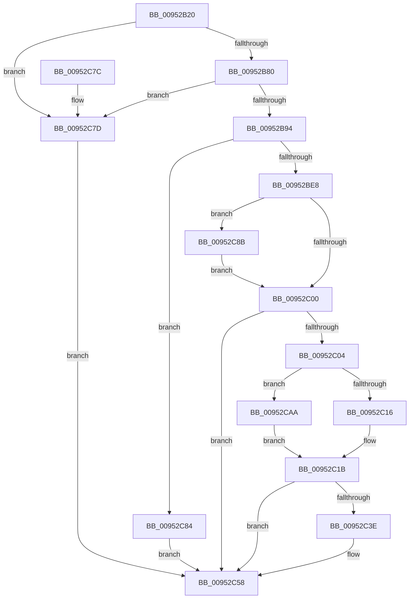

# IoVolumeDeviceToGuidPath

- RVA: `0x00952B20`–`0x00952CB6` (길이 `406` bytes)
- VA: `0x0000000140952B20`
- 실행 섹션: `PAGE`
- PDB 이름 있음: `예`; PDB Function 태그: `아니요`
- unwind 정보 RVA: `0x00091FF4`
- 디코드: `100`개 명령, `406/406` bytes 표시
- 미해석 바이트: `0` (있으면 어셈블리에 `.byte`로 보존)

> 이 문서는 커널 이미지의 기계어와 PDB 기호를 분석해 생성했습니다. 4번과 5번은 함수 원형과 자료형을 바이너리 사용 방식에서 추정한 C 해석이며 원본 소스 복구 결과는 아닙니다.

## 1. Dependencies

- 직접 호출 지점: **6**; 고유 호출 대상: **6**
- 직접 호출자로 확인된 함수: **3**
- RIP 상대 이미지 참조: **1**

### Outgoing calls
- `0x00952B9E` → [KeInitializeEvent](../../text/40/KeInitializeEvent_function_0040DD10.md) (function, `0x0040DD10`)
- `0x00952BDA` → [IoBuildDeviceIoControlRequest](../../text/20/IoBuildDeviceIoControlRequest_function_00204FD0.md) (function, `0x00204FD0`)
- `0x00952BEE` → [IofCallDriver](../../text/29/IofCallDriver_function_0029B4B0.md) (function, `0x0029B4B0`)
- `0x00952C33` → [IoVolumeDeviceNameToGuidPath](IoVolumeDeviceNameToGuidPath_function_00952CC0.md) (function, `0x00952CC0`)
- `0x00952C64` → [_security_check_cookie](../../text/6A/_security_check_cookie_function_006AC640.md) (function, `0x006AC640`)
- `0x00952C9D` → [KeWaitForSingleObject](../../text/20/KeWaitForSingleObject_function_0020E6B0.md) (function, `0x0020E6B0`)

### Direct callers
- [IopValidateJunctionTarget](../71/IopValidateJunctionTarget_function_0071C808.md) at `0x0071CAA6`
- [CmpVolumeContextStart](../7E/CmpVolumeContextStart_function_007E88A4.md) at `0x007E8940`
- [IoVolumeDeviceToGuid](IoVolumeDeviceToGuid_function_00952A90.md) at `0x00952AB8`

### Static image references
- `0x00952B37` → RVA `0x00E0A740` (`.data`; read)

## 2. Other-region calls and transfers

- 다른 실행 섹션으로 향하는 call: **5**
  - `0x00952B9E` → [KeInitializeEvent](../../text/40/KeInitializeEvent_function_0040DD10.md) (`PAGE` → `.text`)
  - `0x00952BDA` → [IoBuildDeviceIoControlRequest](../../text/20/IoBuildDeviceIoControlRequest_function_00204FD0.md) (`PAGE` → `.text`)
  - `0x00952BEE` → [IofCallDriver](../../text/29/IofCallDriver_function_0029B4B0.md) (`PAGE` → `.text`)
  - `0x00952C64` → [_security_check_cookie](../../text/6A/_security_check_cookie_function_006AC640.md) (`PAGE` → `.text`)
  - `0x00952C9D` → [KeWaitForSingleObject](../../text/20/KeWaitForSingleObject_function_0020E6B0.md) (`PAGE` → `.text`)
- 별도 외부 분기/꼬리 이동을 확인하지 못했습니다.

## 3. Assembly (complete function range)

```asm
00952B20  48 89 5C 24 18                  mov qword ptr [rsp + 0x18], rbx
00952B25  55                              push rbp
00952B26  56                              push rsi
00952B27  57                              push rdi
00952B28  48 8D AC 24 60 FE FF FF         lea rbp, [rsp - 0x1a0]
00952B30  48 81 EC A0 02 00 00            sub rsp, 0x2a0
00952B37  48 8B 05 02 7C 4B 00            mov rax, qword ptr [rip + 0x4b7c02]
00952B3E  48 33 C4                        xor rax, rsp
00952B41  48 89 85 98 01 00 00            mov qword ptr [rbp + 0x198], rax
00952B48  33 C0                           xor eax, eax
00952B4A  33 F6                           xor esi, esi
00952B4C  0F 57 C0                        xorps xmm0, xmm0
00952B4F  48 89 45 80                     mov qword ptr [rbp - 0x80], rax
00952B53  8B 41 48                        mov eax, dword ptr [rcx + 0x48]
00952B56  0F 57 C9                        xorps xmm1, xmm1
00952B59  48 89 74 24 50                  mov qword ptr [rsp + 0x50], rsi
00952B5E  48 8B DA                        mov rbx, rdx
00952B61  48 89 74 24 58                  mov qword ptr [rsp + 0x58], rsi
00952B66  48 8B F9                        mov rdi, rcx
00952B69  0F 11 44 24 70                  movups xmmword ptr [rsp + 0x70], xmm0
00952B6E  0F 11 45 88                     movups xmmword ptr [rbp - 0x78], xmm0
00952B72  0F 11 4C 24 60                  movups xmmword ptr [rsp + 0x60], xmm1
00952B77  83 F8 24                        cmp eax, 0x24
00952B7A  0F 87 FD 00 00 00               ja 0x140952c7d
00952B80  48 B9 84 00 00 80 10 00 00 00   movabs rcx, 0x1080000084
00952B8A  48 0F A3 C1                     bt rcx, rax
00952B8E  0F 83 E9 00 00 00               jae 0x140952c7d
00952B94  45 33 C0                        xor r8d, r8d
00952B97  48 8D 4C 24 70                  lea rcx, [rsp + 0x70]
00952B9C  33 D2                           xor edx, edx
00952B9E  E8 6D B1 AB FF                  call 0x14040dd10
00952BA3  48 8D 45 88                     lea rax, [rbp - 0x78]
00952BA7  45 33 C9                        xor r9d, r9d
00952BAA  48 89 44 24 40                  mov qword ptr [rsp + 0x40], rax
00952BAF  45 33 C0                        xor r8d, r8d
00952BB2  48 8D 44 24 70                  lea rax, [rsp + 0x70]
00952BB7  48 8B D7                        mov rdx, rdi
00952BBA  48 89 44 24 38                  mov qword ptr [rsp + 0x38], rax
00952BBF  B9 08 00 4D 00                  mov ecx, 0x4d0008
00952BC4  40 88 74 24 30                  mov byte ptr [rsp + 0x30], sil
00952BC9  48 8D 45 98                     lea rax, [rbp - 0x68]
00952BCD  C7 44 24 28 00 02 00 00         mov dword ptr [rsp + 0x28], 0x200
00952BD5  48 89 44 24 20                  mov qword ptr [rsp + 0x20], rax
00952BDA  E8 F1 23 8B FF                  call 0x140204fd0
00952BDF  48 85 C0                        test rax, rax
00952BE2  0F 84 9C 00 00 00               je 0x140952c84
00952BE8  48 8B D0                        mov rdx, rax
00952BEB  48 8B CF                        mov rcx, rdi
00952BEE  E8 BD 88 94 FF                  call 0x14029b4b0
00952BF3  8B C8                           mov ecx, eax
00952BF5  3D 03 01 00 00                  cmp eax, 0x103
00952BFA  0F 84 8B 00 00 00               je 0x140952c8b
00952C00  85 C9                           test ecx, ecx
00952C02  78 54                           js 0x140952c58
00952C04  0F B7 45 98                     movzx eax, word ptr [rbp - 0x68]
00952C08  B9 FE 01 00 00                  mov ecx, 0x1fe
00952C0D  66 3B C1                        cmp ax, cx
00952C10  0F 83 94 00 00 00               jae 0x140952caa
00952C16  66 89 44 24 60                  mov word ptr [rsp + 0x60], ax
00952C1B  66 89 44 24 62                  mov word ptr [rsp + 0x62], ax
00952C20  48 8D 54 24 50                  lea rdx, [rsp + 0x50]
00952C25  48 8D 45 9A                     lea rax, [rbp - 0x66]
00952C29  48 8D 4C 24 60                  lea rcx, [rsp + 0x60]
00952C2E  48 89 44 24 68                  mov qword ptr [rsp + 0x68], rax
00952C33  E8 88 00 00 00                  call 0x140952cc0
00952C38  8B C8                           mov ecx, eax
00952C3A  85 C0                           test eax, eax
00952C3C  78 1A                           js 0x140952c58
00952C3E  0F B7 44 24 50                  movzx eax, word ptr [rsp + 0x50]
00952C43  66 89 03                        mov word ptr [rbx], ax
00952C46  0F B7 44 24 52                  movzx eax, word ptr [rsp + 0x52]
00952C4B  66 89 43 02                     mov word ptr [rbx + 2], ax
00952C4F  48 8B 44 24 58                  mov rax, qword ptr [rsp + 0x58]
00952C54  48 89 43 08                     mov qword ptr [rbx + 8], rax
00952C58  8B C1                           mov eax, ecx
00952C5A  48 8B 8D 98 01 00 00            mov rcx, qword ptr [rbp + 0x198]
00952C61  48 33 CC                        xor rcx, rsp
00952C64  E8 D7 99 D5 FF                  call 0x1406ac640
00952C69  48 8B 9C 24 D0 02 00 00         mov rbx, qword ptr [rsp + 0x2d0]
00952C71  48 81 C4 A0 02 00 00            add rsp, 0x2a0
00952C78  5F                              pop rdi
00952C79  5E                              pop rsi
00952C7A  5D                              pop rbp
00952C7B  C3                              ret
00952C7C  CC                              int3
00952C7D  B9 0D 00 00 C0                  mov ecx, 0xc000000d
00952C82  EB D4                           jmp 0x140952c58
00952C84  B9 9A 00 00 C0                  mov ecx, 0xc000009a
00952C89  EB CD                           jmp 0x140952c58
00952C8B  45 33 C9                        xor r9d, r9d
00952C8E  48 89 74 24 20                  mov qword ptr [rsp + 0x20], rsi
00952C93  45 33 C0                        xor r8d, r8d
00952C96  48 8D 4C 24 70                  lea rcx, [rsp + 0x70]
00952C9B  33 D2                           xor edx, edx
00952C9D  E8 0E BA 8B FF                  call 0x14020e6b0
00952CA2  8B 4D 88                        mov ecx, dword ptr [rbp - 0x78]
00952CA5  E9 56 FF FF FF                  jmp 0x140952c00
00952CAA  8B C1                           mov eax, ecx
00952CAC  66 89 4C 24 60                  mov word ptr [rsp + 0x60], cx
00952CB1  E9 65 FF FF FF                  jmp 0x140952c1b
```

## 4. C-style interpretation (structured pseudocode)

```c
__int64 __fastcall IoVolumeDeviceToGuidPath(__int64 a1, __int64 a2, int a3, int a4)
{
    __int64 result;
    __int64 v_rsi;
    __int64 v_rsp;
    unsigned __int64 v_stack_m1B8;
    unsigned __int64 v_stack_m20;
    unsigned __int64 v_stack_m21E;
    unsigned __int64 v_stack_m220;
    unsigned __int64 v_stack_m230;
    unsigned __int64 v_stack_m238;
    unsigned __int64 v_stack_m248;
    unsigned __int64 v_stack_m250;
    unsigned __int16 v_stack_m256;
    unsigned __int64 v_stack_m258;
    unsigned __int64 v_stack_m260;
    unsigned __int16 v_stack_m266;
    unsigned __int64 v_stack_m268;
    unsigned __int64 v_stack_m278;
    unsigned __int64 v_stack_m280;
    unsigned __int8 v_stack_m288;
    unsigned int v_stack_m290;
    unsigned __int64 v_stack_m298;
    unsigned __int64 v_stack_p18;
    unsigned __int64 v_stack_p20;
    unsigned __int16 v_stack_p60;
    unsigned __int64 v_stack_p70;

    v_stack_p18 = v_rbx;
    v_rsp = (v_rsp) - (672);
    result = (*(unsigned __int64 *)(v_rip + 4946946)) ^ (v_rsp);
    v_stack_m20 = result;
    result = 0;
    v_rsi = 0;
    v_stack_m238 = 0;
    v_stack_m268 = 0;
    v_stack_m260 = 0;
    v_stack_m248 = v_xmm0;
    v_stack_m230 = v_xmm0;
    v_stack_m258 = v_xmm1;
    if (((unsigned int)((unsigned int)(*(unsigned int *)(a1 + 72)))) > 36) goto loc_00952C7D;
    if (((unsigned int)((unsigned int)(*(unsigned int *)(a1 + 72)))) >= 36) goto loc_00952C7D;
    a3 = 0;
    a2 = 0;
    result = KeInitializeEvent(v_stack_m248, a2, a3, a4);
    a4 = 0;
    v_stack_m278 = v_stack_m230;
    a3 = 0;
    v_stack_m280 = v_stack_m248;
    v_stack_m288 = 0;
    v_stack_m290 = 512;
    v_stack_m298 = v_stack_m220;
    result = IoBuildDeviceIoControlRequest((unsigned int)(0x4D0008ULL), a1, a3, a4);
    if (result == 0) goto loc_00952C84;
    result = IofCallDriver(a1, result, a3, a4);
    if (((unsigned int)(result)) == 259) goto loc_00952C8B;
loc_00952C00:
    if (sign_flag) goto loc_00952C58;
    if (((unsigned __int16)(v_stack_m220)) >= 510) goto loc_00952CAA;
    v_stack_m258 = (unsigned __int16)(v_stack_m220);
loc_00952C1B:
    v_stack_m256 = (unsigned __int16)(v_stack_m220);
    v_stack_m250 = v_stack_m21E;
    result = IoVolumeDeviceNameToGuidPath(v_stack_m258, v_stack_m268, a3, a4);
    if (!(sign_flag)) {
        result = v_stack_m268;
        *(unsigned __int16 *)(a2) = (unsigned __int16)(result);
        result = v_stack_m266;
        *(unsigned __int16 *)(a2 + 2) = (unsigned __int16)(result);
        result = v_stack_m260;
        *(unsigned __int64 *)(a2 + 8) = result;
    }
    a1 = (v_stack_m20) ^ (v_rsp);
    result = _security_check_cookie(a1, v_stack_m268, a3, a4);
    v_rsp = (v_rsp) + (672);
    return result;
loc_00952C7D:
    goto loc_00952C58;
loc_00952C84:
    goto loc_00952C58;
loc_00952C8B:
    a4 = 0;
    v_stack_p20 = 0;
    a3 = 0;
    a2 = 0;
    result = KeWaitForSingleObject(v_stack_p70, a2, a3, a4);
    goto loc_00952C00;
loc_00952CAA:
    v_stack_p60 = (unsigned __int16)((unsigned int)(v_stack_m230));
    goto loc_00952C1B;
}
```

## 5. (Beta) C Style

```c
int64_t IoVolumeDeviceToGuidPath(void *Arg1, void *Arg2, int32_t Arg3, int32_t Arg4)
{
    uint8_t *arg1 = (uint8_t *)Arg1;
    uint8_t *arg2 = (uint8_t *)Arg2;

    int64_t result;
    int64_t local_rsi;
    int64_t local_rsp;
    uint64_t v_stack_m1B8;
    uint64_t v_stack_m20;
    uint64_t v_stack_m21E;
    uint64_t v_stack_m220;
    uint64_t v_stack_m230;
    uint64_t v_stack_m238;
    uint64_t v_stack_m248;
    uint64_t v_stack_m250;
    uint16_t v_stack_m256;
    uint64_t v_stack_m258;
    uint64_t v_stack_m260;
    uint16_t v_stack_m266;
    uint64_t v_stack_m268;
    uint64_t v_stack_m278;
    uint64_t v_stack_m280;
    uint8_t v_stack_m288;
    uint32_t v_stack_m290;
    uint64_t v_stack_m298;
    uint64_t v_stack_p18;
    uint64_t v_stack_p20;
    uint16_t v_stack_p60;
    uint64_t v_stack_p70;

    v_stack_p18 = local_rbx;
    local_rsp = (local_rsp) - (672);
    result = (*(uint64_t *)(v_rip + 0x4B7C02)) ^ (local_rsp);
    v_stack_m20 = result;
    result = 0;
    local_rsi = 0;
    v_stack_m238 = 0;
    v_stack_m268 = 0;
    v_stack_m260 = 0;
    v_stack_m248 = v_xmm0;
    v_stack_m230 = v_xmm0;
    v_stack_m258 = v_xmm1;
    if (((uint32_t)((uint32_t)(*(uint32_t *)(arg1 + 0x48)))) > 36) goto loc_00952C7D;
    if (((uint32_t)((uint32_t)(*(uint32_t *)(arg1 + 0x48)))) >= 36) goto loc_00952C7D;
    Arg3 = 0;
    Arg2 = 0;
    result = KeInitializeEvent(v_stack_m248, Arg2, Arg3, Arg4);
    Arg4 = 0;
    v_stack_m278 = v_stack_m230;
    Arg3 = 0;
    v_stack_m280 = v_stack_m248;
    v_stack_m288 = 0;
    v_stack_m290 = 512;
    v_stack_m298 = v_stack_m220;
    result = IoBuildDeviceIoControlRequest((uint32_t)(0x4D0008ULL), Arg1, Arg3, Arg4);
    if (result == 0) goto loc_00952C84;
    result = IofCallDriver(Arg1, result, Arg3, Arg4);
    if (((uint32_t)(result)) == 259) goto loc_00952C8B;
loc_00952C00:
    if (sign_flag) goto loc_00952C58;
    if (((uint16_t)(v_stack_m220)) >= 510) goto loc_00952CAA;
    v_stack_m258 = (uint16_t)(v_stack_m220);
loc_00952C1B:
    v_stack_m256 = (uint16_t)(v_stack_m220);
    v_stack_m250 = v_stack_m21E;
    result = IoVolumeDeviceNameToGuidPath(v_stack_m258, v_stack_m268, Arg3, Arg4);
    if (!(sign_flag)) {
        result = v_stack_m268;
        *(uint16_t *)(arg2) = (uint16_t)(result);
        result = v_stack_m266;
        *(uint16_t *)(arg2 + 0x2) = (uint16_t)(result);
        result = v_stack_m260;
        *(uint64_t *)(arg2 + 0x8) = result;
    }
    Arg1 = (v_stack_m20) ^ (local_rsp);
    result = _security_check_cookie(Arg1, v_stack_m268, Arg3, Arg4);
    local_rsp = (local_rsp) + (672);
    return result;
loc_00952C7D:
    goto loc_00952C58;
loc_00952C84:
    goto loc_00952C58;
loc_00952C8B:
    Arg4 = 0;
    v_stack_p20 = 0;
    Arg3 = 0;
    Arg2 = 0;
    result = KeWaitForSingleObject(v_stack_p70, Arg2, Arg3, Arg4);
    goto loc_00952C00;
loc_00952CAA:
    v_stack_p60 = (uint16_t)((uint32_t)(v_stack_m230));
    goto loc_00952C1B;
}
```

### 관측된 메모리 오프셋

구조체 형식이 확인되지 않은 접근은 인자 기준의 오프셋으로만 기록했습니다.

| 기준 인자 | 오프셋 표현 | 폭 (bit) | 접근 |
|---|---:|---:|---|
| `Arg1` | `+ 0x48` | `32` | `R` |
| `Arg2` | `+ 0x0` | `16` | `W` |
| `Arg2` | `+ 0x2` | `16` | `W` |
| `Arg2` | `+ 0x8` | `64` | `W` |

## 6. Execution-region graph

[열기: 2D/3D 그래프와 함수 탐색 컨트롤 패널](../../../control-panel.html?section=page&rva=0x00952B20&view=graph)

- 2D 그래프는 위에서 아래로 흐르고, 3D 그래프는 빈 공간을 드래그해 회전합니다. Shift+드래그는 이동, 휠은 확대·축소, 함수 노드 선택은 대상 보고서 이동입니다.

### Static fallback


