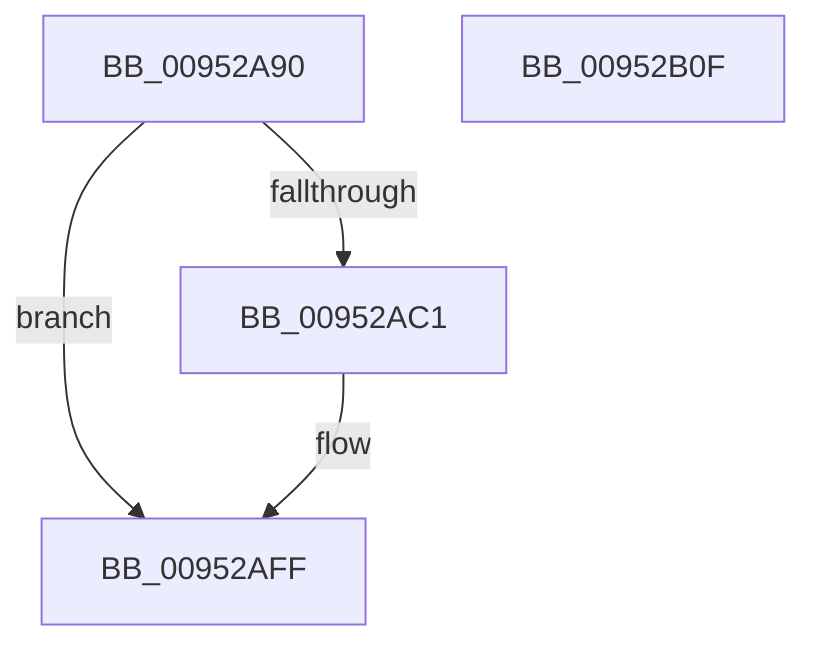

# IoVolumeDeviceToGuid

- RVA: `0x00952A90`–`0x00952B10` (길이 `128` bytes)
- VA: `0x0000000140952A90`
- 실행 섹션: `PAGE`
- PDB 이름 있음: `예`; PDB Function 태그: `아니요`
- unwind 정보 RVA: `0x00091FE0`
- 디코드: `38`개 명령, `128/128` bytes 표시
- 미해석 바이트: `0` (있으면 어셈블리에 `.byte`로 보존)

> 이 문서는 커널 이미지의 기계어와 PDB 기호를 분석해 생성했습니다. 4번과 5번은 함수 원형과 자료형을 바이너리 사용 방식에서 추정한 C 해석이며 원본 소스 복구 결과는 아닙니다.

## 1. Dependencies

- 직접 호출 지점: **3**; 고유 호출 대상: **3**
- 직접 호출자로 확인된 함수: **5**
- RIP 상대 이미지 참조: **0**

### Outgoing calls
- `0x00952AB8` → [IoVolumeDeviceToGuidPath](IoVolumeDeviceToGuidPath_function_00952B20.md) (function, `0x00952B20`)
- `0x00952AEC` → [RtlGUIDFromString](../8F/RtlGUIDFromString_function_008F1EF0.md) (function, `0x008F1EF0`)
- `0x00952AF8` → [ExFreePoolWithTag](../../poolcode/B8/ExFreePoolWithTag_function_00B82870.md) (function, `0x00B82870`)

### Direct callers
- [CmpVolumeContextStart](../7E/CmpVolumeContextStart_function_007E88A4.md) at `0x007E892A`
- [CmpVolumeManagerGetContextForFile](CmpVolumeManagerGetContextForFile_function_009525A8.md) at `0x00952628`
- [IopMountVolume](../A3/IopMountVolume_function_00A329D0.md) at `0x00A32F31`
- [FsRtlVolumeDeviceToCorrelationId](../A6/FsRtlVolumeDeviceToCorrelationId_function_00A62E20.md) at `0x00A62EA2`
- [CcGetDeviceGuid](../AA/CcGetDeviceGuid_function_00AAFABC.md) at `0x00AAFAEA`

### Static image references
- 디코드된 RIP-relative 메모리 참조가 없습니다.

## 2. Other-region calls and transfers

- 다른 실행 섹션으로 향하는 call: **1**
  - `0x00952AF8` → [ExFreePoolWithTag](../../poolcode/B8/ExFreePoolWithTag_function_00B82870.md) (`PAGE` → `POOLCODE`)
- 별도 외부 분기/꼬리 이동을 확인하지 못했습니다.

## 3. Assembly (complete function range)

```asm
00952A90  48 89 5C 24 08                  mov qword ptr [rsp + 8], rbx
00952A95  48 89 7C 24 10                  mov qword ptr [rsp + 0x10], rdi
00952A9A  55                              push rbp
00952A9B  48 8B EC                        mov rbp, rsp
00952A9E  48 83 EC 40                     sub rsp, 0x40
00952AA2  48 8B DA                        mov rbx, rdx
00952AA5  33 FF                           xor edi, edi
00952AA7  33 C0                           xor eax, eax
00952AA9  48 89 7D E0                     mov qword ptr [rbp - 0x20], rdi
00952AAD  48 8D 55 E0                     lea rdx, [rbp - 0x20]
00952AB1  48 89 7D E8                     mov qword ptr [rbp - 0x18], rdi
00952AB5  89 45 F4                        mov dword ptr [rbp - 0xc], eax
00952AB8  E8 63 00 00 00                  call 0x140952b20
00952ABD  85 C0                           test eax, eax
00952ABF  78 3E                           js 0x140952aff
00952AC1  0F B7 45 E0                     movzx eax, word ptr [rbp - 0x20]
00952AC5  48 8D 4D F0                     lea rcx, [rbp - 0x10]
00952AC9  48 8B 7D E8                     mov rdi, qword ptr [rbp - 0x18]
00952ACD  66 83 E8 14                     sub ax, 0x14
00952AD1  66 89 45 F0                     mov word ptr [rbp - 0x10], ax
00952AD5  48 8B D3                        mov rdx, rbx
00952AD8  0F B7 45 E2                     movzx eax, word ptr [rbp - 0x1e]
00952ADC  66 83 E8 14                     sub ax, 0x14
00952AE0  66 89 45 F2                     mov word ptr [rbp - 0xe], ax
00952AE4  48 8D 47 14                     lea rax, [rdi + 0x14]
00952AE8  48 89 45 F8                     mov qword ptr [rbp - 8], rax
00952AEC  E8 FF F3 F9 FF                  call 0x1408f1ef0
00952AF1  33 D2                           xor edx, edx
00952AF3  48 8B CF                        mov rcx, rdi
00952AF6  8B D8                           mov ebx, eax
00952AF8  E8 73 FD 22 00                  call 0x140b82870
00952AFD  8B C3                           mov eax, ebx
00952AFF  48 8B 5C 24 50                  mov rbx, qword ptr [rsp + 0x50]
00952B04  48 8B 7C 24 58                  mov rdi, qword ptr [rsp + 0x58]
00952B09  48 83 C4 40                     add rsp, 0x40
00952B0D  5D                              pop rbp
00952B0E  C3                              ret
00952B0F  CC                              int3
```

## 4. C-style interpretation (structured pseudocode)

```c
__int64 __fastcall IoVolumeDeviceToGuid(__int64 a1, __int64 a2)
{
    __int64 result;
    __int64 v_rbx;
    __int64 v_rdi;
    __int64 v_rsp;
    unsigned __int64 v_stack_m10;
    unsigned int v_stack_m14;
    unsigned __int16 v_stack_m16;
    unsigned __int64 v_stack_m18;
    unsigned __int64 v_stack_m20;
    unsigned __int16 v_stack_m26;
    unsigned __int64 v_stack_m28;
    unsigned __int64 v_stack_p10;
    unsigned __int64 v_stack_p8;

    v_stack_p8 = v_rbx;
    v_stack_p10 = v_rdi;
    v_rsp = (v_rsp) - (64);
    v_rdi = 0;
    result = 0;
    v_stack_m28 = 0;
    v_stack_m20 = 0;
    v_stack_m14 = 0;
    result = IoVolumeDeviceToGuidPath(a1, v_stack_m28, a3, a4);
    v_rbx = a2;
    if (!(sign_flag)) {
        result = v_stack_m28;
        a1 = v_stack_m18;
        v_rdi = v_stack_m20;
        result = (unsigned __int16)((result) - (20));
        v_stack_m18 = (unsigned __int16)(result);
        a2 = a2;
        result = v_stack_m26;
        result = (unsigned __int16)((result) - (20));
        v_stack_m16 = (unsigned __int16)(result);
        result = v_rdi + 20;
        v_stack_m10 = result;
        result = RtlGUIDFromString(a1, a2, a3, a4);
        a2 = 0;
        a1 = v_rdi;
        v_rbx = (unsigned int)(result);
        result = ExFreePoolWithTag(a1, a2, a3, a4);
        result = (unsigned int)(v_rbx);
    }
    v_rsp = (v_rsp) + (64);
    return result;
}
```

## 5. (Beta) C Style

```c
int64_t IoVolumeDeviceToGuid(int64_t Arg1, int64_t Arg2)
{
    int64_t result;
    int64_t local_rbx;
    int64_t local_rdi;
    int64_t local_rsp;
    uint64_t v_stack_m10;
    uint32_t v_stack_m14;
    uint16_t v_stack_m16;
    uint64_t v_stack_m18;
    uint64_t v_stack_m20;
    uint16_t v_stack_m26;
    uint64_t v_stack_m28;
    uint64_t v_stack_p10;
    uint64_t v_stack_p8;

    v_stack_p8 = local_rbx;
    v_stack_p10 = local_rdi;
    local_rsp = (local_rsp) - (64);
    local_rdi = 0;
    result = 0;
    v_stack_m28 = 0;
    v_stack_m20 = 0;
    v_stack_m14 = 0;
    result = IoVolumeDeviceToGuidPath(Arg1, v_stack_m28, a3, a4);
    local_rbx = Arg2;
    if (!(sign_flag)) {
        result = v_stack_m28;
        Arg1 = v_stack_m18;
        local_rdi = v_stack_m20;
        result = (uint16_t)((result) - (20));
        v_stack_m18 = (uint16_t)(result);
        Arg2 = Arg2;
        result = v_stack_m26;
        result = (uint16_t)((result) - (20));
        v_stack_m16 = (uint16_t)(result);
        result = local_rdi + 20;
        v_stack_m10 = result;
        result = RtlGUIDFromString(Arg1, Arg2, a3, a4);
        Arg2 = 0;
        Arg1 = local_rdi;
        local_rbx = (uint32_t)(result);
        result = ExFreePoolWithTag(Arg1, Arg2, a3, a4);
        result = (uint32_t)(local_rbx);
    }
    local_rsp = (local_rsp) + (64);
    return result;
}
```

## 6. Execution-region graph

[열기: 2D/3D 그래프와 함수 탐색 컨트롤 패널](../../../control-panel.html?section=page&rva=0x00952A90&view=graph)

- 2D 그래프는 위에서 아래로 흐르고, 3D 그래프는 빈 공간을 드래그해 회전합니다. Shift+드래그는 이동, 휠은 확대·축소, 함수 노드 선택은 대상 보고서 이동입니다.

### Static fallback


