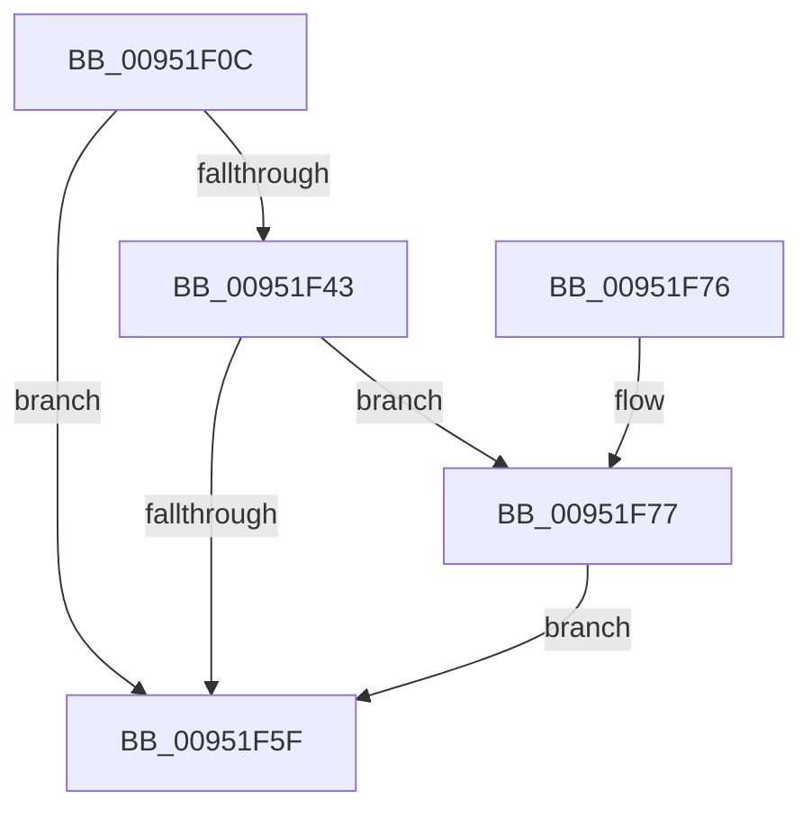

# IopAllocateUnicodeString

- RVA: `0x00951F0C`–`0x00951F81` (길이 `117` bytes)
- VA: `0x0000000140951F0C`
- 실행 섹션: `PAGE`
- PDB 이름 있음: `예`; PDB Function 태그: `아니요`
- unwind 정보 RVA: `0x00073808`
- 디코드: `35`개 명령, `117/117` bytes 표시
- 미해석 바이트: `0` (있으면 어셈블리에 `.byte`로 보존)

> 이 문서는 커널 이미지의 기계어와 PDB 기호를 분석해 생성했습니다. 4번과 5번은 함수 원형과 자료형을 바이너리 사용 방식에서 추정한 C 해석이며 원본 소스 복구 결과는 아닙니다.

## 1. Dependencies

- 직접 호출 지점: **2**; 고유 호출 대상: **2**
- 직접 호출자로 확인된 함수: **10**
- RIP 상대 이미지 참조: **0**

### Outgoing calls
- `0x00951F38` → [RtlUShortAdd](../../text/47/RtlUShortAdd_function_00474F70.md) (function, `0x00474F70`)
- `0x00951F51` → [ExAllocatePool2](../../poolcode/B8/ExAllocatePool2_function_00B820F0.md) (function, `0x00B820F0`)

### Direct callers
- [PiBuildAndOpenDeviceDirectoryPath](../72/PiBuildAndOpenDeviceDirectoryPath_function_00728724.md) at `0x00728799`
- [PiCreateServiceKeyUnderPath](../72/PiCreateServiceKeyUnderPath_function_00728DEC.md) at `0x00728EB5`
- [PiGetDriverMutableStateDirectory](../72/PiGetDriverMutableStateDirectory_function_00729038.md) at `0x007290E7`
- [PipProcessDevNodeTree](../8F/PipProcessDevNodeTree_function_008F9068.md) at `0x008F943E`
- [IopBuildGlobalSymbolicLinkString](IopBuildGlobalSymbolicLinkString_function_00951530.md) at `0x00951678`
- [PnpConcatenateUnicodeStrings](PnpConcatenateUnicodeStrings_function_00951ED0.md) at `0x00951EE3`
- [PiOpenDriverRedirectedStateKey](../96/PiOpenDriverRedirectedStateKey_function_00965D04.md) at `0x00965DD1`
- [PiDeviceRegistration](../A0/PiDeviceRegistration_function_00A07A60.md) at `0x00A07BF3`
- [PiDeferSetInterfaceState](../AA/PiDeferSetInterfaceState_function_00AA6FA4.md) at `0x00AA6FE8`
- [PnpLogVetoInformation](../AB/PnpLogVetoInformation_function_00AB6BE8.md) at `0x00AB6CB3`

### Static image references
- 디코드된 RIP-relative 메모리 참조가 없습니다.

## 2. Other-region calls and transfers

- 다른 실행 섹션으로 향하는 call: **2**
  - `0x00951F38` → [RtlUShortAdd](../../text/47/RtlUShortAdd_function_00474F70.md) (`PAGE` → `.text`)
  - `0x00951F51` → [ExAllocatePool2](../../poolcode/B8/ExAllocatePool2_function_00B820F0.md) (`PAGE` → `POOLCODE`)
- 별도 외부 분기/꼬리 이동을 확인하지 못했습니다.

## 3. Assembly (complete function range)

```asm
00951F0C  48 89 5C 24 08                  mov qword ptr [rsp + 8], rbx
00951F11  48 89 6C 24 10                  mov qword ptr [rsp + 0x10], rbp
00951F16  48 89 74 24 18                  mov qword ptr [rsp + 0x18], rsi
00951F1B  57                              push rdi
00951F1C  48 83 EC 20                     sub rsp, 0x20
00951F20  0F B7 C2                        movzx eax, dx
00951F23  48 8D 79 02                     lea rdi, [rcx + 2]
00951F27  33 ED                           xor ebp, ebp
00951F29  48 8B F1                        mov rsi, rcx
00951F2C  66 89 29                        mov word ptr [rcx], bp
00951F2F  4C 8B C7                        mov r8, rdi
00951F32  0F B7 C8                        movzx ecx, ax
00951F35  8D 55 02                        lea edx, [rbp + 2]
00951F38  E8 33 30 B2 FF                  call 0x140474f70
00951F3D  8B D8                           mov ebx, eax
00951F3F  85 C0                           test eax, eax
00951F41  78 1C                           js 0x140951f5f
00951F43  0F B7 17                        movzx edx, word ptr [rdi]
00951F46  B9 00 01 00 00                  mov ecx, 0x100
00951F4B  41 B8 50 70 73 75               mov r8d, 0x75737050
00951F51  E8 9A 01 23 00                  call 0x140b820f0
00951F56  48 89 46 08                     mov qword ptr [rsi + 8], rax
00951F5A  48 85 C0                        test rax, rax
00951F5D  74 18                           je 0x140951f77
00951F5F  48 8B 6C 24 38                  mov rbp, qword ptr [rsp + 0x38]
00951F64  8B C3                           mov eax, ebx
00951F66  48 8B 5C 24 30                  mov rbx, qword ptr [rsp + 0x30]
00951F6B  48 8B 74 24 40                  mov rsi, qword ptr [rsp + 0x40]
00951F70  48 83 C4 20                     add rsp, 0x20
00951F74  5F                              pop rdi
00951F75  C3                              ret
00951F76  CC                              int3
00951F77  66 89 2F                        mov word ptr [rdi], bp
00951F7A  BB 9A 00 00 C0                  mov ebx, 0xc000009a
00951F7F  EB DE                           jmp 0x140951f5f
```

## 4. C-style interpretation (structured pseudocode)

```c
__int64 __fastcall IopAllocateUnicodeString(__int64 a1, unsigned __int16 a2)
{
    __int64 result;
    __int64 v_rbp;
    __int64 v_rsp;
    unsigned __int64 v_stack_p10;
    unsigned __int64 v_stack_p18;
    unsigned __int64 v_stack_p8;

    v_stack_p8 = v_rbx;
    v_stack_p10 = v_rbp;
    v_stack_p18 = v_rsi;
    v_rsp = (v_rsp) - (32);
    v_rbp = 0;
    *(unsigned __int16 *)(a1) = 0;
    result = RtlUShortAdd(a2, v_rbp + 2, a1 + 2, a4);
    if (sign_flag) goto loc_00951F5F;
    result = ExAllocatePool2(256, *(unsigned __int16 *)(a1 + 2), (unsigned int)(0x75737050ULL), a4);
    *(unsigned __int64 *)(a1 + 8) = result;
    if (result == 0) goto loc_00951F77;
loc_00951F5F:
    v_rsp = (v_rsp) + (32);
    return (unsigned int)((unsigned int)((unsigned int)((unsigned int)(result))));
loc_00951F77:
    *(unsigned __int16 *)(a1 + 2) = (unsigned __int16)(v_stack_p10);
    goto loc_00951F5F;
}
```

## 5. (Beta) C Style

```c
int64_t IopAllocateUnicodeString(void *Arg1, uint16_t Arg2)
{
    uint8_t *arg1 = (uint8_t *)Arg1;

    int64_t result;
    int64_t local_rbp;
    int64_t local_rsp;
    uint64_t v_stack_p10;
    uint64_t v_stack_p18;
    uint64_t v_stack_p8;

    v_stack_p8 = local_rbx;
    v_stack_p10 = local_rbp;
    v_stack_p18 = local_rsi;
    local_rsp = (local_rsp) - (32);
    local_rbp = 0;
    *(uint16_t *)(arg1) = 0;
    result = RtlUShortAdd(Arg2, local_rbp + 2, Arg1 + 2, a4);
    if (sign_flag) goto loc_00951F5F;
    result = ExAllocatePool2(256, *(uint16_t *)(arg1 + 0x2), (uint32_t)(0x75737050ULL), a4);
    *(uint64_t *)(arg1 + 0x8) = result;
    if (result == 0) goto loc_00951F77;
loc_00951F5F:
    local_rsp = (local_rsp) + (32);
    return (uint32_t)((uint32_t)((uint32_t)((uint32_t)(result))));
loc_00951F77:
    *(uint16_t *)(arg1 + 0x2) = (uint16_t)(v_stack_p10);
    goto loc_00951F5F;
}
```

### 관측된 메모리 오프셋

구조체 형식이 확인되지 않은 접근은 인자 기준의 오프셋으로만 기록했습니다.

| 기준 인자 | 오프셋 표현 | 폭 (bit) | 접근 |
|---|---:|---:|---|
| `Arg1` | `+ 0x0` | `16` | `R` |
| `Arg1` | `+ 0x0` | `16` | `W` |
| `Arg1` | `+ 0x2` | `64` | `R` |
| `Arg1` | `+ 0x8` | `64` | `W` |

## 6. Execution-region graph

[열기: 2D/3D 그래프와 함수 탐색 컨트롤 패널](../../../control-panel.html?section=page&rva=0x00951F0C&view=graph)

- 2D 그래프는 위에서 아래로 흐르고, 3D 그래프는 빈 공간을 드래그해 회전합니다. Shift+드래그는 이동, 휠은 확대·축소, 함수 노드 선택은 대상 보고서 이동입니다.

### Static fallback


