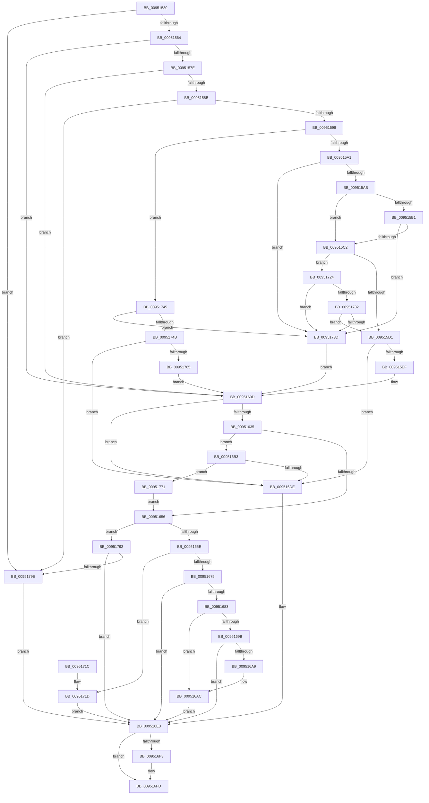

# IopBuildGlobalSymbolicLinkString

- RVA: `0x00951530`–`0x009517A8` (길이 `632` bytes)
- VA: `0x0000000140951530`
- 실행 섹션: `PAGE`
- PDB 이름 있음: `예`; PDB Function 태그: `아니요`
- unwind 정보 RVA: `0x00091E08`
- 디코드: `165`개 명령, `632/632` bytes 표시
- 미해석 바이트: `0` (있으면 어셈블리에 `.byte`로 보존)

> 이 문서는 커널 이미지의 기계어와 PDB 기호를 분석해 생성했습니다. 4번과 5번은 함수 원형과 자료형을 바이너리 사용 방식에서 추정한 C 해석이며 원본 소스 복구 결과는 아닙니다.

## 1. Dependencies

- 직접 호출 지점: **14**; 고유 호출 대상: **8**
- 직접 호출자로 확인된 함수: **1**
- RIP 상대 이미지 참조: **1**

### Outgoing calls
- `0x009515DE` → [ExAllocatePool2](../../poolcode/B8/ExAllocatePool2_function_00B820F0.md) (function, `0x00B820F0`)
- `0x009515FA` → [memcpy](../../text/6C/memcpy_function_006C6840.md) (function, `0x006C6840`)
- `0x00951624` → [ExAllocatePool2](../../poolcode/B8/ExAllocatePool2_function_00B820F0.md) (function, `0x00B820F0`)
- `0x00951648` → [CmGetDeviceInterfaceSymbolicLinkName](CmGetDeviceInterfaceSymbolicLinkName_function_00951DA4.md) (function, `0x00951DA4`)
- `0x00951678` → [IopAllocateUnicodeString](IopAllocateUnicodeString_function_00951F0C.md) (function, `0x00951F0C`)
- `0x0095168D` → [RtlAppendUnicodeToString](../../text/40/RtlAppendUnicodeToString_function_0040F990.md) (function, `0x0040F990`)
- `0x0095169E` → [RtlAppendUnicodeToString](../../text/40/RtlAppendUnicodeToString_function_0040F990.md) (function, `0x0040F990`)
- `0x009516AC` → [RtlFreeAnsiString](../9C/RtlFreeAnsiString_function_009C0800.md) (function, `0x009C0800`)
- `0x009516B8` → [ExFreePoolWithTag](../../poolcode/B8/ExFreePoolWithTag_function_00B82870.md) (function, `0x00B82870`)
- `0x009516CD` → [ExAllocatePool2](../../poolcode/B8/ExAllocatePool2_function_00B820F0.md) (function, `0x00B820F0`)
- `0x009516E9` → [PnpUnicodeStringToWstrFree](../8F/PnpUnicodeStringToWstrFree_function_008F59F0.md) (function, `0x008F59F0`)
- `0x009516F8` → [ExFreePoolWithTag](../../poolcode/B8/ExFreePoolWithTag_function_00B82870.md) (function, `0x00B82870`)
- `0x00951757` → [ExAllocatePool2](../../poolcode/B8/ExAllocatePool2_function_00B820F0.md) (function, `0x00B820F0`)
- `0x00951786` → [CmGetDeviceInterfaceSymbolicLinkName](CmGetDeviceInterfaceSymbolicLinkName_function_00951DA4.md) (function, `0x00951DA4`)

### Direct callers
- [IopProcessSetInterfaceState](IopProcessSetInterfaceState_function_00950964.md) at `0x00950AB6`

### Static image references
- `0x00951683` → RVA `0x00AFD8E0` (` ?? ::NNGAKEGL::`string'`; read)

## 2. Other-region calls and transfers

- 다른 실행 섹션으로 향하는 call: **9**
  - `0x009515DE` → [ExAllocatePool2](../../poolcode/B8/ExAllocatePool2_function_00B820F0.md) (`PAGE` → `POOLCODE`)
  - `0x009515FA` → [memcpy](../../text/6C/memcpy_function_006C6840.md) (`PAGE` → `.text`)
  - `0x00951624` → [ExAllocatePool2](../../poolcode/B8/ExAllocatePool2_function_00B820F0.md) (`PAGE` → `POOLCODE`)
  - `0x0095168D` → [RtlAppendUnicodeToString](../../text/40/RtlAppendUnicodeToString_function_0040F990.md) (`PAGE` → `.text`)
  - `0x0095169E` → [RtlAppendUnicodeToString](../../text/40/RtlAppendUnicodeToString_function_0040F990.md) (`PAGE` → `.text`)
  - `0x009516B8` → [ExFreePoolWithTag](../../poolcode/B8/ExFreePoolWithTag_function_00B82870.md) (`PAGE` → `POOLCODE`)
  - `0x009516CD` → [ExAllocatePool2](../../poolcode/B8/ExAllocatePool2_function_00B820F0.md) (`PAGE` → `POOLCODE`)
  - `0x009516F8` → [ExFreePoolWithTag](../../poolcode/B8/ExFreePoolWithTag_function_00B82870.md) (`PAGE` → `POOLCODE`)
  - `0x00951757` → [ExAllocatePool2](../../poolcode/B8/ExAllocatePool2_function_00B820F0.md) (`PAGE` → `POOLCODE`)
- 별도 외부 분기/꼬리 이동을 확인하지 못했습니다.

## 3. Assembly (complete function range)

```asm
00951530  48 89 5C 24 08                  mov qword ptr [rsp + 8], rbx
00951535  48 89 6C 24 10                  mov qword ptr [rsp + 0x10], rbp
0095153A  48 89 74 24 20                  mov qword ptr [rsp + 0x20], rsi
0095153F  57                              push rdi
00951540  41 54                           push r12
00951542  41 55                           push r13
00951544  41 56                           push r14
00951546  41 57                           push r15
00951548  48 83 EC 30                     sub rsp, 0x30
0095154C  45 33 E4                        xor r12d, r12d
0095154F  4C 8B FA                        mov r15, rdx
00951552  48 8B F1                        mov rsi, rcx
00951555  41 8B EC                        mov ebp, r12d
00951558  41 8B FC                        mov edi, r12d
0095155B  48 85 C9                        test rcx, rcx
0095155E  0F 84 3A 02 00 00               je 0x14095179e
00951564  44 0F B7 41 02                  movzx r8d, word ptr [rcx + 2]
00951569  45 8D 54 24 02                  lea r10d, [r12 + 2]
0095156E  41 BD 00 01 00 00               mov r13d, 0x100
00951574  66 45 3B C2                     cmp r8w, r10w
00951578  0F 82 8F 00 00 00               jb 0x14095160d
0095157E  48 8B 51 08                     mov rdx, qword ptr [rcx + 8]
00951582  48 85 D2                        test rdx, rdx
00951585  0F 84 82 00 00 00               je 0x14095160d
0095158B  0F B7 09                        movzx ecx, word ptr [rcx]
0095158E  66 41 3B C8                     cmp cx, r8w
00951592  0F 87 06 02 00 00               ja 0x14095179e
00951598  66 85 C9                        test cx, cx
0095159B  0F 84 A4 01 00 00               je 0x140951745
009515A1  66 44 39 22                     cmp word ptr [rdx], r12w
009515A5  0F 84 92 01 00 00               je 0x14095173d
009515AB  66 41 3B C8                     cmp cx, r8w
009515AF  75 11                           jne 0x1409515c2
009515B1  8B C1                           mov eax, ecx
009515B3  48 D1 E8                        shr rax, 1
009515B6  66 44 39 64 42 FE               cmp word ptr [rdx + rax*2 - 2], r12w
009515BC  0F 84 7B 01 00 00               je 0x14095173d
009515C2  49 8B C0                        mov rax, r8
009515C5  49 2B C2                        sub rax, r10
009515C8  48 3B C8                        cmp rcx, rax
009515CB  0F 86 53 01 00 00               jbe 0x140951724
009515D1  48 8D 51 02                     lea rdx, [rcx + 2]
009515D5  41 B8 50 70 73 75               mov r8d, 0x75737050
009515DB  49 8B CD                        mov rcx, r13
009515DE  E8 0D 0B 23 00                  call 0x140b820f0
009515E3  48 8B D8                        mov rbx, rax
009515E6  48 85 C0                        test rax, rax
009515E9  0F 84 EF 00 00 00               je 0x1409516de
009515EF  44 0F B7 06                     movzx r8d, word ptr [rsi]
009515F3  48 8B C8                        mov rcx, rax
009515F6  48 8B 56 08                     mov rdx, qword ptr [rsi + 8]
009515FA  E8 41 52 D7 FF                  call 0x1406c6840
009515FF  0F B7 06                        movzx eax, word ptr [rsi]
00951602  48 8B FB                        mov rdi, rbx
00951605  48 D1 E8                        shr rax, 1
00951608  66 44 89 24 43                  mov word ptr [rbx + rax*2], r12w
0095160D  BB 00 02 00 00                  mov ebx, 0x200
00951612  BA 00 04 00 00                  mov edx, 0x400
00951617  41 B8 50 70 20 20               mov r8d, 0x20207050
0095161D  89 5C 24 70                     mov dword ptr [rsp + 0x70], ebx
00951621  49 8B CD                        mov rcx, r13
00951624  E8 C7 0A 23 00                  call 0x140b820f0
00951629  48 8B E8                        mov rbp, rax
0095162C  48 85 C0                        test rax, rax
0095162F  0F 84 A9 00 00 00               je 0x1409516de
00951635  48 8D 44 24 70                  lea rax, [rsp + 0x70]
0095163A  44 8B CB                        mov r9d, ebx
0095163D  4C 8B C5                        mov r8, rbp
00951640  48 89 44 24 20                  mov qword ptr [rsp + 0x20], rax
00951645  48 8B D7                        mov rdx, rdi
00951648  E8 57 07 00 00                  call 0x140951da4
0095164D  8B D8                           mov ebx, eax
0095164F  3D 23 00 00 C0                  cmp eax, 0xc0000023
00951654  74 5D                           je 0x1409516b3
00951656  85 DB                           test ebx, ebx
00951658  0F 88 34 01 00 00               js 0x140951792
0095165E  8B 44 24 70                     mov eax, dword ptr [rsp + 0x70]
00951662  8D 14 45 14 00 00 00            lea edx, [rax*2 + 0x14]
00951669  81 FA FF FF 00 00               cmp edx, 0xffff
0095166F  0F 87 A8 00 00 00               ja 0x14095171d
00951675  49 8B CF                        mov rcx, r15
00951678  E8 8F 08 00 00                  call 0x140951f0c
0095167D  8B D8                           mov ebx, eax
0095167F  85 C0                           test eax, eax
00951681  78 60                           js 0x1409516e3
00951683  48 8D 15 56 C2 1A 00            lea rdx, [rip + 0x1ac256]
0095168A  49 8B CF                        mov rcx, r15
0095168D  E8 FE E2 AB FF                  call 0x14040f990
00951692  8B D8                           mov ebx, eax
00951694  49 8B CF                        mov rcx, r15
00951697  85 C0                           test eax, eax
00951699  78 11                           js 0x1409516ac
0095169B  48 8B D5                        mov rdx, rbp
0095169E  E8 ED E2 AB FF                  call 0x14040f990
009516A3  8B D8                           mov ebx, eax
009516A5  85 C0                           test eax, eax
009516A7  79 3A                           jns 0x1409516e3
009516A9  49 8B CF                        mov rcx, r15
009516AC  E8 4F F1 06 00                  call 0x1409c0800
009516B1  EB 30                           jmp 0x1409516e3
009516B3  33 D2                           xor edx, edx
009516B5  48 8B CD                        mov rcx, rbp
009516B8  E8 B3 11 23 00                  call 0x140b82870
009516BD  8B 54 24 70                     mov edx, dword ptr [rsp + 0x70]
009516C1  41 B8 50 70 20 20               mov r8d, 0x20207050
009516C7  48 03 D2                        add rdx, rdx
009516CA  49 8B CD                        mov rcx, r13
009516CD  E8 1E 0A 23 00                  call 0x140b820f0
009516D2  48 8B E8                        mov rbp, rax
009516D5  48 85 C0                        test rax, rax
009516D8  0F 85 93 00 00 00               jne 0x140951771
009516DE  BB 9A 00 00 C0                  mov ebx, 0xc000009a
009516E3  48 8B D6                        mov rdx, rsi
009516E6  48 8B CF                        mov rcx, rdi
009516E9  E8 02 43 FA FF                  call 0x1408f59f0
009516EE  48 85 ED                        test rbp, rbp
009516F1  74 0A                           je 0x1409516fd
009516F3  33 D2                           xor edx, edx
009516F5  48 8B CD                        mov rcx, rbp
009516F8  E8 73 11 23 00                  call 0x140b82870
009516FD  48 8B 6C 24 68                  mov rbp, qword ptr [rsp + 0x68]
00951702  8B C3                           mov eax, ebx
00951704  48 8B 5C 24 60                  mov rbx, qword ptr [rsp + 0x60]
00951709  48 8B 74 24 78                  mov rsi, qword ptr [rsp + 0x78]
0095170E  48 83 C4 30                     add rsp, 0x30
00951712  41 5F                           pop r15
00951714  41 5E                           pop r14
00951716  41 5D                           pop r13
00951718  41 5C                           pop r12
0095171A  5F                              pop rdi
0095171B  C3                              ret
0095171C  CC                              int3
0095171D  BB 95 00 00 C0                  mov ebx, 0xc0000095
00951722  EB BF                           jmp 0x1409516e3
00951724  48 8B C1                        mov rax, rcx
00951727  48 D1 E8                        shr rax, 1
0095172A  66 44 39 64 42 FE               cmp word ptr [rdx + rax*2 - 2], r12w
00951730  74 0B                           je 0x14095173d
00951732  66 44 39 24 42                  cmp word ptr [rdx + rax*2], r12w
00951737  0F 85 94 FE FF FF               jne 0x1409515d1
0095173D  48 8B FA                        mov rdi, rdx
00951740  E9 C8 FE FF FF                  jmp 0x14095160d
00951745  66 44 39 22                     cmp word ptr [rdx], r12w
00951749  74 F2                           je 0x14095173d
0095174B  41 B8 50 70 73 75               mov r8d, 0x75737050
00951751  49 8B D2                        mov rdx, r10
00951754  49 8B CD                        mov rcx, r13
00951757  E8 94 09 23 00                  call 0x140b820f0
0095175C  48 85 C0                        test rax, rax
0095175F  0F 84 79 FF FF FF               je 0x1409516de
00951765  66 44 89 20                     mov word ptr [rax], r12w
00951769  48 8B F8                        mov rdi, rax
0095176C  E9 9C FE FF FF                  jmp 0x14095160d
00951771  44 8B 4C 24 70                  mov r9d, dword ptr [rsp + 0x70]
00951776  48 8D 44 24 70                  lea rax, [rsp + 0x70]
0095177B  4C 8B C5                        mov r8, rbp
0095177E  48 89 44 24 20                  mov qword ptr [rsp + 0x20], rax
00951783  48 8B D7                        mov rdx, rdi
00951786  E8 19 06 00 00                  call 0x140951da4
0095178B  8B D8                           mov ebx, eax
0095178D  E9 C4 FE FF FF                  jmp 0x140951656
00951792  81 FB 33 00 00 C0               cmp ebx, 0xc0000033
00951798  0F 85 45 FF FF FF               jne 0x1409516e3
0095179E  BB 0D 00 00 C0                  mov ebx, 0xc000000d
009517A3  E9 3B FF FF FF                  jmp 0x1409516e3
```

## 4. C-style interpretation (structured pseudocode)

```c
__int64 __fastcall IopBuildGlobalSymbolicLinkString(__int64 a1, __int64 a2)
{
    __int64 result;
    __int64 v_r12;
    __int64 v_rsp;
    unsigned __int64 v_stack_m38;
    unsigned __int64 v_stack_p10;
    unsigned int v_stack_p18;
    unsigned __int64 v_stack_p20;
    unsigned int v_stack_p70;
    unsigned __int64 v_stack_p8;

    v_stack_p8 = v_rbx;
    v_stack_p10 = v_rbp;
    v_stack_p20 = v_rsi;
    v_rsp = (v_rsp) - (48);
    v_r12 = 0;
    if (a1 == 0) goto loc_0095179E;
    if (((unsigned __int16)(*(unsigned __int16 *)(a1 + 2))) < ((unsigned __int16)(v_r12 + 2))) goto loc_0095160D;
    if (*(unsigned __int64 *)(a1 + 8) == 0) goto loc_0095160D;
    if (((unsigned __int16)(*(unsigned __int16 *)(a1))) > ((unsigned __int16)(*(unsigned __int16 *)(a1 + 2)))) goto loc_0095179E;
    if ((unsigned __int16)(*(unsigned __int16 *)(a1)) == 0) goto loc_00951745;
    if ((*(unsigned __int16 *)(*(unsigned __int64 *)(a1 + 8))) == 0) goto loc_0095173D;
    if (((unsigned __int16)(*(unsigned __int16 *)(a1))) != ((unsigned __int16)(*(unsigned __int16 *)(a1 + 2)))) goto loc_009515C2;
    result = ((unsigned int)((unsigned int)(*(unsigned __int16 *)(a1)))) >> (1);
    if ((*(unsigned __int16 *)(*(unsigned __int64 *)(a1 + 8) + result * 2 - 2)) == 0) goto loc_0095173D;
loc_009515C2:
    result = (*(unsigned __int16 *)(a1 + 2)) - (v_r12 + 2);
    if ((*(unsigned __int16 *)(a1)) <= result) goto loc_00951724;
loc_009515D1:
    result = ExAllocatePool2(256, *(unsigned __int16 *)(a1) + 2, (unsigned int)(0x75737050ULL), a4);
    if (result == 0) goto loc_009516DE;
    result = memcpy(result, *(unsigned __int64 *)(a1 + 8), *(unsigned __int16 *)(a1), a4);
    result = (*(unsigned __int16 *)(a1)) >> (1);
    *(unsigned __int16 *)(result + result * 2) = 0;
loc_0095160D:
    v_stack_p18 = 512;
    result = ExAllocatePool2(256, (unsigned int)(0x400ULL), (unsigned int)(0x20207050ULL), a4);
    if (result == 0) goto loc_009516DE;
    v_stack_m38 = v_stack_p18;
    result = CmGetDeviceInterfaceSymbolicLinkName(256, result, result, 512);
    if (((unsigned int)(result)) == 0xC0000023ULL) goto loc_009516B3;
loc_00951656:
    if (sign_flag) goto loc_00951792;
    if (((unsigned int)((unsigned int)(v_stack_p18) * 2 + 20)) > 0xFFFFULL) goto loc_0095171D;
    result = IopAllocateUnicodeString(a2, (unsigned int)(v_stack_p18) * 2 + 20, result, 512);
    if (sign_flag) goto loc_009516E3;
    result = RtlAppendUnicodeToString(a2, v_rip + 1753686, result, 512);
    if (sign_flag) goto loc_009516AC;
    result = RtlAppendUnicodeToString(a2, result, result, 512);
    if (!sign_flag) goto loc_009516E3;
loc_009516AC:
    result = RtlFreeAnsiString(a2, result, result, 512);
    goto loc_009516E3;
loc_009516B3:
    a2 = 0;
    result = ExFreePoolWithTag(result, a2, result, 512);
    a2 = ((unsigned int)(v_stack_p18)) + ((unsigned int)(v_stack_p18));
    result = ExAllocatePool2(256, a2, (unsigned int)(0x20207050ULL), 512);
    if (result != 0) goto loc_00951771;
loc_009516DE:
loc_009516E3:
    result = PnpUnicodeStringToWstrFree(result, a1, (unsigned int)(0x20207050ULL), 512);
    if (result != 0) {
        a2 = 0;
        a1 = result;
        result = ExFreePoolWithTag(a1, a2, (unsigned int)(0x20207050ULL), 512);
    }
    v_rsp = (v_rsp) + (48);
    return (unsigned int)((unsigned int)((unsigned int)(0xC000009AULL)));
loc_0095171D:
    goto loc_009516E3;
loc_00951724:
    result = (a1) >> (1);
    if ((*(unsigned __int16 *)(a2 + result * 2 - 2)) == 0) goto loc_0095173D;
    if ((*(unsigned __int16 *)(a2 + result * 2)) != 0) goto loc_009515D1;
loc_0095173D:
    goto loc_0095160D;
loc_00951745:
    if ((*(unsigned __int16 *)(a2)) == 0) goto loc_0095173D;
    result = ExAllocatePool2(256, v_r12 + 2, (unsigned int)(0x75737050ULL), 512);
    if (result == 0) goto loc_009516DE;
    *(unsigned __int16 *)(result) = 0;
    goto loc_0095160D;
loc_00951771:
    v_stack_p20 = v_stack_p70;
    result = CmGetDeviceInterfaceSymbolicLinkName(256, result, v_stack_p10, (unsigned int)(v_stack_p70));
    goto loc_00951656;
loc_00951792:
    if (((unsigned int)((unsigned int)((unsigned int)(result)))) != 0xC0000033ULL) goto loc_009516E3;
loc_0095179E:
    goto loc_009516E3;
}
```

## 5. (Beta) C Style

```c
int64_t IopBuildGlobalSymbolicLinkString(void *Arg1, int64_t Arg2)
{
    uint8_t *arg1 = (uint8_t *)Arg1;

    int64_t result;
    int64_t local_r12;
    int64_t local_rsp;
    uint64_t v_stack_m38;
    uint64_t v_stack_p10;
    uint32_t v_stack_p18;
    uint64_t v_stack_p20;
    uint32_t v_stack_p70;
    uint64_t v_stack_p8;

    v_stack_p8 = local_rbx;
    v_stack_p10 = local_rbp;
    v_stack_p20 = local_rsi;
    local_rsp = (local_rsp) - (48);
    local_r12 = 0;
    if (Arg1 == NULL) goto loc_0095179E;
    if (((uint16_t)(*(uint16_t *)(arg1 + 0x2))) < ((uint16_t)(local_r12 + 2))) goto loc_0095160D;
    if (*(uint64_t *)(arg1 + 0x8) == 0) goto loc_0095160D;
    if (((uint16_t)(*(uint16_t *)(arg1))) > ((uint16_t)(*(uint16_t *)(arg1 + 0x2)))) goto loc_0095179E;
    if ((uint16_t)(*(uint16_t *)(arg1)) == 0) goto loc_00951745;
    if ((*(uint16_t *)(*(uint64_t *)(arg1 + 0x8))) == 0) goto loc_0095173D;
    if (((uint16_t)(*(uint16_t *)(arg1))) != ((uint16_t)(*(uint16_t *)(arg1 + 0x2)))) goto loc_009515C2;
    result = ((uint32_t)((uint32_t)(*(uint16_t *)(arg1)))) >> (1);
    if ((*(uint16_t *)(*(uint64_t *)(arg1 + 0x8) + result * 2 - 0x2)) == 0) goto loc_0095173D;
loc_009515C2:
    result = (*(uint16_t *)(arg1 + 0x2)) - (local_r12 + 2);
    if ((*(uint16_t *)(arg1)) <= result) goto loc_00951724;
loc_009515D1:
    result = ExAllocatePool2(256, *(uint16_t *)(arg1) + 2, (uint32_t)(0x75737050ULL), a4);
    if (result == 0) goto loc_009516DE;
    result = memcpy(result, *(uint64_t *)(arg1 + 0x8), *(uint16_t *)(arg1), a4);
    result = (*(uint16_t *)(arg1)) >> (1);
    *(uint16_t *)(result + result * 2) = 0;
loc_0095160D:
    v_stack_p18 = 512;
    result = ExAllocatePool2(256, (uint32_t)(0x400ULL), (uint32_t)(0x20207050ULL), a4);
    if (result == 0) goto loc_009516DE;
    v_stack_m38 = v_stack_p18;
    result = CmGetDeviceInterfaceSymbolicLinkName(256, result, result, 512);
    if (((uint32_t)(result)) == 0xC0000023ULL) goto loc_009516B3;
loc_00951656:
    if (sign_flag) goto loc_00951792;
    if (((uint32_t)((uint32_t)(v_stack_p18) * 2 + 20)) > 0xFFFFULL) goto loc_0095171D;
    result = IopAllocateUnicodeString(Arg2, (uint32_t)(v_stack_p18) * 2 + 20, result, 512);
    if (sign_flag) goto loc_009516E3;
    result = RtlAppendUnicodeToString(Arg2, v_rip + 1753686, result, 512);
    if (sign_flag) goto loc_009516AC;
    result = RtlAppendUnicodeToString(Arg2, result, result, 512);
    if (!sign_flag) goto loc_009516E3;
loc_009516AC:
    result = RtlFreeAnsiString(Arg2, result, result, 512);
    goto loc_009516E3;
loc_009516B3:
    Arg2 = 0;
    result = ExFreePoolWithTag(result, Arg2, result, 512);
    Arg2 = ((uint32_t)(v_stack_p18)) + ((uint32_t)(v_stack_p18));
    result = ExAllocatePool2(256, Arg2, (uint32_t)(0x20207050ULL), 512);
    if (result != 0) goto loc_00951771;
loc_009516DE:
loc_009516E3:
    result = PnpUnicodeStringToWstrFree(result, Arg1, (uint32_t)(0x20207050ULL), 512);
    if (result != 0) {
        Arg2 = 0;
        Arg1 = result;
        result = ExFreePoolWithTag(Arg1, Arg2, (uint32_t)(0x20207050ULL), 512);
    }
    local_rsp = (local_rsp) + (48);
    return (uint32_t)((uint32_t)((uint32_t)(0xC000009AULL)));
loc_0095171D:
    goto loc_009516E3;
loc_00951724:
    result = (Arg1) >> (1);
    if ((*(uint16_t *)(Arg2 + result * 2 - 0x2)) == 0) goto loc_0095173D;
    if ((*(uint16_t *)(Arg2 + result * 2)) != 0) goto loc_009515D1;
loc_0095173D:
    goto loc_0095160D;
loc_00951745:
    if ((*(uint16_t *)(Arg2)) == 0) goto loc_0095173D;
    result = ExAllocatePool2(256, local_r12 + 2, (uint32_t)(0x75737050ULL), 512);
    if (result == 0) goto loc_009516DE;
    *(uint16_t *)(result) = 0;
    goto loc_0095160D;
loc_00951771:
    v_stack_p20 = v_stack_p70;
    result = CmGetDeviceInterfaceSymbolicLinkName(256, result, v_stack_p10, (uint32_t)(v_stack_p70));
    goto loc_00951656;
loc_00951792:
    if (((uint32_t)((uint32_t)((uint32_t)(result)))) != 0xC0000033ULL) goto loc_009516E3;
loc_0095179E:
    goto loc_009516E3;
}
```

### 관측된 메모리 오프셋

구조체 형식이 확인되지 않은 접근은 인자 기준의 오프셋으로만 기록했습니다.

| 기준 인자 | 오프셋 표현 | 폭 (bit) | 접근 |
|---|---:|---:|---|
| `Arg1` | `+ 0x0` | `16` | `R` |
| `Arg1` | `+ 0x8` | `64` | `R` |

## 6. Execution-region graph

[열기: 2D/3D 그래프와 함수 탐색 컨트롤 패널](../../../control-panel.html?section=page&rva=0x00951530&view=graph)

- 2D 그래프는 위에서 아래로 흐르고, 3D 그래프는 빈 공간을 드래그해 회전합니다. Shift+드래그는 이동, 휠은 확대·축소, 함수 노드 선택은 대상 보고서 이동입니다.

### Static fallback


