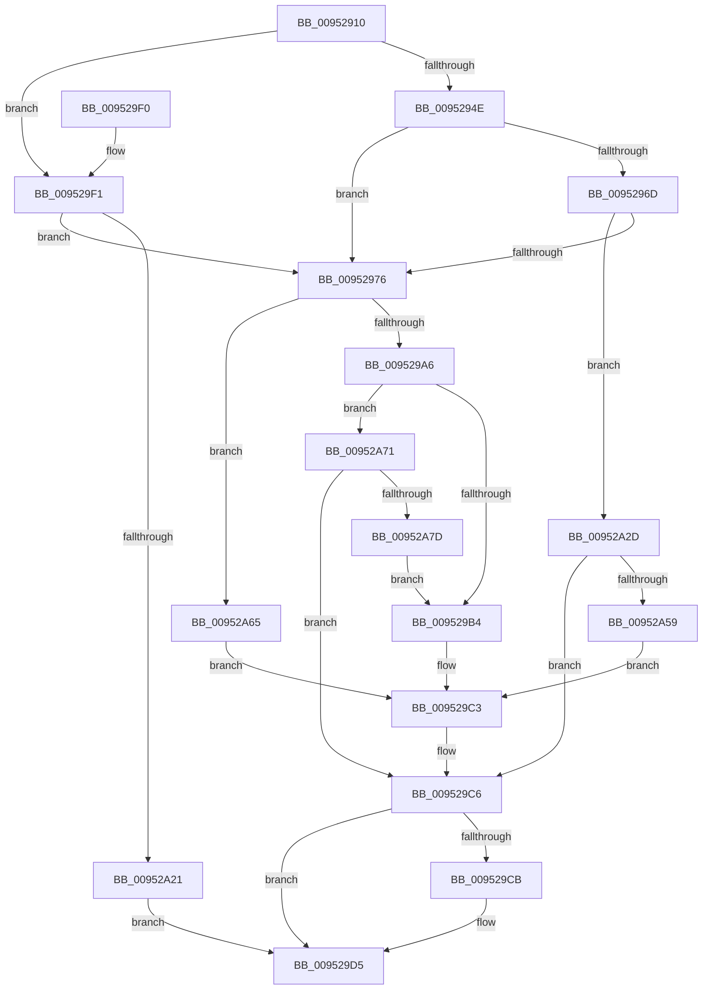

# IopOpenSystemVariableDevice

- RVA: `0x00952910`–`0x00952A82` (길이 `370` bytes)
- VA: `0x0000000140952910`
- 실행 섹션: `PAGE`
- PDB 이름 있음: `예`; PDB Function 태그: `아니요`
- unwind 정보 RVA: `0x00091FC4`
- 디코드: `95`개 명령, `370/370` bytes 표시
- 미해석 바이트: `0` (있으면 어셈블리에 `.byte`로 보존)

> 이 문서는 커널 이미지의 기계어와 PDB 기호를 분석해 생성했습니다. 4번과 5번은 함수 원형과 자료형을 바이너리 사용 방식에서 추정한 C 해석이며 원본 소스 복구 결과는 아닙니다.

## 1. Dependencies

- 직접 호출 지점: **8**; 고유 호출 대상: **4**
- 직접 호출자로 확인된 함수: **4**
- RIP 상대 이미지 참조: **7**

### Outgoing calls
- `0x0095295F` → [IoGetDeviceInterfaces](IoGetDeviceInterfaces_function_00953340.md) (function, `0x00953340`)
- `0x00952982` → [RtlInitUnicodeString](../../text/42/RtlInitUnicodeString_function_0042A780.md) (function, `0x0042A780`)
- `0x00952997` → [IoGetDeviceObjectPointer](IoGetDeviceObjectPointer_function_00953220.md) (function, `0x00953220`)
- `0x009529D0` → [ExFreePoolWithTag](../../poolcode/B8/ExFreePoolWithTag_function_00B82870.md) (function, `0x00B82870`)
- `0x009529FD` → [RtlInitUnicodeString](../../text/42/RtlInitUnicodeString_function_0042A780.md) (function, `0x0042A780`)
- `0x00952A12` → [IoGetDeviceObjectPointer](IoGetDeviceObjectPointer_function_00953220.md) (function, `0x00953220`)
- `0x00952A35` → [RtlInitUnicodeString](../../text/42/RtlInitUnicodeString_function_0042A780.md) (function, `0x0042A780`)
- `0x00952A4A` → [IoGetDeviceObjectPointer](IoGetDeviceObjectPointer_function_00953220.md) (function, `0x00953220`)

### Direct callers
- [IoQueryEnvironmentVariableInfoEx](../72/IoQueryEnvironmentVariableInfoEx_function_00721CA8.md) at `0x00721CF6`
- [IoGetEnvironmentVariableEx](IoGetEnvironmentVariableEx_function_00952760.md) at `0x009527B8`
- [IoEnumerateEnvironmentVariablesEx](../A2/IoEnumerateEnvironmentVariablesEx_function_00A2592C.md) at `0x00A25975`
- [IoSetEnvironmentVariableEx](../A9/IoSetEnvironmentVariableEx_function_00A91A84.md) at `0x00A91AD2`

### Static image references
- `0x0095293D` → RVA `0x00F8D080` (`.data`; read)
- `0x00952958` → RVA `0x00012310` (`.rdata`; read)
- `0x00952976` → RVA `0x00AFD050` (` ?? ::NNGAKEGL::`string'`; read)
- `0x009529B7` → RVA `0x00B4CA38` (`IopSysEnvFunctionTableHal`; read)
- `0x009529F1` → RVA `0x00AFCFD0` (` ?? ::NNGAKEGL::`string'`; read)
- `0x00952A21` → RVA `0x00B4C028` (`IopSysEnvFunctionTableTrEE`; read)
- `0x00952A65` → RVA `0x00B4CA58` (`IopSysEnvFunctionTableSysEnv`; read)

## 2. Other-region calls and transfers

- 다른 실행 섹션으로 향하는 call: **4**
  - `0x00952982` → [RtlInitUnicodeString](../../text/42/RtlInitUnicodeString_function_0042A780.md) (`PAGE` → `.text`)
  - `0x009529D0` → [ExFreePoolWithTag](../../poolcode/B8/ExFreePoolWithTag_function_00B82870.md) (`PAGE` → `POOLCODE`)
  - `0x009529FD` → [RtlInitUnicodeString](../../text/42/RtlInitUnicodeString_function_0042A780.md) (`PAGE` → `.text`)
  - `0x00952A35` → [RtlInitUnicodeString](../../text/42/RtlInitUnicodeString_function_0042A780.md) (`PAGE` → `.text`)
- 별도 외부 분기/꼬리 이동을 확인하지 못했습니다.

## 3. Assembly (complete function range)

```asm
00952910  48 8B C4                        mov rax, rsp
00952913  48 89 58 08                     mov qword ptr [rax + 8], rbx
00952917  48 89 68 10                     mov qword ptr [rax + 0x10], rbp
0095291B  48 89 70 18                     mov qword ptr [rax + 0x18], rsi
0095291F  57                              push rdi
00952920  41 56                           push r14
00952922  41 57                           push r15
00952924  48 83 EC 30                     sub rsp, 0x30
00952928  33 ED                           xor ebp, ebp
0095292A  0F 57 C0                        xorps xmm0, xmm0
0095292D  8B DD                           mov ebx, ebp
0095292F  49 8B F0                        mov rsi, r8
00952932  48 89 58 20                     mov qword ptr [rax + 0x20], rbx
00952936  4C 8B F2                        mov r14, rdx
00952939  0F 11 40 D8                     movups xmmword ptr [rax - 0x28], xmm0
0095293D  8B 05 3D A7 63 00               mov eax, dword ptr [rip + 0x63a73d]
00952943  4C 8B F9                        mov r15, rcx
00952946  A8 01                           test al, 1
00952948  0F 85 A3 00 00 00               jne 0x1409529f1
0095294E  4C 8D 4C 24 68                  lea r9, [rsp + 0x68]
00952953  45 33 C0                        xor r8d, r8d
00952956  33 D2                           xor edx, edx
00952958  48 8D 0D B1 F9 6B FF            lea rcx, [rip - 0x94064f]
0095295F  E8 DC 09 00 00                  call 0x140953340
00952964  48 8B 5C 24 68                  mov rbx, qword ptr [rsp + 0x68]
00952969  85 C0                           test eax, eax
0095296B  78 09                           js 0x140952976
0095296D  66 39 2B                        cmp word ptr [rbx], bp
00952970  0F 85 B7 00 00 00               jne 0x140952a2d
00952976  48 8D 15 D3 A6 1A 00            lea rdx, [rip + 0x1aa6d3]
0095297D  48 8D 4C 24 20                  lea rcx, [rsp + 0x20]
00952982  E8 F9 7D AD FF                  call 0x14042a780
00952987  4D 8B CE                        mov r9, r14
0095298A  48 8D 4C 24 20                  lea rcx, [rsp + 0x20]
0095298F  4D 8B C7                        mov r8, r15
00952992  BA 00 00 00 10                  mov edx, 0x10000000
00952997  E8 84 08 00 00                  call 0x140953220
0095299C  8B F8                           mov edi, eax
0095299E  85 C0                           test eax, eax
009529A0  0F 89 BF 00 00 00               jns 0x140952a65
009529A6  05 CD FF FF 3F                  add eax, 0x3fffffcd
009529AB  83 F8 01                        cmp eax, 1
009529AE  0F 87 BD 00 00 00               ja 0x140952a71
009529B4  49 89 2F                        mov qword ptr [r15], rbp
009529B7  48 8D 05 7A A0 1F 00            lea rax, [rip + 0x1fa07a]
009529BE  49 89 2E                        mov qword ptr [r14], rbp
009529C1  8B FD                           mov edi, ebp
009529C3  48 89 06                        mov qword ptr [rsi], rax
009529C6  48 85 DB                        test rbx, rbx
009529C9  74 0A                           je 0x1409529d5
009529CB  33 D2                           xor edx, edx
009529CD  48 8B CB                        mov rcx, rbx
009529D0  E8 9B FE 22 00                  call 0x140b82870
009529D5  48 8B 5C 24 50                  mov rbx, qword ptr [rsp + 0x50]
009529DA  8B C7                           mov eax, edi
009529DC  48 8B 6C 24 58                  mov rbp, qword ptr [rsp + 0x58]
009529E1  48 8B 74 24 60                  mov rsi, qword ptr [rsp + 0x60]
009529E6  48 83 C4 30                     add rsp, 0x30
009529EA  41 5F                           pop r15
009529EC  41 5E                           pop r14
009529EE  5F                              pop rdi
009529EF  C3                              ret
009529F0  CC                              int3
009529F1  48 8D 15 D8 A5 1A 00            lea rdx, [rip + 0x1aa5d8]
009529F8  48 8D 4C 24 20                  lea rcx, [rsp + 0x20]
009529FD  E8 7E 7D AD FF                  call 0x14042a780
00952A02  4D 8B CE                        mov r9, r14
00952A05  48 8D 4C 24 20                  lea rcx, [rsp + 0x20]
00952A0A  4D 8B C7                        mov r8, r15
00952A0D  BA 00 00 00 10                  mov edx, 0x10000000
00952A12  E8 09 08 00 00                  call 0x140953220
00952A17  8B F8                           mov edi, eax
00952A19  85 C0                           test eax, eax
00952A1B  0F 88 55 FF FF FF               js 0x140952976
00952A21  48 8D 05 00 96 1F 00            lea rax, [rip + 0x1f9600]
00952A28  48 89 06                        mov qword ptr [rsi], rax
00952A2B  EB A8                           jmp 0x1409529d5
00952A2D  48 8B D3                        mov rdx, rbx
00952A30  48 8D 4C 24 20                  lea rcx, [rsp + 0x20]
00952A35  E8 46 7D AD FF                  call 0x14042a780
00952A3A  4D 8B CE                        mov r9, r14
00952A3D  48 8D 4C 24 20                  lea rcx, [rsp + 0x20]
00952A42  4D 8B C7                        mov r8, r15
00952A45  BA 00 00 00 10                  mov edx, 0x10000000
00952A4A  E8 D1 07 00 00                  call 0x140953220
00952A4F  8B F8                           mov edi, eax
00952A51  85 C0                           test eax, eax
00952A53  0F 88 6D FF FF FF               js 0x1409529c6
00952A59  48 8D 05 C8 95 1F 00            lea rax, [rip + 0x1f95c8]
00952A60  E9 5E FF FF FF                  jmp 0x1409529c3
00952A65  48 8D 05 EC 9F 1F 00            lea rax, [rip + 0x1f9fec]
00952A6C  E9 52 FF FF FF                  jmp 0x1409529c3
00952A71  81 FF 3A 00 00 C0               cmp edi, 0xc000003a
00952A77  0F 85 49 FF FF FF               jne 0x1409529c6
00952A7D  E9 32 FF FF FF                  jmp 0x1409529b4
```

## 4. C-style interpretation (structured pseudocode)

```c
__int64 __fastcall IopOpenSystemVariableDevice(__int64 a1, __int64 a2, __int64 a3)
{
    __int64 result;
    __int64 v_rbp;
    __int64 v_rsp;
    unsigned __int64 v_stack_m28;
    unsigned __int64 v_stack_p10;
    unsigned __int64 v_stack_p18;
    unsigned __int64 v_stack_p20;
    unsigned __int64 v_stack_p8;

    *(unsigned __int64 *)(v_rsp + 8) = v_rbx;
    *(unsigned __int64 *)(v_rsp + 16) = v_rbp;
    *(unsigned __int64 *)(v_rsp + 24) = v_rsi;
    v_rsp = (v_rsp) - (48);
    v_rbp = 0;
    *(unsigned __int64 *)(v_rsp + 32) = 0;
    *(unsigned __int64 *)(v_rsp - 40) = v_xmm0;
    if ((((unsigned __int8)((unsigned int)(*(unsigned int *)(v_rip + 6530877)))) & (1)) != 0) goto loc_009529F1;
    a3 = 0;
    a2 = 0;
    result = IoGetDeviceInterfaces(v_rip - 9700943, a2, a3, v_stack_p20);
    if (sign_flag) goto loc_00952976;
    if ((*(unsigned __int16 *)(v_stack_p20)) != 0) goto loc_00952A2D;
loc_00952976:
    result = RtlInitUnicodeString(v_stack_m28, v_rip + 1746643, a3, v_stack_p20);
    result = IoGetDeviceObjectPointer(v_stack_m28, (unsigned int)(0x10000000ULL), a1, 0);
    if (!sign_flag) goto loc_00952A65;
    result = (unsigned int)((result) + (0x3FFFFFCDULL));
    if (((unsigned int)(result)) > 1) goto loc_00952A71;
loc_009529B4:
    *(unsigned __int64 *)(a1) = 0;
    *(unsigned __int64 *)(a2) = 0;
loc_009529C3:
    *(unsigned __int64 *)(a3) = v_rip + 2072698;
loc_009529C6:
    result = v_rip + 2072698;
    if (v_stack_p20 != 0) {
        a2 = 0;
        a1 = v_stack_p20;
        result = ExFreePoolWithTag(a1, a2, a1, 0);
    }
    v_rsp = (v_rsp) + (48);
    return 0;
loc_009529F1:
    result = RtlInitUnicodeString(v_stack_p20, v_rip + 1746392, a1, 0);
    result = IoGetDeviceObjectPointer(v_stack_p20, (unsigned int)(0x10000000ULL), a1, 0);
    if (sign_flag) goto loc_00952976;
    *(unsigned __int64 *)(v_stack_p18) = v_rip + 2070016;
    goto loc_009529D5;
loc_00952A2D:
    result = RtlInitUnicodeString(v_stack_p20, v_stack_p8, a1, 0);
    result = IoGetDeviceObjectPointer(v_stack_p20, (unsigned int)(0x10000000ULL), a1, 0);
    if (sign_flag) goto loc_009529C6;
    goto loc_009529C3;
loc_00952A65:
    goto loc_009529C3;
loc_00952A71:
    if (((unsigned int)((unsigned int)((unsigned int)(result)))) != 0xC000003AULL) goto loc_009529C6;
    goto loc_009529B4;
}
```

## 5. (Beta) C Style

```c
int64_t IopOpenSystemVariableDevice(void *Arg1, void *Arg2, void *Arg3)
{
    uint8_t *arg1 = (uint8_t *)Arg1;
    uint8_t *arg2 = (uint8_t *)Arg2;
    uint8_t *arg3 = (uint8_t *)Arg3;

    int64_t result;
    int64_t local_rbp;
    int64_t local_rsp;
    uint64_t v_stack_m28;
    uint64_t v_stack_p10;
    uint64_t v_stack_p18;
    uint64_t v_stack_p20;
    uint64_t v_stack_p8;

    *(uint64_t *)(local_rsp + 0x8) = local_rbx;
    *(uint64_t *)(local_rsp + 0x10) = local_rbp;
    *(uint64_t *)(local_rsp + 0x18) = local_rsi;
    local_rsp = (local_rsp) - (48);
    local_rbp = 0;
    *(uint64_t *)(local_rsp + 0x20) = 0;
    *(uint64_t *)(local_rsp - 0x28) = v_xmm0;
    if ((((uint8_t)((uint32_t)(*(uint32_t *)(v_rip + 0x63A73D)))) & (1)) != 0) goto loc_009529F1;
    Arg3 = 0;
    Arg2 = 0;
    result = IoGetDeviceInterfaces(v_rip - 9700943, Arg2, Arg3, v_stack_p20);
    if (sign_flag) goto loc_00952976;
    if ((*(uint16_t *)(v_stack_p20)) != 0) goto loc_00952A2D;
loc_00952976:
    result = RtlInitUnicodeString(v_stack_m28, v_rip + 1746643, Arg3, v_stack_p20);
    result = IoGetDeviceObjectPointer(v_stack_m28, (uint32_t)(0x10000000ULL), Arg1, 0);
    if (!sign_flag) goto loc_00952A65;
    result = (uint32_t)((result) + (0x3FFFFFCDULL));
    if (((uint32_t)(result)) > 1) goto loc_00952A71;
loc_009529B4:
    *(uint64_t *)(arg1) = 0;
    *(uint64_t *)(arg2) = 0;
loc_009529C3:
    *(uint64_t *)(arg3) = v_rip + 2072698;
loc_009529C6:
    result = v_rip + 2072698;
    if (v_stack_p20 != 0) {
        Arg2 = 0;
        Arg1 = v_stack_p20;
        result = ExFreePoolWithTag(Arg1, Arg2, Arg1, 0);
    }
    local_rsp = (local_rsp) + (48);
    return 0;
loc_009529F1:
    result = RtlInitUnicodeString(v_stack_p20, v_rip + 1746392, Arg1, 0);
    result = IoGetDeviceObjectPointer(v_stack_p20, (uint32_t)(0x10000000ULL), Arg1, 0);
    if (sign_flag) goto loc_00952976;
    *(uint64_t *)(v_stack_p18) = v_rip + 2070016;
    goto loc_009529D5;
loc_00952A2D:
    result = RtlInitUnicodeString(v_stack_p20, v_stack_p8, Arg1, 0);
    result = IoGetDeviceObjectPointer(v_stack_p20, (uint32_t)(0x10000000ULL), Arg1, 0);
    if (sign_flag) goto loc_009529C6;
    goto loc_009529C3;
loc_00952A65:
    goto loc_009529C3;
loc_00952A71:
    if (((uint32_t)((uint32_t)((uint32_t)(result)))) != 0xC000003AULL) goto loc_009529C6;
    goto loc_009529B4;
}
```

### 관측된 메모리 오프셋

구조체 형식이 확인되지 않은 접근은 인자 기준의 오프셋으로만 기록했습니다.

| 기준 인자 | 오프셋 표현 | 폭 (bit) | 접근 |
|---|---:|---:|---|
| `Arg1` | `+ 0x0` | `64` | `W` |
| `Arg2` | `+ 0x0` | `64` | `W` |
| `Arg3` | `+ 0x0` | `64` | `W` |

## 6. Execution-region graph

[열기: 2D/3D 그래프와 함수 탐색 컨트롤 패널](../../../control-panel.html?section=page&rva=0x00952910&view=graph)

- 2D 그래프는 위에서 아래로 흐르고, 3D 그래프는 빈 공간을 드래그해 회전합니다. Shift+드래그는 이동, 휠은 확대·축소, 함수 노드 선택은 대상 보고서 이동입니다.

### Static fallback


