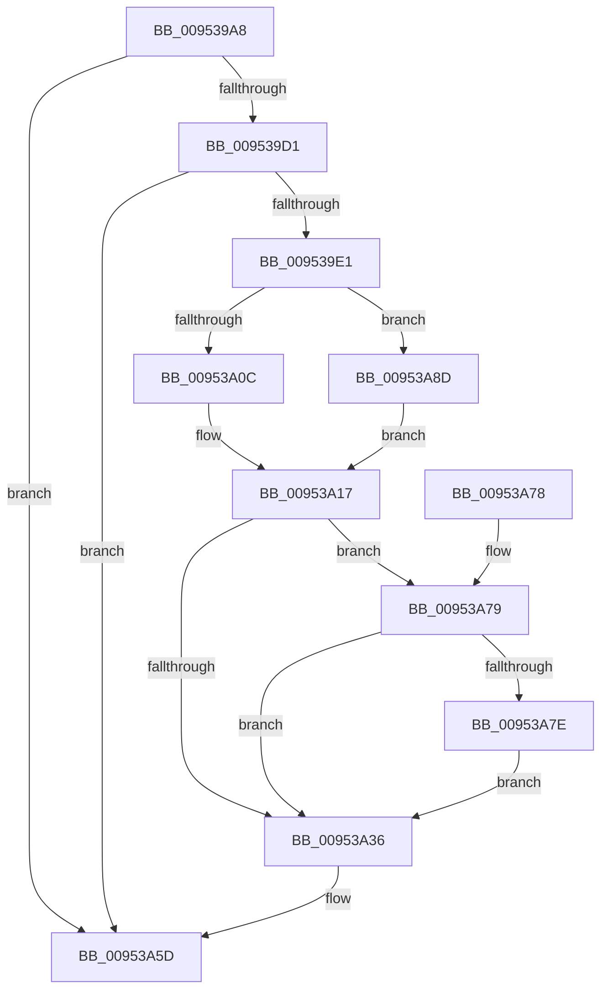

# IopProcessInvalidateBusRelationsRequest

- RVA: `0x009539A8`–`0x00953A96` (길이 `238` bytes)
- VA: `0x00000001409539A8`
- 실행 섹션: `PAGE`
- PDB 이름 있음: `예`; PDB Function 태그: `아니요`
- unwind 정보 RVA: `0x00092110`
- 디코드: `59`개 명령, `238/238` bytes 표시
- 미해석 바이트: `0` (있으면 어셈블리에 `.byte`로 보존)

> 이 문서는 커널 이미지의 기계어와 PDB 기호를 분석해 생성했습니다. 4번과 5번은 함수 원형과 자료형을 바이너리 사용 방식에서 추정한 C 해석이며 원본 소스 복구 결과는 아닙니다.

## 1. Dependencies

- 직접 호출 지점: **4**; 고유 호출 대상: **4**
- 직접 호출자로 확인된 함수: **1**
- RIP 상대 이미지 참조: **4**

### Outgoing calls
- `0x00953A0F` → [IopQueryDeviceHardwareIdForPdcTask](IopQueryDeviceHardwareIdForPdcTask_function_00953500.md) (function, `0x00953500`)
- `0x00953A23` → [PiPdcActivate](PiPdcActivate_function_00953BF4.md) (function, `0x00953BF4`)
- `0x00953A58` → [PnpRequestDeviceAction](../../text/47/PnpRequestDeviceAction_function_00477FF8.md) (function, `0x00477FF8`)
- `0x00953A86` → [ExFreePoolWithTag](../../poolcode/B8/ExFreePoolWithTag_function_00B82870.md) (function, `0x00B82870`)

### Direct callers
- [IopInvalidateBusRelationsWorker](../../text/4C/IopInvalidateBusRelationsWorker_function_004C8900.md) at `0x004C8A19`

### Static image references
- `0x009539E4` → RVA `0x00AFD900` (` ?? ::NNGAKEGL::`string'`; read)
- `0x009539EF` → RVA `0x00AFD910` (` ?? ::NNGAKEGL::`string'`; read)
- `0x009539FF` → RVA `0x00F8C438` (`.data`; read)
- `0x00953A8D` → RVA `0x00AFD930` (` ?? ::NNGAKEGL::`string'`; read)

## 2. Other-region calls and transfers

- 다른 실행 섹션으로 향하는 call: **2**
  - `0x00953A58` → [PnpRequestDeviceAction](../../text/47/PnpRequestDeviceAction_function_00477FF8.md) (`PAGE` → `.text`)
  - `0x00953A86` → [ExFreePoolWithTag](../../poolcode/B8/ExFreePoolWithTag_function_00B82870.md) (`PAGE` → `POOLCODE`)
- 별도 외부 분기/꼬리 이동을 확인하지 못했습니다.

## 3. Assembly (complete function range)

```asm
009539A8  48 8B C4                        mov rax, rsp
009539AB  48 89 58 08                     mov qword ptr [rax + 8], rbx
009539AF  48 89 68 10                     mov qword ptr [rax + 0x10], rbp
009539B3  48 89 70 18                     mov qword ptr [rax + 0x18], rsi
009539B7  48 89 78 20                     mov qword ptr [rax + 0x20], rdi
009539BB  41 56                           push r14
009539BD  48 83 EC 50                     sub rsp, 0x50
009539C1  48 8B 51 10                     mov rdx, qword ptr [rcx + 0x10]
009539C5  48 8B F9                        mov rdi, rcx
009539C8  48 85 D2                        test rdx, rdx
009539CB  0F 84 8C 00 00 00               je 0x140953a5d
009539D1  48 8B 82 38 01 00 00            mov rax, qword ptr [rdx + 0x138]
009539D8  48 8B 70 28                     mov rsi, qword ptr [rax + 0x28]
009539DC  48 85 F6                        test rsi, rsi
009539DF  74 7C                           je 0x140953a5d
009539E1  8B 49 18                        mov ecx, dword ptr [rcx + 0x18]
009539E4  48 8D 2D 15 9F 1A 00            lea rbp, [rip + 0x1a9f15]
009539EB  8B C1                           mov eax, ecx
009539ED  F7 D8                           neg eax
009539EF  48 8D 05 1A 9F 1A 00            lea rax, [rip + 0x1a9f1a]
009539F6  45 1B F6                        sbb r14d, r14d
009539F9  85 C9                           test ecx, ecx
009539FB  48 0F 45 E8                     cmovne rbp, rax
009539FF  48 3B 35 32 8A 63 00            cmp rsi, qword ptr [rip + 0x638a32]
00953A06  0F 84 81 00 00 00               je 0x140953a8d
00953A0C  48 8B CA                        mov rcx, rdx
00953A0F  E8 EC FA FF FF                  call 0x140953500
00953A14  48 8B D8                        mov rbx, rax
00953A17  48 83 64 24 48 00               and qword ptr [rsp + 0x48], 0
00953A1D  48 8B D3                        mov rdx, rbx
00953A20  48 8B CD                        mov rcx, rbp
00953A23  E8 CC 01 00 00                  call 0x140953bf4
00953A28  48 3B 35 09 8A 63 00            cmp rsi, qword ptr [rip + 0x638a09]
00953A2F  48 89 44 24 40                  mov qword ptr [rsp + 0x40], rax
00953A34  75 43                           jne 0x140953a79
00953A36  48 83 64 24 30 00               and qword ptr [rsp + 0x30], 0
00953A3C  4C 8D 4C 24 40                  lea r9, [rsp + 0x40]
00953A41  48 83 64 24 28 00               and qword ptr [rsp + 0x28], 0
00953A47  41 8D 56 09                     lea edx, [r14 + 9]
00953A4B  48 83 64 24 20 00               and qword ptr [rsp + 0x20], 0
00953A51  45 33 C0                        xor r8d, r8d
00953A54  48 8B 4F 10                     mov rcx, qword ptr [rdi + 0x10]
00953A58  E8 9B 45 B2 FF                  call 0x140477ff8
00953A5D  48 8B 5C 24 60                  mov rbx, qword ptr [rsp + 0x60]
00953A62  48 8B 6C 24 68                  mov rbp, qword ptr [rsp + 0x68]
00953A67  48 8B 74 24 70                  mov rsi, qword ptr [rsp + 0x70]
00953A6C  48 8B 7C 24 78                  mov rdi, qword ptr [rsp + 0x78]
00953A71  48 83 C4 50                     add rsp, 0x50
00953A75  41 5E                           pop r14
00953A77  C3                              ret
00953A78  CC                              int3
00953A79  48 85 DB                        test rbx, rbx
00953A7C  74 B8                           je 0x140953a36
00953A7E  BA 50 70 69 6F                  mov edx, 0x6f697050
00953A83  48 8B CB                        mov rcx, rbx
00953A86  E8 E5 ED 22 00                  call 0x140b82870
00953A8B  EB A9                           jmp 0x140953a36
00953A8D  48 8D 1D 9C 9E 1A 00            lea rbx, [rip + 0x1a9e9c]
00953A94  EB 81                           jmp 0x140953a17
```

## 4. C-style interpretation (structured pseudocode)

```c
__int64 __fastcall IopProcessInvalidateBusRelationsRequest(__int64 a1, __int64 a2, int a3)
{
    __int64 result;
    __int64 v_rbp;
    __int64 v_rsp;
    unsigned __int64 v_stack_m10;
    unsigned __int64 v_stack_m18;
    unsigned __int64 v_stack_m28;
    unsigned __int64 v_stack_m30;
    unsigned __int64 v_stack_m38;
    unsigned __int64 v_stack_p10;
    unsigned __int64 v_stack_p18;
    unsigned __int64 v_stack_p20;
    unsigned __int64 v_stack_p8;

    *(unsigned __int64 *)(v_rsp + 8) = v_rbx;
    *(unsigned __int64 *)(v_rsp + 16) = v_rbp;
    *(unsigned __int64 *)(v_rsp + 24) = v_rsi;
    *(unsigned __int64 *)(v_rsp + 32) = v_rdi;
    v_rsp = (v_rsp) - (80);
    if (*(unsigned __int64 *)(a1 + 16) == 0) goto loc_00953A5D;
    if (*(unsigned __int64 *)(*(unsigned __int64 *)(*(unsigned __int64 *)(a1 + 16) + 312) + 40) == 0) goto loc_00953A5D;
    result = (unsigned int)(-((unsigned int)((unsigned int)((unsigned int)(*(unsigned int *)(a1 + 24))))));
    v_rbp = v_rip + 1744661;
    if ((unsigned int)((unsigned int)(*(unsigned int *)(a1 + 24))) != 0) { v_rbp = v_rip + 1744666; }
    if ((*(unsigned __int64 *)(*(unsigned __int64 *)(*(unsigned __int64 *)(a1 + 16) + 312) + 40)) == (*(unsigned __int64 *)(v_rip + 6523442))) goto loc_00953A8D;
    result = IopQueryDeviceHardwareIdForPdcTask(*(unsigned __int64 *)(a1 + 16), *(unsigned __int64 *)(a1 + 16), a3, a4);
loc_00953A17:
    result = PiPdcActivate(v_rbp, result, a3, a4);
    v_stack_m18 = result;
    if ((*(unsigned __int64 *)(*(unsigned __int64 *)(*(unsigned __int64 *)(a1 + 16) + 312) + 40)) != (*(unsigned __int64 *)(v_rip + 6523401))) goto loc_00953A79;
loc_00953A36:
    a3 = 0;
    result = PnpRequestDeviceAction(*(unsigned __int64 *)(a1 + 16), v_r14 + 9, a3, v_stack_m18);
loc_00953A5D:
    v_rsp = (v_rsp) + (80);
    return result;
loc_00953A79:
    if (v_stack_p8 == 0) goto loc_00953A36;
    result = ExFreePoolWithTag(v_stack_p8, (unsigned int)(0x6F697050ULL), a3, v_stack_m18);
    goto loc_00953A36;
loc_00953A8D:
    goto loc_00953A17;
}
```

## 5. (Beta) C Style

```c
int64_t IopProcessInvalidateBusRelationsRequest(void *Arg1, int64_t Arg2, int32_t Arg3)
{
    uint8_t *arg1 = (uint8_t *)Arg1;

    int64_t result;
    int64_t local_rbp;
    int64_t local_rsp;
    uint64_t v_stack_m10;
    uint64_t v_stack_m18;
    uint64_t v_stack_m28;
    uint64_t v_stack_m30;
    uint64_t v_stack_m38;
    uint64_t v_stack_p10;
    uint64_t v_stack_p18;
    uint64_t v_stack_p20;
    uint64_t v_stack_p8;

    *(uint64_t *)(local_rsp + 0x8) = local_rbx;
    *(uint64_t *)(local_rsp + 0x10) = local_rbp;
    *(uint64_t *)(local_rsp + 0x18) = local_rsi;
    *(uint64_t *)(local_rsp + 0x20) = local_rdi;
    local_rsp = (local_rsp) - (80);
    if (*(uint64_t *)(arg1 + 0x10) == 0) goto loc_00953A5D;
    if (*(uint64_t *)(*(uint64_t *)(*(uint64_t *)(arg1 + 0x10) + 0x138) + 0x28) == 0) goto loc_00953A5D;
    result = (uint32_t)(-((uint32_t)((uint32_t)((uint32_t)(*(uint32_t *)(arg1 + 0x18))))));
    local_rbp = v_rip + 1744661;
    if ((uint32_t)((uint32_t)(*(uint32_t *)(arg1 + 0x18))) != 0) { local_rbp = v_rip + 1744666; }
    if ((*(uint64_t *)(*(uint64_t *)(*(uint64_t *)(arg1 + 0x10) + 0x138) + 0x28)) == (*(uint64_t *)(v_rip + 0x638A32))) goto loc_00953A8D;
    result = IopQueryDeviceHardwareIdForPdcTask(*(uint64_t *)(arg1 + 0x10), *(uint64_t *)(arg1 + 0x10), Arg3, a4);
loc_00953A17:
    result = PiPdcActivate(local_rbp, result, Arg3, a4);
    v_stack_m18 = result;
    if ((*(uint64_t *)(*(uint64_t *)(*(uint64_t *)(arg1 + 0x10) + 0x138) + 0x28)) != (*(uint64_t *)(v_rip + 0x638A09))) goto loc_00953A79;
loc_00953A36:
    Arg3 = 0;
    result = PnpRequestDeviceAction(*(uint64_t *)(arg1 + 0x10), local_r14 + 9, Arg3, v_stack_m18);
loc_00953A5D:
    local_rsp = (local_rsp) + (80);
    return result;
loc_00953A79:
    if (v_stack_p8 == 0) goto loc_00953A36;
    result = ExFreePoolWithTag(v_stack_p8, (uint32_t)(0x6F697050ULL), Arg3, v_stack_m18);
    goto loc_00953A36;
loc_00953A8D:
    goto loc_00953A17;
}
```

### 관측된 메모리 오프셋

구조체 형식이 확인되지 않은 접근은 인자 기준의 오프셋으로만 기록했습니다.

| 기준 인자 | 오프셋 표현 | 폭 (bit) | 접근 |
|---|---:|---:|---|
| `Arg1` | `+ 0x10` | `64` | `R` |
| `Arg1` | `+ 0x18` | `32` | `R` |

## 6. Execution-region graph

[열기: 2D/3D 그래프와 함수 탐색 컨트롤 패널](../../../control-panel.html?section=page&rva=0x009539A8&view=graph)

- 2D 그래프는 위에서 아래로 흐르고, 3D 그래프는 빈 공간을 드래그해 회전합니다. Shift+드래그는 이동, 휠은 확대·축소, 함수 노드 선택은 대상 보고서 이동입니다.

### Static fallback


