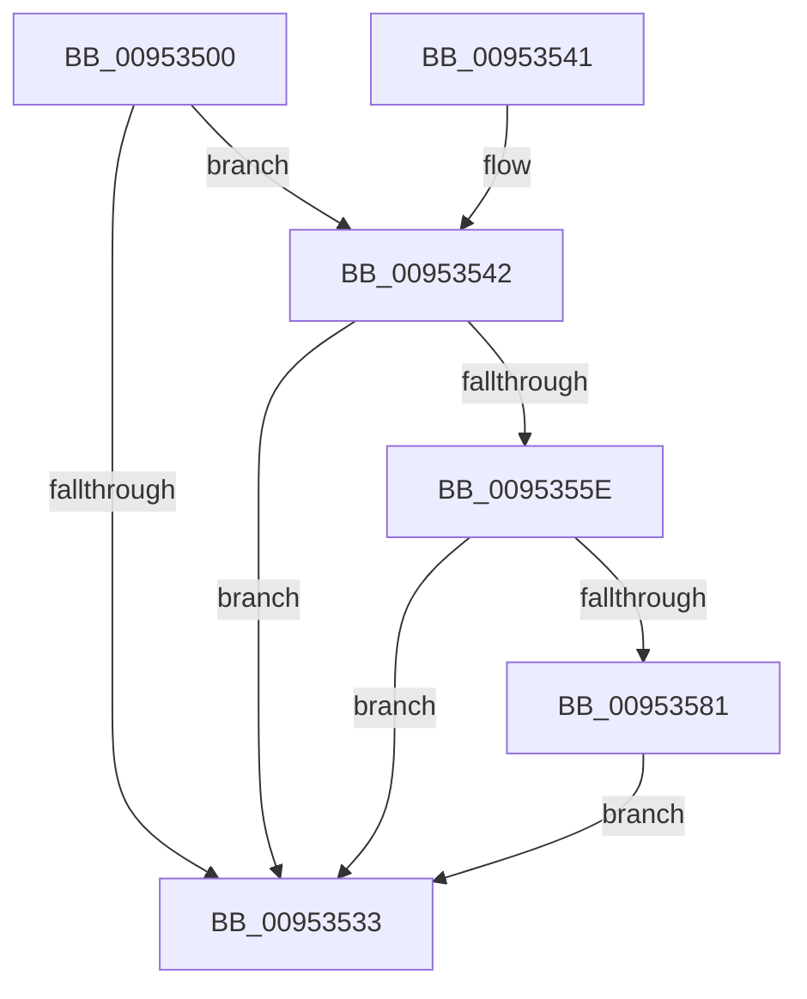

# IopQueryDeviceHardwareIdForPdcTask

- RVA: `0x00953500`–`0x0095358F` (길이 `143` bytes)
- VA: `0x0000000140953500`
- 실행 섹션: `PAGE`
- PDB 이름 있음: `예`; PDB Function 태그: `아니요`
- unwind 정보 RVA: `0x000920C8`
- 디코드: `41`개 명령, `143/143` bytes 표시
- 미해석 바이트: `0` (있으면 어셈블리에 `.byte`로 보존)

> 이 문서는 커널 이미지의 기계어와 PDB 기호를 분석해 생성했습니다. 4번과 5번은 함수 원형과 자료형을 바이너리 사용 방식에서 추정한 C 해석이며 원본 소스 복구 결과는 아닙니다.

## 1. Dependencies

- 직접 호출 지점: **4**; 고유 호출 대상: **3**
- 직접 호출자로 확인된 함수: **1**
- RIP 상대 이미지 참조: **0**

### Outgoing calls
- `0x00953527` → [IoGetDeviceProperty](../8F/IoGetDeviceProperty_function_008FA720.md) (function, `0x008FA720`)
- `0x00953551` → [ExAllocatePool2](../../poolcode/B8/ExAllocatePool2_function_00B820F0.md) (function, `0x00B820F0`)
- `0x00953578` → [IoGetDeviceProperty](../8F/IoGetDeviceProperty_function_008FA720.md) (function, `0x008FA720`)
- `0x00953586` → [ExFreePoolWithTag](../../poolcode/B8/ExFreePoolWithTag_function_00B82870.md) (function, `0x00B82870`)

### Direct callers
- [IopProcessInvalidateBusRelationsRequest](IopProcessInvalidateBusRelationsRequest_function_009539A8.md) at `0x00953A0F`

### Static image references
- 디코드된 RIP-relative 메모리 참조가 없습니다.

## 2. Other-region calls and transfers

- 다른 실행 섹션으로 향하는 call: **2**
  - `0x00953551` → [ExAllocatePool2](../../poolcode/B8/ExAllocatePool2_function_00B820F0.md) (`PAGE` → `POOLCODE`)
  - `0x00953586` → [ExFreePoolWithTag](../../poolcode/B8/ExFreePoolWithTag_function_00B82870.md) (`PAGE` → `POOLCODE`)
- 별도 외부 분기/꼬리 이동을 확인하지 못했습니다.

## 3. Assembly (complete function range)

```asm
00953500  48 89 5C 24 08                  mov qword ptr [rsp + 8], rbx
00953505  57                              push rdi
00953506  48 83 EC 30                     sub rsp, 0x30
0095350A  83 64 24 48 00                  and dword ptr [rsp + 0x48], 0
0095350F  48 8D 44 24 48                  lea rax, [rsp + 0x48]
00953514  33 DB                           xor ebx, ebx
00953516  48 89 44 24 20                  mov qword ptr [rsp + 0x20], rax
0095351B  45 33 C9                        xor r9d, r9d
0095351E  45 33 C0                        xor r8d, r8d
00953521  48 8B F9                        mov rdi, rcx
00953524  8D 53 01                        lea edx, [rbx + 1]
00953527  E8 F4 71 FA FF                  call 0x1408fa720
0095352C  3D 23 00 00 C0                  cmp eax, 0xc0000023
00953531  74 0F                           je 0x140953542
00953533  48 8B C3                        mov rax, rbx
00953536  48 8B 5C 24 40                  mov rbx, qword ptr [rsp + 0x40]
0095353B  48 83 C4 30                     add rsp, 0x30
0095353F  5F                              pop rdi
00953540  C3                              ret
00953541  CC                              int3
00953542  8B 54 24 48                     mov edx, dword ptr [rsp + 0x48]
00953546  B9 00 01 00 00                  mov ecx, 0x100
0095354B  41 B8 50 70 69 6F               mov r8d, 0x6f697050
00953551  E8 9A EB 22 00                  call 0x140b820f0
00953556  48 8B D8                        mov rbx, rax
00953559  48 85 C0                        test rax, rax
0095355C  74 D5                           je 0x140953533
0095355E  44 8B 44 24 48                  mov r8d, dword ptr [rsp + 0x48]
00953563  48 8D 44 24 48                  lea rax, [rsp + 0x48]
00953568  4C 8B CB                        mov r9, rbx
0095356B  48 89 44 24 20                  mov qword ptr [rsp + 0x20], rax
00953570  BA 01 00 00 00                  mov edx, 1
00953575  48 8B CF                        mov rcx, rdi
00953578  E8 A3 71 FA FF                  call 0x1408fa720
0095357D  85 C0                           test eax, eax
0095357F  79 B2                           jns 0x140953533
00953581  33 D2                           xor edx, edx
00953583  48 8B CB                        mov rcx, rbx
00953586  E8 E5 F2 22 00                  call 0x140b82870
0095358B  33 DB                           xor ebx, ebx
0095358D  EB A4                           jmp 0x140953533
```

## 4. C-style interpretation (structured pseudocode)

```c
__int64 __fastcall IopQueryDeviceHardwareIdForPdcTask(__int64 a1, __int64 a2, int a3, int a4)
{
    __int64 result;
    __int64 v_rbx;
    __int64 v_rsp;
    unsigned __int64 v_stack_m18;
    unsigned int v_stack_p10;
    unsigned __int64 v_stack_p20;
    unsigned int v_stack_p48;
    unsigned __int64 v_stack_p8;

    v_stack_p8 = v_rbx;
    v_rsp = (v_rsp) - (48);
    v_rbx = 0;
    v_stack_m18 = v_stack_p10;
    a4 = 0;
    a3 = 0;
    result = IoGetDeviceProperty(a1, v_rbx + 1, a3, a4);
    if (((unsigned int)(result)) == 0xC0000023ULL) goto loc_00953542;
loc_00953533:
    v_rsp = (v_rsp) + (48);
    return 0;
loc_00953542:
    result = ExAllocatePool2(256, (unsigned int)(v_stack_p48), (unsigned int)(0x6F697050ULL), a4);
    if (result == 0) goto loc_00953533;
    v_stack_p20 = v_stack_p48;
    result = IoGetDeviceProperty(a1, 1, (unsigned int)(v_stack_p48), result);
    if (!sign_flag) goto loc_00953533;
    a2 = 0;
    result = ExFreePoolWithTag(result, a2, (unsigned int)(v_stack_p48), result);
    v_rbx = 0;
    goto loc_00953533;
}
```

## 5. (Beta) C Style

```c
int64_t IopQueryDeviceHardwareIdForPdcTask(int64_t Arg1, int64_t Arg2, int32_t Arg3, int32_t Arg4)
{
    int64_t result;
    int64_t local_rbx;
    int64_t local_rsp;
    uint64_t v_stack_m18;
    uint32_t v_stack_p10;
    uint64_t v_stack_p20;
    uint32_t v_stack_p48;
    uint64_t v_stack_p8;

    v_stack_p8 = local_rbx;
    local_rsp = (local_rsp) - (48);
    local_rbx = 0;
    v_stack_m18 = v_stack_p10;
    Arg4 = 0;
    Arg3 = 0;
    result = IoGetDeviceProperty(Arg1, local_rbx + 1, Arg3, Arg4);
    if (((uint32_t)(result)) == 0xC0000023ULL) goto loc_00953542;
loc_00953533:
    local_rsp = (local_rsp) + (48);
    return 0;
loc_00953542:
    result = ExAllocatePool2(256, (uint32_t)(v_stack_p48), (uint32_t)(0x6F697050ULL), Arg4);
    if (result == 0) goto loc_00953533;
    v_stack_p20 = v_stack_p48;
    result = IoGetDeviceProperty(Arg1, 1, (uint32_t)(v_stack_p48), result);
    if (!sign_flag) goto loc_00953533;
    Arg2 = 0;
    result = ExFreePoolWithTag(result, Arg2, (uint32_t)(v_stack_p48), result);
    local_rbx = 0;
    goto loc_00953533;
}
```

## 6. Execution-region graph

[열기: 2D/3D 그래프와 함수 탐색 컨트롤 패널](../../../control-panel.html?section=page&rva=0x00953500&view=graph)

- 2D 그래프는 위에서 아래로 흐르고, 3D 그래프는 빈 공간을 드래그해 회전합니다. Shift+드래그는 이동, 휠은 확대·축소, 함수 노드 선택은 대상 보고서 이동입니다.

### Static fallback


