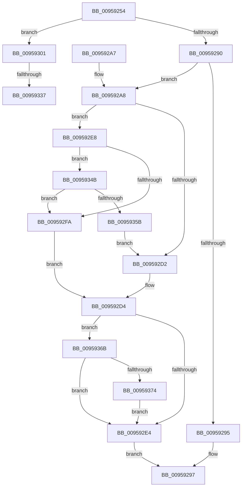

# KseAddHardwareId

- RVA: `0x00959254`–`0x0095938A` (길이 `310` bytes)
- VA: `0x0000000140959254`
- 실행 섹션: `PAGE`
- PDB 이름 있음: `예`; PDB Function 태그: `예`
- unwind 정보 RVA: `0x000927E4`
- 디코드: `80`개 명령, `310/310` bytes 표시
- 미해석 바이트: `0` (있으면 어셈블리에 `.byte`로 보존)

> 이 문서는 커널 이미지의 기계어와 PDB 기호를 분석해 생성했습니다. 4번과 5번은 함수 원형과 자료형을 바이너리 사용 방식에서 추정한 C 해석이며 원본 소스 복구 결과는 아닙니다.

## 1. Dependencies

- 직접 호출 지점: **10**; 고유 호출 대상: **10**
- 직접 호출자로 확인된 함수: **1**
- RIP 상대 이미지 참조: **6**

### Outgoing calls
- `0x009592B0` → [RtlInitUnicodeString](../../text/42/RtlInitUnicodeString_function_0042A780.md) (function, `0x0042A780`)
- `0x009592B8` → [CmpLockSiloKeyLockTrackerExclusive](../8F/CmpLockSiloKeyLockTrackerExclusive_function_008F9EF8.md) (function, `0x008F9EF8`)
- `0x009592C5` → [KsepCacheLookup](KsepCacheLookup_function_00959DE8.md) (function, `0x00959DE8`)
- `0x009592D7` → [KsepCacheUnlock](KsepCacheUnlock_function_00959ECC.md) (function, `0x00959ECC`)
- `0x009592ED` → [KsepPoolAllocatePaged](../../text/4A/KsepPoolAllocatePaged_function_004A9EFC.md) (function, `0x004A9EFC`)
- `0x00959340` → [KsepDebugPrint](../../text/4D/KsepDebugPrint_function_004DCFF0.md) (function, `0x004DCFF0`)
- `0x00959352` → [KsepStringDuplicate](KsepStringDuplicate_function_0095B454.md) (function, `0x0095B454`)
- `0x00959361` → [KsepCacheInsert](../AB/KsepCacheInsert_function_00AB722C.md) (function, `0x00AB722C`)
- `0x00959378` → [KsepStringFree](KsepStringFree_function_0095A1B8.md) (function, `0x0095A1B8`)
- `0x00959380` → [KsepPoolFreePaged](../../text/4B/KsepPoolFreePaged_function_004B0E10.md) (function, `0x004B0E10`)

### Direct callers
- [PiProcessNewDeviceNode](../A2/PiProcessNewDeviceNode_function_00A28F20.md) at `0x00A29BFF`

### Static image references
- `0x00959263` → RVA `0x00E66CD0` (`.data`; read)
- `0x00959273` → RVA `0x00E66C84` (`.data`; read)
- `0x00959306` → RVA `0x00F101C0` (`.data`; read/write)
- `0x00959310` → RVA `0x00F101E0` (`.data`; read)
- `0x00959329` → RVA `0x00E66CE8` (`.data`; read)
- `0x00959337` → RVA `0x00B00E50` (` ?? ::NNGAKEGL::`string'`; read)

## 2. Other-region calls and transfers

- 다른 실행 섹션으로 향하는 call: **4**
  - `0x009592B0` → [RtlInitUnicodeString](../../text/42/RtlInitUnicodeString_function_0042A780.md) (`PAGE` → `.text`)
  - `0x009592ED` → [KsepPoolAllocatePaged](../../text/4A/KsepPoolAllocatePaged_function_004A9EFC.md) (`PAGE` → `.text`)
  - `0x00959340` → [KsepDebugPrint](../../text/4D/KsepDebugPrint_function_004DCFF0.md) (`PAGE` → `.text`)
  - `0x00959380` → [KsepPoolFreePaged](../../text/4B/KsepPoolFreePaged_function_004B0E10.md) (`PAGE` → `.text`)
- call이 아닌 외부 분기/꼬리 이동: **2**
  - `0x00959331` → [sub_00B27548](../B2/Unknown_function_00B27548.md) (`tail-transfer`)
  - `0x00959346` → [sub_00B27548](../B2/Unknown_function_00B27548.md) (`tail-transfer`)

## 3. Assembly (complete function range)

```asm
00959254  48 89 5C 24 08                  mov qword ptr [rsp + 8], rbx
00959259  48 89 74 24 10                  mov qword ptr [rsp + 0x10], rsi
0095925E  57                              push rdi
0095925F  48 83 EC 60                     sub rsp, 0x60
00959263  48 8B 35 66 DA 50 00            mov rsi, qword ptr [rip + 0x50da66]
0095926A  33 C0                           xor eax, eax
0095926C  0F 57 C0                        xorps xmm0, xmm0
0095926F  89 44 24 50                     mov dword ptr [rsp + 0x50], eax
00959273  8B 05 0B DA 50 00               mov eax, dword ptr [rip + 0x50da0b]
00959279  48 8B D9                        mov rbx, rcx
0095927C  0F 11 44 24 20                  movups xmmword ptr [rsp + 0x20], xmm0
00959281  0F 11 44 24 30                  movups xmmword ptr [rsp + 0x30], xmm0
00959286  0F 11 44 24 40                  movups xmmword ptr [rsp + 0x40], xmm0
0095928B  83 F8 02                        cmp eax, 2
0095928E  75 71                           jne 0x140959301
00959290  48 85 C9                        test rcx, rcx
00959293  75 13                           jne 0x1409592a8
00959295  33 C0                           xor eax, eax
00959297  48 8B 5C 24 70                  mov rbx, qword ptr [rsp + 0x70]
0095929C  48 8B 74 24 78                  mov rsi, qword ptr [rsp + 0x78]
009592A1  48 83 C4 60                     add rsp, 0x60
009592A5  5F                              pop rdi
009592A6  C3                              ret
009592A7  CC                              int3
009592A8  48 8B D3                        mov rdx, rbx
009592AB  48 8D 4C 24 48                  lea rcx, [rsp + 0x48]
009592B0  E8 CB 14 AD FF                  call 0x14042a780
009592B5  48 8B CE                        mov rcx, rsi
009592B8  E8 3B 0C FA FF                  call 0x1408f9ef8
009592BD  48 8D 54 24 20                  lea rdx, [rsp + 0x20]
009592C2  48 8B CE                        mov rcx, rsi
009592C5  E8 1E 0B 00 00                  call 0x140959de8
009592CA  48 8B F8                        mov rdi, rax
009592CD  48 85 C0                        test rax, rax
009592D0  74 16                           je 0x1409592e8
009592D2  33 DB                           xor ebx, ebx
009592D4  48 8B CE                        mov rcx, rsi
009592D7  E8 F0 0B 00 00                  call 0x140959ecc
009592DC  85 DB                           test ebx, ebx
009592DE  0F 88 87 00 00 00               js 0x14095936b
009592E4  8B C3                           mov eax, ebx
009592E6  EB AF                           jmp 0x140959297
009592E8  B9 38 00 00 00                  mov ecx, 0x38
009592ED  E8 0A 0C B5 FF                  call 0x1404a9efc
009592F2  48 8B F8                        mov rdi, rax
009592F5  48 85 C0                        test rax, rax
009592F8  75 51                           jne 0x14095934b
009592FA  BB 17 00 00 C0                  mov ebx, 0xc0000017
009592FF  EB D3                           jmp 0x1409592d4
00959301  B8 01 00 00 00                  mov eax, 1
00959306  F0 0F C1 05 B2 6E 5B 00         lock xadd dword ptr [rip + 0x5b6eb2], eax
0095930E  FF C0                           inc eax
00959310  48 8D 15 C9 6E 5B 00            lea rdx, [rip + 0x5b6ec9]
00959317  83 E0 3F                        and eax, 0x3f
0095931A  C7 44 C2 04 01 00 00 C0         mov dword ptr [rdx + rax*8 + 4], 0xc0000001
00959322  C7 04 C2 CB 02 0A 00            mov dword ptr [rdx + rax*8], 0xa02cb
00959329  8B 05 B9 D9 50 00               mov eax, dword ptr [rip + 0x50d9b9]
0095932F  A8 02                           test al, 2
00959331  0F 84 11 E2 1C 00               je 0x140b27548
00959337  48 8D 15 12 7B 1A 00            lea rdx, [rip + 0x1a7b12]
0095933E  33 C9                           xor ecx, ecx
00959340  E8 AB 3C B8 FF                  call 0x1404dcff0
00959345  90                              nop
00959346  E9 FD E1 1C 00                  jmp 0x140b27548
0095934B  48 8D 48 28                     lea rcx, [rax + 0x28]
0095934F  48 8B D3                        mov rdx, rbx
00959352  E8 FD 20 00 00                  call 0x14095b454
00959357  85 C0                           test eax, eax
00959359  78 9F                           js 0x1409592fa
0095935B  48 8B D7                        mov rdx, rdi
0095935E  48 8B CE                        mov rcx, rsi
00959361  E8 C6 DE 15 00                  call 0x140ab722c
00959366  E9 67 FF FF FF                  jmp 0x1409592d2
0095936B  48 85 FF                        test rdi, rdi
0095936E  0F 84 70 FF FF FF               je 0x1409592e4
00959374  48 8D 4F 28                     lea rcx, [rdi + 0x28]
00959378  E8 3B 0E 00 00                  call 0x14095a1b8
0095937D  48 8B CF                        mov rcx, rdi
00959380  E8 8B 7A B5 FF                  call 0x1404b0e10
00959385  E9 5A FF FF FF                  jmp 0x1409592e4
```

## 4. C-style interpretation (structured pseudocode)

```c
__int64 __fastcall KseAddHardwareId(__int64 a1)
{
    __int64 result;
    __int64 v_rbx;
    __int64 v_rsp;
    unsigned int v_stack_m18;
    unsigned __int64 v_stack_m28;
    unsigned __int64 v_stack_m38;
    unsigned __int64 v_stack_m48;
    unsigned __int64 v_stack_p10;
    unsigned __int64 v_stack_p20;
    unsigned __int64 v_stack_p48;
    unsigned __int64 v_stack_p8;

    v_stack_p8 = v_rbx;
    v_stack_p10 = v_rsi;
    v_rsp = (v_rsp) - (96);
    result = 0;
    v_stack_m18 = 0;
    v_stack_m48 = v_xmm0;
    v_stack_m38 = v_xmm0;
    v_stack_m28 = v_xmm0;
    if (((unsigned int)((unsigned int)(*(unsigned int *)(v_rip + 5298699)))) != 2) goto loc_00959301;
    if (a1 != 0) goto loc_009592A8;
    result = 0;
loc_00959297:
    v_rsp = (v_rsp) + (96);
    return result;
loc_009592A8:
    result = RtlInitUnicodeString(v_stack_p48, v_stack_p8, a3, a4);
    result = CmpLockSiloKeyLockTrackerExclusive(v_stack_p10, v_stack_p8, a3, a4);
    result = KsepCacheLookup(v_stack_p10, v_stack_p20, a3, a4);
    if (result == 0) goto loc_009592E8;
loc_009592D2:
    v_rbx = 0;
loc_009592D4:
    result = KsepCacheUnlock(v_stack_p10, v_stack_p20, a3, a4);
    if (sign_flag) goto loc_0095936B;
loc_009592E4:
    goto loc_00959297;
loc_009592E8:
    result = KsepPoolAllocatePaged(56, v_stack_p20, a3, a4);
    if (result != 0) goto loc_0095934B;
loc_009592FA:
    goto loc_009592D4;
loc_00959301:
    result = (unsigned int)((1) + 1);
    result = (unsigned int)((result) & (63));
    *(unsigned int *)(v_rip + 5992137 + result * 8 + 4) = 0xC0000001ULL;
    *(unsigned int *)(v_rip + 5992137 + result * 8) = 0xA02CBULL;
    a1 = 0;
    result = KsepDebugPrint(a1, v_rip + 1735442, a3, a4);
loc_0095934B:
    result = KsepStringDuplicate(result + 40, (unsigned int)(0xC0000017ULL), a3, a4);
    if (sign_flag) goto loc_009592FA;
    result = KsepCacheInsert(v_stack_p10, result, a3, a4);
    goto loc_009592D2;
loc_0095936B:
    if (result == 0) goto loc_009592E4;
    result = KsepStringFree(result + 40, result, a3, a4);
    result = KsepPoolFreePaged(result, result, a3, a4);
    goto loc_009592E4;
}
```

## 5. (Beta) C Style

```c
int64_t KseAddHardwareId(int64_t Arg1)
{
    int64_t result;
    int64_t local_rbx;
    int64_t local_rsp;
    uint32_t v_stack_m18;
    uint64_t v_stack_m28;
    uint64_t v_stack_m38;
    uint64_t v_stack_m48;
    uint64_t v_stack_p10;
    uint64_t v_stack_p20;
    uint64_t v_stack_p48;
    uint64_t v_stack_p8;

    v_stack_p8 = local_rbx;
    v_stack_p10 = local_rsi;
    local_rsp = (local_rsp) - (96);
    result = 0;
    v_stack_m18 = 0;
    v_stack_m48 = v_xmm0;
    v_stack_m38 = v_xmm0;
    v_stack_m28 = v_xmm0;
    if (((uint32_t)((uint32_t)(*(uint32_t *)(v_rip + 0x50DA0B)))) != 2) goto loc_00959301;
    if (Arg1 != 0) goto loc_009592A8;
    result = 0;
loc_00959297:
    local_rsp = (local_rsp) + (96);
    return result;
loc_009592A8:
    result = RtlInitUnicodeString(v_stack_p48, v_stack_p8, a3, a4);
    result = CmpLockSiloKeyLockTrackerExclusive(v_stack_p10, v_stack_p8, a3, a4);
    result = KsepCacheLookup(v_stack_p10, v_stack_p20, a3, a4);
    if (result == 0) goto loc_009592E8;
loc_009592D2:
    local_rbx = 0;
loc_009592D4:
    result = KsepCacheUnlock(v_stack_p10, v_stack_p20, a3, a4);
    if (sign_flag) goto loc_0095936B;
loc_009592E4:
    goto loc_00959297;
loc_009592E8:
    result = KsepPoolAllocatePaged(56, v_stack_p20, a3, a4);
    if (result != 0) goto loc_0095934B;
loc_009592FA:
    goto loc_009592D4;
loc_00959301:
    result = (uint32_t)((1) + 1);
    result = (uint32_t)((result) & (63));
    *(uint32_t *)(v_rip + 0x5B6EC9 + result * 8 + 0x4) = 0xC0000001ULL;
    *(uint32_t *)(v_rip + 0x5B6EC9 + result * 8) = 0xA02CBULL;
    Arg1 = 0;
    result = KsepDebugPrint(Arg1, v_rip + 1735442, a3, a4);
loc_0095934B:
    result = KsepStringDuplicate(result + 40, (uint32_t)(0xC0000017ULL), a3, a4);
    if (sign_flag) goto loc_009592FA;
    result = KsepCacheInsert(v_stack_p10, result, a3, a4);
    goto loc_009592D2;
loc_0095936B:
    if (result == 0) goto loc_009592E4;
    result = KsepStringFree(result + 40, result, a3, a4);
    result = KsepPoolFreePaged(result, result, a3, a4);
    goto loc_009592E4;
}
```

## 6. Execution-region graph

[열기: 2D/3D 그래프와 함수 탐색 컨트롤 패널](../../../control-panel.html?section=page&rva=0x00959254&view=graph)

- 2D 그래프는 위에서 아래로 흐르고, 3D 그래프는 빈 공간을 드래그해 회전합니다. Shift+드래그는 이동, 휠은 확대·축소, 함수 노드 선택은 대상 보고서 이동입니다.

### Static fallback


