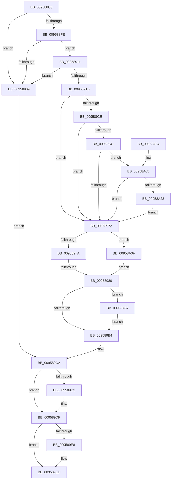

# KseDriverLoadImage

- RVA: `0x009588C0`–`0x00958A72` (길이 `434` bytes)
- VA: `0x00000001409588C0`
- 실행 섹션: `PAGE`
- PDB 이름 있음: `예`; PDB Function 태그: `예`
- unwind 정보 RVA: `0x000926F0`
- 디코드: `113`개 명령, `434/434` bytes 표시
- 미해석 바이트: `0` (있으면 어셈블리에 `.byte`로 보존)

> 이 문서는 커널 이미지의 기계어와 PDB 기호를 분석해 생성했습니다. 4번과 5번은 함수 원형과 자료형을 바이너리 사용 방식에서 추정한 C 해석이며 원본 소스 복구 결과는 아닙니다.

## 1. Dependencies

- 직접 호출 지점: **9**; 고유 호출 대상: **7**
- 직접 호출자로 확인된 함수: **2**
- RIP 상대 이미지 참조: **8**

### Outgoing calls
- `0x00958923` → [KsepStringDuplicateUnicode](KsepStringDuplicateUnicode_function_00958D78.md) (function, `0x00958D78`)
- `0x00958936` → [KsepStringDuplicateUnicode](KsepStringDuplicateUnicode_function_00958D78.md) (function, `0x00958D78`)
- `0x00958963` → [KsepGetShimsForDriver](KsepGetShimsForDriver_function_00958A78.md) (function, `0x00958A78`)
- `0x009589C5` → [KsepLogInfo](../../text/49/KsepLogInfo_function_00499A68.md) (function, `0x00499A68`)
- `0x009589D3` → [KsepPoolFreePaged](../../text/4B/KsepPoolFreePaged_function_004B0E10.md) (function, `0x004B0E10`)
- `0x009589E8` → [KsepPoolFreePaged](../../text/4B/KsepPoolFreePaged_function_004B0E10.md) (function, `0x004B0E10`)
- `0x00958A14` → [KsepApplyShimsToDriver](../74/KsepApplyShimsToDriver_function_00749C84.md) (function, `0x00749C84`)
- `0x00958A35` → [KsepEvntLogShimsApplied](../../text/5C/KsepEvntLogShimsApplied_function_005CBBE4.md) (function, `0x005CBBE4`)
- `0x00958A68` → [KsepDebugPrint](../../text/4D/KsepDebugPrint_function_004DCFF0.md) (function, `0x004DCFF0`)

### Direct callers
- [MmLoadSystemImageEx](../99/MmLoadSystemImageEx_function_00999B8C.md) at `0x0099A06E`
- [IopInitializeBuiltinDriver](../../init/C7/IopInitializeBuiltinDriver_function_00C7625C.md) at `0x00C76618`

### Static image references
- `0x009588FE` → RVA `0x00E66C84` (`.data`; read)
- `0x00958911` → RVA `0x00E66C80` (`.data`; read)
- `0x00958985` → RVA `0x00F105E0` (`.data`; read/write)
- `0x0095898F` → RVA `0x00F103E0` (`.data`; read)
- `0x009589A6` → RVA `0x00E66CE8` (`.data`; read)
- `0x009589B8` → RVA `0x00B00B60` (` ?? ::NNGAKEGL::`string'`; read)
- `0x00958A3F` → RVA `0x00E66C88` (`.data`; read/write)
- `0x00958A4B` → RVA `0x00E66CD8` (`.data`; write)

## 2. Other-region calls and transfers

- 다른 실행 섹션으로 향하는 call: **5**
  - `0x009589C5` → [KsepLogInfo](../../text/49/KsepLogInfo_function_00499A68.md) (`PAGE` → `.text`)
  - `0x009589D3` → [KsepPoolFreePaged](../../text/4B/KsepPoolFreePaged_function_004B0E10.md) (`PAGE` → `.text`)
  - `0x009589E8` → [KsepPoolFreePaged](../../text/4B/KsepPoolFreePaged_function_004B0E10.md) (`PAGE` → `.text`)
  - `0x00958A35` → [KsepEvntLogShimsApplied](../../text/5C/KsepEvntLogShimsApplied_function_005CBBE4.md) (`PAGE` → `.text`)
  - `0x00958A68` → [KsepDebugPrint](../../text/4D/KsepDebugPrint_function_004DCFF0.md) (`PAGE` → `.text`)
- call이 아닌 외부 분기/꼬리 이동: **1**
  - `0x0095897A` → [sub_00B26E86](../B2/Unknown_function_00B26E86.md) (`tail-transfer`)

## 3. Assembly (complete function range)

```asm
009588C0  48 89 5C 24 18                  mov qword ptr [rsp + 0x18], rbx
009588C5  48 89 74 24 20                  mov qword ptr [rsp + 0x20], rsi
009588CA  55                              push rbp
009588CB  57                              push rdi
009588CC  41 56                           push r14
009588CE  48 8B EC                        mov rbp, rsp
009588D1  48 83 EC 50                     sub rsp, 0x50
009588D5  45 33 F6                        xor r14d, r14d
009588D8  48 8B F2                        mov rsi, rdx
009588DB  44 89 75 20                     mov dword ptr [rbp + 0x20], r14d
009588DF  48 8B F9                        mov rdi, rcx
009588E2  4C 89 75 28                     mov qword ptr [rbp + 0x28], r14
009588E6  4C 89 75 E0                     mov qword ptr [rbp - 0x20], r14
009588EA  4C 89 75 E8                     mov qword ptr [rbp - 0x18], r14
009588EE  4C 89 75 F0                     mov qword ptr [rbp - 0x10], r14
009588F2  4C 89 75 F8                     mov qword ptr [rbp - 8], r14
009588F6  44 89 32                        mov dword ptr [rdx], r14d
009588F9  48 85 C9                        test rcx, rcx
009588FC  74 0B                           je 0x140958909
009588FE  8B 05 80 E3 50 00               mov eax, dword ptr [rip + 0x50e380]
00958904  83 F8 02                        cmp eax, 2
00958907  74 08                           je 0x140958911
00958909  41 8B DE                        mov ebx, r14d
0095890C  E9 B9 00 00 00                  jmp 0x1409589ca
00958911  8B 05 69 E3 50 00               mov eax, dword ptr [rip + 0x50e369]
00958917  A8 01                           test al, 1
00958919  75 EE                           jne 0x140958909
0095891B  48 8D 51 58                     lea rdx, [rcx + 0x58]
0095891F  48 8D 4D E0                     lea rcx, [rbp - 0x20]
00958923  E8 50 04 00 00                  call 0x140958d78
00958928  8B D8                           mov ebx, eax
0095892A  85 C0                           test eax, eax
0095892C  78 44                           js 0x140958972
0095892E  48 8D 57 48                     lea rdx, [rdi + 0x48]
00958932  48 8D 4D F0                     lea rcx, [rbp - 0x10]
00958936  E8 3D 04 00 00                  call 0x140958d78
0095893B  8B D8                           mov ebx, eax
0095893D  85 C0                           test eax, eax
0095893F  78 31                           js 0x140958972
00958941  44 8B 4F 40                     mov r9d, dword ptr [rdi + 0x40]
00958945  48 8D 45 20                     lea rax, [rbp + 0x20]
00958949  4C 8B 47 30                     mov r8, qword ptr [rdi + 0x30]
0095894D  48 8D 55 F0                     lea rdx, [rbp - 0x10]
00958951  48 89 44 24 28                  mov qword ptr [rsp + 0x28], rax
00958956  48 8D 4D E0                     lea rcx, [rbp - 0x20]
0095895A  48 8D 45 28                     lea rax, [rbp + 0x28]
0095895E  48 89 44 24 20                  mov qword ptr [rsp + 0x20], rax
00958963  E8 10 01 00 00                  call 0x140958a78
00958968  8B D8                           mov ebx, eax
0095896A  85 C0                           test eax, eax
0095896C  0F 89 93 00 00 00               jns 0x140958a05
00958972  85 DB                           test ebx, ebx
00958974  0F 84 C5 00 00 00               je 0x140958a3f
0095897A  0F 88 06 E5 1C 00               js 0x140b26e86
00958980  B8 01 00 00 00                  mov eax, 1
00958985  F0 0F C1 05 53 7C 5B 00         lock xadd dword ptr [rip + 0x5b7c53], eax
0095898D  FF C0                           inc eax
0095898F  48 8D 0D 4A 7A 5B 00            lea rcx, [rip + 0x5b7a4a]
00958996  83 E0 3F                        and eax, 0x3f
00958999  BF 04 00 00 00                  mov edi, 4
0095899E  48 C7 04 C1 C4 00 07 00         mov qword ptr [rcx + rax*8], 0x700c4
009589A6  8B 05 3C E3 50 00               mov eax, dword ptr [rip + 0x50e33c]
009589AC  A8 01                           test al, 1
009589AE  0F 85 A3 00 00 00               jne 0x140958a57
009589B4  4C 8B 4D E8                     mov r9, qword ptr [rbp - 0x18]
009589B8  48 8D 15 A1 81 1A 00            lea rdx, [rip + 0x1a81a1]
009589BF  44 8B 45 20                     mov r8d, dword ptr [rbp + 0x20]
009589C3  8B CF                           mov ecx, edi
009589C5  E8 9E 10 B4 FF                  call 0x140499a68
009589CA  48 8B 4D E8                     mov rcx, qword ptr [rbp - 0x18]
009589CE  48 85 C9                        test rcx, rcx
009589D1  74 0C                           je 0x1409589df
009589D3  E8 38 84 B5 FF                  call 0x1404b0e10
009589D8  0F 57 C0                        xorps xmm0, xmm0
009589DB  0F 11 45 E0                     movups xmmword ptr [rbp - 0x20], xmm0
009589DF  48 8B 4D F8                     mov rcx, qword ptr [rbp - 8]
009589E3  48 85 C9                        test rcx, rcx
009589E6  74 05                           je 0x1409589ed
009589E8  E8 23 84 B5 FF                  call 0x1404b0e10
009589ED  4C 8D 5C 24 50                  lea r11, [rsp + 0x50]
009589F2  8B C3                           mov eax, ebx
009589F4  49 8B 5B 30                     mov rbx, qword ptr [r11 + 0x30]
009589F8  49 8B 73 38                     mov rsi, qword ptr [r11 + 0x38]
009589FC  49 8B E3                        mov rsp, r11
009589FF  41 5E                           pop r14
00958A01  5F                              pop rdi
00958A02  5D                              pop rbp
00958A03  C3                              ret
00958A04  CC                              int3
00958A05  44 8B 4D 20                     mov r9d, dword ptr [rbp + 0x20]
00958A09  48 8D 55 E0                     lea rdx, [rbp - 0x20]
00958A0D  4C 8B 45 28                     mov r8, qword ptr [rbp + 0x28]
00958A11  48 8B CF                        mov rcx, rdi
00958A14  E8 6B 12 DF FF                  call 0x140749c84
00958A19  8B D8                           mov ebx, eax
00958A1B  85 C0                           test eax, eax
00958A1D  0F 88 4F FF FF FF               js 0x140958972
00958A23  44 8B 45 20                     mov r8d, dword ptr [rbp + 0x20]
00958A27  48 8D 4D E0                     lea rcx, [rbp - 0x20]
00958A2B  48 8B 55 28                     mov rdx, qword ptr [rbp + 0x28]
00958A2F  C7 06 01 00 00 00               mov dword ptr [rsi], 1
00958A35  E8 AA 31 C7 FF                  call 0x1405cbbe4
00958A3A  E9 33 FF FF FF                  jmp 0x140958972
00958A3F  0F BA 2D 41 E2 50 00 0B         bts dword ptr [rip + 0x50e241], 0xb
00958A47  48 8B 47 30                     mov rax, qword ptr [rdi + 0x30]
00958A4B  48 89 05 86 E2 50 00            mov qword ptr [rip + 0x50e286], rax
00958A52  E9 29 FF FF FF                  jmp 0x140958980
00958A57  4C 8B 4D E8                     mov r9, qword ptr [rbp - 0x18]
00958A5B  48 8D 15 FE 80 1A 00            lea rdx, [rip + 0x1a80fe]
00958A62  44 8B 45 20                     mov r8d, dword ptr [rbp + 0x20]
00958A66  8B CF                           mov ecx, edi
00958A68  E8 83 45 B8 FF                  call 0x1404dcff0
00958A6D  E9 42 FF FF FF                  jmp 0x1409589b4
```

## 4. C-style interpretation (structured pseudocode)

```c
__int64 __fastcall KseDriverLoadImage(__int64 a1, __int64 a2)
{
    __int64 result;
    __int64 v_r14;
    __int64 v_rsp;
    unsigned __int64 v_stack_m18;
    unsigned __int64 v_stack_m20;
    unsigned __int64 v_stack_m28;
    unsigned __int64 v_stack_m30;
    unsigned __int64 v_stack_m38;
    unsigned __int64 v_stack_m40;
    unsigned __int64 v_stack_m48;
    unsigned __int64 v_stack_p10;
    unsigned __int64 v_stack_p18;
    unsigned __int64 v_stack_p20;
    unsigned int v_stack_p8;

    v_stack_p18 = v_rbx;
    v_stack_p20 = v_rsi;
    v_rsp = (v_rsp) - (80);
    v_r14 = 0;
    v_stack_p8 = 0;
    v_stack_p10 = 0;
    v_stack_m38 = 0;
    v_stack_m30 = 0;
    v_stack_m28 = 0;
    v_stack_m20 = 0;
    *(unsigned int *)(a2) = 0;
    if (a1 == 0) goto loc_00958909;
    if (((unsigned int)((unsigned int)(*(unsigned int *)(v_rip + 5301120)))) == 2) goto loc_00958911;
loc_00958909:
    goto loc_009589CA;
loc_00958911:
    if ((((unsigned __int8)((unsigned int)(*(unsigned int *)(v_rip + 5301097)))) & (1)) != 0) goto loc_00958909;
    result = KsepStringDuplicateUnicode(v_stack_m38, a1 + 88, a3, a4);
    if (sign_flag) goto loc_00958972;
    result = KsepStringDuplicateUnicode(v_stack_m28, a1 + 72, a3, a4);
    if (sign_flag) goto loc_00958972;
    v_stack_m40 = v_stack_p8;
    v_stack_m48 = v_stack_p10;
    result = KsepGetShimsForDriver(v_stack_m38, v_stack_m28, *(unsigned __int64 *)(a1 + 48), (unsigned int)(*(unsigned int *)(a1 + 64)));
    if (!sign_flag) goto loc_00958A05;
loc_00958972:
    if ((unsigned int)((unsigned int)((unsigned int)(result))) == 0) goto loc_00958A3F;
loc_00958980:
    result = (unsigned int)((1) + 1);
    result = (unsigned int)((result) & (63));
    *(unsigned __int64 *)(v_rip + 5995082 + result * 8) = 0x700C4ULL;
    if ((((unsigned __int8)((unsigned int)(*(unsigned int *)(v_rip + 5301052)))) & (1)) != 0) goto loc_00958A57;
loc_009589B4:
    result = KsepLogInfo(4, v_rip + 1737121, (unsigned int)(v_stack_p8), v_stack_m30);
loc_009589CA:
    if (v_stack_m30 != 0) {
        result = KsepPoolFreePaged(v_stack_m30, v_rip + 1737121, (unsigned int)(v_stack_p8), v_stack_m30);
        v_stack_m38 = v_xmm0;
    }
    if (v_stack_m20 != 0) {
        result = KsepPoolFreePaged(v_stack_m20, v_rip + 1737121, (unsigned int)(v_stack_p8), v_stack_m30);
    }
    return (unsigned int)((unsigned int)((unsigned int)((unsigned int)(result))));
loc_00958A05:
    result = KsepApplyShimsToDriver(4, v_stack_m38, v_stack_p10, (unsigned int)(v_stack_p8));
    if (sign_flag) goto loc_00958972;
    *(unsigned int *)(*(unsigned __int64 *)(v_stack_m18 + 56)) = 1;
    result = KsepEvntLogShimsApplied(v_stack_m38, v_stack_p10, (unsigned int)(v_stack_p8), (unsigned int)(v_stack_p8));
    goto loc_00958972;
loc_00958A3F:
    *(unsigned __int64 *)(v_rip + 5300870) = *(unsigned __int64 *)(4 + 48);
    goto loc_00958980;
loc_00958A57:
    result = KsepDebugPrint(4, v_rip + 1736958, (unsigned int)(v_stack_p8), v_stack_m30);
    goto loc_009589B4;
}
```

## 5. (Beta) C Style

```c
int64_t KseDriverLoadImage(void *Arg1, void *Arg2)
{
    uint8_t *arg1 = (uint8_t *)Arg1;
    uint8_t *arg2 = (uint8_t *)Arg2;

    int64_t result;
    int64_t local_r14;
    int64_t local_rsp;
    uint64_t v_stack_m18;
    uint64_t v_stack_m20;
    uint64_t v_stack_m28;
    uint64_t v_stack_m30;
    uint64_t v_stack_m38;
    uint64_t v_stack_m40;
    uint64_t v_stack_m48;
    uint64_t v_stack_p10;
    uint64_t v_stack_p18;
    uint64_t v_stack_p20;
    uint32_t v_stack_p8;

    v_stack_p18 = local_rbx;
    v_stack_p20 = local_rsi;
    local_rsp = (local_rsp) - (80);
    local_r14 = 0;
    v_stack_p8 = 0;
    v_stack_p10 = 0;
    v_stack_m38 = 0;
    v_stack_m30 = 0;
    v_stack_m28 = 0;
    v_stack_m20 = 0;
    *(uint32_t *)(arg2) = 0;
    if (Arg1 == NULL) goto loc_00958909;
    if (((uint32_t)((uint32_t)(*(uint32_t *)(v_rip + 0x50E380)))) == 2) goto loc_00958911;
loc_00958909:
    goto loc_009589CA;
loc_00958911:
    if ((((uint8_t)((uint32_t)(*(uint32_t *)(v_rip + 0x50E369)))) & (1)) != 0) goto loc_00958909;
    result = KsepStringDuplicateUnicode(v_stack_m38, Arg1 + 88, a3, a4);
    if (sign_flag) goto loc_00958972;
    result = KsepStringDuplicateUnicode(v_stack_m28, Arg1 + 72, a3, a4);
    if (sign_flag) goto loc_00958972;
    v_stack_m40 = v_stack_p8;
    v_stack_m48 = v_stack_p10;
    result = KsepGetShimsForDriver(v_stack_m38, v_stack_m28, *(uint64_t *)(arg1 + 0x30), (uint32_t)(*(uint32_t *)(arg1 + 0x40)));
    if (!sign_flag) goto loc_00958A05;
loc_00958972:
    if ((uint32_t)((uint32_t)((uint32_t)(result))) == 0) goto loc_00958A3F;
loc_00958980:
    result = (uint32_t)((1) + 1);
    result = (uint32_t)((result) & (63));
    *(uint64_t *)(v_rip + 0x5B7A4A + result * 8) = 0x700C4ULL;
    if ((((uint8_t)((uint32_t)(*(uint32_t *)(v_rip + 0x50E33C)))) & (1)) != 0) goto loc_00958A57;
loc_009589B4:
    result = KsepLogInfo(4, v_rip + 1737121, (uint32_t)(v_stack_p8), v_stack_m30);
loc_009589CA:
    if (v_stack_m30 != 0) {
        result = KsepPoolFreePaged(v_stack_m30, v_rip + 1737121, (uint32_t)(v_stack_p8), v_stack_m30);
        v_stack_m38 = v_xmm0;
    }
    if (v_stack_m20 != 0) {
        result = KsepPoolFreePaged(v_stack_m20, v_rip + 1737121, (uint32_t)(v_stack_p8), v_stack_m30);
    }
    return (uint32_t)((uint32_t)((uint32_t)((uint32_t)(result))));
loc_00958A05:
    result = KsepApplyShimsToDriver(4, v_stack_m38, v_stack_p10, (uint32_t)(v_stack_p8));
    if (sign_flag) goto loc_00958972;
    *(uint32_t *)(*(uint64_t *)(v_stack_m18 + 0x38)) = 1;
    result = KsepEvntLogShimsApplied(v_stack_m38, v_stack_p10, (uint32_t)(v_stack_p8), (uint32_t)(v_stack_p8));
    goto loc_00958972;
loc_00958A3F:
    *(uint64_t *)(v_rip + 0x50E286) = *(uint64_t *)(4 + 0x30);
    goto loc_00958980;
loc_00958A57:
    result = KsepDebugPrint(4, v_rip + 1736958, (uint32_t)(v_stack_p8), v_stack_m30);
    goto loc_009589B4;
}
```

### 관측된 메모리 오프셋

구조체 형식이 확인되지 않은 접근은 인자 기준의 오프셋으로만 기록했습니다.

| 기준 인자 | 오프셋 표현 | 폭 (bit) | 접근 |
|---|---:|---:|---|
| `Arg1` | `+ 0x30` | `64` | `R` |
| `Arg1` | `+ 0x40` | `32` | `R` |
| `Arg1` | `+ 0x48` | `64` | `R` |
| `Arg2` | `+ 0x0` | `32` | `W` |

## 6. Execution-region graph

[열기: 2D/3D 그래프와 함수 탐색 컨트롤 패널](../../../control-panel.html?section=page&rva=0x009588C0&view=graph)

- 2D 그래프는 위에서 아래로 흐르고, 3D 그래프는 빈 공간을 드래그해 회전합니다. Shift+드래그는 이동, 휠은 확대·축소, 함수 노드 선택은 대상 보고서 이동입니다.

### Static fallback


