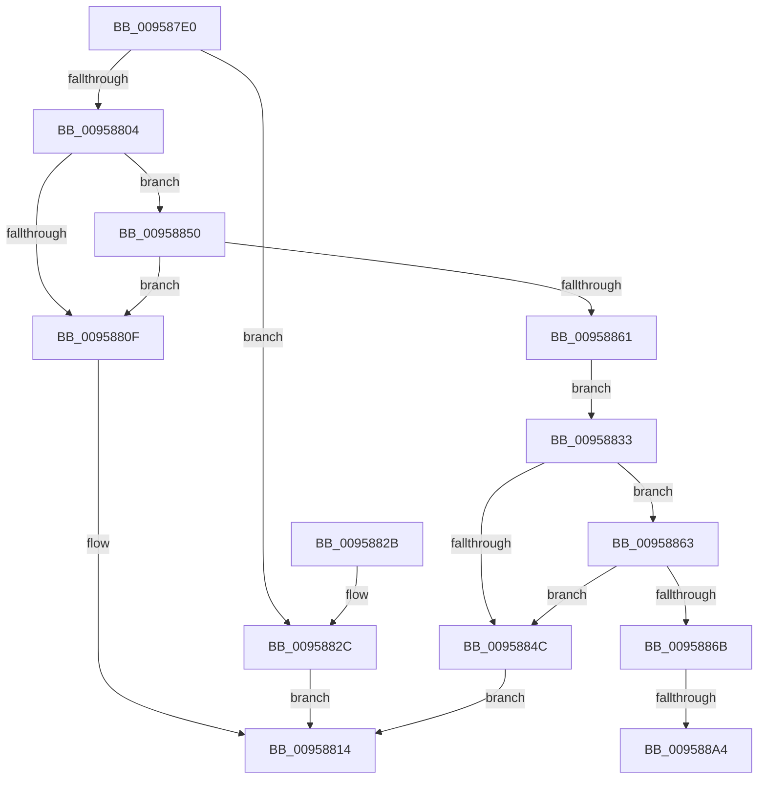

# KseDriverUnloadImage

- RVA: `0x009587E0`–`0x009588B8` (길이 `216` bytes)
- VA: `0x00000001409587E0`
- 실행 섹션: `PAGE`
- PDB 이름 있음: `예`; PDB Function 태그: `예`
- unwind 정보 RVA: `0x000926C4`
- 디코드: `61`개 명령, `216/216` bytes 표시
- 미해석 바이트: `0` (있으면 어셈블리에 `.byte`로 보존)

> 이 문서는 커널 이미지의 기계어와 PDB 기호를 분석해 생성했습니다. 4번과 5번은 함수 원형과 자료형을 바이너리 사용 방식에서 추정한 C 해석이며 원본 소스 복구 결과는 아닙니다.

## 1. Dependencies

- 직접 호출 지점: **3**; 고유 호출 대상: **3**
- 직접 호출자로 확인된 함수: **1**
- RIP 상대 이미지 참조: **3**

### Outgoing calls
- `0x00958843` → [KsepIsModuleShimmed](KsepIsModuleShimmed_function_00958F70.md) (function, `0x00958F70`)
- `0x0095888F` → [KeAbPreAcquire](../../text/21/KeAbPreAcquire_function_00210230.md) (function, `0x00210230`)
- `0x009588AD` → [ExfAcquirePushLockExclusiveEx](../../text/20/ExfAcquirePushLockExclusiveEx_function_0020FC90.md) (function, `0x0020FC90`)

### Direct callers
- [MiUnloadSystemImage](../AA/MiUnloadSystemImage_function_00AA2FD4.md) at `0x00AA31AD`

### Static image references
- `0x00958804` → RVA `0x00E66C84` (`.data`; read)
- `0x0095883C` → RVA `0x00E66C80` (`.data`; read)
- `0x00958874` → RVA `0x00E66CB0` (`.data`; read)

## 2. Other-region calls and transfers

- 다른 실행 섹션으로 향하는 call: **2**
  - `0x0095888F` → [KeAbPreAcquire](../../text/21/KeAbPreAcquire_function_00210230.md) (`PAGE` → `.text`)
  - `0x009588AD` → [ExfAcquirePushLockExclusiveEx](../../text/20/ExfAcquirePushLockExclusiveEx_function_0020FC90.md) (`PAGE` → `.text`)
- call이 아닌 외부 분기/꼬리 이동: **2**
  - `0x0095889E` → [sub_00B26BF6](../B2/Unknown_function_00B26BF6.md) (`tail-transfer`)
  - `0x009588B3` → [sub_00B26BF6](../B2/Unknown_function_00B26BF6.md) (`tail-transfer`)

## 3. Assembly (complete function range)

```asm
009587E0  48 89 5C 24 10                  mov qword ptr [rsp + 0x10], rbx
009587E5  48 89 6C 24 18                  mov qword ptr [rsp + 0x18], rbp
009587EA  56                              push rsi
009587EB  57                              push rdi
009587EC  41 54                           push r12
009587EE  41 55                           push r13
009587F0  41 56                           push r14
009587F2  48 83 EC 20                     sub rsp, 0x20
009587F6  48 83 64 24 50 00               and qword ptr [rsp + 0x50], 0
009587FC  48 8B E9                        mov rbp, rcx
009587FF  48 85 C9                        test rcx, rcx
00958802  74 28                           je 0x14095882c
00958804  8B 05 7A E4 50 00               mov eax, dword ptr [rip + 0x50e47a]
0095880A  83 F8 02                        cmp eax, 2
0095880D  74 41                           je 0x140958850
0095880F  B8 BB 00 00 C0                  mov eax, 0xc00000bb
00958814  48 8B 5C 24 58                  mov rbx, qword ptr [rsp + 0x58]
00958819  48 8B 6C 24 60                  mov rbp, qword ptr [rsp + 0x60]
0095881E  48 83 C4 20                     add rsp, 0x20
00958822  41 5E                           pop r14
00958824  41 5D                           pop r13
00958826  41 5C                           pop r12
00958828  5F                              pop rdi
00958829  5E                              pop rsi
0095882A  C3                              ret
0095882B  CC                              int3
0095882C  B8 0D 00 00 C0                  mov eax, 0xc000000d
00958831  EB E1                           jmp 0x140958814
00958833  48 8B 51 30                     mov rdx, qword ptr [rcx + 0x30]
00958837  4C 8D 44 24 50                  lea r8, [rsp + 0x50]
0095883C  48 8D 0D 3D E4 50 00            lea rcx, [rip + 0x50e43d]
00958843  E8 28 07 00 00                  call 0x140958f70
00958848  85 C0                           test eax, eax
0095884A  75 17                           jne 0x140958863
0095884C  33 C0                           xor eax, eax
0095884E  EB C4                           jmp 0x140958814
00958850  8B 05 2A E4 50 00               mov eax, dword ptr [rip + 0x50e42a]
00958856  41 BC 01 00 00 00               mov r12d, 1
0095885C  41 84 C4                        test r12b, al
0095885F  75 AE                           jne 0x14095880f
00958861  EB D0                           jmp 0x140958833
00958863  48 83 7C 24 50 00               cmp qword ptr [rsp + 0x50], 0
00958869  74 E1                           je 0x14095884c
0095886B  65 48 8B 04 25 88 01 00 00      mov rax, qword ptr gs:[0x188]
00958874  4C 8D 2D 35 E4 50 00            lea r13, [rip + 0x50e435]
0095887B  48 83 CB FF                     or rbx, 0xffffffffffffffff
0095887F  45 33 C0                        xor r8d, r8d
00958882  33 D2                           xor edx, edx
00958884  49 8B CD                        mov rcx, r13
00958887  66 01 98 E4 01 00 00            add word ptr [rax + 0x1e4], bx
0095888E  90                              nop
0095888F  E8 9C 79 8B FF                  call 0x140210230
00958894  F0 49 0F BA 6D 00 00            lock bts qword ptr [r13], 0
0095889B  48 8B F8                        mov rdi, rax
0095889E  0F 83 52 E3 1C 00               jae 0x140b26bf6
009588A4  4D 8B C5                        mov r8, r13
009588A7  48 8B D0                        mov rdx, rax
009588AA  49 8B CD                        mov rcx, r13
009588AD  E8 DE 73 8B FF                  call 0x14020fc90
009588B2  90                              nop
009588B3  E9 3E E3 1C 00                  jmp 0x140b26bf6
```

## 4. C-style interpretation (structured pseudocode)

```c
__int64 __fastcall KseDriverUnloadImage(__int64 a1)
{
    __int64 result;
    __int64 v_rbx;
    __int64 v_rsp;
    unsigned __int64 v_stack_p10;
    unsigned __int64 v_stack_p18;
    unsigned __int64 v_stack_p50;
    unsigned __int64 v_stack_p8;

    v_stack_p10 = v_rbx;
    v_stack_p18 = v_rbp;
    v_rsp = (v_rsp) - (32);
    if (a1 == 0) goto loc_0095882C;
    if (((unsigned int)((unsigned int)(*(unsigned int *)(v_rip + 5301370)))) == 2) goto loc_00958850;
loc_0095880F:
loc_00958814:
    v_rsp = (v_rsp) + (32);
    return (unsigned int)(0xC00000BBULL);
loc_0095882C:
    goto loc_00958814;
loc_00958833:
    result = KsepIsModuleShimmed(v_rip + 5301309, *(unsigned __int64 *)(a1 + 48), v_stack_p50, a4);
    if ((unsigned int)(result) != 0) goto loc_00958863;
loc_0095884C:
    result = 0;
    goto loc_00958814;
loc_00958850:
    if (((1) & ((unsigned __int8)((unsigned int)(*(unsigned int *)(v_rip + 5301290))))) != 0) goto loc_0095880F;
    goto loc_00958833;
loc_00958863:
    if (v_stack_p50 == 0) goto loc_0095884C;
    v_rbx = (v_stack_p10) | (-1);
    a3 = 0;
    a2 = 0;
    result = KeAbPreAcquire(v_rip + 5301301, a2, a3, a4);
    result = ExfAcquirePushLockExclusiveEx(v_rip + 5301301, result, v_rip + 5301301, a4);
}
```

## 5. (Beta) C Style

```c
int64_t KseDriverUnloadImage(int64_t Arg1)
{
    int64_t result;
    int64_t local_rbx;
    int64_t local_rsp;
    uint64_t v_stack_p10;
    uint64_t v_stack_p18;
    uint64_t v_stack_p50;
    uint64_t v_stack_p8;

    v_stack_p10 = local_rbx;
    v_stack_p18 = local_rbp;
    local_rsp = (local_rsp) - (32);
    if (Arg1 == 0) goto loc_0095882C;
    if (((uint32_t)((uint32_t)(*(uint32_t *)(v_rip + 0x50E47A)))) == 2) goto loc_00958850;
loc_0095880F:
loc_00958814:
    local_rsp = (local_rsp) + (32);
    return (uint32_t)(0xC00000BBULL);
loc_0095882C:
    goto loc_00958814;
loc_00958833:
    result = KsepIsModuleShimmed(v_rip + 5301309, *(uint64_t *)(Arg1 + 0x30), v_stack_p50, a4);
    if ((uint32_t)(result) != 0) goto loc_00958863;
loc_0095884C:
    result = 0;
    goto loc_00958814;
loc_00958850:
    if (((1) & ((uint8_t)((uint32_t)(*(uint32_t *)(v_rip + 0x50E42A))))) != 0) goto loc_0095880F;
    goto loc_00958833;
loc_00958863:
    if (v_stack_p50 == 0) goto loc_0095884C;
    local_rbx = (v_stack_p10) | (-1);
    a3 = 0;
    a2 = 0;
    result = KeAbPreAcquire(v_rip + 5301301, a2, a3, a4);
    result = ExfAcquirePushLockExclusiveEx(v_rip + 5301301, result, v_rip + 5301301, a4);
}
```

## 6. Execution-region graph

[열기: 2D/3D 그래프와 함수 탐색 컨트롤 패널](../../../control-panel.html?section=page&rva=0x009587E0&view=graph)

- 2D 그래프는 위에서 아래로 흐르고, 3D 그래프는 빈 공간을 드래그해 회전합니다. Shift+드래그는 이동, 휠은 확대·축소, 함수 노드 선택은 대상 보고서 이동입니다.

### Static fallback


