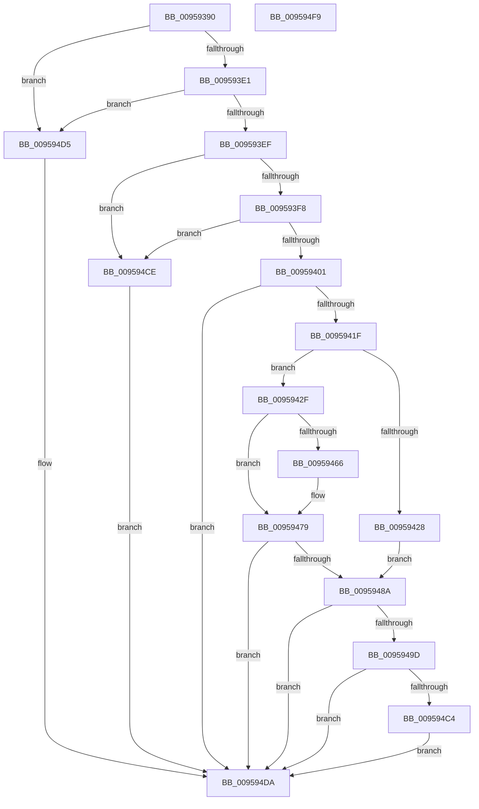

# KseQueryDeviceDataList

- RVA: `0x00959390`–`0x009594FA` (길이 `362` bytes)
- VA: `0x0000000140959390`
- 실행 섹션: `PAGE`
- PDB 이름 있음: `예`; PDB Function 태그: `아니요`
- unwind 정보 RVA: `0x0008A26C`
- 디코드: `99`개 명령, `362/362` bytes 표시
- 미해석 바이트: `0` (있으면 어셈블리에 `.byte`로 보존)

> 이 문서는 커널 이미지의 기계어와 PDB 기호를 분석해 생성했습니다. 4번과 5번은 함수 원형과 자료형을 바이너리 사용 방식에서 추정한 C 해석이며 원본 소스 복구 결과는 아닙니다.

## 1. Dependencies

- 직접 호출 지점: **13**; 고유 호출 대상: **12**
- 직접 호출자로 확인된 함수: **1**
- RIP 상대 이미지 참조: **3**

### Outgoing calls
- `0x009593C7` → [memset](../../text/6C/memset_function_006C6C40.md) (function, `0x006C6C40`)
- `0x0095940D` → [KsepDbQueryRegistryDeviceDataList](../74/KsepDbQueryRegistryDeviceDataList_function_007490B4.md) (function, `0x007490B4`)
- `0x0095941F` → [KsepShimDbChanged](../../text/4B/KsepShimDbChanged_function_004B014C.md) (function, `0x004B014C`)
- `0x00959428` → [KseResetDeviceCache](KseResetDeviceCache_function_00959CDC.md) (function, `0x00959CDC`)
- `0x00959437` → [RtlInitUnicodeString](../../text/42/RtlInitUnicodeString_function_0042A780.md) (function, `0x0042A780`)
- `0x00959443` → [CmpLockSiloKeyLockTrackerExclusive](../8F/CmpLockSiloKeyLockTrackerExclusive_function_008F9EF8.md) (function, `0x008F9EF8`)
- `0x00959454` → [KsepCacheLookup](KsepCacheLookup_function_00959DE8.md) (function, `0x00959DE8`)
- `0x00959472` → [KsepDbCacheQueryDeviceDataList](../74/KsepDbCacheQueryDeviceDataList_function_00748DB4.md) (function, `0x00748DB4`)
- `0x00959480` → [KsepCacheUnlock](KsepCacheUnlock_function_00959ECC.md) (function, `0x00959ECC`)
- `0x00959492` → [KsepDbCacheReadDevice](KsepDbCacheReadDevice_function_0095AAC8.md) (function, `0x0095AAC8`)
- `0x009594AE` → [KsepDbCacheQueryDeviceDataList](../74/KsepDbCacheQueryDeviceDataList_function_00748DB4.md) (function, `0x00748DB4`)
- `0x009594BB` → [KsepDbCacheInsertDevice](../74/KsepDbCacheInsertDevice_function_00748C64.md) (function, `0x00748C64`)
- `0x009594C7` → [KsepCacheDeviceFree](KsepCacheDeviceFree_function_0095AD00.md) (function, `0x0095AD00`)

### Direct callers
- [ExpGetDeviceDataInformation](ExpGetDeviceDataInformation_function_0095A300.md) at `0x0095A4DA`

### Static image references
- `0x009593D2` → RVA `0x00E66C84` (`.data`; read)
- `0x009593E1` → RVA `0x00E66C80` (`.data`; read)
- `0x0095943C` → RVA `0x00E66CC8` (`.data`; read)

## 2. Other-region calls and transfers

- 다른 실행 섹션으로 향하는 call: **3**
  - `0x009593C7` → [memset](../../text/6C/memset_function_006C6C40.md) (`PAGE` → `.text`)
  - `0x0095941F` → [KsepShimDbChanged](../../text/4B/KsepShimDbChanged_function_004B014C.md) (`PAGE` → `.text`)
  - `0x00959437` → [RtlInitUnicodeString](../../text/42/RtlInitUnicodeString_function_0042A780.md) (`PAGE` → `.text`)
- 별도 외부 분기/꼬리 이동을 확인하지 못했습니다.

## 3. Assembly (complete function range)

```asm
00959390  4C 8B DC                        mov r11, rsp
00959393  49 89 5B 08                     mov qword ptr [r11 + 8], rbx
00959397  49 89 6B 10                     mov qword ptr [r11 + 0x10], rbp
0095939B  49 89 73 18                     mov qword ptr [r11 + 0x18], rsi
0095939F  57                              push rdi
009593A0  41 56                           push r14
009593A2  41 57                           push r15
009593A4  48 81 EC 80 00 00 00            sub rsp, 0x80
009593AB  33 C0                           xor eax, eax
009593AD  45 8B F0                        mov r14d, r8d
009593B0  4C 8B FA                        mov r15, rdx
009593B3  89 44 24 34                     mov dword ptr [rsp + 0x34], eax
009593B7  48 8B F9                        mov rdi, rcx
009593BA  33 D2                           xor edx, edx
009593BC  49 8D 4B 98                     lea rcx, [r11 - 0x68]
009593C0  49 8B E9                        mov rbp, r9
009593C3  44 8D 40 44                     lea r8d, [rax + 0x44]
009593C7  E8 74 D8 D6 FF                  call 0x1406c6c40
009593CC  48 83 64 24 20 00               and qword ptr [rsp + 0x20], 0
009593D2  8B 05 AC D8 50 00               mov eax, dword ptr [rip + 0x50d8ac]
009593D8  83 F8 02                        cmp eax, 2
009593DB  0F 85 F4 00 00 00               jne 0x1409594d5
009593E1  8B 05 99 D8 50 00               mov eax, dword ptr [rip + 0x50d899]
009593E7  A8 02                           test al, 2
009593E9  0F 85 E6 00 00 00               jne 0x1409594d5
009593EF  48 85 FF                        test rdi, rdi
009593F2  0F 84 D6 00 00 00               je 0x1409594ce
009593F8  48 85 ED                        test rbp, rbp
009593FB  0F 84 CD 00 00 00               je 0x1409594ce
00959401  4C 8B CD                        mov r9, rbp
00959404  45 8B C6                        mov r8d, r14d
00959407  49 8B D7                        mov rdx, r15
0095940A  48 8B CF                        mov rcx, rdi
0095940D  E8 A2 FC DE FF                  call 0x1407490b4
00959412  8B D8                           mov ebx, eax
00959414  3D 25 02 00 C0                  cmp eax, 0xc0000225
00959419  0F 85 BB 00 00 00               jne 0x1409594da
0095941F  E8 28 6D B5 FF                  call 0x1404b014c
00959424  85 C0                           test eax, eax
00959426  74 07                           je 0x14095942f
00959428  E8 AF 08 00 00                  call 0x140959cdc
0095942D  EB 5B                           jmp 0x14095948a
0095942F  48 8B D7                        mov rdx, rdi
00959432  48 8D 4C 24 58                  lea rcx, [rsp + 0x58]
00959437  E8 44 13 AD FF                  call 0x14042a780
0095943C  48 8B 0D 85 D8 50 00            mov rcx, qword ptr [rip + 0x50d885]
00959443  E8 B0 0A FA FF                  call 0x1408f9ef8
00959448  48 8B 0D 79 D8 50 00            mov rcx, qword ptr [rip + 0x50d879]
0095944F  48 8D 54 24 30                  lea rdx, [rsp + 0x30]
00959454  E8 8F 09 00 00                  call 0x140959de8
00959459  48 89 44 24 20                  mov qword ptr [rsp + 0x20], rax
0095945E  48 8B F0                        mov rsi, rax
00959461  48 85 C0                        test rax, rax
00959464  74 13                           je 0x140959479
00959466  4C 8B CD                        mov r9, rbp
00959469  45 8B C6                        mov r8d, r14d
0095946C  49 8B D7                        mov rdx, r15
0095946F  48 8B C8                        mov rcx, rax
00959472  E8 3D F9 DE FF                  call 0x140748db4
00959477  8B D8                           mov ebx, eax
00959479  48 8B 0D 48 D8 50 00            mov rcx, qword ptr [rip + 0x50d848]
00959480  E8 47 0A 00 00                  call 0x140959ecc
00959485  48 85 F6                        test rsi, rsi
00959488  75 50                           jne 0x1409594da
0095948A  48 8D 54 24 20                  lea rdx, [rsp + 0x20]
0095948F  48 8B CF                        mov rcx, rdi
00959492  E8 31 16 00 00                  call 0x14095aac8
00959497  8B D8                           mov ebx, eax
00959499  85 C0                           test eax, eax
0095949B  78 3D                           js 0x1409594da
0095949D  48 8B 74 24 20                  mov rsi, qword ptr [rsp + 0x20]
009594A2  4C 8B CD                        mov r9, rbp
009594A5  48 8B CE                        mov rcx, rsi
009594A8  45 8B C6                        mov r8d, r14d
009594AB  49 8B D7                        mov rdx, r15
009594AE  E8 01 F9 DE FF                  call 0x140748db4
009594B3  48 8B D6                        mov rdx, rsi
009594B6  48 8B CF                        mov rcx, rdi
009594B9  8B D8                           mov ebx, eax
009594BB  E8 A4 F7 DE FF                  call 0x140748c64
009594C0  85 C0                           test eax, eax
009594C2  79 16                           jns 0x1409594da
009594C4  48 8B CE                        mov rcx, rsi
009594C7  E8 34 18 00 00                  call 0x14095ad00
009594CC  EB 0C                           jmp 0x1409594da
009594CE  BB 0D 00 00 C0                  mov ebx, 0xc000000d
009594D3  EB 05                           jmp 0x1409594da
009594D5  BB 25 02 00 C0                  mov ebx, 0xc0000225
009594DA  4C 8D 9C 24 80 00 00 00         lea r11, [rsp + 0x80]
009594E2  8B C3                           mov eax, ebx
009594E4  49 8B 5B 20                     mov rbx, qword ptr [r11 + 0x20]
009594E8  49 8B 6B 28                     mov rbp, qword ptr [r11 + 0x28]
009594EC  49 8B 73 30                     mov rsi, qword ptr [r11 + 0x30]
009594F0  49 8B E3                        mov rsp, r11
009594F3  41 5F                           pop r15
009594F5  41 5E                           pop r14
009594F7  5F                              pop rdi
009594F8  C3                              ret
009594F9  CC                              int3
```

## 4. C-style interpretation (structured pseudocode)

```c
__int64 __fastcall KseQueryDeviceDataList(__int64 a1, __int64 a2, int a3, __int64 a4)
{
    __int64 result;
    __int64 v_rbx;
    __int64 v_rsp;
    unsigned __int64 v_stack_m18;
    unsigned __int64 v_stack_m40;
    unsigned int v_stack_m64;
    unsigned __int64 v_stack_m68;
    unsigned __int64 v_stack_m78;

    *(unsigned __int64 *)(v_rsp + 8) = v_rbx;
    *(unsigned __int64 *)(v_rsp + 16) = v_rbp;
    *(unsigned __int64 *)(v_rsp + 24) = v_rsi;
    v_rsp = (v_rsp) - (128);
    result = 0;
    v_stack_m64 = 0;
    a2 = 0;
    result = memset(v_rsp - 104, a2, result + 68, a4);
    if (((unsigned int)((unsigned int)(*(unsigned int *)(v_rip + 5298348)))) != 2) goto loc_009594D5;
    if ((((unsigned __int8)((unsigned int)(*(unsigned int *)(v_rip + 5298329)))) & (2)) != 0) goto loc_009594D5;
    if (a1 == 0) goto loc_009594CE;
    if (a4 == 0) goto loc_009594CE;
    result = KsepDbQueryRegistryDeviceDataList(a1, 0, (unsigned int)((unsigned int)((unsigned int)(a3))), a4);
    if (((unsigned int)(result)) != 0xC0000225ULL) goto loc_009594DA;
    result = KsepShimDbChanged(a1, 0, (unsigned int)((unsigned int)((unsigned int)(a3))), a4);
    if ((unsigned int)(result) == 0) goto loc_0095942F;
    result = KseResetDeviceCache(a1, 0, (unsigned int)((unsigned int)((unsigned int)(a3))), a4);
    goto loc_0095948A;
loc_0095942F:
    result = RtlInitUnicodeString(v_stack_m40, a1, (unsigned int)((unsigned int)((unsigned int)(a3))), a4);
    result = CmpLockSiloKeyLockTrackerExclusive(*(unsigned __int64 *)(v_rip + 5298309), a1, (unsigned int)((unsigned int)((unsigned int)(a3))), a4);
    result = KsepCacheLookup(*(unsigned __int64 *)(v_rip + 5298297), v_stack_m68, (unsigned int)((unsigned int)((unsigned int)(a3))), a4);
    v_stack_m78 = result;
    v_rbx = (unsigned int)((unsigned int)(result));
    if (result != 0) {
        a4 = a4;
        a3 = (unsigned int)((unsigned int)(a3));
        a2 = 0;
        a1 = result;
        result = KsepDbCacheQueryDeviceDataList(a1, a2, a3, a4);
        v_rbx = (unsigned int)(result);
    }
    result = KsepCacheUnlock(*(unsigned __int64 *)(v_rip + 5298248), a2, a3, a4);
    if (result != 0) goto loc_009594DA;
loc_0095948A:
    result = KsepDbCacheReadDevice(a1, v_stack_m78, a3, a4);
    if (sign_flag) goto loc_009594DA;
    result = KsepDbCacheQueryDeviceDataList(v_stack_m78, a2, (unsigned int)((unsigned int)((unsigned int)(a3))), a4);
    result = KsepDbCacheInsertDevice(a1, v_stack_m78, (unsigned int)((unsigned int)((unsigned int)(a3))), a4);
    if (!sign_flag) goto loc_009594DA;
    result = KsepCacheDeviceFree(v_stack_m78, v_stack_m78, (unsigned int)((unsigned int)((unsigned int)(a3))), a4);
    goto loc_009594DA;
loc_009594CE:
    goto loc_009594DA;
loc_009594D5:
loc_009594DA:
    return (unsigned int)((unsigned int)((unsigned int)(0xC0000225ULL)));
}
```

## 5. (Beta) C Style

```c
int64_t KseQueryDeviceDataList(int64_t Arg1, int64_t Arg2, int32_t Arg3, int64_t Arg4)
{
    int64_t result;
    int64_t local_rbx;
    int64_t local_rsp;
    uint64_t v_stack_m18;
    uint64_t v_stack_m40;
    uint32_t v_stack_m64;
    uint64_t v_stack_m68;
    uint64_t v_stack_m78;

    *(uint64_t *)(local_rsp + 0x8) = local_rbx;
    *(uint64_t *)(local_rsp + 0x10) = local_rbp;
    *(uint64_t *)(local_rsp + 0x18) = local_rsi;
    local_rsp = (local_rsp) - (128);
    result = 0;
    v_stack_m64 = 0;
    Arg2 = 0;
    result = memset(local_rsp - 104, Arg2, result + 68, Arg4);
    if (((uint32_t)((uint32_t)(*(uint32_t *)(v_rip + 0x50D8AC)))) != 2) goto loc_009594D5;
    if ((((uint8_t)((uint32_t)(*(uint32_t *)(v_rip + 0x50D899)))) & (2)) != 0) goto loc_009594D5;
    if (Arg1 == 0) goto loc_009594CE;
    if (Arg4 == 0) goto loc_009594CE;
    result = KsepDbQueryRegistryDeviceDataList(Arg1, 0, (uint32_t)((uint32_t)((uint32_t)(Arg3))), Arg4);
    if (((uint32_t)(result)) != 0xC0000225ULL) goto loc_009594DA;
    result = KsepShimDbChanged(Arg1, 0, (uint32_t)((uint32_t)((uint32_t)(Arg3))), Arg4);
    if ((uint32_t)(result) == 0) goto loc_0095942F;
    result = KseResetDeviceCache(Arg1, 0, (uint32_t)((uint32_t)((uint32_t)(Arg3))), Arg4);
    goto loc_0095948A;
loc_0095942F:
    result = RtlInitUnicodeString(v_stack_m40, Arg1, (uint32_t)((uint32_t)((uint32_t)(Arg3))), Arg4);
    result = CmpLockSiloKeyLockTrackerExclusive(*(uint64_t *)(v_rip + 0x50D885), Arg1, (uint32_t)((uint32_t)((uint32_t)(Arg3))), Arg4);
    result = KsepCacheLookup(*(uint64_t *)(v_rip + 0x50D879), v_stack_m68, (uint32_t)((uint32_t)((uint32_t)(Arg3))), Arg4);
    v_stack_m78 = result;
    local_rbx = (uint32_t)((uint32_t)(result));
    if (result != 0) {
        Arg4 = Arg4;
        Arg3 = (uint32_t)((uint32_t)(Arg3));
        Arg2 = 0;
        Arg1 = result;
        result = KsepDbCacheQueryDeviceDataList(Arg1, Arg2, Arg3, Arg4);
        local_rbx = (uint32_t)(result);
    }
    result = KsepCacheUnlock(*(uint64_t *)(v_rip + 0x50D848), Arg2, Arg3, Arg4);
    if (result != 0) goto loc_009594DA;
loc_0095948A:
    result = KsepDbCacheReadDevice(Arg1, v_stack_m78, Arg3, Arg4);
    if (sign_flag) goto loc_009594DA;
    result = KsepDbCacheQueryDeviceDataList(v_stack_m78, Arg2, (uint32_t)((uint32_t)((uint32_t)(Arg3))), Arg4);
    result = KsepDbCacheInsertDevice(Arg1, v_stack_m78, (uint32_t)((uint32_t)((uint32_t)(Arg3))), Arg4);
    if (!sign_flag) goto loc_009594DA;
    result = KsepCacheDeviceFree(v_stack_m78, v_stack_m78, (uint32_t)((uint32_t)((uint32_t)(Arg3))), Arg4);
    goto loc_009594DA;
loc_009594CE:
    goto loc_009594DA;
loc_009594D5:
loc_009594DA:
    return (uint32_t)((uint32_t)((uint32_t)(0xC0000225ULL)));
}
```

## 6. Execution-region graph

[열기: 2D/3D 그래프와 함수 탐색 컨트롤 패널](../../../control-panel.html?section=page&rva=0x00959390&view=graph)

- 2D 그래프는 위에서 아래로 흐르고, 3D 그래프는 빈 공간을 드래그해 회전합니다. Shift+드래그는 이동, 휠은 확대·축소, 함수 노드 선택은 대상 보고서 이동입니다.

### Static fallback


