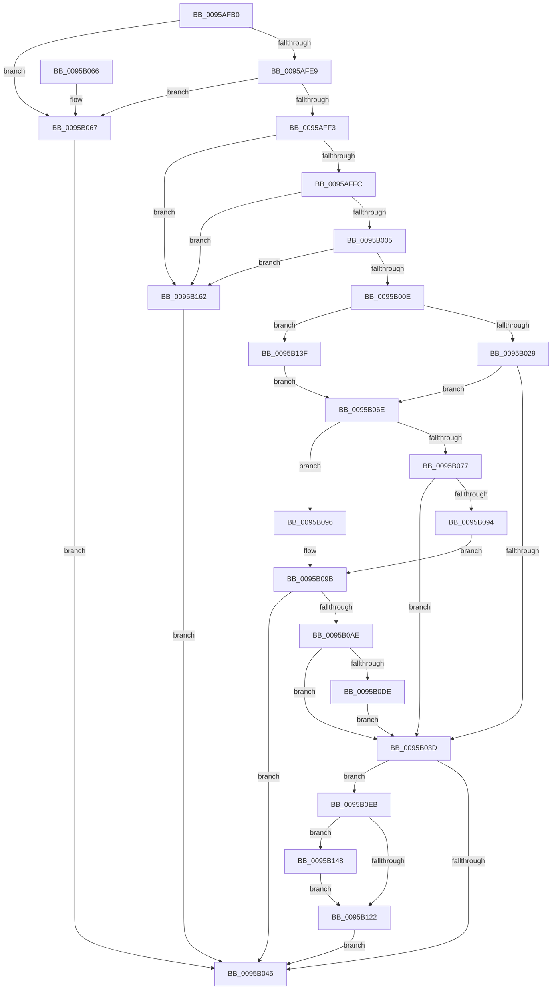

# KseQueryDeviceData

- RVA: `0x0095AFB0`–`0x0095B16C` (길이 `444` bytes)
- VA: `0x000000014095AFB0`
- 실행 섹션: `PAGE`
- PDB 이름 있음: `예`; PDB Function 태그: `아니요`
- unwind 정보 RVA: `0x00092AAC`
- 디코드: `117`개 명령, `444/444` bytes 표시
- 미해석 바이트: `0` (있으면 어셈블리에 `.byte`로 보존)

> 이 문서는 커널 이미지의 기계어와 PDB 기호를 분석해 생성했습니다. 4번과 5번은 함수 원형과 자료형을 바이너리 사용 방식에서 추정한 C 해석이며 원본 소스 복구 결과는 아닙니다.

## 1. Dependencies

- 직접 호출 지점: **10**; 고유 호출 대상: **10**
- 직접 호출자로 확인된 함수: **2**
- RIP 상대 이미지 참조: **6**

### Outgoing calls
- `0x0095B031` → [KsepDbQueryRegistryDeviceData](KsepDbQueryRegistryDeviceData_function_0095B174.md) (function, `0x0095B174`)
- `0x0095B06E` → [KsepShimDbChanged](../../text/4B/KsepShimDbChanged_function_004B014C.md) (function, `0x004B014C`)
- `0x0095B088` → [KsepDbCacheQueryDevice](KsepDbCacheQueryDevice_function_00959D20.md) (function, `0x00959D20`)
- `0x0095B096` → [KseResetDeviceCache](KseResetDeviceCache_function_00959CDC.md) (function, `0x00959CDC`)
- `0x0095B0A3` → [KsepDbCacheReadDevice](KsepDbCacheReadDevice_function_0095AAC8.md) (function, `0x0095AAC8`)
- `0x0095B0C4` → [KsepDbCacheQueryDeviceData](../74/KsepDbCacheQueryDeviceData_function_00748CFC.md) (function, `0x00748CFC`)
- `0x0095B0D1` → [KsepDbCacheInsertDevice](../74/KsepDbCacheInsertDevice_function_00748C64.md) (function, `0x00748C64`)
- `0x0095B0E1` → [KsepCacheDeviceFree](KsepCacheDeviceFree_function_0095AD00.md) (function, `0x0095AD00`)
- `0x0095B135` → [KsepLogInfo](../../text/49/KsepLogInfo_function_00499A68.md) (function, `0x00499A68`)
- `0x0095B15B` → [KsepDebugPrint](../../text/4D/KsepDebugPrint_function_004DCFF0.md) (function, `0x004DCFF0`)

### Direct callers
- [ExpGetDeviceDataInformation](ExpGetDeviceDataInformation_function_0095A300.md) at `0x0095A46D`
- [KseQueryDeviceFlags](KseQueryDeviceFlags_function_0095AF00.md) at `0x0095AF6F`

### Static image references
- `0x0095AFD5` → RVA `0x00E66C84` (`.data`; read)
- `0x0095AFE9` → RVA `0x00E66C80` (`.data`; read)
- `0x0095B0F8` → RVA `0x00F105E0` (`.data`; read/write)
- `0x0095B102` → RVA `0x00F103E0` (`.data`; read)
- `0x0095B118` → RVA `0x00E66CE8` (`.data`; read)
- `0x0095B12C` → RVA `0x00B00800` (` ?? ::NNGAKEGL::`string'`; read)

## 2. Other-region calls and transfers

- 다른 실행 섹션으로 향하는 call: **3**
  - `0x0095B06E` → [KsepShimDbChanged](../../text/4B/KsepShimDbChanged_function_004B014C.md) (`PAGE` → `.text`)
  - `0x0095B135` → [KsepLogInfo](../../text/49/KsepLogInfo_function_00499A68.md) (`PAGE` → `.text`)
  - `0x0095B15B` → [KsepDebugPrint](../../text/4D/KsepDebugPrint_function_004DCFF0.md) (`PAGE` → `.text`)
- 별도 외부 분기/꼬리 이동을 확인하지 못했습니다.

## 3. Assembly (complete function range)

```asm
0095AFB0  4C 8B DC                        mov r11, rsp
0095AFB3  49 89 5B 08                     mov qword ptr [r11 + 8], rbx
0095AFB7  49 89 6B 10                     mov qword ptr [r11 + 0x10], rbp
0095AFBB  49 89 73 18                     mov qword ptr [r11 + 0x18], rsi
0095AFBF  49 89 7B 20                     mov qword ptr [r11 + 0x20], rdi
0095AFC3  41 54                           push r12
0095AFC5  41 56                           push r14
0095AFC7  41 57                           push r15
0095AFC9  48 83 EC 40                     sub rsp, 0x40
0095AFCD  49 83 63 D8 00                  and qword ptr [r11 - 0x28], 0
0095AFD2  4D 8B F9                        mov r15, r9
0095AFD5  8B 05 A9 BC 50 00               mov eax, dword ptr [rip + 0x50bca9]
0095AFDB  49 8B F8                        mov rdi, r8
0095AFDE  48 8B F2                        mov rsi, rdx
0095AFE1  48 8B E9                        mov rbp, rcx
0095AFE4  83 F8 02                        cmp eax, 2
0095AFE7  75 7E                           jne 0x14095b067
0095AFE9  8B 05 91 BC 50 00               mov eax, dword ptr [rip + 0x50bc91]
0095AFEF  A8 02                           test al, 2
0095AFF1  75 74                           jne 0x14095b067
0095AFF3  48 85 D2                        test rdx, rdx
0095AFF6  0F 84 66 01 00 00               je 0x14095b162
0095AFFC  4D 85 C0                        test r8, r8
0095AFFF  0F 84 5D 01 00 00               je 0x14095b162
0095B005  4D 85 C9                        test r9, r9
0095B008  0F 84 54 01 00 00               je 0x14095b162
0095B00E  41 F7 00 00 00 00 20            test dword ptr [r8], 0x20000000
0095B015  41 BE 25 02 00 C0               mov r14d, 0xc0000225
0095B01B  4C 8B A4 24 80 00 00 00         mov r12, qword ptr [rsp + 0x80]
0095B023  0F 85 16 01 00 00               jne 0x14095b13f
0095B029  41 83 20 00                     and dword ptr [r8], 0
0095B02D  4D 89 63 C8                     mov qword ptr [r11 - 0x38], r12
0095B031  E8 3E 01 00 00                  call 0x14095b174
0095B036  8B D8                           mov ebx, eax
0095B038  41 3B C6                        cmp eax, r14d
0095B03B  74 31                           je 0x14095b06e
0095B03D  85 DB                           test ebx, ebx
0095B03F  0F 89 A6 00 00 00               jns 0x14095b0eb
0095B045  48 8B 6C 24 68                  mov rbp, qword ptr [rsp + 0x68]
0095B04A  8B C3                           mov eax, ebx
0095B04C  48 8B 5C 24 60                  mov rbx, qword ptr [rsp + 0x60]
0095B051  48 8B 74 24 70                  mov rsi, qword ptr [rsp + 0x70]
0095B056  48 8B 7C 24 78                  mov rdi, qword ptr [rsp + 0x78]
0095B05B  48 83 C4 40                     add rsp, 0x40
0095B05F  41 5F                           pop r15
0095B061  41 5E                           pop r14
0095B063  41 5C                           pop r12
0095B065  C3                              ret
0095B066  CC                              int3
0095B067  BB 25 02 00 C0                  mov ebx, 0xc0000225
0095B06C  EB D7                           jmp 0x14095b045
0095B06E  E8 D9 50 B5 FF                  call 0x1404b014c
0095B073  85 C0                           test eax, eax
0095B075  75 1F                           jne 0x14095b096
0095B077  4D 8B CF                        mov r9, r15
0095B07A  4C 89 64 24 20                  mov qword ptr [rsp + 0x20], r12
0095B07F  4C 8B C7                        mov r8, rdi
0095B082  48 8B D6                        mov rdx, rsi
0095B085  48 8B CD                        mov rcx, rbp
0095B088  E8 93 EC FF FF                  call 0x140959d20
0095B08D  8B D8                           mov ebx, eax
0095B08F  41 3B C6                        cmp eax, r14d
0095B092  75 A9                           jne 0x14095b03d
0095B094  EB 05                           jmp 0x14095b09b
0095B096  E8 41 EC FF FF                  call 0x140959cdc
0095B09B  48 8D 54 24 30                  lea rdx, [rsp + 0x30]
0095B0A0  48 8B CD                        mov rcx, rbp
0095B0A3  E8 20 FA FF FF                  call 0x14095aac8
0095B0A8  8B D8                           mov ebx, eax
0095B0AA  85 C0                           test eax, eax
0095B0AC  78 97                           js 0x14095b045
0095B0AE  4C 8B C7                        mov r8, rdi
0095B0B1  4C 89 64 24 20                  mov qword ptr [rsp + 0x20], r12
0095B0B6  48 8B 7C 24 30                  mov rdi, qword ptr [rsp + 0x30]
0095B0BB  4D 8B CF                        mov r9, r15
0095B0BE  48 8B CF                        mov rcx, rdi
0095B0C1  48 8B D6                        mov rdx, rsi
0095B0C4  E8 33 DC DE FF                  call 0x140748cfc
0095B0C9  48 8B D7                        mov rdx, rdi
0095B0CC  48 8B CD                        mov rcx, rbp
0095B0CF  8B D8                           mov ebx, eax
0095B0D1  E8 8E DB DE FF                  call 0x140748c64
0095B0D6  85 C0                           test eax, eax
0095B0D8  0F 89 5F FF FF FF               jns 0x14095b03d
0095B0DE  48 8B CF                        mov rcx, rdi
0095B0E1  E8 1A FC FF FF                  call 0x14095ad00
0095B0E6  E9 52 FF FF FF                  jmp 0x14095b03d
0095B0EB  41 83 3F 00                     cmp dword ptr [r15], 0
0095B0EF  B8 01 00 00 00                  mov eax, 1
0095B0F4  41 0F 44 DE                     cmove ebx, r14d
0095B0F8  F0 0F C1 05 E0 54 5B 00         lock xadd dword ptr [rip + 0x5b54e0], eax
0095B100  FF C0                           inc eax
0095B102  48 8D 15 D7 52 5B 00            lea rdx, [rip + 0x5b52d7]
0095B109  83 E0 3F                        and eax, 0x3f
0095B10C  83 64 C2 04 00                  and dword ptr [rdx + rax*8 + 4], 0
0095B111  C7 04 C2 EF 08 09 00            mov dword ptr [rdx + rax*8], 0x908ef
0095B118  8B 05 CA BB 50 00               mov eax, dword ptr [rip + 0x50bbca]
0095B11E  A8 01                           test al, 1
0095B120  75 26                           jne 0x14095b148
0095B122  4C 8B CD                        mov r9, rbp
0095B125  89 5C 24 20                     mov dword ptr [rsp + 0x20], ebx
0095B129  4C 8B C6                        mov r8, rsi
0095B12C  48 8D 15 CD 56 1A 00            lea rdx, [rip + 0x1a56cd]
0095B133  33 C9                           xor ecx, ecx
0095B135  E8 2E E9 B3 FF                  call 0x140499a68
0095B13A  E9 06 FF FF FF                  jmp 0x14095b045
0095B13F  41 83 20 00                     and dword ptr [r8], 0
0095B143  E9 26 FF FF FF                  jmp 0x14095b06e
0095B148  4C 8B CD                        mov r9, rbp
0095B14B  89 5C 24 20                     mov dword ptr [rsp + 0x20], ebx
0095B14F  4C 8B C6                        mov r8, rsi
0095B152  48 8D 15 A7 56 1A 00            lea rdx, [rip + 0x1a56a7]
0095B159  33 C9                           xor ecx, ecx
0095B15B  E8 90 1E B8 FF                  call 0x1404dcff0
0095B160  EB C0                           jmp 0x14095b122
0095B162  BB 0D 00 00 C0                  mov ebx, 0xc000000d
0095B167  E9 D9 FE FF FF                  jmp 0x14095b045
```

## 4. C-style interpretation (structured pseudocode)

```c
__int64 __fastcall KseQueryDeviceData(__int64 a1, __int64 a2, __int64 a3, __int64 a4, __int64 a5)
{
    __int64 result;
    __int64 v_rbx;
    __int64 v_rsp;
    unsigned __int64 v_stack_p10;
    unsigned __int64 v_stack_p18;
    unsigned __int64 v_stack_p20;
    unsigned __int64 v_stack_p30;
    unsigned __int64 v_stack_p8;

    *(unsigned __int64 *)(v_rsp + 8) = v_rbx;
    *(unsigned __int64 *)(v_rsp + 16) = v_rbp;
    *(unsigned __int64 *)(v_rsp + 24) = v_rsi;
    *(unsigned __int64 *)(v_rsp + 32) = v_rdi;
    v_rsp = (v_rsp) - (64);
    if (((unsigned int)((unsigned int)(*(unsigned int *)(v_rip + 5291177)))) != 2) goto loc_0095B067;
    if ((((unsigned __int8)((unsigned int)(*(unsigned int *)(v_rip + 5291153)))) & (2)) != 0) goto loc_0095B067;
    if (a2 == 0) goto loc_0095B162;
    if (a3 == 0) goto loc_0095B162;
    if (a4 == 0) goto loc_0095B162;
    if (((*(unsigned int *)(a3)) & (0x20000000ULL)) != 0) goto loc_0095B13F;
    *(unsigned __int64 *)(v_rsp - 56) = a5;
    result = KsepDbQueryRegistryDeviceData(a1, a2, a3, a4);
    if (((unsigned int)(result)) == ((unsigned int)((unsigned int)(0xC0000225ULL)))) goto loc_0095B06E;
loc_0095B03D:
    if (!sign_flag) goto loc_0095B0EB;
loc_0095B045:
    v_rsp = (v_rsp) + (64);
    return (unsigned int)((unsigned int)((unsigned int)((unsigned int)(result))));
loc_0095B067:
    goto loc_0095B045;
loc_0095B06E:
    result = KsepShimDbChanged(a1, a2, a3, a4);
    if ((unsigned int)(result) != 0) goto loc_0095B096;
    v_stack_p20 = a5;
    result = KsepDbCacheQueryDevice(v_stack_p10, v_stack_p18, v_stack_p20, a4);
    if (((unsigned int)(result)) != ((unsigned int)((unsigned int)(0xC0000225ULL)))) goto loc_0095B03D;
    goto loc_0095B09B;
loc_0095B096:
    result = KseResetDeviceCache(v_stack_p10, v_stack_p18, v_stack_p20, a4);
loc_0095B09B:
    result = KsepDbCacheReadDevice(v_stack_p10, v_stack_p30, v_stack_p20, a4);
    if (sign_flag) goto loc_0095B045;
    v_stack_p20 = a5;
    result = KsepDbCacheQueryDeviceData(v_stack_p30, v_stack_p18, v_stack_p20, a4);
    result = KsepDbCacheInsertDevice(v_stack_p10, v_stack_p30, v_stack_p20, a4);
    if (!sign_flag) goto loc_0095B03D;
    result = KsepCacheDeviceFree(v_stack_p30, v_stack_p30, v_stack_p20, a4);
    goto loc_0095B03D;
loc_0095B0EB:
    v_rbx = (unsigned int)((unsigned int)(result));
    if ((*(unsigned int *)(a4)) == 0) { v_rbx = (unsigned int)((unsigned int)(0xC0000225ULL)); }
    result = (unsigned int)((1) + 1);
    result = (unsigned int)((result) & (63));
    *(unsigned int *)(v_rip + 5984983 + result * 8) = 0x908EFULL;
    if ((((unsigned __int8)((unsigned int)(*(unsigned int *)(v_rip + 5290954)))) & (1)) != 0) goto loc_0095B148;
loc_0095B122:
    v_stack_p20 = (unsigned int)(v_rbx);
    a1 = 0;
    result = KsepLogInfo(a1, v_rip + 1726157, v_stack_p18, v_stack_p10);
    goto loc_0095B045;
loc_0095B13F:
    goto loc_0095B06E;
loc_0095B148:
    v_stack_p20 = (unsigned int)(v_rbx);
    a1 = 0;
    result = KsepDebugPrint(a1, v_rip + 1726119, v_stack_p18, v_stack_p10);
    goto loc_0095B122;
loc_0095B162:
    goto loc_0095B045;
}
```

## 5. (Beta) C Style

```c
int64_t KseQueryDeviceData(int64_t Arg1, int64_t Arg2, int64_t Arg3, void *Arg4, int64_t Arg5)
{
    uint8_t *arg4 = (uint8_t *)Arg4;

    int64_t result;
    int64_t local_rbx;
    int64_t local_rsp;
    uint64_t v_stack_p10;
    uint64_t v_stack_p18;
    uint64_t v_stack_p20;
    uint64_t v_stack_p30;
    uint64_t v_stack_p8;

    *(uint64_t *)(local_rsp + 0x8) = local_rbx;
    *(uint64_t *)(local_rsp + 0x10) = local_rbp;
    *(uint64_t *)(local_rsp + 0x18) = local_rsi;
    *(uint64_t *)(local_rsp + 0x20) = local_rdi;
    local_rsp = (local_rsp) - (64);
    if (((uint32_t)((uint32_t)(*(uint32_t *)(v_rip + 0x50BCA9)))) != 2) goto loc_0095B067;
    if ((((uint8_t)((uint32_t)(*(uint32_t *)(v_rip + 0x50BC91)))) & (2)) != 0) goto loc_0095B067;
    if (Arg2 == 0) goto loc_0095B162;
    if (Arg3 == 0) goto loc_0095B162;
    if (Arg4 == NULL) goto loc_0095B162;
    if (((*(uint32_t *)(Arg3)) & (0x20000000ULL)) != 0) goto loc_0095B13F;
    *(uint64_t *)(local_rsp - 0x38) = Arg5;
    result = KsepDbQueryRegistryDeviceData(Arg1, Arg2, Arg3, Arg4);
    if (((uint32_t)(result)) == ((uint32_t)((uint32_t)(0xC0000225ULL)))) goto loc_0095B06E;
loc_0095B03D:
    if (!sign_flag) goto loc_0095B0EB;
loc_0095B045:
    local_rsp = (local_rsp) + (64);
    return (uint32_t)((uint32_t)((uint32_t)((uint32_t)(result))));
loc_0095B067:
    goto loc_0095B045;
loc_0095B06E:
    result = KsepShimDbChanged(Arg1, Arg2, Arg3, Arg4);
    if ((uint32_t)(result) != 0) goto loc_0095B096;
    v_stack_p20 = Arg5;
    result = KsepDbCacheQueryDevice(v_stack_p10, v_stack_p18, v_stack_p20, Arg4);
    if (((uint32_t)(result)) != ((uint32_t)((uint32_t)(0xC0000225ULL)))) goto loc_0095B03D;
    goto loc_0095B09B;
loc_0095B096:
    result = KseResetDeviceCache(v_stack_p10, v_stack_p18, v_stack_p20, Arg4);
loc_0095B09B:
    result = KsepDbCacheReadDevice(v_stack_p10, v_stack_p30, v_stack_p20, Arg4);
    if (sign_flag) goto loc_0095B045;
    v_stack_p20 = Arg5;
    result = KsepDbCacheQueryDeviceData(v_stack_p30, v_stack_p18, v_stack_p20, Arg4);
    result = KsepDbCacheInsertDevice(v_stack_p10, v_stack_p30, v_stack_p20, Arg4);
    if (!sign_flag) goto loc_0095B03D;
    result = KsepCacheDeviceFree(v_stack_p30, v_stack_p30, v_stack_p20, Arg4);
    goto loc_0095B03D;
loc_0095B0EB:
    local_rbx = (uint32_t)((uint32_t)(result));
    if ((*(uint32_t *)(arg4)) == 0) { local_rbx = (uint32_t)((uint32_t)(0xC0000225ULL)); }
    result = (uint32_t)((1) + 1);
    result = (uint32_t)((result) & (63));
    *(uint32_t *)(v_rip + 0x5B52D7 + result * 8) = 0x908EFULL;
    if ((((uint8_t)((uint32_t)(*(uint32_t *)(v_rip + 0x50BBCA)))) & (1)) != 0) goto loc_0095B148;
loc_0095B122:
    v_stack_p20 = (uint32_t)(local_rbx);
    Arg1 = 0;
    result = KsepLogInfo(Arg1, v_rip + 1726157, v_stack_p18, v_stack_p10);
    goto loc_0095B045;
loc_0095B13F:
    goto loc_0095B06E;
loc_0095B148:
    v_stack_p20 = (uint32_t)(local_rbx);
    Arg1 = 0;
    result = KsepDebugPrint(Arg1, v_rip + 1726119, v_stack_p18, v_stack_p10);
    goto loc_0095B122;
loc_0095B162:
    goto loc_0095B045;
}
```

### 관측된 메모리 오프셋

구조체 형식이 확인되지 않은 접근은 인자 기준의 오프셋으로만 기록했습니다.

| 기준 인자 | 오프셋 표현 | 폭 (bit) | 접근 |
|---|---:|---:|---|
| `Arg4` | `+ 0x0` | `32` | `R` |

## 6. Execution-region graph

[열기: 2D/3D 그래프와 함수 탐색 컨트롤 패널](../../../control-panel.html?section=page&rva=0x0095AFB0&view=graph)

- 2D 그래프는 위에서 아래로 흐르고, 3D 그래프는 빈 공간을 드래그해 회전합니다. Shift+드래그는 이동, 휠은 확대·축소, 함수 노드 선택은 대상 보고서 이동입니다.

### Static fallback


