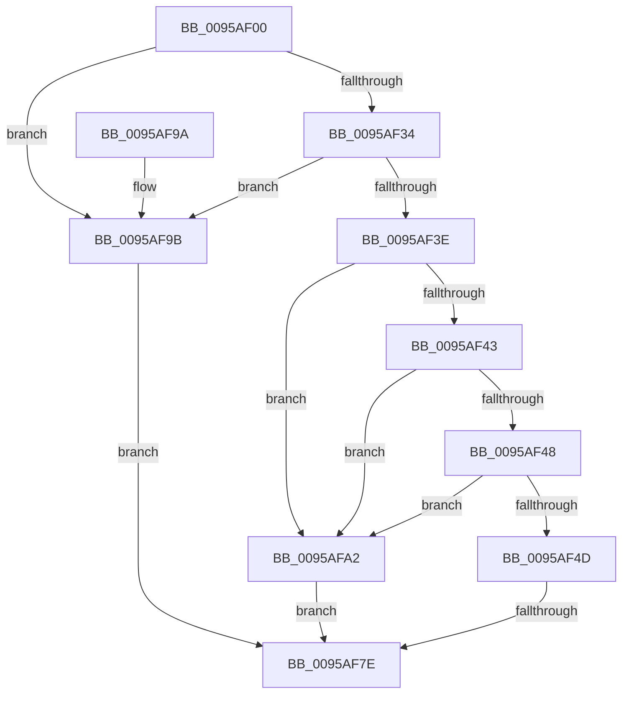

# KseQueryDeviceFlags

- RVA: `0x0095AF00`–`0x0095AFA9` (길이 `169` bytes)
- VA: `0x000000014095AF00`
- 실행 섹션: `PAGE`
- PDB 이름 있음: `예`; PDB Function 태그: `예`
- unwind 정보 RVA: `0x00092A80`
- 디코드: `51`개 명령, `169/169` bytes 표시
- 미해석 바이트: `0` (있으면 어셈블리에 `.byte`로 보존)

> 이 문서는 커널 이미지의 기계어와 PDB 기호를 분석해 생성했습니다. 4번과 5번은 함수 원형과 자료형을 바이너리 사용 방식에서 추정한 C 해석이며 원본 소스 복구 결과는 아닙니다.

## 1. Dependencies

- 직접 호출 지점: **1**; 고유 호출 대상: **1**
- 직접 호출자로 확인된 함수: **0**
- RIP 상대 이미지 참조: **2**

### Outgoing calls
- `0x0095AF6F` → [KseQueryDeviceData](KseQueryDeviceData_function_0095AFB0.md) (function, `0x0095AFB0`)

### Direct callers
- 이 함수 시작 RVA로 연결되는 직접 call은 확인되지 않았습니다. 간접 호출은 완전히 역산할 수 없습니다.

### Static image references
- `0x0095AF23` → RVA `0x00E66C84` (`.data`; read)
- `0x0095AF34` → RVA `0x00E66C80` (`.data`; read)

## 2. Other-region calls and transfers

- 다른 실행 섹션으로 향하는 call: **0**
- call이 아닌 외부 분기/꼬리 이동: **1**
  - `0x0095AF78` → [sub_00B277B0](../B2/Unknown_function_00B277B0.md) (`tail-transfer`)

## 3. Assembly (complete function range)

```asm
0095AF00  4C 8B DC                        mov r11, rsp
0095AF03  49 89 5B 08                     mov qword ptr [r11 + 8], rbx
0095AF07  49 89 73 10                     mov qword ptr [r11 + 0x10], rsi
0095AF0B  49 89 7B 18                     mov qword ptr [r11 + 0x18], rdi
0095AF0F  55                              push rbp
0095AF10  41 56                           push r14
0095AF12  41 57                           push r15
0095AF14  48 8B EC                        mov rbp, rsp
0095AF17  48 83 EC 60                     sub rsp, 0x60
0095AF1B  48 83 65 D8 00                  and qword ptr [rbp - 0x28], 0
0095AF20  4D 8B F0                        mov r14, r8
0095AF23  8B 05 5B BD 50 00               mov eax, dword ptr [rip + 0x50bd5b]
0095AF29  48 8B DA                        mov rbx, rdx
0095AF2C  4C 8B F9                        mov r15, rcx
0095AF2F  83 F8 02                        cmp eax, 2
0095AF32  75 67                           jne 0x14095af9b
0095AF34  8B 05 46 BD 50 00               mov eax, dword ptr [rip + 0x50bd46]
0095AF3A  A8 02                           test al, 2
0095AF3C  75 5D                           jne 0x14095af9b
0095AF3E  48 85 C9                        test rcx, rcx
0095AF41  74 5F                           je 0x14095afa2
0095AF43  48 85 D2                        test rdx, rdx
0095AF46  74 5A                           je 0x14095afa2
0095AF48  4D 85 C0                        test r8, r8
0095AF4B  74 55                           je 0x14095afa2
0095AF4D  49 83 20 00                     and qword ptr [r8], 0
0095AF51  48 8D 45 D8                     lea rax, [rbp - 0x28]
0095AF55  4C 8D 45 38                     lea r8, [rbp + 0x38]
0095AF59  49 89 43 A8                     mov qword ptr [r11 - 0x58], rax
0095AF5D  4C 8D 4D D0                     lea r9, [rbp - 0x30]
0095AF61  C7 45 38 0B 00 00 00            mov dword ptr [rbp + 0x38], 0xb
0095AF68  C7 45 D0 08 00 00 00            mov dword ptr [rbp - 0x30], 8
0095AF6F  E8 3C 00 00 00                  call 0x14095afb0
0095AF74  8B F8                           mov edi, eax
0095AF76  85 C0                           test eax, eax
0095AF78  0F 89 32 C8 1C 00               jns 0x140b277b0
0095AF7E  4C 8D 5C 24 60                  lea r11, [rsp + 0x60]
0095AF83  8B C7                           mov eax, edi
0095AF85  49 8B 5B 20                     mov rbx, qword ptr [r11 + 0x20]
0095AF89  49 8B 73 28                     mov rsi, qword ptr [r11 + 0x28]
0095AF8D  49 8B 7B 30                     mov rdi, qword ptr [r11 + 0x30]
0095AF91  49 8B E3                        mov rsp, r11
0095AF94  41 5F                           pop r15
0095AF96  41 5E                           pop r14
0095AF98  5D                              pop rbp
0095AF99  C3                              ret
0095AF9A  CC                              int3
0095AF9B  BF 25 02 00 C0                  mov edi, 0xc0000225
0095AFA0  EB DC                           jmp 0x14095af7e
0095AFA2  BF 0D 00 00 C0                  mov edi, 0xc000000d
0095AFA7  EB D5                           jmp 0x14095af7e
```

## 4. C-style interpretation (structured pseudocode)

```c
__int64 __fastcall KseQueryDeviceFlags(__int64 a1, __int64 a2, __int64 a3)
{
    __int64 result;
    __int64 v_rsp;
    unsigned __int64 v_stack_m18;
    unsigned __int64 v_stack_m40;
    unsigned __int64 v_stack_m48;
    unsigned __int64 v_stack_p20;

    *(unsigned __int64 *)(v_rsp + 8) = v_rbx;
    *(unsigned __int64 *)(v_rsp + 16) = v_rsi;
    *(unsigned __int64 *)(v_rsp + 24) = v_rdi;
    v_rsp = (v_rsp) - (96);
    if (((unsigned int)((unsigned int)(*(unsigned int *)(v_rip + 5291355)))) != 2) goto loc_0095AF9B;
    if ((((unsigned __int8)((unsigned int)(*(unsigned int *)(v_rip + 5291334)))) & (2)) != 0) goto loc_0095AF9B;
    if (a1 == 0) goto loc_0095AFA2;
    if (a2 == 0) goto loc_0095AFA2;
    if (a3 == 0) goto loc_0095AFA2;
    *(unsigned __int64 *)(v_rsp - 88) = v_stack_m40;
    v_stack_p20 = 11;
    v_stack_m48 = 8;
    result = KseQueryDeviceData(a1, a2, v_stack_p20, v_stack_m48);
loc_0095AF7E:
    return (unsigned int)((unsigned int)((unsigned int)((unsigned int)(result))));
loc_0095AF9B:
    goto loc_0095AF7E;
loc_0095AFA2:
    goto loc_0095AF7E;
}
```

## 5. (Beta) C Style

```c
int64_t KseQueryDeviceFlags(int64_t Arg1, int64_t Arg2, int64_t Arg3)
{
    int64_t result;
    int64_t local_rsp;
    uint64_t v_stack_m18;
    uint64_t v_stack_m40;
    uint64_t v_stack_m48;
    uint64_t v_stack_p20;

    *(uint64_t *)(local_rsp + 0x8) = local_rbx;
    *(uint64_t *)(local_rsp + 0x10) = local_rsi;
    *(uint64_t *)(local_rsp + 0x18) = local_rdi;
    local_rsp = (local_rsp) - (96);
    if (((uint32_t)((uint32_t)(*(uint32_t *)(v_rip + 0x50BD5B)))) != 2) goto loc_0095AF9B;
    if ((((uint8_t)((uint32_t)(*(uint32_t *)(v_rip + 0x50BD46)))) & (2)) != 0) goto loc_0095AF9B;
    if (Arg1 == 0) goto loc_0095AFA2;
    if (Arg2 == 0) goto loc_0095AFA2;
    if (Arg3 == 0) goto loc_0095AFA2;
    *(uint64_t *)(local_rsp - 0x58) = v_stack_m40;
    v_stack_p20 = 11;
    v_stack_m48 = 8;
    result = KseQueryDeviceData(Arg1, Arg2, v_stack_p20, v_stack_m48);
loc_0095AF7E:
    return (uint32_t)((uint32_t)((uint32_t)((uint32_t)(result))));
loc_0095AF9B:
    goto loc_0095AF7E;
loc_0095AFA2:
    goto loc_0095AF7E;
}
```

## 6. Execution-region graph

[열기: 2D/3D 그래프와 함수 탐색 컨트롤 패널](../../../control-panel.html?section=page&rva=0x0095AF00&view=graph)

- 2D 그래프는 위에서 아래로 흐르고, 3D 그래프는 빈 공간을 드래그해 회전합니다. Shift+드래그는 이동, 휠은 확대·축소, 함수 노드 선택은 대상 보고서 이동입니다.

### Static fallback


