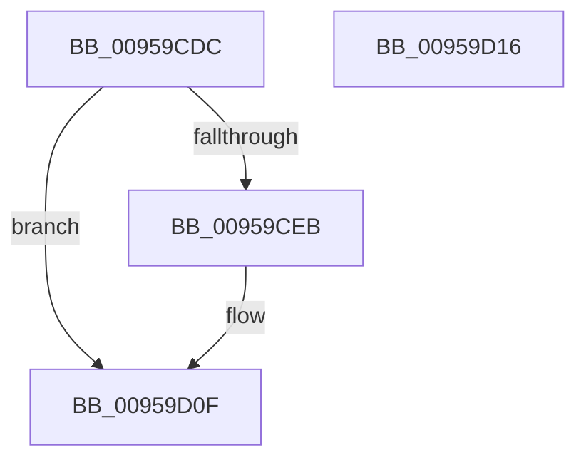

# KseResetDeviceCache

- RVA: `0x00959CDC`–`0x00959D17` (길이 `59` bytes)
- VA: `0x0000000140959CDC`
- 실행 섹션: `PAGE`
- PDB 이름 있음: `예`; PDB Function 태그: `아니요`
- unwind 정보 RVA: `0x0005C788`
- 디코드: `14`개 명령, `59/59` bytes 표시
- 미해석 바이트: `0` (있으면 어셈블리에 `.byte`로 보존)

> 이 문서는 커널 이미지의 기계어와 PDB 기호를 분석해 생성했습니다. 4번과 5번은 함수 원형과 자료형을 바이너리 사용 방식에서 추정한 C 해석이며 원본 소스 복구 결과는 아닙니다.

## 1. Dependencies

- 직접 호출 지점: **3**; 고유 호출 대상: **3**
- 직접 호출자로 확인된 함수: **2**
- RIP 상대 이미지 참조: **2**

### Outgoing calls
- `0x00959CF2` → [CmpLockSiloKeyLockTrackerExclusive](../8F/CmpLockSiloKeyLockTrackerExclusive_function_008F9EF8.md) (function, `0x008F9EF8`)
- `0x00959CFE` → [KsepCacheReset](../74/KsepCacheReset_function_0074AF3C.md) (function, `0x0074AF3C`)
- `0x00959D0A` → [KsepCacheUnlock](KsepCacheUnlock_function_00959ECC.md) (function, `0x00959ECC`)

### Direct callers
- [KseQueryDeviceDataList](KseQueryDeviceDataList_function_00959390.md) at `0x00959428`
- [KseQueryDeviceData](KseQueryDeviceData_function_0095AFB0.md) at `0x0095B096`

### Static image references
- `0x00959CE0` → RVA `0x00E66C84` (`.data`; read)
- `0x00959CEB` → RVA `0x00E66CC8` (`.data`; read)

## 2. Other-region calls and transfers

- 다른 실행 섹션으로 향하는 call: **0**
- 별도 외부 분기/꼬리 이동을 확인하지 못했습니다.

## 3. Assembly (complete function range)

```asm
00959CDC  48 83 EC 28                     sub rsp, 0x28
00959CE0  8B 05 9E CF 50 00               mov eax, dword ptr [rip + 0x50cf9e]
00959CE6  83 F8 02                        cmp eax, 2
00959CE9  75 24                           jne 0x140959d0f
00959CEB  48 8B 0D D6 CF 50 00            mov rcx, qword ptr [rip + 0x50cfd6]
00959CF2  E8 01 02 FA FF                  call 0x1408f9ef8
00959CF7  48 8B 0D CA CF 50 00            mov rcx, qword ptr [rip + 0x50cfca]
00959CFE  E8 39 12 DF FF                  call 0x14074af3c
00959D03  48 8B 0D BE CF 50 00            mov rcx, qword ptr [rip + 0x50cfbe]
00959D0A  E8 BD 01 00 00                  call 0x140959ecc
00959D0F  33 C0                           xor eax, eax
00959D11  48 83 C4 28                     add rsp, 0x28
00959D15  C3                              ret
00959D16  CC                              int3
```

## 4. C-style interpretation (structured pseudocode)

```c
__int64 __fastcall KseResetDeviceCache(void)
{
    __int64 result;
    __int64 v_rsp;

    v_rsp = (v_rsp) - (40);
    result = (unsigned int)(*(unsigned int *)(v_rip + 5296030));
    if (((unsigned int)((unsigned int)(*(unsigned int *)(v_rip + 5296030)))) == 2) {
        a1 = *(unsigned __int64 *)(v_rip + 5296086);
        result = CmpLockSiloKeyLockTrackerExclusive(a1, a2, a3, a4);
        a1 = *(unsigned __int64 *)(v_rip + 5296074);
        result = KsepCacheReset(a1, a2, a3, a4);
        a1 = *(unsigned __int64 *)(v_rip + 5296062);
        result = KsepCacheUnlock(a1, a2, a3, a4);
    }
    result = 0;
    v_rsp = (v_rsp) + (40);
    return result;
}
```

## 5. (Beta) C Style

```c
void KseResetDeviceCache(void)
{
    int64_t result;
    int64_t local_rsp;

    local_rsp = (local_rsp) - (40);
    result = (uint32_t)(*(uint32_t *)(v_rip + 0x50CF9E));
    if (((uint32_t)((uint32_t)(*(uint32_t *)(v_rip + 0x50CF9E)))) == 2) {
        a1 = *(uint64_t *)(v_rip + 0x50CFD6);
        result = CmpLockSiloKeyLockTrackerExclusive(a1, a2, a3, a4);
        a1 = *(uint64_t *)(v_rip + 0x50CFCA);
        result = KsepCacheReset(a1, a2, a3, a4);
        a1 = *(uint64_t *)(v_rip + 0x50CFBE);
        result = KsepCacheUnlock(a1, a2, a3, a4);
    }
    result = 0;
    local_rsp = (local_rsp) + (40);
    return result;
}
```

## 6. Execution-region graph

[열기: 2D/3D 그래프와 함수 탐색 컨트롤 패널](../../../control-panel.html?section=page&rva=0x00959CDC&view=graph)

- 2D 그래프는 위에서 아래로 흐르고, 3D 그래프는 빈 공간을 드래그해 회전합니다. Shift+드래그는 이동, 휠은 확대·축소, 함수 노드 선택은 대상 보고서 이동입니다.

### Static fallback


