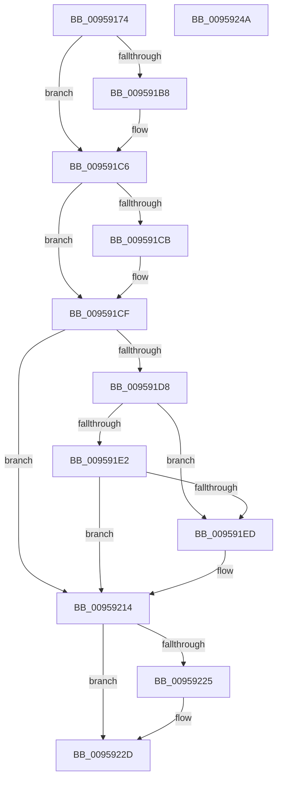

# KseShimDatabaseBootRelease

- RVA: `0x00959174`–`0x0095924B` (길이 `215` bytes)
- VA: `0x0000000140959174`
- 실행 섹션: `PAGE`
- PDB 이름 있음: `예`; PDB Function 태그: `아니요`
- unwind 정보 RVA: `0x000927D0`
- 디코드: `52`개 명령, `215/215` bytes 표시
- 미해석 바이트: `0` (있으면 어셈블리에 `.byte`로 보존)

> 이 문서는 커널 이미지의 기계어와 PDB 기호를 분석해 생성했습니다. 4번과 5번은 함수 원형과 자료형을 바이너리 사용 방식에서 추정한 C 해석이며 원본 소스 복구 결과는 아닙니다.

## 1. Dependencies

- 직접 호출 지점: **7**; 고유 호출 대상: **6**
- 직접 호출자로 확인된 함수: **2**
- RIP 상대 이미지 참조: **9**

### Outgoing calls
- `0x009591A7` → [KeAbPreAcquire](../../text/21/KeAbPreAcquire_function_00210230.md) (function, `0x00210230`)
- `0x009591C1` → [ExfAcquirePushLockExclusiveEx](../../text/20/ExfAcquirePushLockExclusiveEx_function_0020FC90.md) (function, `0x0020FC90`)
- `0x009591F4` → [KsepSdbBootRelease](../74/KsepSdbBootRelease_function_0074A924.md) (function, `0x0074A924`)
- `0x00959200` → [KsepSdbBootRelease](../74/KsepSdbBootRelease_function_0074A924.md) (function, `0x0074A924`)
- `0x00959228` → [ExfTryToWakePushLock](../../text/26/ExfTryToWakePushLock_function_00265DD0.md) (function, `0x00265DD0`)
- `0x00959230` → [KeAbPostRelease](../../text/2E/KeAbPostRelease_function_002E1600.md) (function, `0x002E1600`)
- `0x00959235` → [KeLeaveCriticalRegion](../../text/25/KeLeaveCriticalRegion_function_0025D8B0.md) (function, `0x0025D8B0`)

### Direct callers
- [PnpCompleteSystemStartProcess](../../text/5A/PnpCompleteSystemStartProcess_function_005A6F2C.md) at `0x005A6F8C`
- [KseShimDatabaseClose](KseShimDatabaseClose_function_0095ABCC.md) at `0x0095ACD7`

### Static image references
- `0x0095918C` → RVA `0x00F10670` (`.data`; read)
- `0x009591CF` → RVA `0x00F105E8` (`.data`; read)
- `0x009591D8` → RVA `0x00F105E4` (`.data`; read)
- `0x009591E5` → RVA `0x00F105E4` (`.data`; write)
- `0x009591ED` → RVA `0x00F10600` (`.data`; read)
- `0x009591F9` → RVA `0x00F10638` (`.data`; read)
- `0x00959205` → RVA `0x00F10678` (`.data`; read/write)
- `0x0095920D` → RVA `0x00F105E8` (`.data`; read/write)
- `0x00959214` → RVA `0x00F10670` (`.data`; read/write)

## 2. Other-region calls and transfers

- 다른 실행 섹션으로 향하는 call: **5**
  - `0x009591A7` → [KeAbPreAcquire](../../text/21/KeAbPreAcquire_function_00210230.md) (`PAGE` → `.text`)
  - `0x009591C1` → [ExfAcquirePushLockExclusiveEx](../../text/20/ExfAcquirePushLockExclusiveEx_function_0020FC90.md) (`PAGE` → `.text`)
  - `0x00959228` → [ExfTryToWakePushLock](../../text/26/ExfTryToWakePushLock_function_00265DD0.md) (`PAGE` → `.text`)
  - `0x00959230` → [KeAbPostRelease](../../text/2E/KeAbPostRelease_function_002E1600.md) (`PAGE` → `.text`)
  - `0x00959235` → [KeLeaveCriticalRegion](../../text/25/KeLeaveCriticalRegion_function_0025D8B0.md) (`PAGE` → `.text`)
- 별도 외부 분기/꼬리 이동을 확인하지 못했습니다.

## 3. Assembly (complete function range)

```asm
00959174  48 89 5C 24 08                  mov qword ptr [rsp + 8], rbx
00959179  48 89 6C 24 10                  mov qword ptr [rsp + 0x10], rbp
0095917E  57                              push rdi
0095917F  48 83 EC 20                     sub rsp, 0x20
00959183  65 48 8B 04 25 88 01 00 00      mov rax, qword ptr gs:[0x188]
0095918C  48 8D 2D DD 74 5B 00            lea rbp, [rip + 0x5b74dd]
00959193  48 83 CB FF                     or rbx, 0xffffffffffffffff
00959197  45 33 C0                        xor r8d, r8d
0095919A  33 D2                           xor edx, edx
0095919C  48 8B CD                        mov rcx, rbp
0095919F  66 01 98 E4 01 00 00            add word ptr [rax + 0x1e4], bx
009591A6  90                              nop
009591A7  E8 84 70 8B FF                  call 0x140210230
009591AC  F0 48 0F BA 6D 00 00            lock bts qword ptr [rbp], 0
009591B3  48 8B F8                        mov rdi, rax
009591B6  73 0E                           jae 0x1409591c6
009591B8  4C 8B C5                        mov r8, rbp
009591BB  48 8B D0                        mov rdx, rax
009591BE  48 8B CD                        mov rcx, rbp
009591C1  E8 CA 6A 8B FF                  call 0x14020fc90
009591C6  48 85 FF                        test rdi, rdi
009591C9  74 04                           je 0x1409591cf
009591CB  C6 47 0A 01                     mov byte ptr [rdi + 0xa], 1
009591CF  83 3D 12 74 5B 00 00            cmp dword ptr [rip + 0x5b7412], 0
009591D6  74 3C                           je 0x140959214
009591D8  8B 05 06 74 5B 00               mov eax, dword ptr [rip + 0x5b7406]
009591DE  85 C0                           test eax, eax
009591E0  74 0B                           je 0x1409591ed
009591E2  83 C0 FF                        add eax, -1
009591E5  89 05 F9 73 5B 00               mov dword ptr [rip + 0x5b73f9], eax
009591EB  75 27                           jne 0x140959214
009591ED  48 8D 0D 0C 74 5B 00            lea rcx, [rip + 0x5b740c]
009591F4  E8 2B 17 DF FF                  call 0x14074a924
009591F9  48 8D 0D 38 74 5B 00            lea rcx, [rip + 0x5b7438]
00959200  E8 1F 17 DF FF                  call 0x14074a924
00959205  48 83 25 6B 74 5B 00 00         and qword ptr [rip + 0x5b746b], 0
0095920D  83 25 D4 73 5B 00 00            and dword ptr [rip + 0x5b73d4], 0
00959214  F0 48 0F C1 1D 53 74 5B 00      lock xadd qword ptr [rip + 0x5b7453], rbx
0095921D  80 E3 06                        and bl, 6
00959220  80 FB 02                        cmp bl, 2
00959223  75 08                           jne 0x14095922d
00959225  48 8B CD                        mov rcx, rbp
00959228  E8 A3 CB 90 FF                  call 0x140265dd0
0095922D  48 8B CD                        mov rcx, rbp
00959230  E8 CB 83 98 FF                  call 0x1402e1600
00959235  E8 76 46 90 FF                  call 0x14025d8b0
0095923A  48 8B 5C 24 30                  mov rbx, qword ptr [rsp + 0x30]
0095923F  48 8B 6C 24 38                  mov rbp, qword ptr [rsp + 0x38]
00959244  48 83 C4 20                     add rsp, 0x20
00959248  5F                              pop rdi
00959249  C3                              ret
0095924A  CC                              int3
```

## 4. C-style interpretation (structured pseudocode)

```c
__int64 __fastcall KseShimDatabaseBootRelease(__int64 a1, int a2, int a3)
{
    __int64 result;
    __int64 v_rbx;
    __int64 v_rsp;
    unsigned __int64 v_stack_p10;
    unsigned __int64 v_stack_p8;

    v_stack_p8 = v_rbx;
    v_stack_p10 = v_rbp;
    v_rsp = (v_rsp) - (32);
    v_rbx = (v_rbx) | (-1);
    a3 = 0;
    a2 = 0;
    result = KeAbPreAcquire(v_rip + 5993693, a2, a3, a4);
    if (!(condition_is_above_or_equal)) {
        a3 = v_rip + 5993693;
        a2 = result;
        a1 = v_rip + 5993693;
        result = ExfAcquirePushLockExclusiveEx(a1, a2, a3, a4);
    }
    if (result != 0) {
        *(unsigned __int8 *)(result + 10) = 1;
    }
    if ((*(unsigned int *)(v_rip + 5993490)) == 0) goto loc_00959214;
    if ((unsigned int)((unsigned int)(*(unsigned int *)(v_rip + 5993478))) == 0) goto loc_009591ED;
    result = (unsigned int)(((unsigned int)(*(unsigned int *)(v_rip + 5993478))) + (-1));
    *(unsigned int *)(v_rip + 5993465) = (unsigned int)(result);
    if (!(condition_is_not_equal)) {
        a1 = v_rip + 5993484;
        result = KsepSdbBootRelease(a1, a2, a3, a4);
        a1 = v_rip + 5993528;
        result = KsepSdbBootRelease(a1, a2, a3, a4);
    }
    v_rbx = (unsigned __int8)((v_rbx) & (6));
    if (((unsigned __int8)(v_rbx)) == 2) {
        a1 = v_rip + 5993693;
        result = ExfTryToWakePushLock(a1, a2, a3, a4);
    }
    result = KeAbPostRelease(v_rip + 5993693, a2, a3, a4);
    result = KeLeaveCriticalRegion(v_rip + 5993693, a2, a3, a4);
    v_rsp = (v_rsp) + (32);
    return result;
}
```

## 5. (Beta) C Style

```c
int64_t KseShimDatabaseBootRelease(int64_t Arg1, int32_t Arg2, int32_t Arg3)
{
    int64_t result;
    int64_t local_rbx;
    int64_t local_rsp;
    uint64_t v_stack_p10;
    uint64_t v_stack_p8;

    v_stack_p8 = local_rbx;
    v_stack_p10 = local_rbp;
    local_rsp = (local_rsp) - (32);
    local_rbx = (local_rbx) | (-1);
    Arg3 = 0;
    Arg2 = 0;
    result = KeAbPreAcquire(v_rip + 5993693, Arg2, Arg3, a4);
    if (!(condition_is_above_or_equal)) {
        Arg3 = v_rip + 5993693;
        Arg2 = result;
        Arg1 = v_rip + 5993693;
        result = ExfAcquirePushLockExclusiveEx(Arg1, Arg2, Arg3, a4);
    }
    if (result != 0) {
        *(uint8_t *)(result + 0xA) = 1;
    }
    if ((*(uint32_t *)(v_rip + 0x5B7412)) == 0) goto loc_00959214;
    if ((uint32_t)((uint32_t)(*(uint32_t *)(v_rip + 0x5B7406))) == 0) goto loc_009591ED;
    result = (uint32_t)(((uint32_t)(*(uint32_t *)(v_rip + 0x5B7406))) + (-1));
    *(uint32_t *)(v_rip + 0x5B73F9) = (uint32_t)(result);
    if (!(condition_is_not_equal)) {
        Arg1 = v_rip + 5993484;
        result = KsepSdbBootRelease(Arg1, Arg2, Arg3, a4);
        Arg1 = v_rip + 5993528;
        result = KsepSdbBootRelease(Arg1, Arg2, Arg3, a4);
    }
    local_rbx = (uint8_t)((local_rbx) & (6));
    if (((uint8_t)(local_rbx)) == 2) {
        Arg1 = v_rip + 5993693;
        result = ExfTryToWakePushLock(Arg1, Arg2, Arg3, a4);
    }
    result = KeAbPostRelease(v_rip + 5993693, Arg2, Arg3, a4);
    result = KeLeaveCriticalRegion(v_rip + 5993693, Arg2, Arg3, a4);
    local_rsp = (local_rsp) + (32);
    return result;
}
```

## 6. Execution-region graph

[열기: 2D/3D 그래프와 함수 탐색 컨트롤 패널](../../../control-panel.html?section=page&rva=0x00959174&view=graph)

- 2D 그래프는 위에서 아래로 흐르고, 3D 그래프는 빈 공간을 드래그해 회전합니다. Shift+드래그는 이동, 휠은 확대·축소, 함수 노드 선택은 대상 보고서 이동입니다.

### Static fallback


