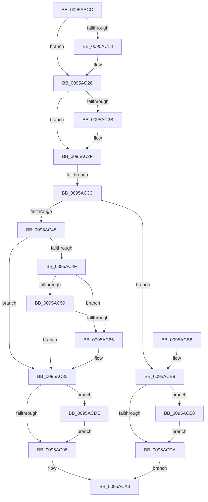

# KseShimDatabaseClose

- RVA: `0x0095ABCC`–`0x0095ACF2` (길이 `294` bytes)
- VA: `0x000000014095ABCC`
- 실행 섹션: `PAGE`
- PDB 이름 있음: `예`; PDB Function 태그: `예`
- unwind 정보 RVA: `0x0005CBA8`
- 디코드: `72`개 명령, `294/294` bytes 표시
- 미해석 바이트: `0` (있으면 어셈블리에 `.byte`로 보존)

> 이 문서는 커널 이미지의 기계어와 PDB 기호를 분석해 생성했습니다. 4번과 5번은 함수 원형과 자료형을 바이너리 사용 방식에서 추정한 C 해석이며 원본 소스 복구 결과는 아닙니다.

## 1. Dependencies

- 직접 호출 지점: **11**; 고유 호출 대상: **7**
- 직접 호출자로 확인된 함수: **4**
- RIP 상대 이미지 참조: **9**

### Outgoing calls
- `0x0095AC07` → [KeAbPreAcquire](../../text/21/KeAbPreAcquire_function_00210230.md) (function, `0x00210230`)
- `0x0095AC21` → [ExfAcquirePushLockExclusiveEx](../../text/20/ExfAcquirePushLockExclusiveEx_function_0020FC90.md) (function, `0x0020FC90`)
- `0x0095AC6C` → [KsepSdbUnmapFromMemory](KsepSdbUnmapFromMemory_function_0095B504.md) (function, `0x0095B504`)
- `0x0095AC78` → [KsepSdbUnmapFromMemory](KsepSdbUnmapFromMemory_function_0095B504.md) (function, `0x0095B504`)
- `0x0095AC99` → [KeAbPostRelease](../../text/2E/KeAbPostRelease_function_002E1600.md) (function, `0x002E1600`)
- `0x0095AC9E` → [KeLeaveCriticalRegion](../../text/25/KeLeaveCriticalRegion_function_0025D8B0.md) (function, `0x0025D8B0`)
- `0x0095ACCD` → [KeAbPostRelease](../../text/2E/KeAbPostRelease_function_002E1600.md) (function, `0x002E1600`)
- `0x0095ACD2` → [KeLeaveCriticalRegion](../../text/25/KeLeaveCriticalRegion_function_0025D8B0.md) (function, `0x0025D8B0`)
- `0x0095ACD7` → [KseShimDatabaseBootRelease](KseShimDatabaseBootRelease_function_00959174.md) (function, `0x00959174`)
- `0x0095ACE1` → [ExfTryToWakePushLock](../../text/26/ExfTryToWakePushLock_function_00265DD0.md) (function, `0x00265DD0`)
- `0x0095ACEB` → [ExfTryToWakePushLock](../../text/26/ExfTryToWakePushLock_function_00265DD0.md) (function, `0x00265DD0`)

### Direct callers
- [KsepDbGetShimInfo](../74/KsepDbGetShimInfo_function_00748E94.md) at `0x0074906F`
- [KsepDbGetDriverShims](KsepDbGetDriverShims_function_00959A58.md) at `0x00959BE5`
- [KsepDbCacheReadDevice](KsepDbCacheReadDevice_function_0095AAC8.md) at `0x0095AB69`
- [KseInitialize](../../init/C3/KseInitialize_function_00C3B5AC.md) at `0x00C3B75D`

### Static image references
- `0x0095ABE9` → RVA `0x00F10670` (`.data`; read)
- `0x0095AC2F` → RVA `0x00F10678` (`.data`; read)
- `0x0095AC3C` → RVA `0x00F105E8` (`.data`; read)
- `0x0095AC4F` → RVA `0x00F105E4` (`.data`; read)
- `0x0095AC5B` → RVA `0x00F105E4` (`.data`; write)
- `0x0095AC65` → RVA `0x00F10600` (`.data`; read)
- `0x0095AC71` → RVA `0x00F10638` (`.data`; read)
- `0x0095AC7D` → RVA `0x00F10678` (`.data`; read/write)
- `0x0095AC85` → RVA `0x00F10670` (`.data`; read/write)

## 2. Other-region calls and transfers

- 다른 실행 섹션으로 향하는 call: **8**
  - `0x0095AC07` → [KeAbPreAcquire](../../text/21/KeAbPreAcquire_function_00210230.md) (`PAGE` → `.text`)
  - `0x0095AC21` → [ExfAcquirePushLockExclusiveEx](../../text/20/ExfAcquirePushLockExclusiveEx_function_0020FC90.md) (`PAGE` → `.text`)
  - `0x0095AC99` → [KeAbPostRelease](../../text/2E/KeAbPostRelease_function_002E1600.md) (`PAGE` → `.text`)
  - `0x0095AC9E` → [KeLeaveCriticalRegion](../../text/25/KeLeaveCriticalRegion_function_0025D8B0.md) (`PAGE` → `.text`)
  - `0x0095ACCD` → [KeAbPostRelease](../../text/2E/KeAbPostRelease_function_002E1600.md) (`PAGE` → `.text`)
  - `0x0095ACD2` → [KeLeaveCriticalRegion](../../text/25/KeLeaveCriticalRegion_function_0025D8B0.md) (`PAGE` → `.text`)
  - `0x0095ACE1` → [ExfTryToWakePushLock](../../text/26/ExfTryToWakePushLock_function_00265DD0.md) (`PAGE` → `.text`)
  - `0x0095ACEB` → [ExfTryToWakePushLock](../../text/26/ExfTryToWakePushLock_function_00265DD0.md) (`PAGE` → `.text`)
- call이 아닌 외부 분기/꼬리 이동: **1**
  - `0x0095AC36` → [sub_00B2774E](../B2/Unknown_function_00B2774E.md) (`tail-transfer`)

## 3. Assembly (complete function range)

```asm
0095ABCC  48 89 5C 24 08                  mov qword ptr [rsp + 8], rbx
0095ABD1  48 89 6C 24 10                  mov qword ptr [rsp + 0x10], rbp
0095ABD6  48 89 74 24 18                  mov qword ptr [rsp + 0x18], rsi
0095ABDB  57                              push rdi
0095ABDC  48 83 EC 20                     sub rsp, 0x20
0095ABE0  65 48 8B 04 25 88 01 00 00      mov rax, qword ptr gs:[0x188]
0095ABE9  48 8D 2D 80 5A 5B 00            lea rbp, [rip + 0x5b5a80]
0095ABF0  48 8B F1                        mov rsi, rcx
0095ABF3  48 83 CB FF                     or rbx, 0xffffffffffffffff
0095ABF7  45 33 C0                        xor r8d, r8d
0095ABFA  33 D2                           xor edx, edx
0095ABFC  48 8B CD                        mov rcx, rbp
0095ABFF  66 01 98 E4 01 00 00            add word ptr [rax + 0x1e4], bx
0095AC06  90                              nop
0095AC07  E8 24 56 8B FF                  call 0x140210230
0095AC0C  F0 48 0F BA 6D 00 00            lock bts qword ptr [rbp], 0
0095AC13  48 8B F8                        mov rdi, rax
0095AC16  73 0E                           jae 0x14095ac26
0095AC18  4C 8B C5                        mov r8, rbp
0095AC1B  48 8B D0                        mov rdx, rax
0095AC1E  48 8B CD                        mov rcx, rbp
0095AC21  E8 6A 50 8B FF                  call 0x14020fc90
0095AC26  48 85 FF                        test rdi, rdi
0095AC29  74 04                           je 0x14095ac2f
0095AC2B  C6 47 0A 01                     mov byte ptr [rdi + 0xa], 1
0095AC2F  48 3B 35 42 5A 5B 00            cmp rsi, qword ptr [rip + 0x5b5a42]
0095AC36  0F 85 12 CB 1C 00               jne 0x140b2774e
0095AC3C  83 3D A5 59 5B 00 00            cmp dword ptr [rip + 0x5b59a5], 0
0095AC43  75 74                           jne 0x14095acb9
0095AC45  48 83 3D 2B 5A 5B 00 00         cmp qword ptr [rip + 0x5b5a2b], 0
0095AC4D  74 36                           je 0x14095ac85
0095AC4F  8B 05 8F 59 5B 00               mov eax, dword ptr [rip + 0x5b598f]
0095AC55  85 C0                           test eax, eax
0095AC57  74 0C                           je 0x14095ac65
0095AC59  FF C8                           dec eax
0095AC5B  89 05 83 59 5B 00               mov dword ptr [rip + 0x5b5983], eax
0095AC61  85 C0                           test eax, eax
0095AC63  75 20                           jne 0x14095ac85
0095AC65  48 8D 0D 94 59 5B 00            lea rcx, [rip + 0x5b5994]
0095AC6C  E8 93 08 00 00                  call 0x14095b504
0095AC71  48 8D 0D C0 59 5B 00            lea rcx, [rip + 0x5b59c0]
0095AC78  E8 87 08 00 00                  call 0x14095b504
0095AC7D  48 83 25 F3 59 5B 00 00         and qword ptr [rip + 0x5b59f3], 0
0095AC85  F0 48 0F C1 1D E2 59 5B 00      lock xadd qword ptr [rip + 0x5b59e2], rbx
0095AC8E  80 E3 06                        and bl, 6
0095AC91  80 FB 02                        cmp bl, 2
0095AC94  74 48                           je 0x14095acde
0095AC96  48 8B CD                        mov rcx, rbp
0095AC99  E8 62 69 98 FF                  call 0x1402e1600
0095AC9E  E8 0D 2C 90 FF                  call 0x14025d8b0
0095ACA3  48 8B 5C 24 30                  mov rbx, qword ptr [rsp + 0x30]
0095ACA8  48 8B 6C 24 38                  mov rbp, qword ptr [rsp + 0x38]
0095ACAD  48 8B 74 24 40                  mov rsi, qword ptr [rsp + 0x40]
0095ACB2  48 83 C4 20                     add rsp, 0x20
0095ACB6  5F                              pop rdi
0095ACB7  C3                              ret
0095ACB8  CC                              int3
0095ACB9  F0 48 0F C1 1D AE 59 5B 00      lock xadd qword ptr [rip + 0x5b59ae], rbx
0095ACC2  80 E3 06                        and bl, 6
0095ACC5  80 FB 02                        cmp bl, 2
0095ACC8  74 1E                           je 0x14095ace8
0095ACCA  48 8B CD                        mov rcx, rbp
0095ACCD  E8 2E 69 98 FF                  call 0x1402e1600
0095ACD2  E8 D9 2B 90 FF                  call 0x14025d8b0
0095ACD7  E8 98 E4 FF FF                  call 0x140959174
0095ACDC  EB C5                           jmp 0x14095aca3
0095ACDE  48 8B CD                        mov rcx, rbp
0095ACE1  E8 EA B0 90 FF                  call 0x140265dd0
0095ACE6  EB AE                           jmp 0x14095ac96
0095ACE8  48 8B CD                        mov rcx, rbp
0095ACEB  E8 E0 B0 90 FF                  call 0x140265dd0
0095ACF0  EB D8                           jmp 0x14095acca
```

## 4. C-style interpretation (structured pseudocode)

```c
__int64 __fastcall KseShimDatabaseClose(__int64 a1, int a2, int a3)
{
    __int64 result;
    __int64 v_rbx;
    __int64 v_rsp;
    unsigned __int64 v_stack_p10;
    unsigned __int64 v_stack_p18;
    unsigned __int64 v_stack_p8;

    v_stack_p8 = v_rbx;
    v_stack_p10 = v_rbp;
    v_stack_p18 = v_rsi;
    v_rsp = (v_rsp) - (32);
    v_rbx = (v_rbx) | (-1);
    a3 = 0;
    a2 = 0;
    result = KeAbPreAcquire(v_rip + 5986944, a2, a3, a4);
    if (!(condition_is_above_or_equal)) {
        a3 = v_rip + 5986944;
        a2 = result;
        a1 = v_rip + 5986944;
        result = ExfAcquirePushLockExclusiveEx(a1, a2, a3, a4);
    }
    if (result != 0) {
        *(unsigned __int8 *)(result + 10) = 1;
    }
    if ((*(unsigned int *)(v_rip + 5986725)) != 0) goto loc_0095ACB9;
    if ((*(unsigned __int64 *)(v_rip + 5986859)) == 0) goto loc_0095AC85;
    if ((unsigned int)((unsigned int)(*(unsigned int *)(v_rip + 5986703))) == 0) goto loc_0095AC65;
    result = (unsigned int)(((unsigned int)(*(unsigned int *)(v_rip + 5986703))) - 1);
    *(unsigned int *)(v_rip + 5986691) = (unsigned int)(result);
    if ((unsigned int)(result) == 0) {
        a1 = v_rip + 5986708;
        result = KsepSdbUnmapFromMemory(a1, a2, a3, a4);
        a1 = v_rip + 5986752;
        result = KsepSdbUnmapFromMemory(a1, a2, a3, a4);
    }
    v_rbx = (unsigned __int8)((v_rbx) & (6));
    if (((unsigned __int8)(v_rbx)) == 2) goto loc_0095ACDE;
loc_0095AC96:
    result = KeAbPostRelease(v_rip + 5986944, a2, a3, a4);
    result = KeLeaveCriticalRegion(v_rip + 5986944, a2, a3, a4);
loc_0095ACA3:
    v_rsp = (v_rsp) + (32);
    return result;
loc_0095ACB9:
    v_rbx = (unsigned __int8)((v_stack_p8) & (6));
    if (((unsigned __int8)(v_rbx)) == 2) goto loc_0095ACE8;
loc_0095ACCA:
    result = KeAbPostRelease(v_stack_p10, a2, a3, a4);
    result = KeLeaveCriticalRegion(v_stack_p10, a2, a3, a4);
    result = KseShimDatabaseBootRelease(v_stack_p10, a2, a3, a4);
    goto loc_0095ACA3;
loc_0095ACDE:
    result = ExfTryToWakePushLock(v_stack_p10, a2, a3, a4);
    goto loc_0095AC96;
loc_0095ACE8:
    result = ExfTryToWakePushLock(v_stack_p10, a2, a3, a4);
    goto loc_0095ACCA;
}
```

## 5. (Beta) C Style

```c
int64_t KseShimDatabaseClose(int64_t Arg1, int32_t Arg2, int32_t Arg3)
{
    int64_t result;
    int64_t local_rbx;
    int64_t local_rsp;
    uint64_t v_stack_p10;
    uint64_t v_stack_p18;
    uint64_t v_stack_p8;

    v_stack_p8 = local_rbx;
    v_stack_p10 = local_rbp;
    v_stack_p18 = local_rsi;
    local_rsp = (local_rsp) - (32);
    local_rbx = (local_rbx) | (-1);
    Arg3 = 0;
    Arg2 = 0;
    result = KeAbPreAcquire(v_rip + 5986944, Arg2, Arg3, a4);
    if (!(condition_is_above_or_equal)) {
        Arg3 = v_rip + 5986944;
        Arg2 = result;
        Arg1 = v_rip + 5986944;
        result = ExfAcquirePushLockExclusiveEx(Arg1, Arg2, Arg3, a4);
    }
    if (result != 0) {
        *(uint8_t *)(result + 0xA) = 1;
    }
    if ((*(uint32_t *)(v_rip + 0x5B59A5)) != 0) goto loc_0095ACB9;
    if ((*(uint64_t *)(v_rip + 0x5B5A2B)) == 0) goto loc_0095AC85;
    if ((uint32_t)((uint32_t)(*(uint32_t *)(v_rip + 0x5B598F))) == 0) goto loc_0095AC65;
    result = (uint32_t)(((uint32_t)(*(uint32_t *)(v_rip + 0x5B598F))) - 1);
    *(uint32_t *)(v_rip + 0x5B5983) = (uint32_t)(result);
    if ((uint32_t)(result) == 0) {
        Arg1 = v_rip + 5986708;
        result = KsepSdbUnmapFromMemory(Arg1, Arg2, Arg3, a4);
        Arg1 = v_rip + 5986752;
        result = KsepSdbUnmapFromMemory(Arg1, Arg2, Arg3, a4);
    }
    local_rbx = (uint8_t)((local_rbx) & (6));
    if (((uint8_t)(local_rbx)) == 2) goto loc_0095ACDE;
loc_0095AC96:
    result = KeAbPostRelease(v_rip + 5986944, Arg2, Arg3, a4);
    result = KeLeaveCriticalRegion(v_rip + 5986944, Arg2, Arg3, a4);
loc_0095ACA3:
    local_rsp = (local_rsp) + (32);
    return result;
loc_0095ACB9:
    local_rbx = (uint8_t)((v_stack_p8) & (6));
    if (((uint8_t)(local_rbx)) == 2) goto loc_0095ACE8;
loc_0095ACCA:
    result = KeAbPostRelease(v_stack_p10, Arg2, Arg3, a4);
    result = KeLeaveCriticalRegion(v_stack_p10, Arg2, Arg3, a4);
    result = KseShimDatabaseBootRelease(v_stack_p10, Arg2, Arg3, a4);
    goto loc_0095ACA3;
loc_0095ACDE:
    result = ExfTryToWakePushLock(v_stack_p10, Arg2, Arg3, a4);
    goto loc_0095AC96;
loc_0095ACE8:
    result = ExfTryToWakePushLock(v_stack_p10, Arg2, Arg3, a4);
    goto loc_0095ACCA;
}
```

## 6. Execution-region graph

[열기: 2D/3D 그래프와 함수 탐색 컨트롤 패널](../../../control-panel.html?section=page&rva=0x0095ABCC&view=graph)

- 2D 그래프는 위에서 아래로 흐르고, 3D 그래프는 빈 공간을 드래그해 회전합니다. Shift+드래그는 이동, 휠은 확대·축소, 함수 노드 선택은 대상 보고서 이동입니다.

### Static fallback


