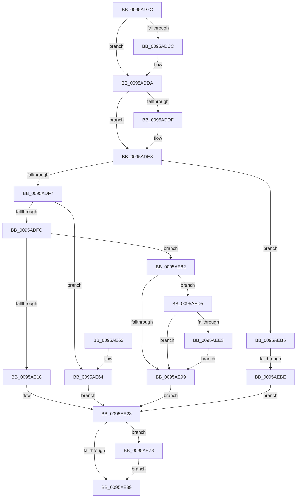

# KseShimDatabaseOpen

- RVA: `0x0095AD7C`–`0x0095AEF6` (길이 `378` bytes)
- VA: `0x000000014095AD7C`
- 실행 섹션: `PAGE`
- PDB 이름 있음: `예`; PDB Function 태그: `예`
- unwind 정보 RVA: `0x00092A54`
- 디코드: `90`개 명령, `378/378` bytes 표시
- 미해석 바이트: `0` (있으면 어셈블리에 `.byte`로 보존)

> 이 문서는 커널 이미지의 기계어와 PDB 기호를 분석해 생성했습니다. 4번과 5번은 함수 원형과 자료형을 바이너리 사용 방식에서 추정한 C 해석이며 원본 소스 복구 결과는 아닙니다.

## 1. Dependencies

- 직접 호출 지점: **9**; 고유 호출 대상: **8**
- 직접 호출자로 확인된 함수: **4**
- RIP 상대 이미지 참조: **16**

### Outgoing calls
- `0x0095ADBC` → [KeAbPreAcquire](../../text/21/KeAbPreAcquire_function_00210230.md) (function, `0x00210230`)
- `0x0095ADD5` → [ExfAcquirePushLockExclusiveEx](../../text/20/ExfAcquirePushLockExclusiveEx_function_0020FC90.md) (function, `0x0020FC90`)
- `0x0095AE0D` → [KsepSdbMapToMemory](KsepSdbMapToMemory_function_0095B81C.md) (function, `0x0095B81C`)
- `0x0095AE3C` → [KeAbPostRelease](../../text/2E/KeAbPostRelease_function_002E1600.md) (function, `0x002E1600`)
- `0x0095AE41` → [KeLeaveCriticalRegion](../../text/25/KeLeaveCriticalRegion_function_0025D8B0.md) (function, `0x0025D8B0`)
- `0x0095AE7B` → [ExfTryToWakePushLock](../../text/26/ExfTryToWakePushLock_function_00265DD0.md) (function, `0x00265DD0`)
- `0x0095AE90` → [KsepSdbMapToMemory](KsepSdbMapToMemory_function_0095B81C.md) (function, `0x0095B81C`)
- `0x0095AEEA` → [KsepSdbUnmapFromMemory](KsepSdbUnmapFromMemory_function_0095B504.md) (function, `0x0095B504`)
- `0x0095AEEF` → [KsepDeletePatchSdb](../74/KsepDeletePatchSdb_function_0074A738.md) (function, `0x0074A738`)

### Direct callers
- [KsepDbGetShimInfo](../74/KsepDbGetShimInfo_function_00748E94.md) at `0x00748ED1`
- [KsepDbGetDriverShims](KsepDbGetDriverShims_function_00959A58.md) at `0x00959ABC`
- [KsepDbCacheReadDevice](KsepDbCacheReadDevice_function_0095AAC8.md) at `0x0095AB22`
- [KseInitialize](../../init/C3/KseInitialize_function_00C3B5AC.md) at `0x00C3B740`

### Static image references
- `0x0095AD9E` → RVA `0x00F10670` (`.data`; read)
- `0x0095ADE3` → RVA `0x00F105E8` (`.data`; read)
- `0x0095ADEA` → RVA `0x00F10678` (`.data`; read)
- `0x0095ADFC` → RVA `0x00F10600` (`.data`; read)
- `0x0095AE06` → RVA `0x00012390` (`.rdata`; read)
- `0x0095AE1C` → RVA `0x00F1015C` (`.data`; read/write)
- `0x0095AE28` → RVA `0x00F10670` (`.data`; read/write)
- `0x0095AE64` → RVA `0x00F105E4` (`.data`; read/write)
- `0x0095AE6F` → RVA `0x00F10158` (`.data`; read/write)
- `0x0095AE82` → RVA `0x00F10638` (`.data`; read)
- `0x0095AE89` → RVA `0x0001BFC0` (`.rdata`; read)
- `0x0095AE9F` → RVA `0x00F10678` (`.data`; write)
- `0x0095AEA9` → RVA `0x00F10154` (`.data`; read/write)
- `0x0095AEC9` → RVA `0x00F10150` (`.data`; read/write)
- `0x0095AED5` → RVA `0x00F10668` (`.data`; read)
- `0x0095AEDB` → RVA `0x00F10630` (`.data`; read)

## 2. Other-region calls and transfers

- 다른 실행 섹션으로 향하는 call: **5**
  - `0x0095ADBC` → [KeAbPreAcquire](../../text/21/KeAbPreAcquire_function_00210230.md) (`PAGE` → `.text`)
  - `0x0095ADD5` → [ExfAcquirePushLockExclusiveEx](../../text/20/ExfAcquirePushLockExclusiveEx_function_0020FC90.md) (`PAGE` → `.text`)
  - `0x0095AE3C` → [KeAbPostRelease](../../text/2E/KeAbPostRelease_function_002E1600.md) (`PAGE` → `.text`)
  - `0x0095AE41` → [KeLeaveCriticalRegion](../../text/25/KeLeaveCriticalRegion_function_0025D8B0.md) (`PAGE` → `.text`)
  - `0x0095AE7B` → [ExfTryToWakePushLock](../../text/26/ExfTryToWakePushLock_function_00265DD0.md) (`PAGE` → `.text`)
- call이 아닌 외부 분기/꼬리 이동: **1**
  - `0x0095AEB8` → [sub_00B277A6](../B2/Unknown_function_00B277A6.md) (`tail-transfer`)

## 3. Assembly (complete function range)

```asm
0095AD7C  48 8B C4                        mov rax, rsp
0095AD7F  48 89 58 08                     mov qword ptr [rax + 8], rbx
0095AD83  48 89 70 10                     mov qword ptr [rax + 0x10], rsi
0095AD87  48 89 78 18                     mov qword ptr [rax + 0x18], rdi
0095AD8B  4C 89 60 20                     mov qword ptr [rax + 0x20], r12
0095AD8F  41 57                           push r15
0095AD91  48 83 EC 20                     sub rsp, 0x20
0095AD95  65 48 8B 04 25 88 01 00 00      mov rax, qword ptr gs:[0x188]
0095AD9E  4C 8D 3D CB 58 5B 00            lea r15, [rip + 0x5b58cb]
0095ADA5  48 8B F1                        mov rsi, rcx
0095ADA8  48 83 CB FF                     or rbx, 0xffffffffffffffff
0095ADAC  45 33 C0                        xor r8d, r8d
0095ADAF  33 D2                           xor edx, edx
0095ADB1  49 8B CF                        mov rcx, r15
0095ADB4  66 01 98 E4 01 00 00            add word ptr [rax + 0x1e4], bx
0095ADBB  90                              nop
0095ADBC  E8 6F 54 8B FF                  call 0x140210230
0095ADC1  F0 49 0F BA 2F 00               lock bts qword ptr [r15], 0
0095ADC7  48 8B F8                        mov rdi, rax
0095ADCA  73 0E                           jae 0x14095adda
0095ADCC  4D 8B C7                        mov r8, r15
0095ADCF  48 8B D0                        mov rdx, rax
0095ADD2  49 8B CF                        mov rcx, r15
0095ADD5  E8 B6 4E 8B FF                  call 0x14020fc90
0095ADDA  48 85 FF                        test rdi, rdi
0095ADDD  74 04                           je 0x14095ade3
0095ADDF  C6 47 0A 01                     mov byte ptr [rdi + 0xa], 1
0095ADE3  83 3D FE 57 5B 00 00            cmp dword ptr [rip + 0x5b57fe], 0
0095ADEA  48 8B 05 87 58 5B 00            mov rax, qword ptr [rip + 0x5b5887]
0095ADF1  0F 85 BE 00 00 00               jne 0x14095aeb5
0095ADF7  48 85 C0                        test rax, rax
0095ADFA  75 68                           jne 0x14095ae64
0095ADFC  4C 8D 25 FD 57 5B 00            lea r12, [rip + 0x5b57fd]
0095AE03  49 8B D4                        mov rdx, r12
0095AE06  48 8D 0D 83 75 6B FF            lea rcx, [rip - 0x948a7d]
0095AE0D  E8 0A 0A 00 00                  call 0x14095b81c
0095AE12  8B F8                           mov edi, eax
0095AE14  85 C0                           test eax, eax
0095AE16  79 6A                           jns 0x14095ae82
0095AE18  48 83 26 00                     and qword ptr [rsi], 0
0095AE1C  F0 FF 05 39 53 5B 00            lock inc dword ptr [rip + 0x5b5339]
0095AE23  BF 01 00 00 C0                  mov edi, 0xc0000001
0095AE28  F0 48 0F C1 1D 3F 58 5B 00      lock xadd qword ptr [rip + 0x5b583f], rbx
0095AE31  80 E3 06                        and bl, 6
0095AE34  80 FB 02                        cmp bl, 2
0095AE37  74 3F                           je 0x14095ae78
0095AE39  49 8B CF                        mov rcx, r15
0095AE3C  E8 BF 67 98 FF                  call 0x1402e1600
0095AE41  E8 6A 2A 90 FF                  call 0x14025d8b0
0095AE46  48 8B 5C 24 30                  mov rbx, qword ptr [rsp + 0x30]
0095AE4B  8B C7                           mov eax, edi
0095AE4D  48 8B 7C 24 40                  mov rdi, qword ptr [rsp + 0x40]
0095AE52  48 8B 74 24 38                  mov rsi, qword ptr [rsp + 0x38]
0095AE57  4C 8B 64 24 48                  mov r12, qword ptr [rsp + 0x48]
0095AE5C  48 83 C4 20                     add rsp, 0x20
0095AE60  41 5F                           pop r15
0095AE62  C3                              ret
0095AE63  CC                              int3
0095AE64  FF 05 7A 57 5B 00               inc dword ptr [rip + 0x5b577a]
0095AE6A  33 FF                           xor edi, edi
0095AE6C  48 89 06                        mov qword ptr [rsi], rax
0095AE6F  F0 FF 05 E2 52 5B 00            lock inc dword ptr [rip + 0x5b52e2]
0095AE76  EB B0                           jmp 0x14095ae28
0095AE78  49 8B CF                        mov rcx, r15
0095AE7B  E8 50 AF 90 FF                  call 0x140265dd0
0095AE80  EB B7                           jmp 0x14095ae39
0095AE82  48 8D 15 AF 57 5B 00            lea rdx, [rip + 0x5b57af]
0095AE89  48 8D 0D 30 11 6C FF            lea rcx, [rip - 0x93eed0]
0095AE90  E8 87 09 00 00                  call 0x14095b81c
0095AE95  85 C0                           test eax, eax
0095AE97  79 3C                           jns 0x14095aed5
0095AE99  FF 05 45 57 5B 00               inc dword ptr [rip + 0x5b5745]
0095AE9F  4C 89 25 D2 57 5B 00            mov qword ptr [rip + 0x5b57d2], r12
0095AEA6  4C 89 26                        mov qword ptr [rsi], r12
0095AEA9  F0 FF 05 A4 52 5B 00            lock inc dword ptr [rip + 0x5b52a4]
0095AEB0  E9 73 FF FF FF                  jmp 0x14095ae28
0095AEB5  48 85 C0                        test rax, rax
0095AEB8  0F 84 E8 C8 1C 00               je 0x140b277a6
0095AEBE  FF 05 20 57 5B 00               inc dword ptr [rip + 0x5b5720]
0095AEC4  33 FF                           xor edi, edi
0095AEC6  48 89 06                        mov qword ptr [rsi], rax
0095AEC9  F0 FF 05 80 52 5B 00            lock inc dword ptr [rip + 0x5b5280]
0095AED0  E9 53 FF FF FF                  jmp 0x14095ae28
0095AED5  8B 15 8D 57 5B 00               mov edx, dword ptr [rip + 0x5b578d]
0095AEDB  39 15 4F 57 5B 00               cmp dword ptr [rip + 0x5b574f], edx
0095AEE1  72 B6                           jb 0x14095ae99
0095AEE3  48 8D 0D 4E 57 5B 00            lea rcx, [rip + 0x5b574e]
0095AEEA  E8 15 06 00 00                  call 0x14095b504
0095AEEF  E8 44 F8 DE FF                  call 0x14074a738
0095AEF4  EB A3                           jmp 0x14095ae99
```

## 4. C-style interpretation (structured pseudocode)

```c
__int64 __fastcall KseShimDatabaseOpen(__int64 a1, int a2, int a3)
{
    __int64 result;
    __int64 v_rbx;
    __int64 v_rdi;
    __int64 v_rsp;
    unsigned __int64 v_stack_p10;
    unsigned __int64 v_stack_p18;
    unsigned __int64 v_stack_p20;
    unsigned __int64 v_stack_p8;

    *(unsigned __int64 *)(v_rsp + 8) = v_rbx;
    *(unsigned __int64 *)(v_rsp + 16) = v_rsi;
    *(unsigned __int64 *)(v_rsp + 24) = v_rdi;
    *(unsigned __int64 *)(v_rsp + 32) = v_r12;
    v_rsp = (v_rsp) - (32);
    v_rbx = (v_rbx) | (-1);
    a3 = 0;
    a2 = 0;
    result = KeAbPreAcquire(v_rip + 5986507, a2, a3, a4);
    if (!(condition_is_above_or_equal)) {
        a3 = v_rip + 5986507;
        a2 = result;
        a1 = v_rip + 5986507;
        result = ExfAcquirePushLockExclusiveEx(a1, a2, a3, a4);
    }
    if (result != 0) {
        *(unsigned __int8 *)(result + 10) = 1;
    }
    if ((*(unsigned int *)(v_rip + 5986302)) != 0) goto loc_0095AEB5;
    if (*(unsigned __int64 *)(v_rip + 5986439) != 0) goto loc_0095AE64;
    result = KsepSdbMapToMemory(v_rip - 9734781, v_rip + 5986301, a3, a4);
    if (!sign_flag) goto loc_0095AE82;
loc_0095AE28:
    v_rbx = (unsigned __int8)((v_rbx) & (6));
    if (((unsigned __int8)(v_rbx)) == 2) goto loc_0095AE78;
loc_0095AE39:
    result = KeAbPostRelease(v_rip + 5986507, v_rip + 5986301, a3, a4);
    result = KeLeaveCriticalRegion(v_rip + 5986507, v_rip + 5986301, a3, a4);
    v_rsp = (v_rsp) + (32);
    return (unsigned int)((unsigned int)((unsigned int)(0xC0000001ULL)));
loc_0095AE64:
    v_rdi = 0;
    *(unsigned __int64 *)(v_stack_p10) = (unsigned int)((unsigned int)((unsigned int)(0xC0000001ULL)));
    goto loc_0095AE28;
loc_0095AE78:
    result = ExfTryToWakePushLock(v_rip + 5986507, v_rip + 5986301, a3, a4);
    goto loc_0095AE39;
loc_0095AE82:
    result = KsepSdbMapToMemory(v_rip - 9694928, v_rip + 5986223, a3, a4);
    if (!sign_flag) goto loc_0095AED5;
loc_0095AE99:
    *(unsigned __int64 *)(v_rip + 5986258) = v_stack_p20;
    *(unsigned __int64 *)(v_stack_p10) = v_stack_p20;
    goto loc_0095AE28;
loc_0095AEB5:
    v_rdi = 0;
    *(unsigned __int64 *)(v_stack_p10) = result;
    goto loc_0095AE28;
loc_0095AED5:
    if ((*(unsigned int *)(v_rip + 5986127)) < ((unsigned int)((unsigned int)(*(unsigned int *)(v_rip + 5986189))))) goto loc_0095AE99;
    result = KsepSdbUnmapFromMemory(v_rip + 5986126, (unsigned int)(*(unsigned int *)(v_rip + 5986189)), a3, a4);
    result = KsepDeletePatchSdb(v_rip + 5986126, (unsigned int)(*(unsigned int *)(v_rip + 5986189)), a3, a4);
    goto loc_0095AE99;
}
```

## 5. (Beta) C Style

```c
int64_t KseShimDatabaseOpen(void *Arg1, int32_t Arg2, int32_t Arg3)
{
    uint8_t *arg1 = (uint8_t *)Arg1;

    int64_t result;
    int64_t local_rbx;
    int64_t local_rdi;
    int64_t local_rsp;
    uint64_t v_stack_p10;
    uint64_t v_stack_p18;
    uint64_t v_stack_p20;
    uint64_t v_stack_p8;

    *(uint64_t *)(local_rsp + 0x8) = local_rbx;
    *(uint64_t *)(local_rsp + 0x10) = local_rsi;
    *(uint64_t *)(local_rsp + 0x18) = local_rdi;
    *(uint64_t *)(local_rsp + 0x20) = local_r12;
    local_rsp = (local_rsp) - (32);
    local_rbx = (local_rbx) | (-1);
    Arg3 = 0;
    Arg2 = 0;
    result = KeAbPreAcquire(v_rip + 5986507, Arg2, Arg3, a4);
    if (!(condition_is_above_or_equal)) {
        Arg3 = v_rip + 5986507;
        Arg2 = result;
        Arg1 = v_rip + 5986507;
        result = ExfAcquirePushLockExclusiveEx(Arg1, Arg2, Arg3, a4);
    }
    if (result != 0) {
        *(uint8_t *)(result + 0xA) = 1;
    }
    if ((*(uint32_t *)(v_rip + 0x5B57FE)) != 0) goto loc_0095AEB5;
    if (*(uint64_t *)(v_rip + 0x5B5887) != 0) goto loc_0095AE64;
    result = KsepSdbMapToMemory(v_rip - 9734781, v_rip + 5986301, Arg3, a4);
    if (!sign_flag) goto loc_0095AE82;
loc_0095AE28:
    local_rbx = (uint8_t)((local_rbx) & (6));
    if (((uint8_t)(local_rbx)) == 2) goto loc_0095AE78;
loc_0095AE39:
    result = KeAbPostRelease(v_rip + 5986507, v_rip + 5986301, Arg3, a4);
    result = KeLeaveCriticalRegion(v_rip + 5986507, v_rip + 5986301, Arg3, a4);
    local_rsp = (local_rsp) + (32);
    return (uint32_t)((uint32_t)((uint32_t)(0xC0000001ULL)));
loc_0095AE64:
    local_rdi = 0;
    *(uint64_t *)(v_stack_p10) = (uint32_t)((uint32_t)((uint32_t)(0xC0000001ULL)));
    goto loc_0095AE28;
loc_0095AE78:
    result = ExfTryToWakePushLock(v_rip + 5986507, v_rip + 5986301, Arg3, a4);
    goto loc_0095AE39;
loc_0095AE82:
    result = KsepSdbMapToMemory(v_rip - 9694928, v_rip + 5986223, Arg3, a4);
    if (!sign_flag) goto loc_0095AED5;
loc_0095AE99:
    *(uint64_t *)(v_rip + 0x5B57D2) = v_stack_p20;
    *(uint64_t *)(v_stack_p10) = v_stack_p20;
    goto loc_0095AE28;
loc_0095AEB5:
    local_rdi = 0;
    *(uint64_t *)(v_stack_p10) = result;
    goto loc_0095AE28;
loc_0095AED5:
    if ((*(uint32_t *)(v_rip + 0x5B574F)) < ((uint32_t)((uint32_t)(*(uint32_t *)(v_rip + 0x5B578D))))) goto loc_0095AE99;
    result = KsepSdbUnmapFromMemory(v_rip + 5986126, (uint32_t)(*(uint32_t *)(v_rip + 0x5B578D)), Arg3, a4);
    result = KsepDeletePatchSdb(v_rip + 5986126, (uint32_t)(*(uint32_t *)(v_rip + 0x5B578D)), Arg3, a4);
    goto loc_0095AE99;
}
```

### 관측된 메모리 오프셋

구조체 형식이 확인되지 않은 접근은 인자 기준의 오프셋으로만 기록했습니다.

| 기준 인자 | 오프셋 표현 | 폭 (bit) | 접근 |
|---|---:|---:|---|
| `Arg1` | `+ 0x0` | `64` | `R/W` |
| `Arg1` | `+ 0x0` | `64` | `W` |

## 6. Execution-region graph

[열기: 2D/3D 그래프와 함수 탐색 컨트롤 패널](../../../control-panel.html?section=page&rva=0x0095AD7C&view=graph)

- 2D 그래프는 위에서 아래로 흐르고, 3D 그래프는 빈 공간을 드래그해 회전합니다. Shift+드래그는 이동, 휠은 확대·축소, 함수 노드 선택은 대상 보고서 이동입니다.

### Static fallback


