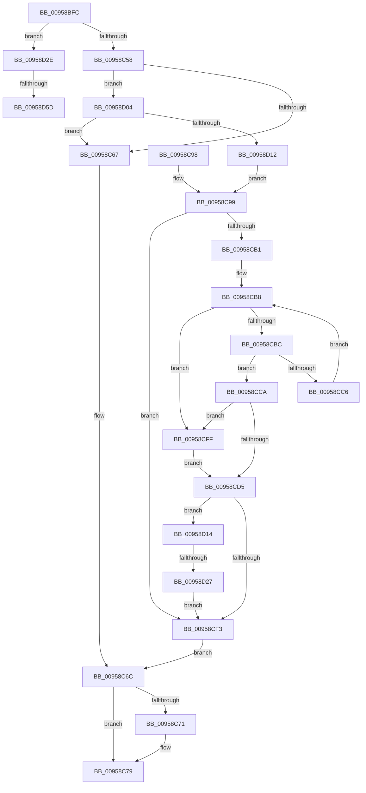

# KseShimDriverIoCallbacks

- RVA: `0x00958BFC`–`0x00958D71` (길이 `373` bytes)
- VA: `0x0000000140958BFC`
- 실행 섹션: `PAGE`
- PDB 이름 있음: `예`; PDB Function 태그: `예`
- unwind 정보 RVA: `0x00092748`
- 디코드: `100`개 명령, `373/373` bytes 표시
- 미해석 바이트: `0` (있으면 어셈블리에 `.byte`로 보존)

> 이 문서는 커널 이미지의 기계어와 PDB 기호를 분석해 생성했습니다. 4번과 5번은 함수 원형과 자료형을 바이너리 사용 방식에서 추정한 C 해석이며 원본 소스 복구 결과는 아닙니다.

## 1. Dependencies

- 직접 호출 지점: **8**; 고유 호출 대상: **8**
- 직접 호출자로 확인된 함수: **2**
- RIP 상대 이미지 참조: **6**

### Outgoing calls
- `0x00958C32` → [memset](../../text/6C/memset_function_006C6C40.md) (function, `0x006C6C40`)
- `0x00958C74` → [KsepPoolFreePaged](../../text/4B/KsepPoolFreePaged_function_004B0E10.md) (function, `0x004B0E10`)
- `0x00958CA1` → [KsepStringDuplicateUnicode](KsepStringDuplicateUnicode_function_00958D78.md) (function, `0x00958D78`)
- `0x00958CDA` → [RtlInitUnicodeString](../../text/42/RtlInitUnicodeString_function_0042A780.md) (function, `0x0042A780`)
- `0x00958CE8` → [KsepGetShimCallbacksForDriver](KsepGetShimCallbacksForDriver_function_00958E64.md) (function, `0x00958E64`)
- `0x00958CF5` → [KsepPoolFreeNonPaged](../../text/4A/KsepPoolFreeNonPaged_function_004AAA00.md) (function, `0x004AAA00`)
- `0x00958D19` → [KsepPoolAllocateNonPaged](../../text/4A/KsepPoolAllocateNonPaged_function_004A8254.md) (function, `0x004A8254`)
- `0x00958D66` → [KsepDebugPrint](../../text/4D/KsepDebugPrint_function_004DCFF0.md) (function, `0x004DCFF0`)

### Direct callers
- [IopLoadDriver](../99/IopLoadDriver_function_00997B54.md) at `0x009983EA`
- [IopInitializeBuiltinDriver](../../init/C7/IopInitializeBuiltinDriver_function_00C7625C.md) at `0x00C76677`

### Static image references
- `0x00958C58` → RVA `0x00E66C84` (`.data`; read)
- `0x00958D04` → RVA `0x00E66C80` (`.data`; read)
- `0x00958D33` → RVA `0x00F105E0` (`.data`; read/write)
- `0x00958D3D` → RVA `0x00F103E0` (`.data`; read)
- `0x00958D4F` → RVA `0x00E66CE8` (`.data`; read)
- `0x00958D5D` → RVA `0x00B00DE0` (` ?? ::NNGAKEGL::`string'`; read)

## 2. Other-region calls and transfers

- 다른 실행 섹션으로 향하는 call: **6**
  - `0x00958C32` → [memset](../../text/6C/memset_function_006C6C40.md) (`PAGE` → `.text`)
  - `0x00958C74` → [KsepPoolFreePaged](../../text/4B/KsepPoolFreePaged_function_004B0E10.md) (`PAGE` → `.text`)
  - `0x00958CDA` → [RtlInitUnicodeString](../../text/42/RtlInitUnicodeString_function_0042A780.md) (`PAGE` → `.text`)
  - `0x00958CF5` → [KsepPoolFreeNonPaged](../../text/4A/KsepPoolFreeNonPaged_function_004AAA00.md) (`PAGE` → `.text`)
  - `0x00958D19` → [KsepPoolAllocateNonPaged](../../text/4A/KsepPoolAllocateNonPaged_function_004A8254.md) (`PAGE` → `.text`)
  - `0x00958D66` → [KsepDebugPrint](../../text/4D/KsepDebugPrint_function_004DCFF0.md) (`PAGE` → `.text`)
- call이 아닌 외부 분기/꼬리 이동: **3**
  - `0x00958D21` → [sub_00B26FE8](../B2/Unknown_function_00B26FE8.md) (`tail-transfer`)
  - `0x00958D57` → [sub_00B26FE8 + 0x115](../B2/Unknown_function_00B26FE8.md) (`tail-transfer`)
  - `0x00958D6C` → [sub_00B26FE8 + 0x115](../B2/Unknown_function_00B26FE8.md) (`tail-transfer`)

## 3. Assembly (complete function range)

```asm
00958BFC  48 8B C4                        mov rax, rsp
00958BFF  48 89 58 08                     mov qword ptr [rax + 8], rbx
00958C03  48 89 70 10                     mov qword ptr [rax + 0x10], rsi
00958C07  48 89 78 18                     mov qword ptr [rax + 0x18], rdi
00958C0B  55                              push rbp
00958C0C  41 56                           push r14
00958C0E  41 57                           push r15
00958C10  48 8D 68 A8                     lea rbp, [rax - 0x58]
00958C14  48 81 EC 40 01 00 00            sub rsp, 0x140
00958C1B  4C 8B 71 30                     mov r14, qword ptr [rcx + 0x30]
00958C1F  49 8B D8                        mov rbx, r8
00958C22  48 8B F9                        mov rdi, rcx
00958C25  41 B8 00 01 00 00               mov r8d, 0x100
00958C2B  48 8D 4C 24 40                  lea rcx, [rsp + 0x40]
00958C30  33 D2                           xor edx, edx
00958C32  E8 09 E0 D6 FF                  call 0x1406c6c40
00958C37  45 33 FF                        xor r15d, r15d
00958C3A  0F 57 C0                        xorps xmm0, xmm0
00958C3D  4C 89 7C 24 20                  mov qword ptr [rsp + 0x20], r15
00958C42  41 8B F7                        mov esi, r15d
00958C45  4C 89 7C 24 28                  mov qword ptr [rsp + 0x28], r15
00958C4A  0F 11 44 24 30                  movups xmmword ptr [rsp + 0x30], xmm0
00958C4F  48 85 DB                        test rbx, rbx
00958C52  0F 84 D6 00 00 00               je 0x140958d2e
00958C58  8B 05 26 E0 50 00               mov eax, dword ptr [rip + 0x50e026]
00958C5E  83 F8 02                        cmp eax, 2
00958C61  0F 84 9D 00 00 00               je 0x140958d04
00958C67  48 8B 5C 24 28                  mov rbx, qword ptr [rsp + 0x28]
00958C6C  48 85 DB                        test rbx, rbx
00958C6F  74 08                           je 0x140958c79
00958C71  48 8B CB                        mov rcx, rbx
00958C74  E8 97 81 B5 FF                  call 0x1404b0e10
00958C79  8B C6                           mov eax, esi
00958C7B  4C 8D 9C 24 40 01 00 00         lea r11, [rsp + 0x140]
00958C83  49 8B 5B 20                     mov rbx, qword ptr [r11 + 0x20]
00958C87  49 8B 73 28                     mov rsi, qword ptr [r11 + 0x28]
00958C8B  49 8B 7B 30                     mov rdi, qword ptr [r11 + 0x30]
00958C8F  49 8B E3                        mov rsp, r11
00958C92  41 5F                           pop r15
00958C94  41 5E                           pop r14
00958C96  5D                              pop rbp
00958C97  C3                              ret
00958C98  CC                              int3
00958C99  48 8B D3                        mov rdx, rbx
00958C9C  48 8D 4C 24 20                  lea rcx, [rsp + 0x20]
00958CA1  E8 D2 00 00 00                  call 0x140958d78
00958CA6  48 8B 5C 24 28                  mov rbx, qword ptr [rsp + 0x28]
00958CAB  8B F0                           mov esi, eax
00958CAD  85 C0                           test eax, eax
00958CAF  78 42                           js 0x140958cf3
00958CB1  0F B7 4C 24 20                  movzx ecx, word ptr [rsp + 0x20]
00958CB6  D1 E9                           shr ecx, 1
00958CB8  85 C9                           test ecx, ecx
00958CBA  74 43                           je 0x140958cff
00958CBC  8D 51 FF                        lea edx, [rcx - 1]
00958CBF  66 83 3C 53 5C                  cmp word ptr [rbx + rdx*2], 0x5c
00958CC4  74 04                           je 0x140958cca
00958CC6  8B CA                           mov ecx, edx
00958CC8  EB EE                           jmp 0x140958cb8
00958CCA  8B C1                           mov eax, ecx
00958CCC  48 8D 14 43                     lea rdx, [rbx + rax*2]
00958CD0  48 85 D2                        test rdx, rdx
00958CD3  74 2A                           je 0x140958cff
00958CD5  48 8D 4C 24 30                  lea rcx, [rsp + 0x30]
00958CDA  E8 A1 1A AD FF                  call 0x14042a780
00958CDF  48 8B 4F 18                     mov rcx, qword ptr [rdi + 0x18]
00958CE3  48 8D 54 24 40                  lea rdx, [rsp + 0x40]
00958CE8  E8 77 01 00 00                  call 0x140958e64
00958CED  8B F0                           mov esi, eax
00958CEF  85 C0                           test eax, eax
00958CF1  79 21                           jns 0x140958d14
00958CF3  33 C9                           xor ecx, ecx
00958CF5  E8 06 1D B5 FF                  call 0x1404aaa00
00958CFA  E9 6D FF FF FF                  jmp 0x140958c6c
00958CFF  48 8B D3                        mov rdx, rbx
00958D02  EB D1                           jmp 0x140958cd5
00958D04  8B 05 76 DF 50 00               mov eax, dword ptr [rip + 0x50df76]
00958D0A  A8 01                           test al, 1
00958D0C  0F 85 55 FF FF FF               jne 0x140958c67
00958D12  EB 85                           jmp 0x140958c99
00958D14  B9 00 01 00 00                  mov ecx, 0x100
00958D19  E8 36 F5 B4 FF                  call 0x1404a8254
00958D1E  48 85 C0                        test rax, rax
00958D21  0F 85 C1 E2 1C 00               jne 0x140b26fe8
00958D27  BE 17 00 00 C0                  mov esi, 0xc0000017
00958D2C  EB C5                           jmp 0x140958cf3
00958D2E  B8 01 00 00 00                  mov eax, 1
00958D33  F0 0F C1 05 A5 78 5B 00         lock xadd dword ptr [rip + 0x5b78a5], eax
00958D3B  FF C0                           inc eax
00958D3D  48 8D 0D 9C 76 5B 00            lea rcx, [rip + 0x5b769c]
00958D44  83 E0 3F                        and eax, 0x3f
00958D47  48 C7 04 C1 94 00 08 00         mov qword ptr [rcx + rax*8], 0x80094
00958D4F  8B 05 93 DF 50 00               mov eax, dword ptr [rip + 0x50df93]
00958D55  A8 01                           test al, 1
00958D57  0F 84 A0 E3 1C 00               je 0x140b270fd
00958D5D  48 8D 15 7C 80 1A 00            lea rdx, [rip + 0x1a807c]
00958D64  33 C9                           xor ecx, ecx
00958D66  E8 85 42 B8 FF                  call 0x1404dcff0
00958D6B  90                              nop
00958D6C  E9 8C E3 1C 00                  jmp 0x140b270fd
```

## 4. C-style interpretation (structured pseudocode)

```c
__int64 __fastcall KseShimDriverIoCallbacks(__int64 a1, int a2, __int64 a3)
{
    __int64 result;
    __int64 v_r15;
    __int64 v_rsp;
    unsigned __int64 v_stack_m100;
    unsigned __int64 v_stack_m110;
    unsigned __int64 v_stack_m118;
    unsigned __int64 v_stack_m120;
    unsigned __int64 v_stack_m128;
    unsigned __int64 v_stack_m130;
    unsigned __int64 v_stack_m138;
    unsigned __int64 v_stack_m18;

    *(unsigned __int64 *)(v_rsp + 8) = v_rbx;
    *(unsigned __int64 *)(v_rsp + 16) = v_rsi;
    *(unsigned __int64 *)(v_rsp + 24) = v_rdi;
    v_rsp = (v_rsp) - (320);
    a2 = 0;
    result = memset(v_stack_m118, a2, 256, a4);
    v_r15 = 0;
    v_stack_m138 = 0;
    v_stack_m130 = 0;
    v_stack_m128 = v_xmm0;
    if (a3 == 0) goto loc_00958D2E;
    if (((unsigned int)((unsigned int)(*(unsigned int *)(v_rip + 5300262)))) == 2) goto loc_00958D04;
loc_00958C67:
loc_00958C6C:
    result = (unsigned int)(*(unsigned int *)(v_rip + 5300262));
    if (v_stack_m130 != 0) {
        a1 = v_stack_m130;
        result = KsepPoolFreePaged(a1, a2, 256, a4);
    }
    return 0;
loc_00958C99:
    result = KsepStringDuplicateUnicode(v_stack_m120, *(unsigned __int64 *)(v_stack_m18 + 32), 256, a4);
    if (sign_flag) goto loc_00958CF3;
    a1 = (unsigned int)((v_stack_m120) >> (1));
loc_00958CB8:
    if ((unsigned int)(a1) == 0) goto loc_00958CFF;
    if ((*(unsigned __int16 *)(v_stack_m118 + a1 - 1 * 2)) == 92) goto loc_00958CCA;
    goto loc_00958CB8;
loc_00958CCA:
    if (v_stack_m118 + (unsigned int)((unsigned int)((unsigned int)((unsigned int)(a1 - 1)))) * 2 == 0) goto loc_00958CFF;
loc_00958CD5:
    result = RtlInitUnicodeString(v_stack_m110, v_stack_m118 + (unsigned int)((unsigned int)((unsigned int)((unsigned int)(a1 - 1)))) * 2, 256, a4);
    result = KsepGetShimCallbacksForDriver(*(unsigned __int64 *)(*(unsigned __int64 *)(v_stack_m18 + 48) + 24), v_stack_m100, 256, a4);
    if (!sign_flag) goto loc_00958D14;
loc_00958CF3:
    a1 = 0;
    result = KsepPoolFreeNonPaged(a1, v_stack_m100, 256, a4);
    goto loc_00958C6C;
loc_00958CFF:
    goto loc_00958CD5;
loc_00958D04:
    if ((((unsigned __int8)((unsigned int)(*(unsigned int *)(v_rip + 5300086)))) & (1)) != 0) goto loc_00958C67;
    goto loc_00958C99;
loc_00958D14:
    result = KsepPoolAllocateNonPaged(256, v_stack_m118, 256, a4);
    goto loc_00958CF3;
loc_00958D2E:
    result = (unsigned int)((1) + 1);
    result = (unsigned int)((result) & (63));
    *(unsigned __int64 *)(v_rip + 5994140 + result * 8) = 0x80094ULL;
    a1 = 0;
    result = KsepDebugPrint(a1, v_rip + 1736828, 256, a4);
}
```

## 5. (Beta) C Style

```c
int64_t KseShimDriverIoCallbacks(void *Arg1, int32_t Arg2, int64_t Arg3)
{
    uint8_t *arg1 = (uint8_t *)Arg1;

    int64_t result;
    int64_t local_r15;
    int64_t local_rsp;
    uint64_t v_stack_m100;
    uint64_t v_stack_m110;
    uint64_t v_stack_m118;
    uint64_t v_stack_m120;
    uint64_t v_stack_m128;
    uint64_t v_stack_m130;
    uint64_t v_stack_m138;
    uint64_t v_stack_m18;

    *(uint64_t *)(local_rsp + 0x8) = local_rbx;
    *(uint64_t *)(local_rsp + 0x10) = local_rsi;
    *(uint64_t *)(local_rsp + 0x18) = local_rdi;
    local_rsp = (local_rsp) - (320);
    Arg2 = 0;
    result = memset(v_stack_m118, Arg2, 256, a4);
    local_r15 = 0;
    v_stack_m138 = 0;
    v_stack_m130 = 0;
    v_stack_m128 = v_xmm0;
    if (Arg3 == 0) goto loc_00958D2E;
    if (((uint32_t)((uint32_t)(*(uint32_t *)(v_rip + 0x50E026)))) == 2) goto loc_00958D04;
loc_00958C67:
loc_00958C6C:
    result = (uint32_t)(*(uint32_t *)(v_rip + 0x50E026));
    if (v_stack_m130 != 0) {
        Arg1 = v_stack_m130;
        result = KsepPoolFreePaged(Arg1, Arg2, 256, a4);
    }
    return 0;
loc_00958C99:
    result = KsepStringDuplicateUnicode(v_stack_m120, *(uint64_t *)(v_stack_m18 + 0x20), 256, a4);
    if (sign_flag) goto loc_00958CF3;
    Arg1 = (uint32_t)((v_stack_m120) >> (1));
loc_00958CB8:
    if ((uint32_t)(Arg1) == 0) goto loc_00958CFF;
    if ((*(uint16_t *)(v_stack_m118 + arg1 - 0x1 * 2)) == 92) goto loc_00958CCA;
    goto loc_00958CB8;
loc_00958CCA:
    if (v_stack_m118 + (uint32_t)((uint32_t)((uint32_t)((uint32_t)(Arg1 - 1)))) * 2 == 0) goto loc_00958CFF;
loc_00958CD5:
    result = RtlInitUnicodeString(v_stack_m110, v_stack_m118 + (uint32_t)((uint32_t)((uint32_t)((uint32_t)(Arg1 - 1)))) * 2, 256, a4);
    result = KsepGetShimCallbacksForDriver(*(uint64_t *)(*(uint64_t *)(v_stack_m18 + 0x30) + 0x18), v_stack_m100, 256, a4);
    if (!sign_flag) goto loc_00958D14;
loc_00958CF3:
    Arg1 = 0;
    result = KsepPoolFreeNonPaged(Arg1, v_stack_m100, 256, a4);
    goto loc_00958C6C;
loc_00958CFF:
    goto loc_00958CD5;
loc_00958D04:
    if ((((uint8_t)((uint32_t)(*(uint32_t *)(v_rip + 0x50DF76)))) & (1)) != 0) goto loc_00958C67;
    goto loc_00958C99;
loc_00958D14:
    result = KsepPoolAllocateNonPaged(256, v_stack_m118, 256, a4);
    goto loc_00958CF3;
loc_00958D2E:
    result = (uint32_t)((1) + 1);
    result = (uint32_t)((result) & (63));
    *(uint64_t *)(v_rip + 0x5B769C + result * 8) = 0x80094ULL;
    Arg1 = 0;
    result = KsepDebugPrint(Arg1, v_rip + 1736828, 256, a4);
}
```

### 관측된 메모리 오프셋

구조체 형식이 확인되지 않은 접근은 인자 기준의 오프셋으로만 기록했습니다.

| 기준 인자 | 오프셋 표현 | 폭 (bit) | 접근 |
|---|---:|---:|---|
| `Arg1` | `+ 0x18` | `64` | `R` |
| `Arg1` | `+ 0x30` | `64` | `R` |

## 6. Execution-region graph

[열기: 2D/3D 그래프와 함수 탐색 컨트롤 패널](../../../control-panel.html?section=page&rva=0x00958BFC&view=graph)

- 2D 그래프는 위에서 아래로 흐르고, 3D 그래프는 빈 공간을 드래그해 회전합니다. Shift+드래그는 이동, 휠은 확대·축소, 함수 노드 선택은 대상 보고서 이동입니다.

### Static fallback


